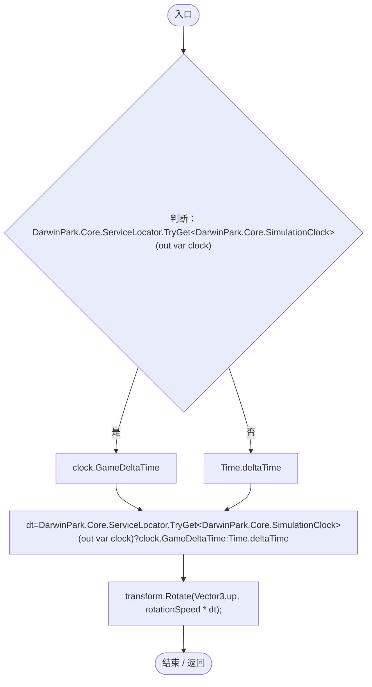

# PlanetRotator.cs

[返回总索引](../README.md) · `Runtime` · `Assets/DarwinPark/Planet/PlanetRotator.cs`

[源文件](../../../Assets/DarwinPark/Planet/PlanetRotator.cs) · 源码校验：`0c4ca2df20a70f85f6a71fbda97f03119de254bc945ad6dcb415e58e2c8e9e07`

方法按源文件位置排列。事件/回调引用不表示立即执行；分支与异常说明见总索引。完整源码与可点击关系图请打开离线手册。

## Update · L10

`private void Update()`

### Editor / Player · Roslyn编译器控制流

项目内调用/回调引用：

- [ServiceLocator.TryGet · L26](f2fdbe9f9ccd93cb.md#m143b24e6d58471b0)（方法）
- [SimulationClock.GameDeltaTime.get · L26](a8f444aec9614b0a.md#me7f11abae18a4f2d)（访问器）
