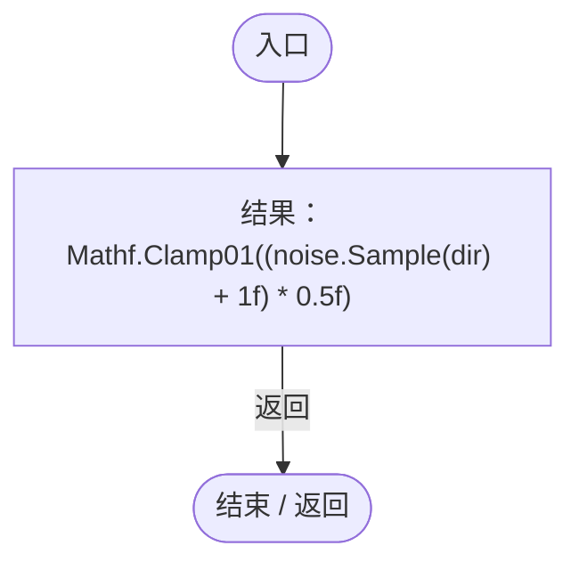
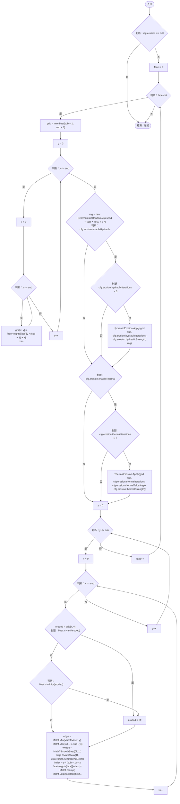
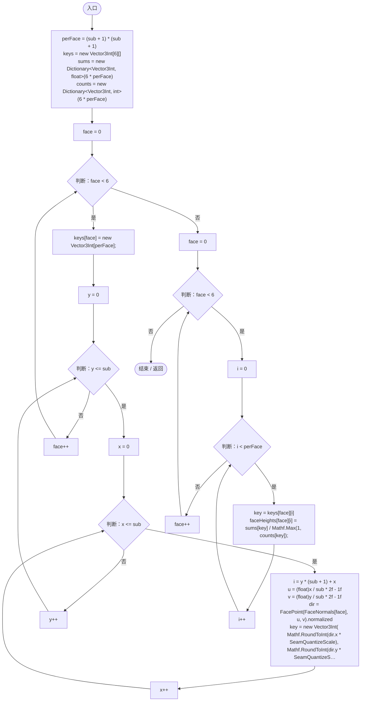
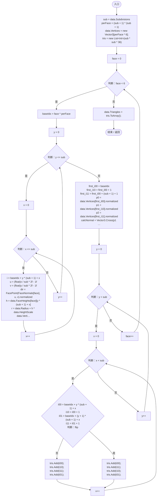
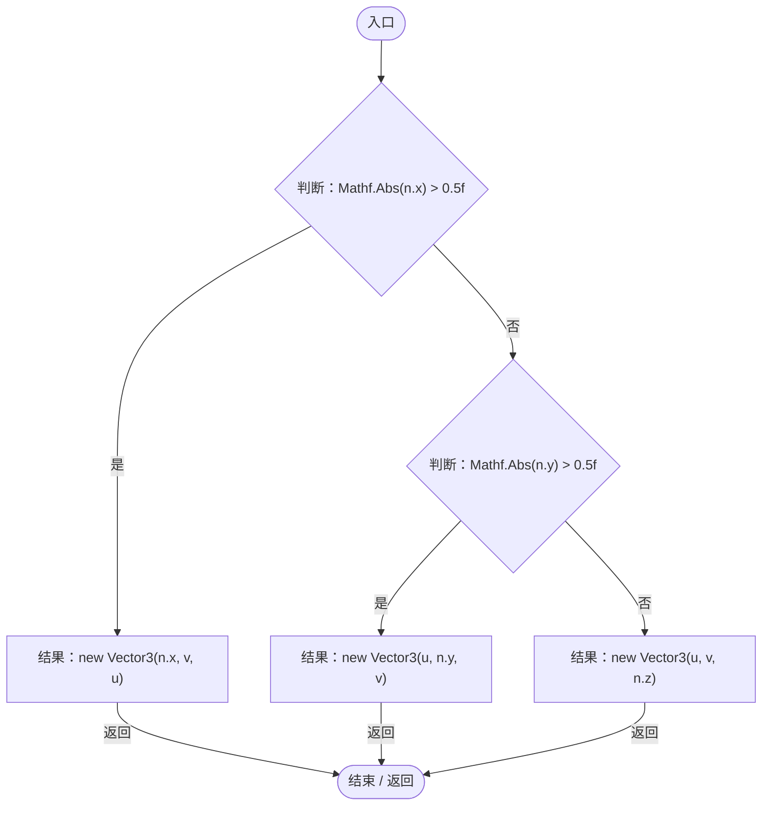

```mermaid
flowchart TD
  b0(["入口"])
  b1{"判断：cfg == null"}
  b2["结果：null"]
  b3["sub = Mathf.Max(2, cfg.subdivisions)<br/>vertsPerFace = (sub + 1) * (sub + 1)"]
  b4["new PlanetTerrainData { Subdivisions = sub, Radius = cfg.radius, HeightScale = cfg.heightScale, FaceHeights = new float[6][] }<br/>Subdivisions = sub<br/>Radius = cfg.radius<br/>HeightScale = cfg.heightScale<br/>FaceHeights = new float[6][]<br/>data = new P…"]
  b5["continentNoise = new FBMNoise(cfg.baseNoise, cfg.seed)<br/>detailNoise = new FBMNoise(cfg.detailNoise, cfg.seed + 1337)<br/>mountains = new PlanetMountainField(cfg)"]
  b6["new FBMConfig { octaves = 3, frequency = cfg.basinFrequency, amplitude = 1f, lacunarity = 2f, gain = 0.5f, warpStrength = 0.15f }<br/>octaves = 3<br/>frequency = cfg.basinFrequency<br/>amplitude = 1f<br/>lacunarity = 2f<br/>gain = 0.5f<br/>warpStrength = 0.15f<br/>…"]
  b7["basinNoise = new FBMNoise(basinCfg, cfg.seed + 1777)"]
  b8["new FBMConfig { octaves = 4, frequency = cfg.valleyFrequency, amplitude = 1f, lacunarity = 2f, gain = 0.5f, warpStrength = 0.25f }<br/>octaves = 4<br/>frequency = cfg.valleyFrequency<br/>amplitude = 1f<br/>lacunarity = 2f<br/>gain = 0.5f<br/>warpStrength = 0.25…"]
  b9["valleyNoise = new FBMNoise(valleyCfg, cfg.seed + 2663)<br/>rawHeights = new float[6][]<br/>allHeights = new List&lt;float&gt;(6 * vertsPerFace)"]
  b10["face = 0"]
  b11{"判断：face &lt; 6"}
  b12["heights = new float[vertsPerFace]"]
  b13["y = 0"]
  b14{"判断：y &lt;= sub"}
  b15["x = 0"]
  b16{"判断：x &lt;= sub"}
  b17["u = (float)x / sub * 2f - 1f<br/>v = (float)y / sub * 2f - 1f<br/>dir = FacePoint(FaceNormals[face], u, v).normalized<br/>c = Noise01(continentNoise, dir)<br/>heights[y * (sub + 1) + x] = c;<br/>allHeights.Add(c);"]
  b18["x++"]
  b19["y++"]
  b20["rawHeights[face] = heights;"]
  b21["face++"]
  b22["allHeights.Sort();<br/>landFraction = Mathf.Clamp01(continentRatio)<br/>seaIndex = Mathf.FloorToInt((1.0f - landFraction) * allHeights.Count)<br/>seaIndex = Mathf.Clamp(seaIndex, 0, allHeights.Count - 1);<br/>seaLevelThreshold = allHeights[seaIndex]<br/>lan…"]
  b23["face = 0"]
  b24{"判断：face &lt; 6"}
  b25["heights = new float[vertsPerFace]"]
  b26["y = 0"]
  b27{"判断：y &lt;= sub"}
  b28["x = 0"]
  b29{"判断：x &lt;= sub"}
  b30{"i = y * (sub + 1) + x<br/>c = rawHeights[face][i]<br/>u = (float)x / sub * 2f - 1f<br/>v = (float)y / sub * 2f - 1f<br/>dir = FacePoint(FaceNormals[face], u, v).normalized<br/>判断：c &lt; seaLevelThreshold"}
  b31{"判断：seaLevelThreshold &gt; 1e-5f"}
  b32["Mathf.Clamp01(c / seaLevelThreshold)"]
  b33["0f"]
  b34["oceanT = seaLevelThreshold &gt; 1e-5f ? Mathf.Clamp01(c / seaLevelThreshold) : 0f"]
  b35["floor = Mathf.Lerp( seaLevelThreshold * cfg.oceanFloorRatio, seaLevelThreshold, Mathf.Pow(oceanT, 1.8f))<br/>floor += detailNoise.Sample(dir) * cfg.detailStrength * 0.4f * (1f - oceanT);<br/>height = floor;"]
  b36["land = Mathf.Clamp01((c - seaLevelThreshold) / landRange)<br/>baseHeight = seaLevelThreshold + cfg.coastalRise + cfg.inlandRise * Mathf.Pow(land, Mathf.Max(0.1f, cfg.inlandCurve))<br/>baseHeight += detailNoise.Sample(dir) * cfg.detailStrength * …"]
  b37["heights[i] = Mathf.Clamp(height, 0f, PlanetTerrainData.MaxNormalizedHeight);"]
  b38["x++"]
  b39["y++"]
  b40["data.FaceHeights[face] = heights;"]
  b41["face++"]
  b42["ApplyErosion(cfg, data.FaceHeights, sub);<br/>MergeSeamVertices(data.FaceHeights, sub);<br/>PlanetSeamContinuity.Smooth(data,cfg.erosion);<br/>MergeSeamVertices(data.FaceHeights,sub);<br/>BuildMesh(data);<br/>PlanetMeshTopology.Weld(data);<br/>结果：data"]
  b43(["结束 / 返回"])
  b0 --> b1
  b1 -->|"是"| b2
  b1 -->|"否"| b3
  b2 -->|"返回"| b43
  b3 --> b4
  b4 --> b5
  b5 --> b6
  b6 --> b7
  b7 --> b8
  b8 --> b9
  b9 --> b10
  b10 --> b11
  b11 -->|"是"| b12
  b11 -->|"否"| b22
  b12 --> b13
  b13 --> b14
  b14 -->|"是"| b15
  b14 -->|"否"| b20
  b15 --> b16
  b16 -->|"是"| b17
  b16 -->|"否"| b19
  b17 --> b18
  b18 --> b16
  b19 --> b14
  b20 --> b21
  b21 --> b11
  b22 --> b23
  b23 --> b24
  b24 -->|"是"| b25
  b24 -->|"否"| b42
  b25 --> b26
  b26 --> b27
  b27 -->|"是"| b28
  b27 -->|"否"| b40
  b28 --> b29
  b29 -->|"是"| b30
  b29 -->|"否"| b39
  b30 -->|"是"| b31
  b30 -->|"否"| b36
  b31 -->|"是"| b32
  b31 -->|"否"| b33
  b32 --> b34
  b33 --> b34
  b34 --> b35
  b35 --> b37
  b36 --> b37
  b37 --> b38
  b38 --> b29
  b39 --> b27
  b40 --> b41
  b41 --> b24
  b42 -->|"返回"| b43

```

# PlanetTerrainGenerator.cs

[返回总索引](../README.md) · `Runtime` · `Assets/DarwinPark/Planet/Terrain/PlanetTerrainGenerator.cs`

[源文件](../../../Assets/DarwinPark/Planet/Terrain/PlanetTerrainGenerator.cs) · 源码校验：`d2a43e94d3e4b7009036260c663ace8e5e5e60cdb663ccf1f54eaafc22283fea`

方法按源文件位置排列。事件/回调引用不表示立即执行；分支与异常说明见总索引。完整源码与可点击关系图请打开离线手册。

## Generate · L20

`public static PlanetTerrainData Generate(PlanetTerrainConfig cfg, float seaLevelRatio, float continentRatio)`

### Editor / Player · Roslyn编译器控制流

项目内调用/回调引用：

- [FBMNoise.FBMNoise.ctor · L12](8e4c1118f3935129.md#m008bcd375f95dd84)（构造函数）
- [PlanetMountainField.PlanetMountainField.ctor · L11](c498fd5cb2934213.md#m01b09f6e87580131)（构造函数）
- [PlanetTerrainGenerator.FacePoint · L329](cde9e7b164fab46e.md#mf839ddaa42670bdf)（方法）
- [PlanetTerrainGenerator.Noise01 · L178](cde9e7b164fab46e.md#m8e1f7c3dad1cd941)（方法）
- [FBMNoise.Sample · L24](8e4c1118f3935129.md#m3997a25fbe63e25e)（方法）
- [PlanetMountainField.Sample · L19](c498fd5cb2934213.md#m75c89d630c47707c)（方法）
- [PlanetTerrainGenerator.ApplyErosion · L183](cde9e7b164fab46e.md#m527708883bd53410)（方法）
- [PlanetTerrainGenerator.MergeSeamVertices · L234](cde9e7b164fab46e.md#m575ca480212de384)（方法）
- [PlanetSeamContinuity.Smooth · L9](b45fffad7e3300e3.md#m8e8308fbbdc4322e)（方法）
- [PlanetTerrainGenerator.BuildMesh · L276](cde9e7b164fab46e.md#m76c0f3e623f9be2c)（方法）
- [PlanetMeshTopology.Weld · L9](a561079dc7786744.md#md9a5bdc8ae62f315)（方法）

## Noise01 · L178

`private static float Noise01(FBMNoise noise, Vector3 dir)`

### Editor / Player · Roslyn编译器控制流

项目内调用/回调引用：

- [FBMNoise.Sample · L24](8e4c1118f3935129.md#m3997a25fbe63e25e)（方法）

## ApplyErosion · L183

`private static void ApplyErosion(PlanetTerrainConfig cfg, float[][] faceHeights, int sub)`

### Editor / Player · Roslyn编译器控制流

项目内调用/回调引用：

- [DeterministicRandom.DeterministicRandom.ctor · L15](0c2b60ffd3650bfd.md#mc863035084287113)（构造函数）
- [HydraulicErosion.Apply · L12](8ec387cb4eb3fa28.md#m45b3f13be397f937)（方法）
- [ThermalErosion.Apply · L11](6648fb3132139fb8.md#m2992e195e77e1a49)（方法）

## MergeSeamVertices · L234

`private static void MergeSeamVertices(float[][] faceHeights, int sub)`

  侵蚀会分别修改 6 个面；接缝处是重复顶点，如果不取平均会出现裂缝。  

### Editor / Player · Roslyn编译器控制流

项目内调用/回调引用：

- [PlanetTerrainGenerator.FacePoint · L329](cde9e7b164fab46e.md#mf839ddaa42670bdf)（方法）

## BuildMesh · L276

`private static void BuildMesh(PlanetTerrainData data)`

### Editor / Player · Roslyn编译器控制流

项目内调用/回调引用：

- [PlanetTerrainGenerator.FacePoint · L329](cde9e7b164fab46e.md#mf839ddaa42670bdf)（方法）

## FacePoint · L329

`private static Vector3 FacePoint(Vector3 n, float u, float v)`

### Editor / Player · Roslyn编译器控制流

