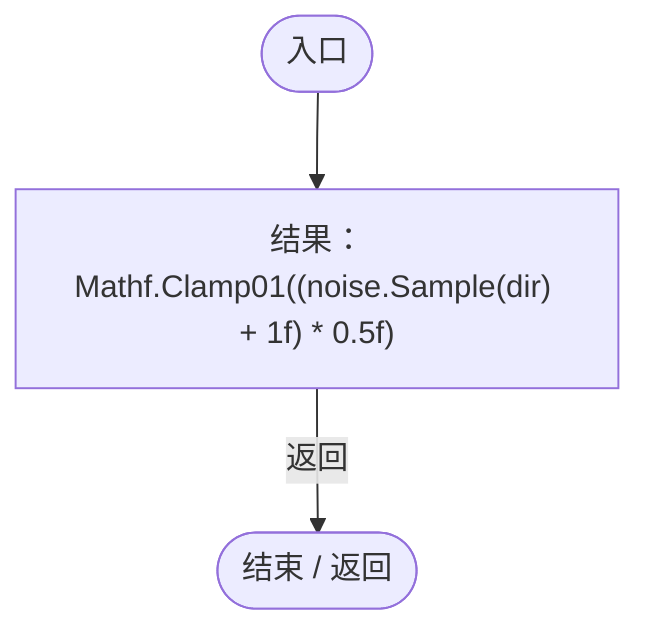
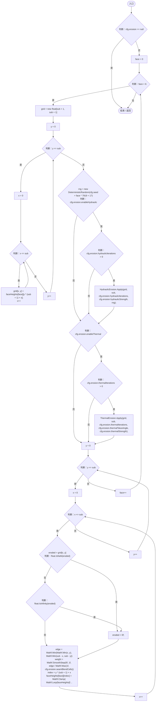
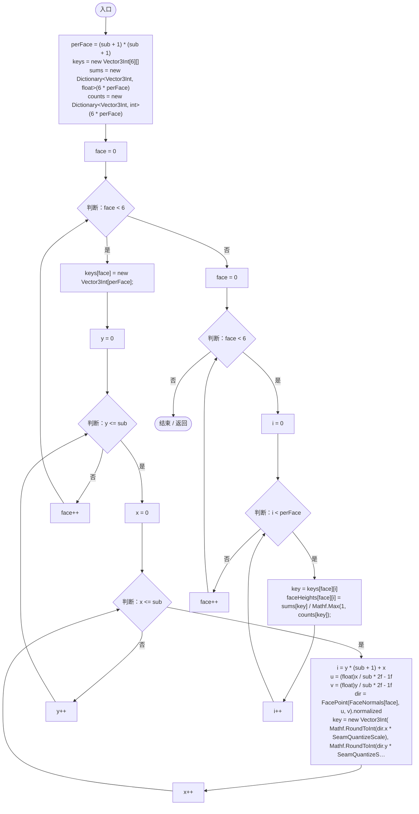
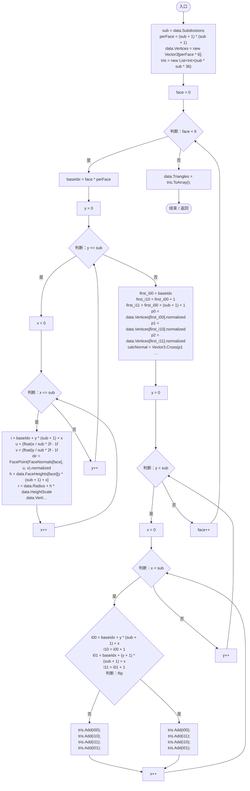
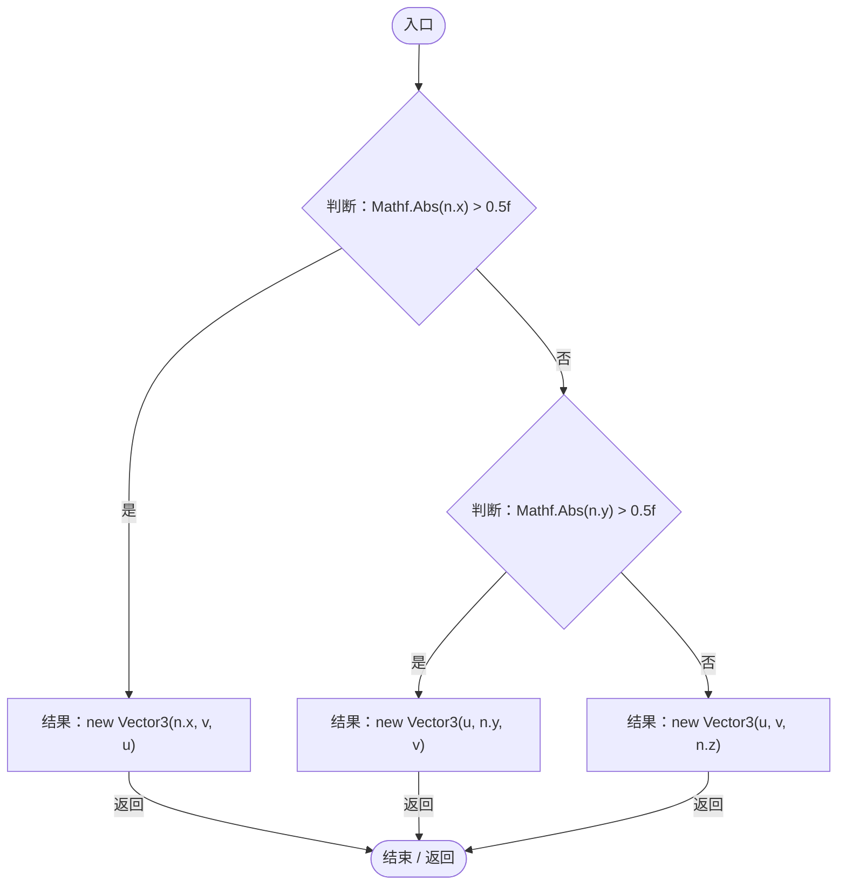

```mermaid
flowchart TD
  b0(["入口"])
  b1{"判断：cfg == null"}
  b2["结果：null"]
  b3["sub = Mathf.Max(2, cfg.subdivisions)<br/>vertsPerFace = (sub + 1) * (sub + 1)"]
  b4["new PlanetTerrainData { Subdivisions = sub, Radius = cfg.radius, HeightScale = cfg.heightScale, FaceHeights = new float[6][] }<br/>Subdivisions = sub<br/>Radius = cfg.radius<br/>HeightScale = cfg.heightScale<br/>FaceHeights = new float[6][]<br/>data = new P…"]
  b5["continentNoise = new FBMNoise(cfg.baseNoise, cfg.seed)<br/>detailNoise = new FBMNoise(cfg.detailNoise, cfg.seed + 1337)<br/>mountains = new PlanetMountainField(cfg)"]
  b6{"cfg.landforms<br/>判断：cfg.landforms"}
  b7["cfg.landforms"]
  b8["new LandformSettings{enabled=false}<br/>enabled=false"]
  b9["landforms=new PlanetLandformField(cfg.landforms??new LandformSettings{enabled=false},cfg.seed)"]
  b10["new FBMConfig { octaves = 3, frequency = cfg.basinFrequency, amplitude = 1f, lacunarity = 2f, gain = 0.5f, warpStrength = 0.15f }<br/>octaves = 3<br/>frequency = cfg.basinFrequency<br/>amplitude = 1f<br/>lacunarity = 2f<br/>gain = 0.5f<br/>warpStrength = 0.15f<br/>…"]
  b11["basinNoise = new FBMNoise(basinCfg, cfg.seed + 1777)"]
  b12["new FBMConfig { octaves = 4, frequency = cfg.valleyFrequency, amplitude = 1f, lacunarity = 2f, gain = 0.5f, warpStrength = 0.25f }<br/>octaves = 4<br/>frequency = cfg.valleyFrequency<br/>amplitude = 1f<br/>lacunarity = 2f<br/>gain = 0.5f<br/>warpStrength = 0.25…"]
  b13["valleyNoise = new FBMNoise(valleyCfg, cfg.seed + 2663)<br/>rawHeights = new float[6][]<br/>allHeights = new List&lt;float&gt;(6 * vertsPerFace)"]
  b14["face = 0"]
  b15{"判断：face &lt; 6"}
  b16["heights = new float[vertsPerFace]"]
  b17["y = 0"]
  b18{"判断：y &lt;= sub"}
  b19["x = 0"]
  b20{"判断：x &lt;= sub"}
  b21["u = (float)x / sub * 2f - 1f<br/>v = (float)y / sub * 2f - 1f<br/>dir = FacePoint(FaceNormals[face], u, v).normalized<br/>c = Noise01(continentNoise, dir)<br/>heights[y * (sub + 1) + x] = c;<br/>allHeights.Add(c);"]
  b22["x++"]
  b23["y++"]
  b24["rawHeights[face] = heights;"]
  b25["face++"]
  b26["allHeights.Sort();<br/>landFraction = Mathf.Clamp01(continentRatio)<br/>seaIndex = Mathf.FloorToInt((1.0f - landFraction) * allHeights.Count)<br/>seaIndex = Mathf.Clamp(seaIndex, 0, allHeights.Count - 1);<br/>seaLevelThreshold = allHeights[seaIndex]<br/>lan…"]
  b27["face = 0"]
  b28{"判断：face &lt; 6"}
  b29["heights = new float[vertsPerFace]"]
  b30["y = 0"]
  b31{"判断：y &lt;= sub"}
  b32["x = 0"]
  b33{"判断：x &lt;= sub"}
  b34{"i = y * (sub + 1) + x<br/>c = rawHeights[face][i]<br/>u = (float)x / sub * 2f - 1f<br/>v = (float)y / sub * 2f - 1f<br/>dir = FacePoint(FaceNormals[face], u, v).normalized<br/>判断：c &lt; seaLevelThreshold"}
  b35{"判断：seaLevelThreshold &gt; 1e-5f"}
  b36["Mathf.Clamp01(c / seaLevelThreshold)"]
  b37["0f"]
  b38["oceanT = seaLevelThreshold &gt; 1e-5f ? Mathf.Clamp01(c / seaLevelThreshold) : 0f"]
  b39["floor = Mathf.Lerp( seaLevelThreshold * cfg.oceanFloorRatio, seaLevelThreshold, Mathf.Pow(oceanT, 1.8f))<br/>floor += detailNoise.Sample(dir) * cfg.detailStrength * 0.4f * (1f - oceanT);<br/>height = floor;"]
  b40["land = Mathf.Clamp01((c - seaLevelThreshold) / landRange)<br/>baseHeight = seaLevelThreshold + cfg.coastalRise + cfg.inlandRise * Mathf.Pow(land, Mathf.Max(0.1f, cfg.inlandCurve))<br/>baseHeight += detailNoise.Sample(dir) * cfg.detailStrength * …"]
  b41["heights[i] = Mathf.Clamp(height, 0f, PlanetTerrainData.MaxNormalizedHeight);"]
  b42["x++"]
  b43["y++"]
  b44["data.FaceHeights[face] = heights;"]
  b45["face++"]
  b46["ApplyErosion(cfg, data.FaceHeights, sub);<br/>MergeSeamVertices(data.FaceHeights, sub);<br/>PlanetSeamContinuity.Smooth(data,cfg.erosion);<br/>MergeSeamVertices(data.FaceHeights,sub);"]
  b47{"cfg.landforms<br/>判断：cfg.landforms"}
  b48[".enabled"]
  b49["cfg.landforms"]
  b50{"判断：cfg.landforms?.enabled==true"}
  b51["data.Hydrology=PlanetHydrology.Build(data,cfg.landforms);<br/>data.Hydrology.Carve(data);<br/>MergeSeamVertices(data.FaceHeights,sub);"]
  b52["BuildMesh(data);<br/>PlanetMeshTopology.Weld(data);"]
  b53["data.Navigation<br/>data"]
  b54{"cfg.navigation<br/>判断：cfg.navigation"}
  b55["cfg.navigation"]
  b56["new LandNavigationSettings()"]
  b57["data.Navigation=new LandNavigationGraph(data,cfg.navigation??new LandNavigationSettings());"]
  b58["结果：data"]
  b59(["结束 / 返回"])
  b0 --> b1
  b1 -->|"是"| b2
  b1 -->|"否"| b3
  b2 -->|"返回"| b59
  b3 --> b4
  b4 --> b5
  b5 --> b6
  b6 -->|"否"| b7
  b6 -->|"是"| b8
  b7 --> b9
  b8 --> b9
  b9 --> b10
  b10 --> b11
  b11 --> b12
  b12 --> b13
  b13 --> b14
  b14 --> b15
  b15 -->|"是"| b16
  b15 -->|"否"| b26
  b16 --> b17
  b17 --> b18
  b18 -->|"是"| b19
  b18 -->|"否"| b24
  b19 --> b20
  b20 -->|"是"| b21
  b20 -->|"否"| b23
  b21 --> b22
  b22 --> b20
  b23 --> b18
  b24 --> b25
  b25 --> b15
  b26 --> b27
  b27 --> b28
  b28 -->|"是"| b29
  b28 -->|"否"| b46
  b29 --> b30
  b30 --> b31
  b31 -->|"是"| b32
  b31 -->|"否"| b44
  b32 --> b33
  b33 -->|"是"| b34
  b33 -->|"否"| b43
  b34 -->|"是"| b35
  b34 -->|"否"| b40
  b35 -->|"是"| b36
  b35 -->|"否"| b37
  b36 --> b38
  b37 --> b38
  b38 --> b39
  b39 --> b41
  b40 --> b41
  b41 --> b42
  b42 --> b33
  b43 --> b31
  b44 --> b45
  b45 --> b28
  b46 --> b47
  b47 -->|"否"| b48
  b47 -->|"是"| b49
  b48 --> b50
  b49 --> b50
  b50 -->|"是"| b51
  b50 -->|"否"| b52
  b51 --> b52
  b52 --> b53
  b53 --> b54
  b54 -->|"否"| b55
  b54 -->|"是"| b56
  b55 --> b57
  b56 --> b57
  b57 --> b58
  b58 -->|"返回"| b59

```

# PlanetTerrainGenerator.cs

[返回总索引](../README.md) · `Runtime` · `Assets/DarwinPark/Planet/Terrain/PlanetTerrainGenerator.cs`

[源文件](../../../Assets/DarwinPark/Planet/Terrain/PlanetTerrainGenerator.cs) · 源码校验：`68d38cc7a60a9b1a38a5c9de063497134804add5639513b62f6491d4b7d0c966`

方法按源文件位置排列。事件/回调引用不表示立即执行；分支与异常说明见总索引。完整源码与可点击关系图请打开离线手册。

## Generate · L20

`public static PlanetTerrainData Generate(PlanetTerrainConfig cfg, float seaLevelRatio, float continentRatio)`

### Editor / Player · Roslyn编译器控制流

项目内调用/回调引用：

- [FBMNoise.FBMNoise.ctor · L12](8e4c1118f3935129.md#m008bcd375f95dd84)（构造函数）
- [PlanetMountainField.PlanetMountainField.ctor · L11](c498fd5cb2934213.md#m01b09f6e87580131)（构造函数）
- [PlanetLandformField.PlanetLandformField.ctor · L73](282937bf06cb5f2a.md#m4519328e460b4907)（构造函数）
- [PlanetTerrainGenerator.FacePoint · L336](cde9e7b164fab46e.md#mfe86a4a87bf91862)（方法）
- [PlanetTerrainGenerator.Noise01 · L185](cde9e7b164fab46e.md#m960131033c9d0fea)（方法）
- [FBMNoise.Sample · L24](8e4c1118f3935129.md#m3997a25fbe63e25e)（方法）
- [PlanetLandformField.Shape · L74](282937bf06cb5f2a.md#m85f86151c8cdf293)（方法）
- [PlanetMountainField.Sample · L19](c498fd5cb2934213.md#m75c89d630c47707c)（方法）
- [PlanetTerrainGenerator.ApplyErosion · L190](cde9e7b164fab46e.md#m0dbe1eafcc76c5bf)（方法）
- [PlanetTerrainGenerator.MergeSeamVertices · L241](cde9e7b164fab46e.md#ma9f3aeb1ced1b0cd)（方法）
- [PlanetSeamContinuity.Smooth · L9](b45fffad7e3300e3.md#m8e8308fbbdc4322e)（方法）
- [PlanetHydrology.Build · L19](282937bf06cb5f2a.md#m89a4629b61694b3d)（方法）
- [PlanetHydrology.Carve · L63](282937bf06cb5f2a.md#m33922055e07c89f3)（方法）
- [PlanetTerrainGenerator.BuildMesh · L283](cde9e7b164fab46e.md#m12cee070473d98c6)（方法）
- [PlanetMeshTopology.Weld · L9](a561079dc7786744.md#md9a5bdc8ae62f315)（方法）
- [LandNavigationGraph.LandNavigationGraph.ctor · L16](6f2590f045ea5d3f.md#m734eccceddc6424c)（构造函数）

## Noise01 · L185

`private static float Noise01(FBMNoise noise, Vector3 dir)`

### Editor / Player · Roslyn编译器控制流

项目内调用/回调引用：

- [FBMNoise.Sample · L24](8e4c1118f3935129.md#m3997a25fbe63e25e)（方法）

## ApplyErosion · L190

`private static void ApplyErosion(PlanetTerrainConfig cfg, float[][] faceHeights, int sub)`

### Editor / Player · Roslyn编译器控制流

项目内调用/回调引用：

- [DeterministicRandom.DeterministicRandom.ctor · L15](0c2b60ffd3650bfd.md#mc863035084287113)（构造函数）
- [HydraulicErosion.Apply · L12](8ec387cb4eb3fa28.md#m45b3f13be397f937)（方法）
- [ThermalErosion.Apply · L11](6648fb3132139fb8.md#m2992e195e77e1a49)（方法）

## MergeSeamVertices · L241

`private static void MergeSeamVertices(float[][] faceHeights, int sub)`

  侵蚀会分别修改 6 个面；接缝处是重复顶点，如果不取平均会出现裂缝。  

### Editor / Player · Roslyn编译器控制流

项目内调用/回调引用：

- [PlanetTerrainGenerator.FacePoint · L336](cde9e7b164fab46e.md#mfe86a4a87bf91862)（方法）

## BuildMesh · L283

`private static void BuildMesh(PlanetTerrainData data)`

### Editor / Player · Roslyn编译器控制流

项目内调用/回调引用：

- [PlanetTerrainGenerator.FacePoint · L336](cde9e7b164fab46e.md#mfe86a4a87bf91862)（方法）

## FacePoint · L336

`private static Vector3 FacePoint(Vector3 n, float u, float v)`

### Editor / Player · Roslyn编译器控制流

