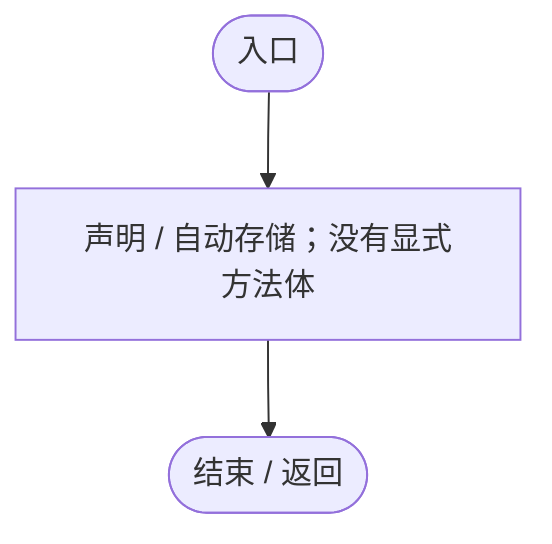
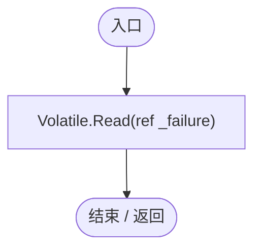
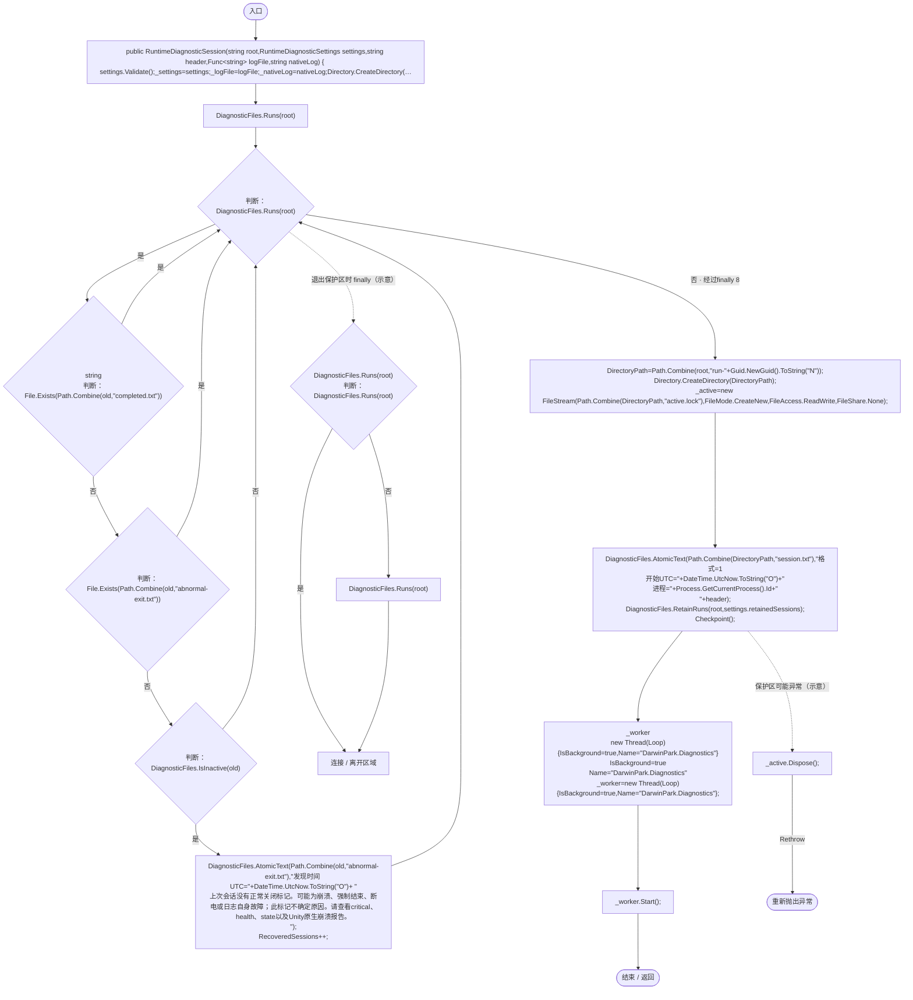
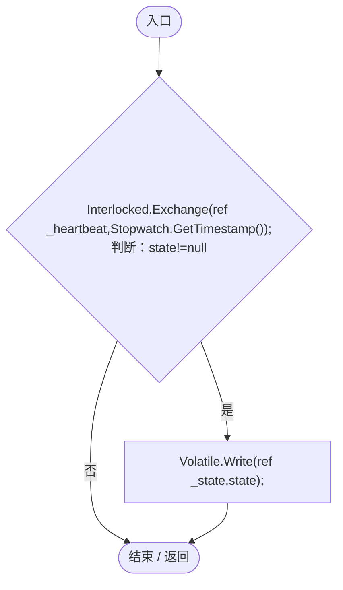
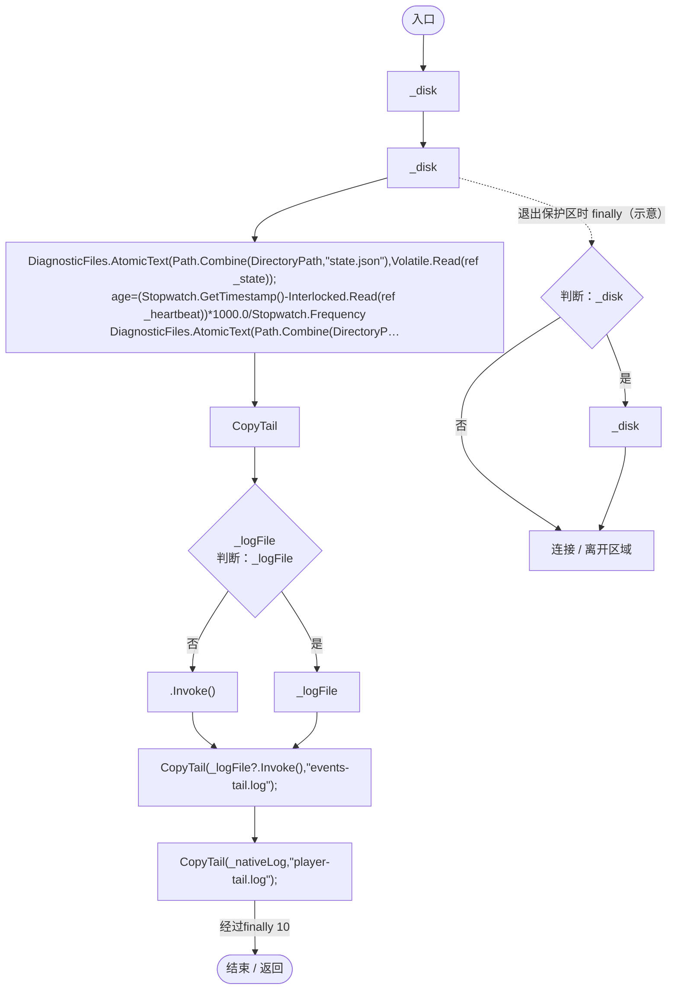
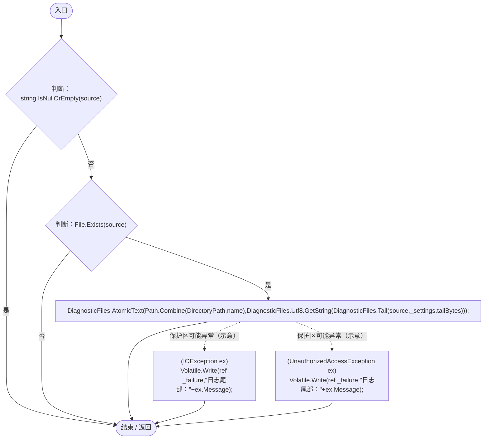
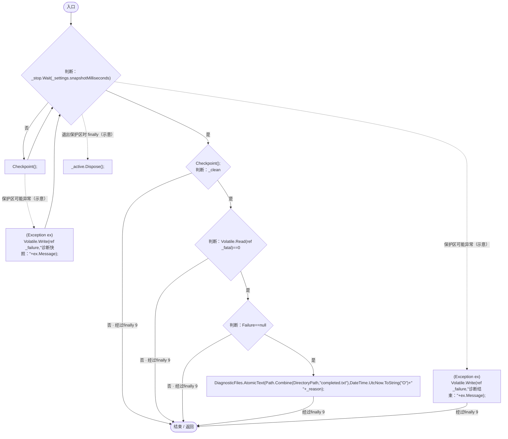
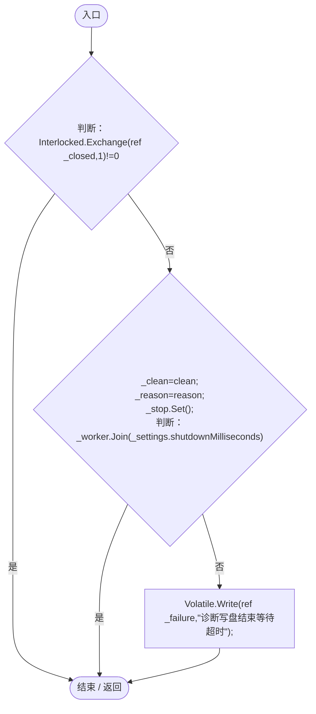
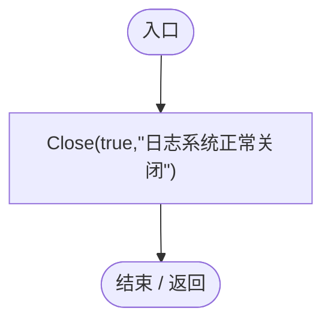

```mermaid
flowchart TD
  b0(["入口"])
  b1{"判断：Volatile.Read(ref _closed)!=0"}
  b2{"判断：fatal"}
  b3["Interlocked.Exchange(ref _fatal,1);"]
  b4["_critical"]
  b5["_critical"]
  b6{"window=Stopwatch.GetTimestamp()/Stopwatch.Frequency<br/>判断：window!=_window"}
  b7["_window=window;<br/>_windowCount=0;"]
  b8{"判断：++_windowCount&gt;_settings.criticalPerSecond"}
  b9{"判断：fatal"}
  b10["Interlocked.Increment(ref _suppressed);"]
  b11{"message<br/>判断：message"}
  b12["message"]
  b13["&quot;&quot;"]
  b14["(message??&quot;&quot;)+&quot;\n&quot;"]
  b15{"stack<br/>判断：stack"}
  b16["stack"]
  b17["&quot;&quot;"]
  b18["detail=(message??&quot;&quot;)+&quot;\n&quot;+(stack??&quot;&quot;)"]
  b19{"limit=_settings.criticalBytes/4<br/>判断：detail.Length&gt;limit"}
  b20["detail=detail.Substring(0,limit)+&quot;…[已截断]&quot;;"]
  b21{"_lastError=DateTimeOffset.Now.ToString(&quot;O&quot;)+&quot; [线程 &quot;+Thread.CurrentThread.ManagedThreadId+&quot;] &quot;+detail;<br/>file=Path.Combine(DirectoryPath,&quot;critical.log&quot;)<br/>判断：File.Exists(file)"}
  b22{"判断：new FileInfo(file).Length+Encoding.UTF8.GetByteCount(_lastError)+2&gt;_settings.criticalBytes"}
  b23{"previous=Path.Combine(DirectoryPath,&quot;critical-previous.log&quot;)<br/>判断：File.Exists(previous)"}
  b24["File.Delete(previous);"]
  b25["File.Move(file,previous);"]
  b26["stream=new FileStream(file,FileMode.Append,FileAccess.Write,FileShare.Read)"]
  b27["bytes=DiagnosticFiles.Utf8.GetBytes(_lastError+&quot;\n&quot;)<br/>stream.Write(bytes,0,bytes.Length);<br/>stream.Flush(true);"]
  b28{"判断：stream=new FileStream(file,FileMode.Append,FileAccess.Write,FileShare.Read)"}
  b29["stream=new FileStream(file,FileMode.Append,FileAccess.Write,FileShare.Read)"]
  b30["连接 / 离开区域"]
  b31{"判断：_critical"}
  b32["_critical"]
  b33["连接 / 离开区域"]
  b34["(Exception ex)<br/>Volatile.Write(ref _failure,&quot;紧急日志：&quot;+ex.Message);"]
  b35(["结束 / 返回"])
  b0 --> b1
  b1 -->|"是"| b35
  b1 -->|"否"| b2
  b2 -->|"是"| b3
  b2 -->|"否"| b4
  b3 --> b4
  b4 --> b5
  b5 --> b6
  b6 -->|"是"| b7
  b6 -->|"否"| b8
  b7 --> b8
  b8 -->|"是"| b9
  b8 -->|"否"| b11
  b9 -->|"否"| b10
  b9 -->|"是"| b11
  b10 -->|"经过finally 31"| b35
  b11 -->|"否"| b12
  b11 -->|"是"| b13
  b12 --> b14
  b13 --> b14
  b14 --> b15
  b15 -->|"否"| b16
  b15 -->|"是"| b17
  b16 --> b18
  b17 --> b18
  b18 --> b19
  b19 -->|"是"| b20
  b19 -->|"否"| b21
  b20 --> b21
  b21 -->|"是"| b22
  b21 -->|"否"| b26
  b22 -->|"是"| b23
  b22 -->|"否"| b26
  b23 -->|"是"| b24
  b23 -->|"否"| b25
  b24 --> b25
  b25 --> b26
  b26 --> b27
  b27 -->|"经过finally 28,31"| b35
  b28 -->|"否"| b29
  b28 -->|"是"| b30
  b29 --> b30
  b31 -->|"是"| b32
  b31 -->|"否"| b33
  b32 --> b33
  b34 --> b35
  b27 -. "退出保护区时 finally（示意）" .-> b28
  b5 -. "退出保护区时 finally（示意）" .-> b31
  b4 -. "保护区可能异常（示意）" .-> b34

```

# RuntimeDiagnosticSession.cs

[返回总索引](../README.md) · `Runtime` · `Assets/DarwinPark/Core/Logging/RuntimeDiagnosticSession.cs`

[源文件](../../../Assets/DarwinPark/Core/Logging/RuntimeDiagnosticSession.cs) · 源码校验：`dd25438046b19174b81a6f38c88637643d1f9eac63cd51c667ea3304a1527b57`

方法按源文件位置排列。事件/回调引用不表示立即执行；分支与异常说明见总索引。完整源码与可点击关系图请打开离线手册。

## DirectoryPath.get · L23

`get`

### Editor / Player · 语法控制结构 / 声明（非CFG）

## Failure.get · L24

`public string Failure`

### Editor / Player · 语法控制结构 / 声明（非CFG）

## RecoveredSessions.get · L25

`get`

### Editor / Player · 语法控制结构 / 声明（非CFG）

## RuntimeDiagnosticSession.ctor · L26

`public RuntimeDiagnosticSession(string root,RuntimeDiagnosticSettings settings,string header,Func<string> logFile,string nativeLog)`

### Editor / Player · Roslyn编译器控制流

项目内调用/回调引用：

- [RuntimeDiagnosticSettings.Validate · L17](e1f8672949291bee.md#mc96db0457c0367e1)（方法）
- [DiagnosticFiles.Runs · L38](d8a018f478416f7b.md#m60809bf5627f2c91)（方法）
- [DiagnosticFiles.IsInactive · L33](d8a018f478416f7b.md#ma71f0b50f516e79b)（方法）
- [DiagnosticFiles.AtomicText · L13](d8a018f478416f7b.md#m8cc20036c6217eca)（方法）
- [RuntimeDiagnosticSession.RecoveredSessions.get · L25](cdf29a3aa679d2b9.md#mbe77d8a7bf1f913f)（访问器）
- [RuntimeDiagnosticSession.DirectoryPath.get · L23](cdf29a3aa679d2b9.md#m508bb212a239179f)（访问器）
- [DiagnosticFiles.RetainRuns · L40](d8a018f478416f7b.md#mb9cc7fb15bafacf2)（方法）
- [RuntimeDiagnosticSession.Checkpoint · L75](cdf29a3aa679d2b9.md#m5da3345844dd040e)（方法）
- [RuntimeDiagnosticSession.Loop · L95](cdf29a3aa679d2b9.md#mc846e16ad73db506)（方法）

## Pulse · L46

`public void Pulse(string state=null)`

### Editor / Player · Roslyn编译器控制流

## RecordCritical · L51

`public void RecordCritical(string message,string stack,bool fatal=false)`

### Editor / Player · Roslyn编译器控制流

项目内调用/回调引用：

- [RuntimeDiagnosticSession.DirectoryPath.get · L23](cdf29a3aa679d2b9.md#m508bb212a239179f)（访问器）

## Checkpoint · L75

`public void Checkpoint()`

### Editor / Player · Roslyn编译器控制流

项目内调用/回调引用：

- [DiagnosticFiles.AtomicText · L13](d8a018f478416f7b.md#m8cc20036c6217eca)（方法）
- [RuntimeDiagnosticSession.DirectoryPath.get · L23](cdf29a3aa679d2b9.md#m508bb212a239179f)（访问器）
- [DiagnosticMemory.WorkingSetBytes · L20](da5a4e8a86332124.md#m87f3b765ab85a4c9)（方法）
- [RuntimeDiagnosticSession.CopyTail · L89](cdf29a3aa679d2b9.md#mfd58fc7c5c73a34c)（方法）

## CopyTail · L89

`private void CopyTail(string source,string name)`

### Editor / Player · Roslyn编译器控制流

项目内调用/回调引用：

- [DiagnosticFiles.AtomicText · L13](d8a018f478416f7b.md#m8cc20036c6217eca)（方法）
- [RuntimeDiagnosticSession.DirectoryPath.get · L23](cdf29a3aa679d2b9.md#m508bb212a239179f)（访问器）
- [DiagnosticFiles.Tail · L20](d8a018f478416f7b.md#m5474ad6077e3293c)（方法）

## Loop · L95

`private void Loop()`

### Editor / Player · Roslyn编译器控制流

项目内调用/回调引用：

- [RuntimeDiagnosticSession.Checkpoint · L75](cdf29a3aa679d2b9.md#m5da3345844dd040e)（方法）
- [DiagnosticFiles.AtomicText · L13](d8a018f478416f7b.md#m8cc20036c6217eca)（方法）
- [RuntimeDiagnosticSession.DirectoryPath.get · L23](cdf29a3aa679d2b9.md#m508bb212a239179f)（访问器）

## Close · L108

`public void Close(bool clean,string reason)`

### Editor / Player · Roslyn编译器控制流

## Dispose · L114

`public void Dispose()`

### Editor / Player · Roslyn编译器控制流

项目内调用/回调引用：

- [RuntimeDiagnosticSession.Close · L108](cdf29a3aa679d2b9.md#m7bdcb9aef7062799)（方法）
