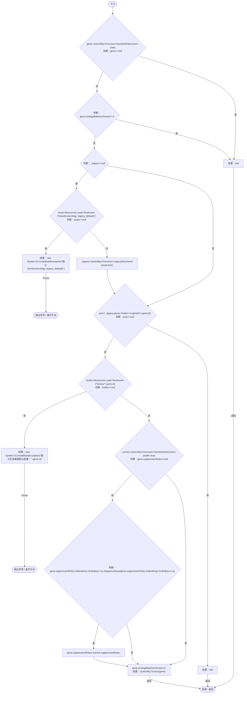
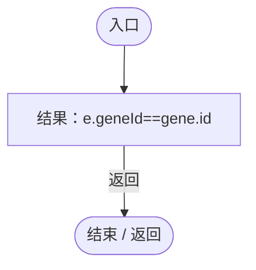
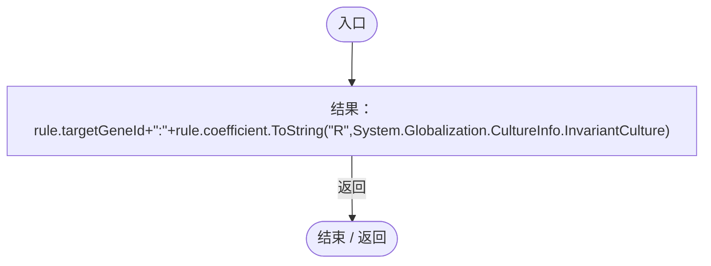
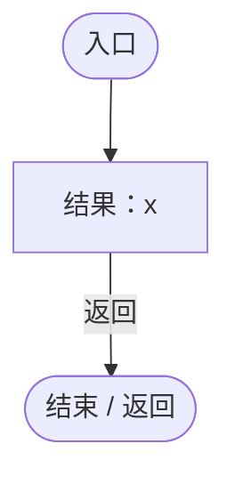
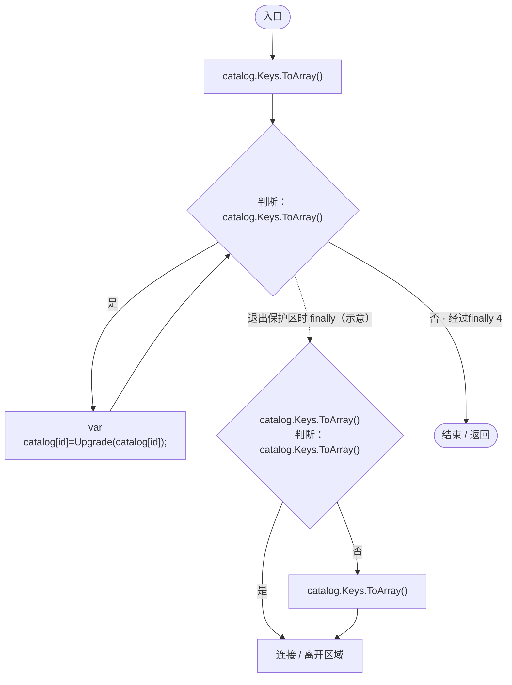

# EcologyGeneDefaults.cs

[返回总索引](../README.md) · `Runtime` · `Assets/DarwinPark/Genetics/EcologyGeneDefaults.cs`

[源文件](../../../Assets/DarwinPark/Genetics/EcologyGeneDefaults.cs) · 源码校验：`f51998afff5abf18d3a23960644c8a8f44b8c563f601220bfec6beca43b7519e`

方法按源文件位置排列。事件/回调引用不表示立即执行；分支与异常说明见总索引。完整源码与可点击关系图请打开离线手册。

## Upgrade · L14

`public static string Upgrade(string raw)`

### Editor / Player · Roslyn编译器控制流

项目内调用/回调引用：

- [EcologyGeneDefaults.回调@23 · L23](ce4f4683a31b001c.md#maaecf3da010895b5)（回调/委托）
- [EcologyGeneDefaults.Key · L26](ce4f4683a31b001c.md#m3d376e7b3363baca)（局部函数）
- [EcologyGeneDefaults.回调@27 · L27](ce4f4683a31b001c.md#mfa7db83fd9e9967a)（回调/委托）
- [EcologyGeneDefaults.回调@27 · L27](ce4f4683a31b001c.md#ma6336261ed31dd73)（回调/委托）

## 回调@23 · L23

`e … => 回调`

### Editor / Player · Roslyn编译器控制流

## Key · L26

`string Key(GeneSuppressionJson rule)`

### Editor / Player · Roslyn编译器控制流

## 回调@27 · L27

`x … => 回调`

### Editor / Player · Roslyn编译器控制流

## 回调@27 · L27

`x … => 回调`

### Editor / Player · Roslyn编译器控制流

## UpgradeCatalog · L30

`public static void UpgradeCatalog(Dictionary<string,string> catalog)`

### Editor / Player · Roslyn编译器控制流

项目内调用/回调引用：

- [EcologyGeneDefaults.Upgrade · L14](ce4f4683a31b001c.md#m0cb614734c6a2d00)（方法）
