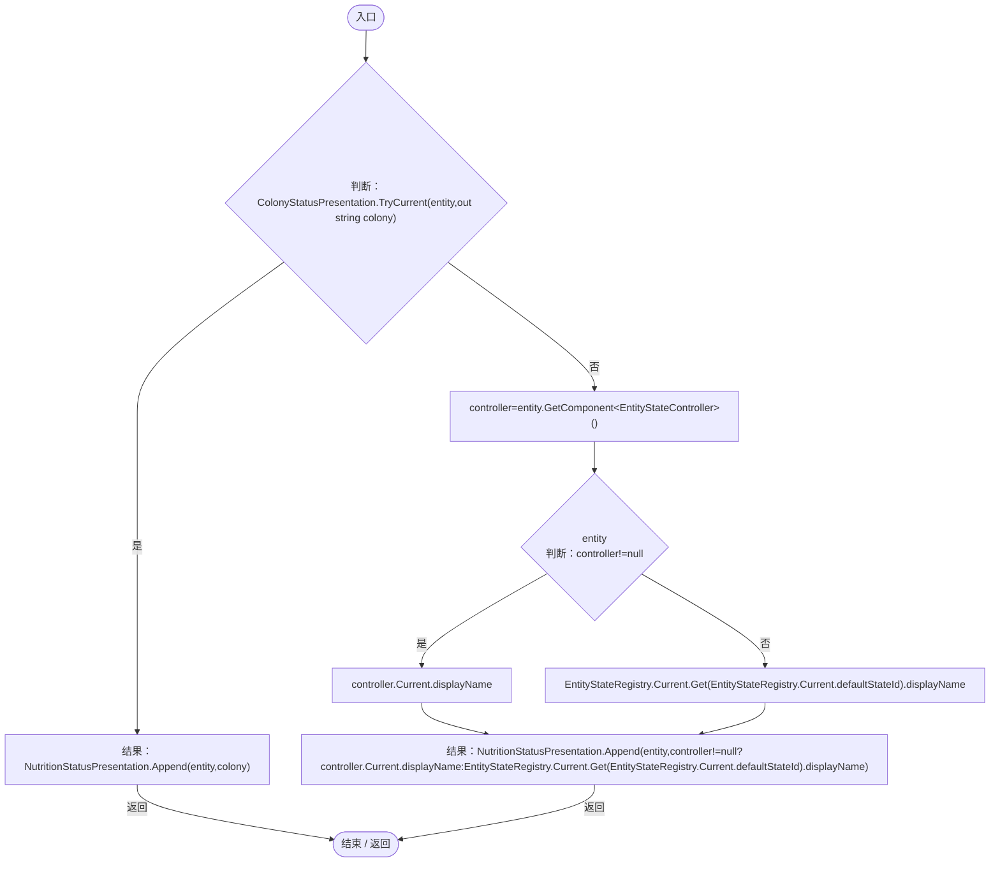
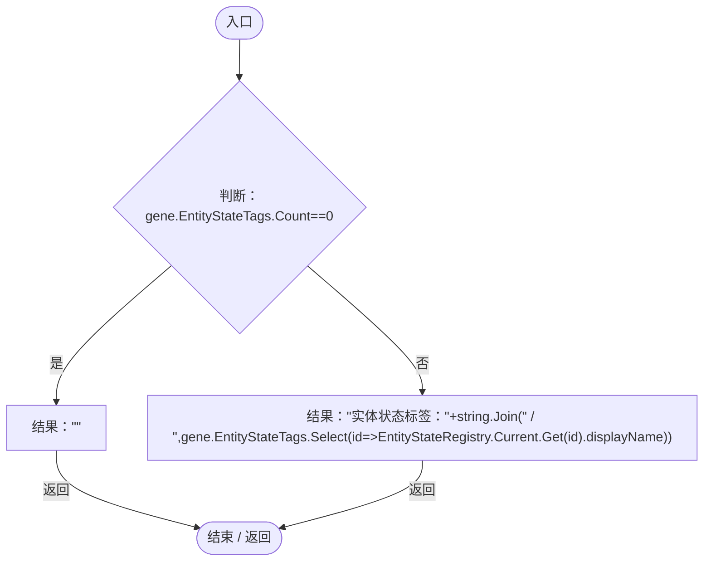
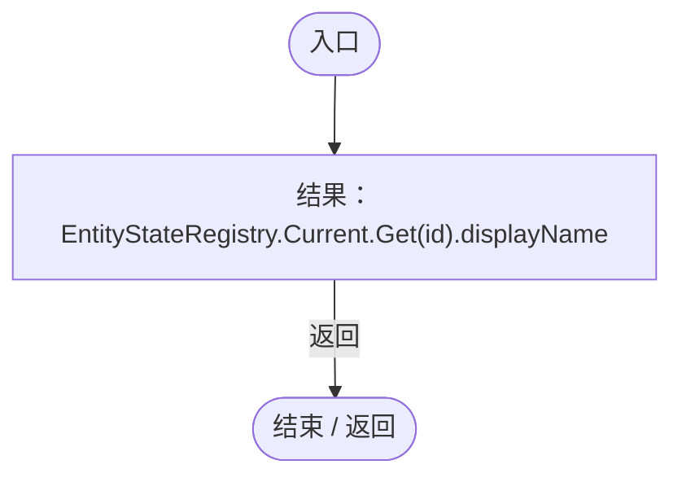

# EntityStatePresentation.cs

[返回总索引](../README.md) · `Runtime` · `Assets/DarwinPark/UI/EntityStatePresentation.cs`

[源文件](../../../Assets/DarwinPark/UI/EntityStatePresentation.cs) · 源码校验：`44bb51f379d79ebebd6e818665a0f626a89f68a6b11ab4798c500152ae182114`

方法按源文件位置排列。事件/回调引用不表示立即执行；分支与异常说明见总索引。完整源码与可点击关系图请打开离线手册。

## Current · L11

`public static string Current(DarwinEntity entity)`

### Editor / Player · Roslyn编译器控制流

项目内调用/回调引用：

- [ColonyStatusPresentation.TryCurrent · L10](37a7c5ffa1a1a8c2.md#m0501c666d2846a93)（方法）
- [NutritionStatusPresentation.Append · L8](495e56e5dfb8b3fa.md#m2455062f491afffa)（方法）
- [EntityStateDocument.Get · L32](440408d2db5c7d96.md#m52cb41ccf0c9d3c9)（方法）
- [EntityStateRegistry.Current.get · L41](440408d2db5c7d96.md#m61b7aa1a54b9a56c)（访问器）

## GeneTags · L18

`public static string GeneTags(GeneDefinition gene)`

### Editor / Player · Roslyn编译器控制流

项目内调用/回调引用：

- [EntityStatePresentation.回调@21 · L21](cedd13b7a8825ed4.md#m5101f482ecf557d1)（回调/委托）

## 回调@21 · L21

`id … => 回调`

### Editor / Player · Roslyn编译器控制流

项目内调用/回调引用：

- [EntityStateDocument.Get · L32](440408d2db5c7d96.md#m52cb41ccf0c9d3c9)（方法）
- [EntityStateRegistry.Current.get · L41](440408d2db5c7d96.md#m61b7aa1a54b9a56c)（访问器）
