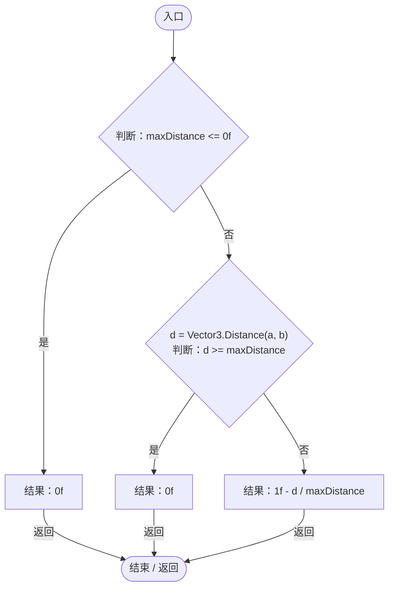

# GeneInteractionSpace.cs

[返回总索引](../README.md) · `Runtime` · `Assets/DarwinPark/Genetics/Mutation/GeneInteractionSpace.cs`

[源文件](../../../Assets/DarwinPark/Genetics/Mutation/GeneInteractionSpace.cs) · 源码校验：`3c20e64ee9f048e9c375284749a04448c192e918e8628eb140a0d488ee3d2167`

方法按源文件位置排列。事件/回调引用不表示立即执行；分支与异常说明见总索引。完整源码与可点击关系图请打开离线手册。

## InteractionProbability · L7

`public static float InteractionProbability(Vector3 a, Vector3 b, float maxDistance)`

### Editor / Player · Roslyn编译器控制流

