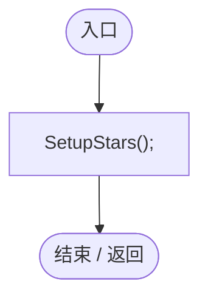
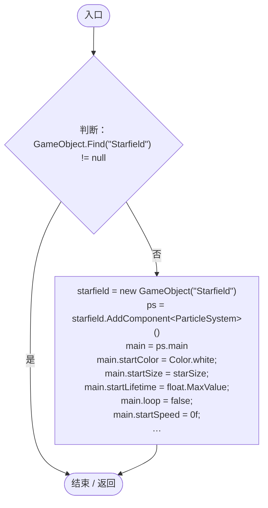

# PlanetVisuals.cs

[返回总索引](../README.md) · `Runtime` · `Assets/DarwinPark/Planet/PlanetVisuals.cs`

[源文件](../../../Assets/DarwinPark/Planet/PlanetVisuals.cs) · 源码校验：`5f33400cb2ad45b4c8aff2f944fc53bc4fa0247c74f8cf88470a1bc9f374723b`

方法按源文件位置排列。事件/回调引用不表示立即执行；分支与异常说明见总索引。完整源码与可点击关系图请打开离线手册。

## Start · L12

`void Start()`

### Editor / Player · Roslyn编译器控制流

项目内调用/回调引用：

- [PlanetVisuals.SetupStars · L18](d17f79d136e52f84.md#m1f0d51c30e444a17)（方法）

## SetupStars · L18

`private void SetupStars()`

### Editor / Player · Roslyn编译器控制流

