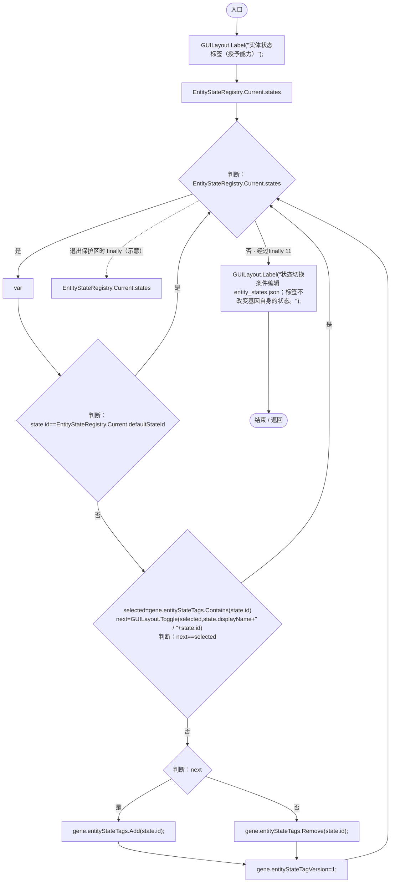

# GeneEntityStateTagEditor.cs

[返回总索引](../README.md) · `Runtime` · `Assets/DarwinPark/UI/GeneEntityStateTagEditor.cs`

[源文件](../../../Assets/DarwinPark/UI/GeneEntityStateTagEditor.cs) · 源码校验：`17009577fee4c04563ad9ecd595cc005ba242d43682778a0cfdcb57d2159f27b`

方法按源文件位置排列。事件/回调引用不表示立即执行；分支与异常说明见总索引。完整源码与可点击关系图请打开离线手册。

## Draw · L9

`public static void Draw(GeneDefinitionJson gene)`

### Editor / Player · Roslyn编译器控制流

项目内调用/回调引用：

- [EntityStateRegistry.Current.get · L41](440408d2db5c7d96.md#m61b7aa1a54b9a56c)（访问器）
