# CorpseCleanupController.cs

[返回总索引](../README.md) · `Runtime` · `Assets/DarwinPark/Entities/Simulation/CorpseCleanupController.cs`

[源文件](../../../Assets/DarwinPark/Entities/Simulation/CorpseCleanupController.cs) · 源码校验：`b44292e211ae48203250764dd7d231359de622f398ff1651339bc0d6241764d9`

方法按源文件位置排列。事件/回调引用不表示立即执行；分支与异常说明见总索引。完整源码与可点击关系图请打开离线手册。

## Removed.get · L15

`public static long Removed`

### Editor / Player · 语法控制结构 / 声明（非CFG）

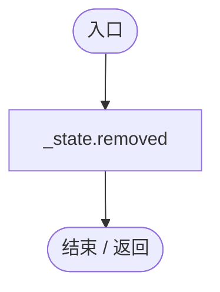

## Queued.get · L15

`public static int Queued`

### Editor / Player · 语法控制结构 / 声明（非CFG）

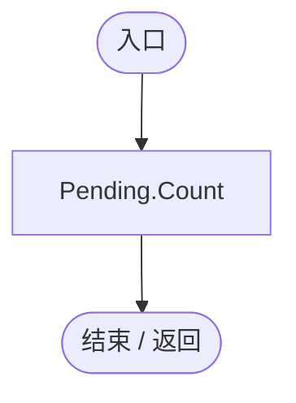

## Elapsed.get · L15

`public static double Elapsed`

### Editor / Player · 语法控制结构 / 声明（非CFG）

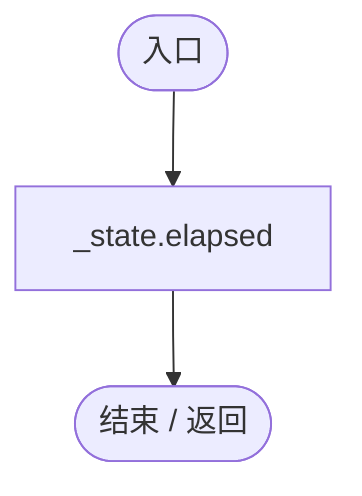

## Ensure · L16

`public static void Ensure(GameObject owner)`

### Editor / Player · Roslyn编译器控制流

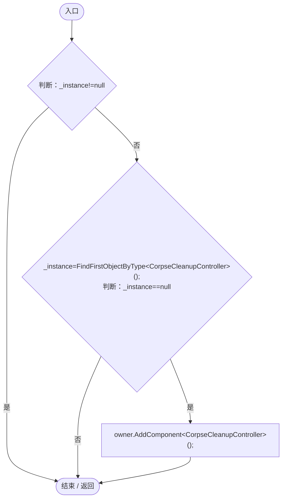

## Awake · L17

`private void Awake()`

### Editor / Player · Roslyn编译器控制流

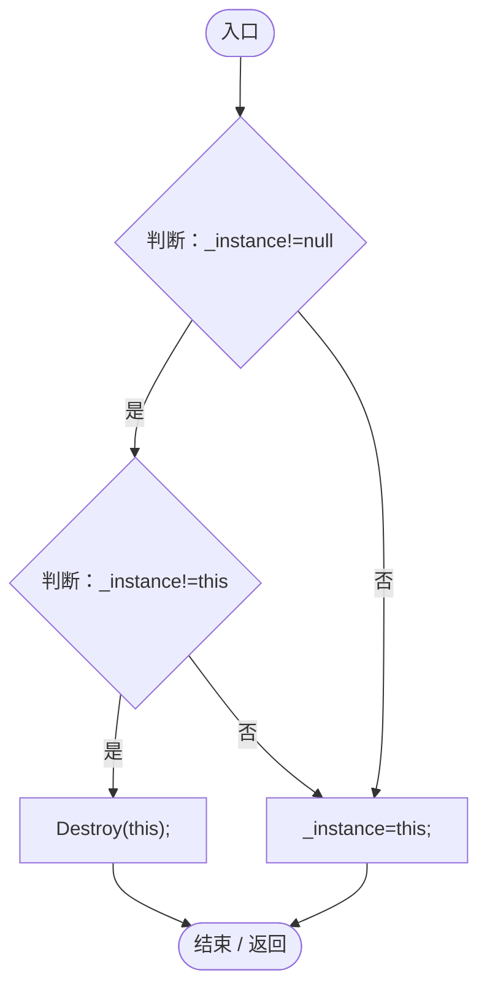

## OnDestroy · L18

`private void OnDestroy()`

### Editor / Player · Roslyn编译器控制流

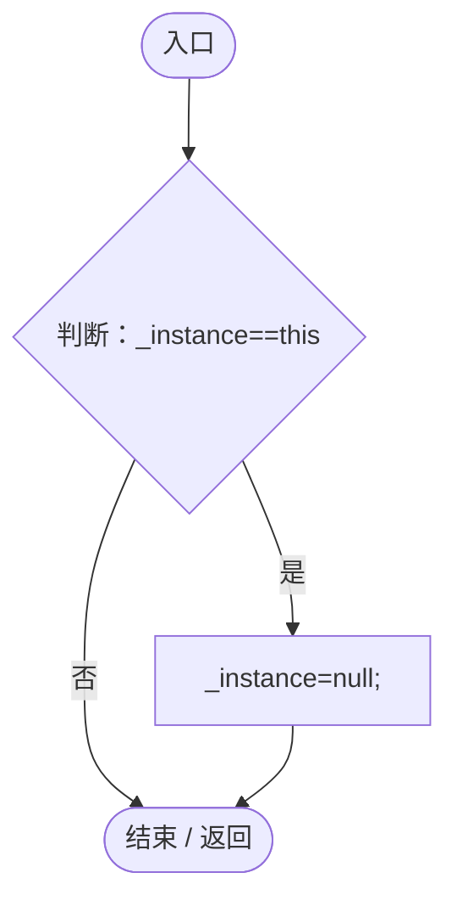

## Update · L19

`private void Update()`

### Editor / Player · Roslyn编译器控制流

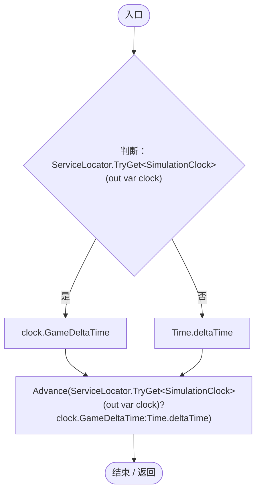

项目内调用/回调引用：

- [CorpseCleanupController.Advance · L20](d2cacacf25d2c28f.md#m7469a7ea8c42a6cc)（方法）
- [ServiceLocator.TryGet · L26](f2fdbe9f9ccd93cb.md#m143b24e6d58471b0)（方法）
- [SimulationClock.GameDeltaTime.get · L26](a8f444aec9614b0a.md#me7f11abae18a4f2d)（访问器）

## Advance · L20

`public static void Advance(float dt)`

### Editor / Player · Roslyn编译器控制流

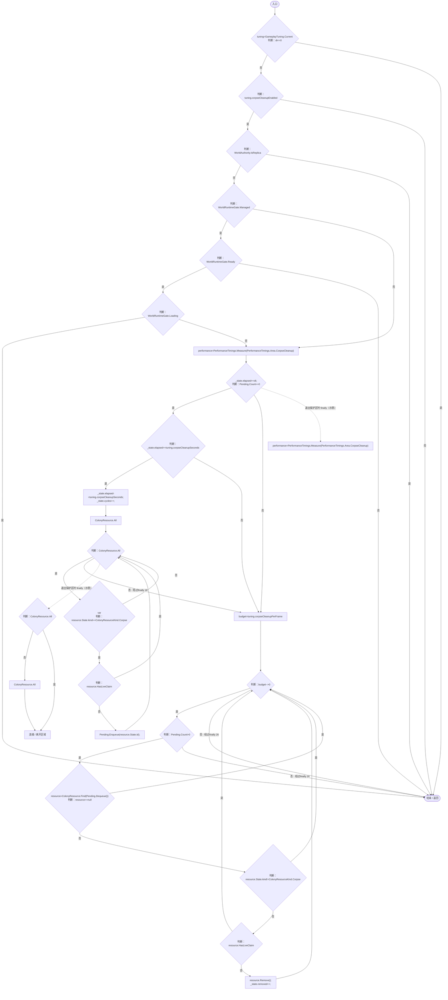

项目内调用/回调引用：

- [GameplayTuning.Current.get · L46](db546e5713b32d53.md#m4fa691bd8a3b9618)（访问器）
- [PerformanceTimings.Measure · L25](a8403a4c7503726d.md#m36fde3c234084192)（方法）
- [ColonyResource.State.get · L24](293dbaecfff4b585.md#m41824f1a0e160aa5)（访问器）
- [ColonyResource.Find · L28](293dbaecfff4b585.md#m1324285ab40ac6f4)（方法）
- [ColonyResource.Remove · L108](293dbaecfff4b585.md#m42fd78441247c433)（方法）

## Capture · L37

`public static CorpseCleanupSave Capture()`

### Editor / Player · Roslyn编译器控制流

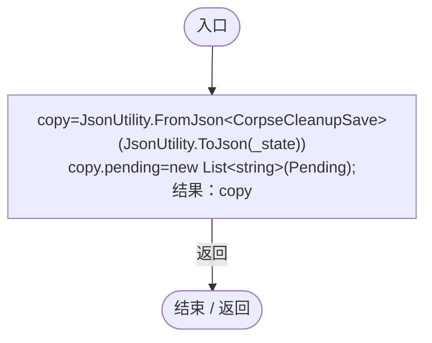

## Restore · L38

`public static void Restore(CorpseCleanupSave state)`

### Editor / Player · Roslyn编译器控制流

```mermaid
flowchart TD
  b0(["入口"])
  b1["Validate(state);<br/>Pending.Clear();"]
  b2{"_state<br/>判断：state==null"}
  b3{"判断：state.version==0"}
  b4["new()"]
  b5["JsonUtility.FromJson&lt;CorpseCleanupSave&gt;(JsonUtility.ToJson(state))"]
  b6["_state=state==null&#124;&#124;state.version==0?new():JsonUtility.FromJson&lt;CorpseCleanupSave&gt;(JsonUtility.ToJson(state));"]
  b7["_state.pending"]
  b8{"判断：_state.pending"}
  b9["var<br/>Pending.Enqueue(id);"]
  b10["_state.pending"]
  b11["_state.pending.Clear();"]
  b12(["结束 / 返回"])
  b0 --> b1
  b1 --> b2
  b2 -->|"否"| b3
  b2 -->|"是"| b4
  b3 -->|"是"| b4
  b3 -->|"否"| b5
  b4 --> b6
  b5 --> b6
  b6 --> b7
  b7 --> b8
  b8 -->|"是"| b9
  b8 -->|"否 · 经过finally 10"| b11
  b9 --> b8
  b11 --> b12
  b8 -. "退出保护区时 finally（示意）" .-> b10

```

项目内调用/回调引用：

- [CorpseCleanupController.Validate · L40](d2cacacf25d2c28f.md#m881c458a99fc0e08)（方法）

## Validate · L40

`public static void Validate(CorpseCleanupSave state)`

### Editor / Player · Roslyn编译器控制流

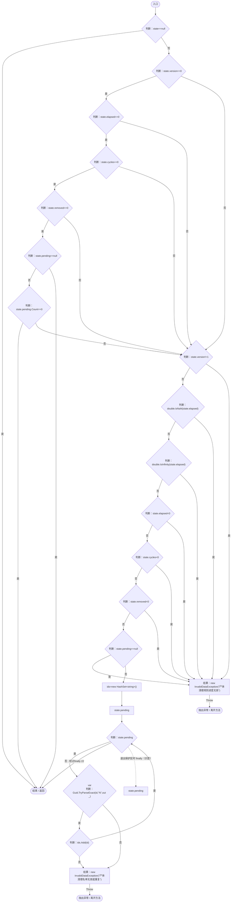

## Reset · L46

`[RuntimeInitializeOnLoadMethod(RuntimeInitializeLoadType.SubsystemRegistration)]private static void Reset()`

### Editor / Player · Roslyn编译器控制流

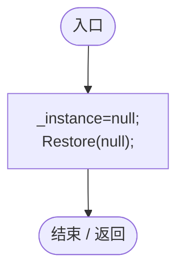

项目内调用/回调引用：

- [CorpseCleanupController.Restore · L38](d2cacacf25d2c28f.md#m88264fca2e08063a)（方法）
