# LandPathScheduler.cs

[返回总索引](../README.md) · `Runtime` · `Assets/DarwinPark/Planet/Terrain/LandPathScheduler.cs`

[源文件](../../../Assets/DarwinPark/Planet/Terrain/LandPathScheduler.cs) · 源码校验：`61fbb0d27835d7fb76bb2805cbb07d5f8cba2dc6215d9ae507f16b5aa025f304`

方法按源文件位置排列。事件/回调引用不表示立即执行；分支与异常说明见总索引。完整源码与可点击关系图请打开离线手册。

## Instance.get · L11

`get`

### Editor / Player · 语法控制结构 / 声明（非CFG）

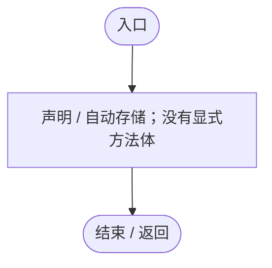

## Instance.set · L11

`private set`

### Editor / Player · 语法控制结构 / 声明（非CFG）

## Configure · L12

`public static void Configure(PlanetTerrainMeshBuilder planet)`

### Editor / Player · Roslyn编译器控制流

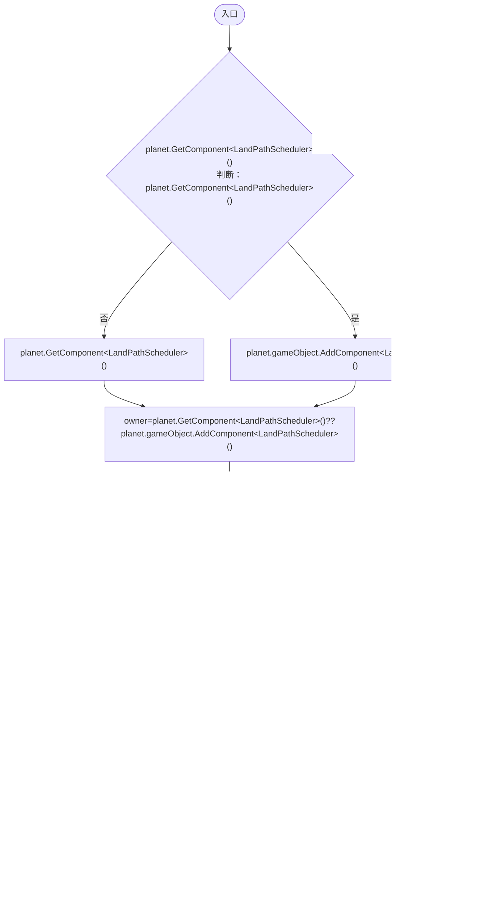

项目内调用/回调引用：

- [LandPathScheduler.Instance.set · L11](d357e13967229560.md#m6085aa9212de5c65)（访问器）
- [PlanetTerrainMeshBuilder.Data.get · L81](415285cf043354a9.md#m1a65abfe0f34c5d8)（访问器）

## RequestPath · L14

`public void RequestPath(LandRoutePlan route,int serial,int start,int goal)`

### Editor / Player · Roslyn编译器控制流

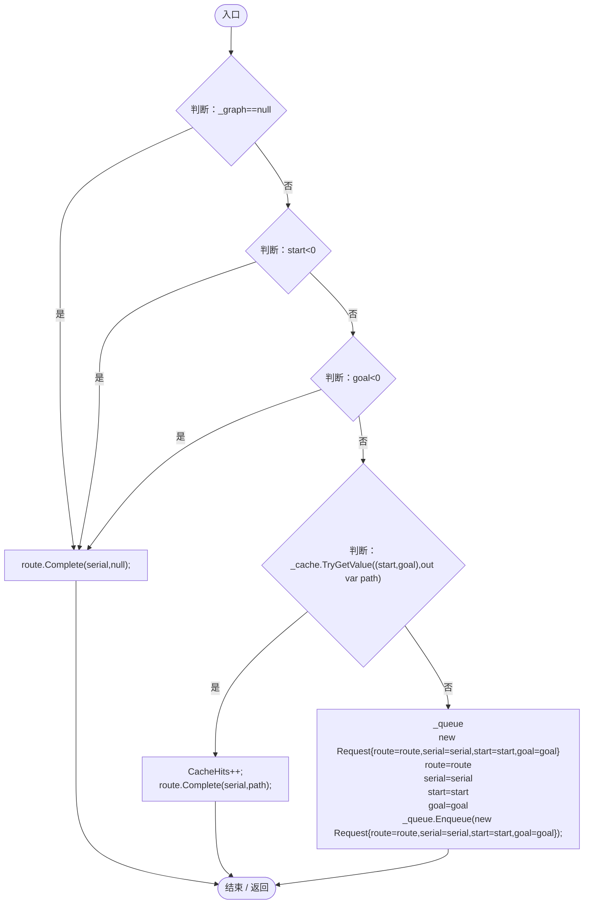

项目内调用/回调引用：

- [LandRoutePlan.Complete · L39](d357e13967229560.md#m7ed653cfda73f2c0)（方法）

## Begin · L16

`private void Begin(Request request)`

### Editor / Player · Roslyn编译器控制流

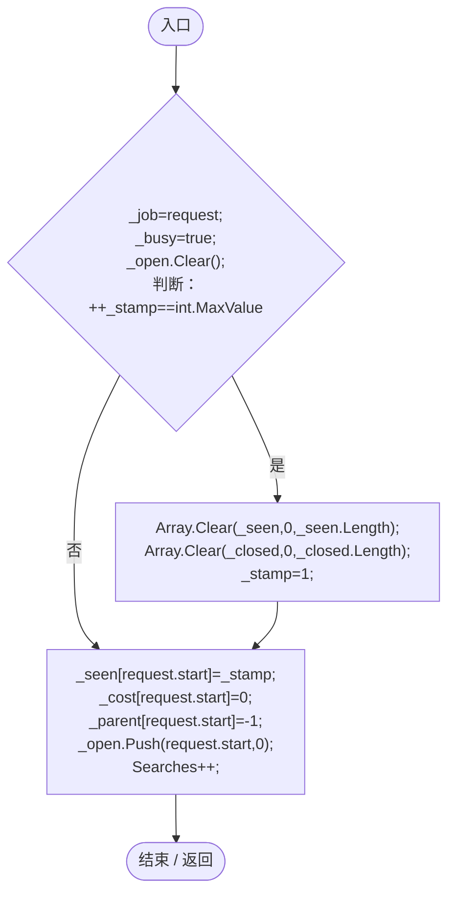

项目内调用/回调引用：

- [SurfaceMinHeap.Clear · L9](958cbffd86775bce.md#m403a4144b0775039)（方法）
- [SurfaceMinHeap.Push · L11](958cbffd86775bce.md#mffe915cc449c4148)（方法）

## Finish · L18

`private void Finish(int[] path)`

### Editor / Player · Roslyn编译器控制流

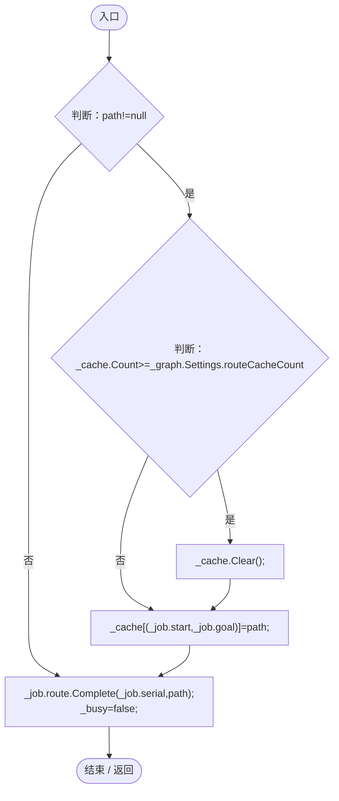

项目内调用/回调引用：

- [LandRoutePlan.Complete · L39](d357e13967229560.md#m7ed653cfda73f2c0)（方法）

## LateUpdate · L20

`private void LateUpdate()`

### Editor / Player · Roslyn编译器控制流

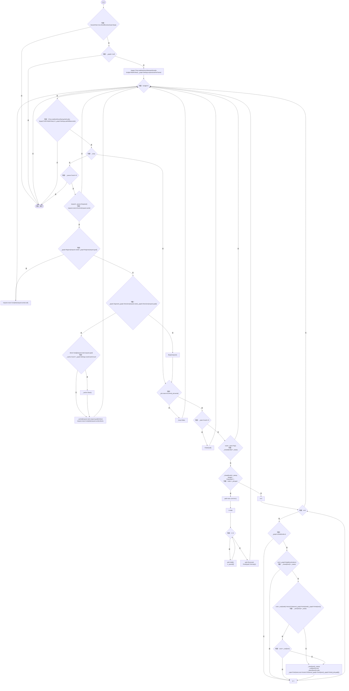

项目内调用/回调引用：

- [LandRoutePlan.IsCurrent · L38](d357e13967229560.md#m288a33db85597841)（方法）
- [LandRoutePlan.Complete · L39](d357e13967229560.md#m7ed653cfda73f2c0)（方法）
- [LandNavigationGraph.Segment · L25](6f2590f045ea5d3f.md#m1357eb7f0ace9eab)（方法）
- [LandPathScheduler.Begin · L16](d357e13967229560.md#m3e64ed5d02870d68)（方法）
- [LandPathScheduler.Finish · L18](d357e13967229560.md#m36cce1b9d70bafd2)（方法）
- [SurfaceMinHeap.Pop · L12](958cbffd86775bce.md#m70941e2003a2c395)（方法）
- [LandNavigationGraph.Linked · L34](6f2590f045ea5d3f.md#m38c3c53f23cc60af)（方法）
- [LandNavigationGraph.Neighbour · L35](6f2590f045ea5d3f.md#m0e919afc27292a26)（方法）
- [SurfaceMinHeap.Push · L11](958cbffd86775bce.md#mffe915cc449c4148)（方法）

## OnDestroy · L32

`private void OnDestroy()`

### Editor / Player · Roslyn编译器控制流

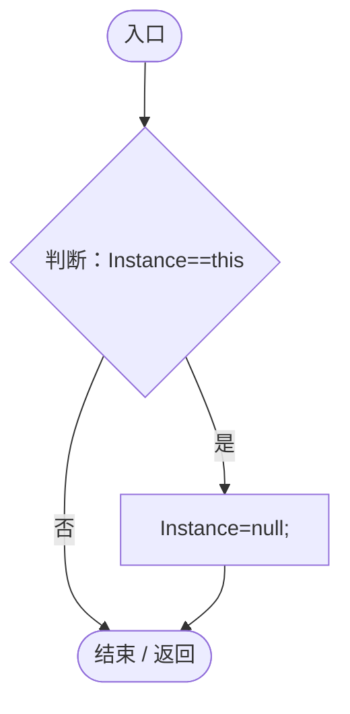

项目内调用/回调引用：

- [LandPathScheduler.Instance.get · L11](d357e13967229560.md#m1a619fa8acb9d2f6)（访问器）
- [LandPathScheduler.Instance.set · L11](d357e13967229560.md#m6085aa9212de5c65)（访问器）

## IsCurrent · L38

`public bool IsCurrent(int serial)`

### Editor / Player · Roslyn编译器控制流

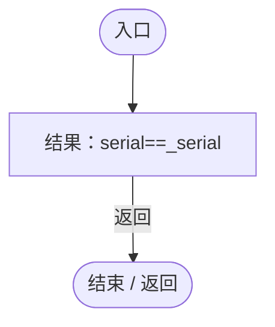

## Complete · L39

`public void Complete(int serial,int[] path)`

### Editor / Player · Roslyn编译器控制流

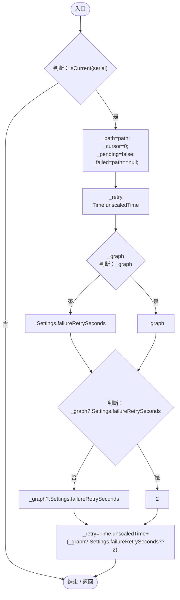

项目内调用/回调引用：

- [LandRoutePlan.IsCurrent · L38](d357e13967229560.md#m288a33db85597841)（方法）

## Resolve · L40

`public bool Resolve(PlanetTerrainMeshBuilder planet,Vector3 current,Vector3 destination,out Vector3 waypoint)`

### Editor / Player · Roslyn编译器控制流

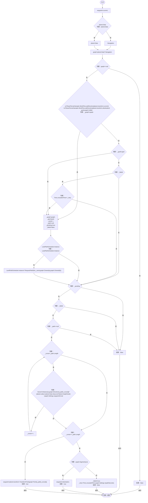

项目内调用/回调引用：

- [PlanetTerrainMeshBuilder.Data.get · L81](415285cf043354a9.md#m1a65abfe0f34c5d8)（访问器）
- [PlanetTerrainSampler.WorldToLocalDirection · L76](fd5c1d83b88a7c8b.md#m463193acae2d5044)（方法）
- [LandNavigationGraph.Cell · L30](6f2590f045ea5d3f.md#m2f85f8538664d703)（方法）
- [LandPathScheduler.Instance.get · L11](d357e13967229560.md#m1a619fa8acb9d2f6)（访问器）
- [LandPathScheduler.RequestPath · L14](d357e13967229560.md#mf21a35457d750af6)（方法）
- [LandNavigationGraph.Closest · L31](6f2590f045ea5d3f.md#m84242b314c22284e)（方法）
- [LandNavigationGraph.Segment · L25](6f2590f045ea5d3f.md#m1357eb7f0ace9eab)（方法）

## SafeVelocity · L49

`public static Vector3 SafeVelocity(PlanetTerrainMeshBuilder planet,Vector3 point,Vector3 velocity)`

### Editor / Player · Roslyn编译器控制流

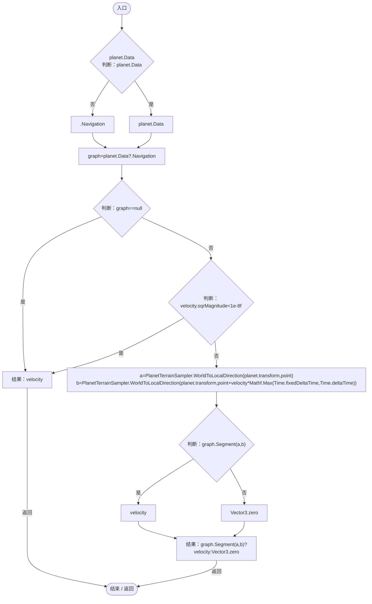

项目内调用/回调引用：

- [PlanetTerrainMeshBuilder.Data.get · L81](415285cf043354a9.md#m1a65abfe0f34c5d8)（访问器）
- [PlanetTerrainSampler.WorldToLocalDirection · L76](fd5c1d83b88a7c8b.md#m463193acae2d5044)（方法）
- [LandNavigationGraph.Segment · L25](6f2590f045ea5d3f.md#m1357eb7f0ace9eab)（方法）
