# RenderDistanceAuditRegression.cs

[返回总索引](../README.md) · `Editor` · `Assets/DarwinPark/Editor/RenderDistanceAuditRegression.cs`

[源文件](../../../Assets/DarwinPark/Editor/RenderDistanceAuditRegression.cs) · 源码校验：`d7efe680ec5616dca564d6af0b3c894fadc3e07d5454a56342ce27ccdf4ea149`

方法按源文件位置排列。事件/回调引用不表示立即执行；分支与异常说明见总索引。完整源码与可点击关系图请打开离线手册。

## Folder.get · L22

`private static string Folder`

### Editor · 语法控制结构 / 声明（非CFG）

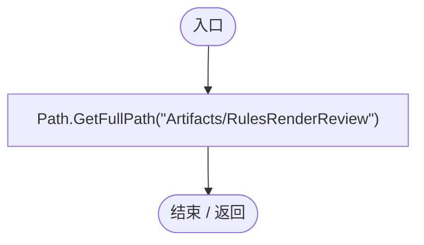

## RenderDistanceAuditRegression.ctor · L23

`static RenderDistanceAuditRegression()`

### Editor · Roslyn编译器控制流

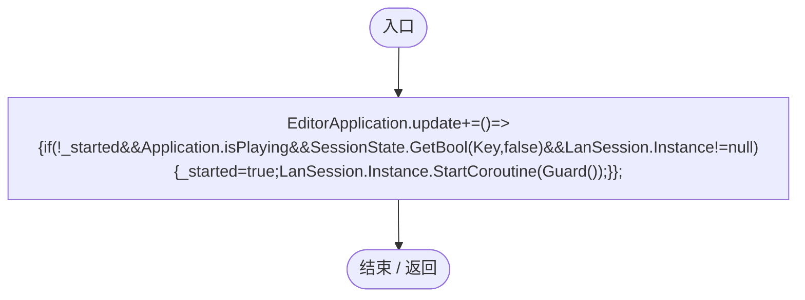

项目内调用/回调引用：

- [RenderDistanceAuditRegression.回调@23 · L23](d5422be5a065ae18.md#m829f86b4f3b3a5a5)（回调/委托）

## 回调@23 · L23

`( … => 回调`

### Editor · Roslyn编译器控制流

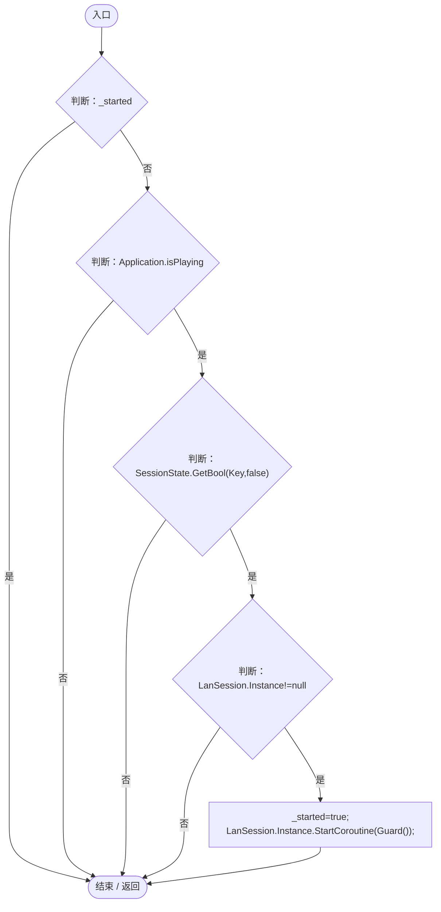

项目内调用/回调引用：

- [LanSession.Instance.get · L23](9fb633eebffe669c.md#mbf83306994878383)（访问器）
- [RenderDistanceAuditRegression.Guard · L25](d5422be5a065ae18.md#m6f071fee0d6ea491)（方法）

## RunBatch · L24

`public static void RunBatch()`

### Editor · Roslyn编译器控制流

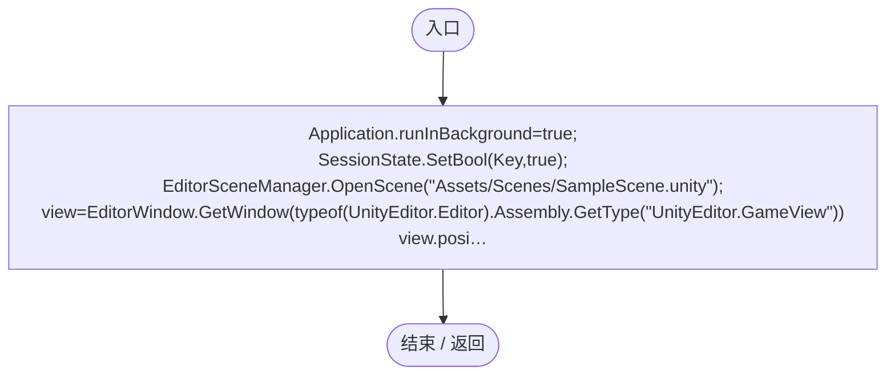

## Guard · L25

`private static IEnumerator Guard()`

### Editor · Roslyn编译器控制流

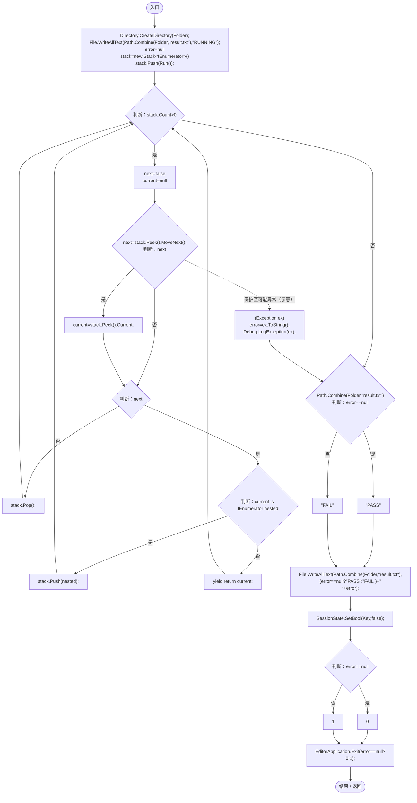

项目内调用/回调引用：

- [RenderDistanceAuditRegression.Run · L38](d5422be5a065ae18.md#m31b6588b255d2c0f)（方法）

## Sample · L31

`private static IEnumerator Sample(string name,bool warm=true)`

### Editor · Roslyn编译器控制流

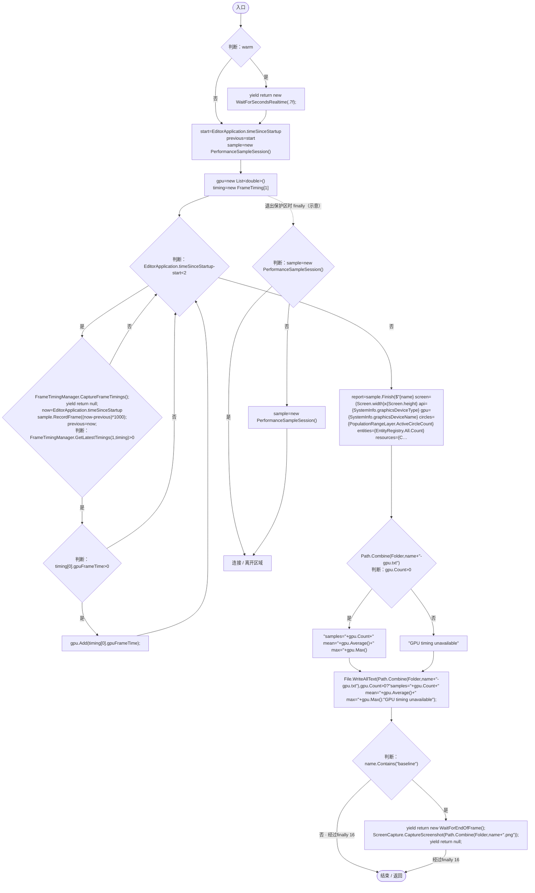

项目内调用/回调引用：

- [PerformanceSampleSession.PerformanceSampleSession.ctor · L42](a8403a4c7503726d.md#maededd26d4b1ea6d)（构造函数）
- [PerformanceSampleSession.RecordFrame · L50](a8403a4c7503726d.md#m944443f0b6e1e80b)（方法）
- [PerformanceSampleSession.Finish · L54](a8403a4c7503726d.md#m2dddffce21e07ed1)（方法）
- [PopulationRangeLayer.ActiveCircleCount.get · L17](7ad316e94c5af908.md#mdf5ce69158592d87)（访问器）
- [SimulationClock.IsRunning.get · L22](a8f444aec9614b0a.md#m10f4fe307faca0f0)（访问器）
- [ServiceLocator.Get · L33](f2fdbe9f9ccd93cb.md#m2ae625299520c56d)（方法）
- [SimulationOptimization.Current.get · L25](11c9091e70893352.md#mde7abfdc18429e4a)（访问器）

## Run · L38

`private static IEnumerator Run()`

### Editor · Roslyn编译器控制流

```mermaid
flowchart TD
  b0(["入口"])
  b1["world=JsonUtility.FromJson&lt;WorldSaveData&gt;(File.ReadAllText(Path.Combine(Folder,&quot;input/world.json&quot;)))<br/>session=Object.FindFirstObjectByType&lt;WorldSessionManager&gt;()<br/>session.autoSaveInterval=36000;<br/>session.Open(world);<br/>began=EditorApplication…"]
  b2{"判断：session.Busy"}
  b3{"判断：EditorApplication.timeSinceStartup-began&gt;300"}
  b4["结果：new TimeoutException(&quot;load&quot;)"]
  x4(["抛出异常 / 离开方法"])
  b5["yield return null;"]
  b6["clock=ServiceLocator.Get&lt;SimulationClock&gt;()<br/>clock.Pause();<br/>Object.FindFirstObjectByType&lt;RandomPlanetSpawner&gt;().enabled=false;<br/>PopulationMaintenance.Restore(null);<br/>FramePacingSettings.SetLimit(0);<br/>camera=Camera.main<br/>camera.GetComponent&lt;Or…"]
  b7{"-radial<br/>判断：Mathf.Abs(radial.y)&gt;.99f"}
  b8["Vector3.right"]
  b9["Vector3.up"]
  b10["rotation=Quaternion.LookRotation(-radial,Mathf.Abs(radial.y)&gt;.99f?Vector3.right:Vector3.up)"]
  b11["File.WriteAllText(Path.Combine(Folder,&quot;context.txt&quot;),$&quot;saved={world.savedUtc} entities={EntityRegistry.All.Count} resources={ColonyResource.All.Count()} point={point} radius={planet.radius} meshTriangles={planet.Data.Triangles.Length/3}&quot;…"]
  b12["lights"]
  b13{"判断：lights"}
  b14["var<br/>light.enabled=false;"]
  b15{"lights<br/>判断：lights"}
  b16["lights"]
  b17["连接 / 离开区域"]
  b18["yield return Sample(&quot;near-no-resource-lights&quot;);"]
  b19["i=0"]
  b20{"判断：i&lt;lights.Length"}
  b21["lights[i].enabled=lightStates[i];<br/>i++"]
  b22["scheduler.enabled=true;<br/>shells=planet.GetComponentsInChildren&lt;Renderer&gt;(true).Where(r=&gt;r.name==&quot;OceanSurface&quot;&#124;&#124;r.name==&quot;CloudVolume&quot;&#124;&#124;r.name==&quot;AtmosphericScattering&quot;).ToArray()<br/>states=shells.Select(r=&gt;r.enabled).ToArray()"]
  b23["shells"]
  b24{"判断：shells"}
  b25["var<br/>r.enabled=false;"]
  b26{"shells<br/>判断：shells"}
  b27["shells"]
  b28["连接 / 离开区域"]
  b29["yield return Sample(&quot;near-no-weather&quot;);"]
  b30["i=0"]
  b31{"判断：i&lt;shells.Length"}
  b32["shells[i].enabled=states[i];<br/>i++"]
  b33["resources=ColonyResource.All.SelectMany(r=&gt;r.GetComponentsInChildren&lt;Renderer&gt;()).ToArray()"]
  b34["resources"]
  b35{"判断：resources"}
  b36["var<br/>r.enabled=false;"]
  b37{"resources<br/>判断：resources"}
  b38["resources"]
  b39["连接 / 离开区域"]
  b40["yield return Sample(&quot;near-no-resources&quot;);"]
  b41["resources"]
  b42{"判断：resources"}
  b43["var<br/>r.enabled=true;"]
  b44{"resources<br/>判断：resources"}
  b45["resources"]
  b46["连接 / 离开区域"]
  b47["entities=EntityRegistry.All.SelectMany(e=&gt;e.GetComponentsInChildren&lt;Renderer&gt;()).ToArray()<br/>visibility=entities.Select(r=&gt;r.enabled).ToArray()"]
  b48["entities"]
  b49{"判断：entities"}
  b50["var<br/>r.enabled=false;"]
  b51{"entities<br/>判断：entities"}
  b52["entities"]
  b53["连接 / 离开区域"]
  b54["yield return Sample(&quot;near-no-entities&quot;);"]
  b55["i=0"]
  b56{"判断：i&lt;entities.Length"}
  b57["entities[i].enabled=visibility[i];<br/>i++"]
  b58{"surface=planet.GetComponent&lt;MeshRenderer&gt;()<br/>original=surface.sharedMaterial<br/>simple=new Material(Shader.Find(&quot;Universal Render Pipeline/Unlit&quot;))<br/>surface.sharedMaterial=simple;<br/>yield return Sample(&quot;near-simple-surface&quot;);<br/>surface.sharedMate…"}
  b59["old=scale.GetValue(pipeline)<br/>scale.SetValue(pipeline,.5f);<br/>yield return Sample(&quot;near-half-resolution&quot;);<br/>scale.SetValue(pipeline,old);"]
  b60(["结束 / 返回"])
  b0 --> b1
  b1 --> b2
  b2 -->|"是"| b3
  b2 -->|"否"| b6
  b3 -->|"是"| b4
  b3 -->|"否"| b5
  b4 -->|"Throw"| x4
  b5 --> b2
  b6 --> b7
  b7 -->|"是"| b8
  b7 -->|"否"| b9
  b8 --> b10
  b9 --> b10
  b10 --> b11
  b11 --> b12
  b12 --> b13
  b13 -->|"是"| b14
  b13 -->|"否 · 经过finally 15"| b18
  b14 --> b13
  b15 -->|"否"| b16
  b15 -->|"是"| b17
  b16 --> b17
  b18 --> b19
  b19 --> b20
  b20 -->|"是"| b21
  b20 -->|"否"| b22
  b21 --> b20
  b22 --> b23
  b23 --> b24
  b24 -->|"是"| b25
  b24 -->|"否 · 经过finally 26"| b29
  b25 --> b24
  b26 -->|"否"| b27
  b26 -->|"是"| b28
  b27 --> b28
  b29 --> b30
  b30 --> b31
  b31 -->|"是"| b32
  b31 -->|"否"| b33
  b32 --> b31
  b33 --> b34
  b34 --> b35
  b35 -->|"是"| b36
  b35 -->|"否 · 经过finally 37"| b40
  b36 --> b35
  b37 -->|"否"| b38
  b37 -->|"是"| b39
  b38 --> b39
  b40 --> b41
  b41 --> b42
  b42 -->|"是"| b43
  b42 -->|"否 · 经过finally 44"| b47
  b43 --> b42
  b44 -->|"否"| b45
  b44 -->|"是"| b46
  b45 --> b46
  b47 --> b48
  b48 --> b49
  b49 -->|"是"| b50
  b49 -->|"否 · 经过finally 51"| b54
  b50 --> b49
  b51 -->|"否"| b52
  b51 -->|"是"| b53
  b52 --> b53
  b54 --> b55
  b55 --> b56
  b56 -->|"是"| b57
  b56 -->|"否"| b58
  b57 --> b56
  b58 -->|"是"| b59
  b58 -->|"否"| b60
  b59 --> b60
  b13 -. "退出保护区时 finally（示意）" .-> b15
  b24 -. "退出保护区时 finally（示意）" .-> b26
  b35 -. "退出保护区时 finally（示意）" .-> b37
  b42 -. "退出保护区时 finally（示意）" .-> b44
  b49 -. "退出保护区时 finally（示意）" .-> b51

```

项目内调用/回调引用：

- [WorldSessionManager.Open · L60](08741c7b7b9d9344.md#m7bd56ef45131b4e5)（方法）
- [WorldSessionManager.Busy.get · L24](08741c7b7b9d9344.md#m4483e2e4f28f7c85)（访问器）
- [ServiceLocator.Get · L33](f2fdbe9f9ccd93cb.md#m2ae625299520c56d)（方法）
- [SimulationClock.Pause · L79](a8f444aec9614b0a.md#m30929d45a885d0f1)（方法）
- [PopulationMaintenance.Restore · L157](923ccc4e86c4786c.md#m6eadf366fa1602cc)（方法）
- [FramePacingSettings.SetLimit · L19](8a946f816b77d4b6.md#mff17d0cc654b6a7f)（方法）
- [PlanetTerrainMeshBuilder.Data.get · L78](415285cf043354a9.md#m8382f579717fbc6d)（访问器）
- [PopulationRangeLayer.SetVisible · L18](7ad316e94c5af908.md#m224360ff57b7a890)（方法）
- [RenderDistanceAuditRegression.Sample · L31](d5422be5a065ae18.md#m525b0d7822419913)（方法）
- [SimulationClock.Play · L78](a8f444aec9614b0a.md#m7aa9e64b7de60ed0)（方法）
- [OrbitCamera.RestoreView · L42](42eb429559b42bcb.md#m8ee0579d9414ca2c)（方法）
- [OrbitCamera.FocusOn · L172](42eb429559b42bcb.md#m1f87e8c62262b27b)（方法）
- [RenderDistanceAuditRegression.回调@45 · L45](d5422be5a065ae18.md#m938d8a9392d728cf)（回调/委托）
- [RenderDistanceAuditRegression.回调@45 · L45](d5422be5a065ae18.md#m7fa52d29c3979407)（回调/委托）
- [RenderDistanceAuditRegression.回调@53 · L53](d5422be5a065ae18.md#m737d9eda0508dd3d)（回调/委托）
- [RenderDistanceAuditRegression.回调@53 · L53](d5422be5a065ae18.md#mcddc7f507c4d68f8)（回调/委托）
- [RenderDistanceAuditRegression.回调@54 · L54](d5422be5a065ae18.md#m1c873e04022695c1)（回调/委托）
- [RenderDistanceAuditRegression.回调@54 · L54](d5422be5a065ae18.md#m2204cf139a7e50ee)（回调/委托）
- [RenderDistanceAuditRegression.回调@55 · L55](d5422be5a065ae18.md#m76cd2fcc4e2d607f)（回调/委托）
- [RenderDistanceAuditRegression.回调@56 · L56](d5422be5a065ae18.md#mf476da863696e87a)（回调/委托）
- [RenderDistanceAuditRegression.回调@56 · L56](d5422be5a065ae18.md#m1a8c3501f691f797)（回调/委托）

## 回调@45 · L45

`e … => 回调`

### Editor · Roslyn编译器控制流

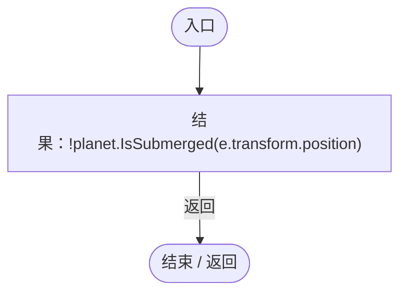

项目内调用/回调引用：

- [PlanetTerrainMeshBuilder.IsSubmerged · L104](415285cf043354a9.md#m248d0b8c4773814f)（方法）

## 回调@45 · L45

`e … => 回调`

### Editor · Roslyn编译器控制流

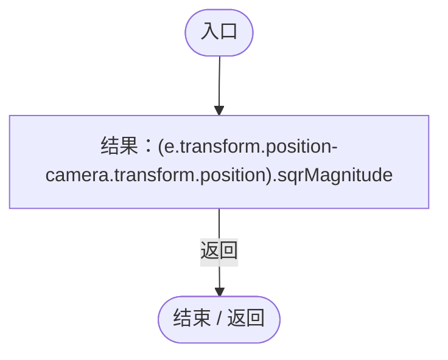

## 回调@53 · L53

`l … => 回调`

### Editor · Roslyn编译器控制流

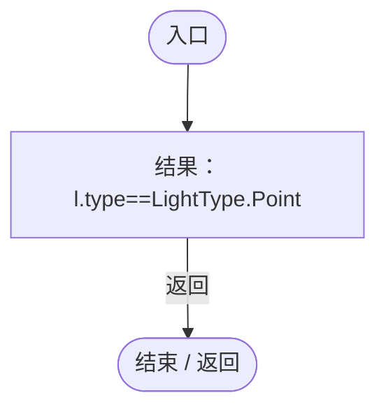

## 回调@53 · L53

`l … => 回调`

### Editor · Roslyn编译器控制流

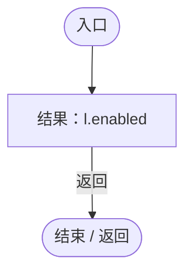

## 回调@54 · L54

`r … => 回调`

### Editor · Roslyn编译器控制流

```mermaid
flowchart TD
  b0(["入口"])
  b1{"判断：r.name==&quot;OceanSurface&quot;"}
  b2{"判断：r.name==&quot;CloudVolume&quot;"}
  b3["r.name==&quot;AtmosphericScattering&quot;"]
  b4["r.name==&quot;OceanSurface&quot;&#124;&#124;r.name==&quot;CloudVolume&quot;&#124;&#124;r.name==&quot;AtmosphericScattering&quot;"]
  b5["结果：r.name==&quot;OceanSurface&quot;&#124;&#124;r.name==&quot;CloudVolume&quot;&#124;&#124;r.name==&quot;AtmosphericScattering&quot;"]
  b6(["结束 / 返回"])
  b0 --> b1
  b1 -->|"否"| b2
  b1 -->|"是"| b4
  b2 -->|"否"| b3
  b2 -->|"是"| b4
  b3 --> b5
  b4 --> b5
  b5 -->|"返回"| b6

```

## 回调@54 · L54

`r … => 回调`

### Editor · Roslyn编译器控制流

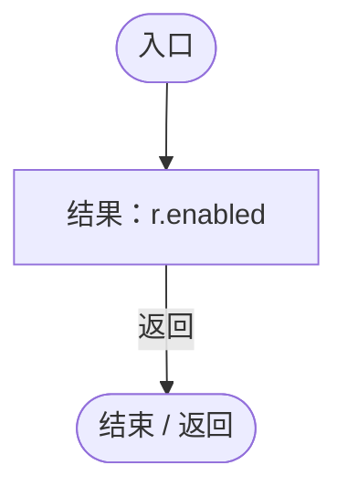

## 回调@55 · L55

`r … => 回调`

### Editor · Roslyn编译器控制流

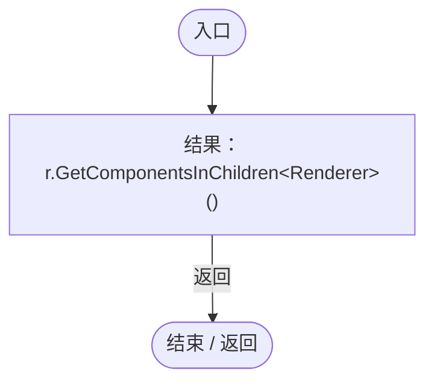

## 回调@56 · L56

`e … => 回调`

### Editor · Roslyn编译器控制流

## 回调@56 · L56

`r … => 回调`

### Editor · Roslyn编译器控制流

