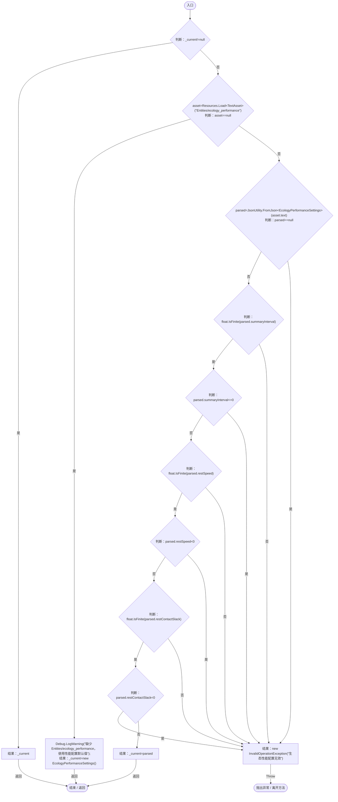
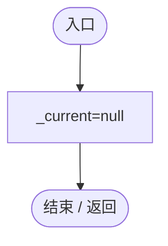

# EcologyPerformanceSettings.cs

[返回总索引](../README.md) · `Runtime` · `Assets/DarwinPark/Entities/Ecology/EcologyPerformanceSettings.cs`

[源文件](../../../Assets/DarwinPark/Entities/Ecology/EcologyPerformanceSettings.cs) · 源码校验：`1eb0d3863d715a23e8b79b8e6dc637253bfe016cac1db8597e5c4a0c23546d58`

方法按源文件位置排列。事件/回调引用不表示立即执行；分支与异常说明见总索引。完整源码与可点击关系图请打开离线手册。

## Current.get · L13

`get`

### Editor / Player · Roslyn编译器控制流

## Reset · L24

`[RuntimeInitializeOnLoadMethod(RuntimeInitializeLoadType.SubsystemRegistration)] private static void Reset()`

### Editor / Player · Roslyn编译器控制流

