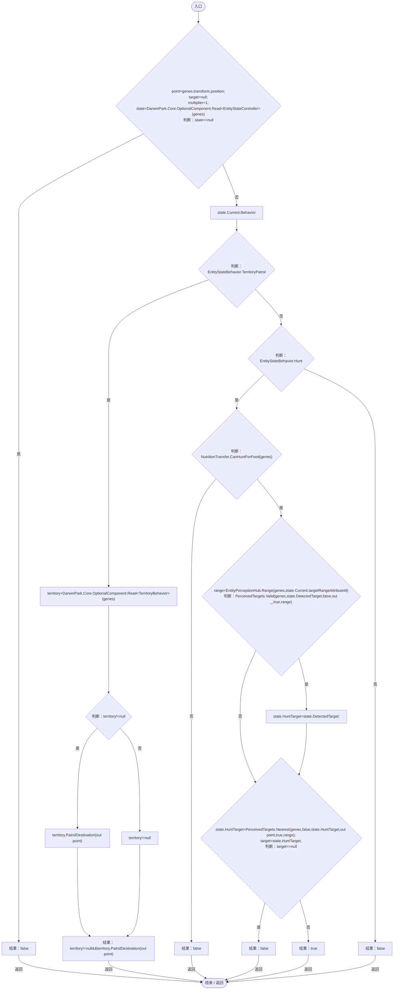

# EntityStateMotion.cs

[返回总索引](../README.md) · `Runtime` · `Assets/DarwinPark/Entities/Ecology/EntityStateMotion.cs`

[源文件](../../../Assets/DarwinPark/Entities/Ecology/EntityStateMotion.cs) · 源码校验：`991f7a5e916073f165256be562449875528154267b880c881d2bfe7b3152939c`

方法按源文件位置排列。事件/回调引用不表示立即执行；分支与异常说明见总索引。完整源码与可点击关系图请打开离线手册。

## Directive · L10

`public static bool Directive(EntityGeneController genes,out Vector3 point,out DarwinEntity target,out float multiplier)`

### Editor / Player · Roslyn编译器控制流

项目内调用/回调引用：

- [OptionalComponent.Read · L7](806c46b42ced4d36.md#m69622a4dee165c5a)（方法）
- [TerritoryBehavior.PatrolDestination · L66](19d504dcdc8bc624.md#m876514deba1e74d9)（方法）
- [NutritionTransfer.CanHuntForFood · L28](081d3b8ff683e442.md#m2cbdf5db3ea5d5c3)（方法）
- [EntityPerceptionHub.Range · L41](aeecc36cb2c3cc24.md#m5135b5615734d39a)（方法）
- [PerceivedTargets.Valid · L7](b78759d0d0a172e4.md#m1aa909943d40ed9f)（方法）
- [EntityStateController.DetectedTarget.get · L18](0f8869eb7018091e.md#m6dbfcf4ac4cb049a)（访问器）
- [EntityStateController.HuntTarget.set · L19](0f8869eb7018091e.md#m6db916eeb719ccff)（访问器）
- [PerceivedTargets.Nearest · L11](b78759d0d0a172e4.md#m0b32361294d1f689)（方法）
- [EntityStateController.HuntTarget.get · L19](0f8869eb7018091e.md#m2d14d3e060ff7346)（访问器）
