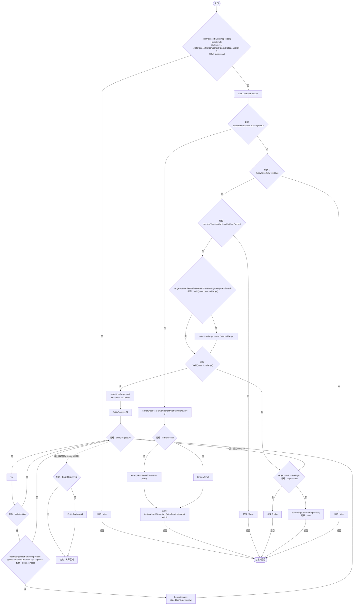
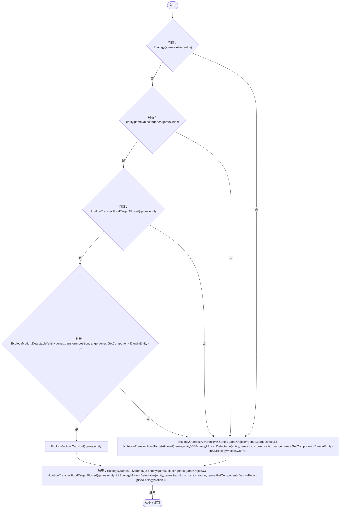

# EntityStateMotion.cs

[返回总索引](../README.md) · `Runtime` · `Assets/DarwinPark/Entities/Ecology/EntityStateMotion.cs`

[源文件](../../../Assets/DarwinPark/Entities/Ecology/EntityStateMotion.cs) · 源码校验：`d00e2d3f02d627a63577038dbfe3b59fac7aef44b08d15b6e9083082ac76a235`

方法按源文件位置排列。事件/回调引用不表示立即执行；分支与异常说明见总索引。完整源码与可点击关系图请打开离线手册。

## Directive · L9

`public static bool Directive(EntityGeneController genes,out Vector3 point,out DarwinEntity target,out float multiplier)`

### Editor / Player · Roslyn编译器控制流

项目内调用/回调引用：

- [TerritoryBehavior.PatrolDestination · L65](19d504dcdc8bc624.md#m4c3ffae68a7fb8fb)（方法）
- [NutritionTransfer.CanHuntForFood · L26](081d3b8ff683e442.md#m2962d3f47f91a266)（方法）
- [EntityGeneController.GetAttribute · L225](7494d53178552f0e.md#mc707943b1138a009)（方法）
- [EntityStateMotion.Valid · L22](d5c725c964fe5c61.md#m09473bfc4cfa75e4)（局部函数）
- [EntityStateController.DetectedTarget.get · L16](0f8869eb7018091e.md#m2d23280359000fb2)（访问器）
- [EntityStateController.HuntTarget.set · L17](0f8869eb7018091e.md#m447c608b233cf9c4)（访问器）
- [EntityStateController.HuntTarget.get · L17](0f8869eb7018091e.md#m8930cfbad73407a2)（访问器）

## Valid · L22

`bool Valid(DarwinEntity entity)`

### Editor / Player · Roslyn编译器控制流

项目内调用/回调引用：

- [EcologyQueries.Alive · L38](bdf7ccc2c9c0452f.md#mb2877c487f449970)（方法）
- [NutritionTransfer.FoodTargetAllowed · L31](081d3b8ff683e442.md#m9a5b5e120aa5f815)（方法）
- [EcologyMotion.Detectable · L61](6ed9d0eedb456d32.md#m24ba4bf4b1ca5c20)（方法）
- [EcologyMotion.CanHunt · L38](6ed9d0eedb456d32.md#m4271864b37a65a94)（方法）
