# WorldSaveStore.cs

[返回总索引](../README.md) · `Runtime` · `Assets/DarwinPark/UI/WorldSaveStore.cs`

[源文件](../../../Assets/DarwinPark/UI/WorldSaveStore.cs) · 源码校验：`dd4ca8b30cecc42182577415ac8f141895b43988b8603abb2554bb5227d8cf42`

方法按源文件位置排列。事件/回调引用不表示立即执行；分支与异常说明见总索引。完整源码与可点击关系图请打开离线手册。

## DefaultName · L40

`public static string DefaultName(int seed)`

### Editor / Player · Roslyn编译器控制流

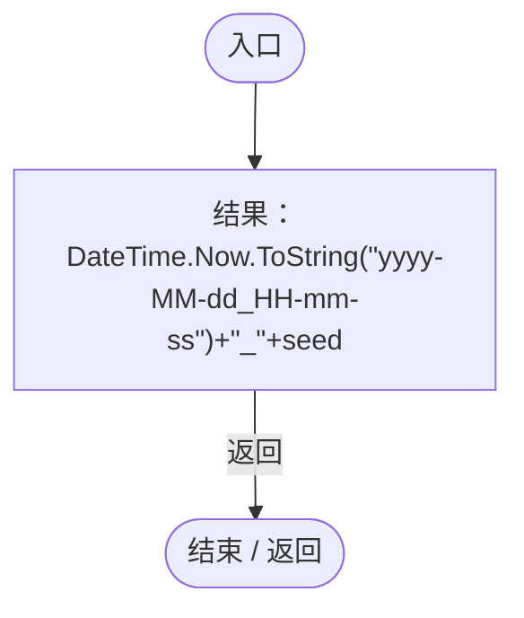

## SeedFromText · L42

`public static int SeedFromText(string text)`

★ 新增：文字种子使用稳定哈希，不能使用跨进程/平台会变化的 string.GetHashCode。

### Editor / Player · Roslyn编译器控制流

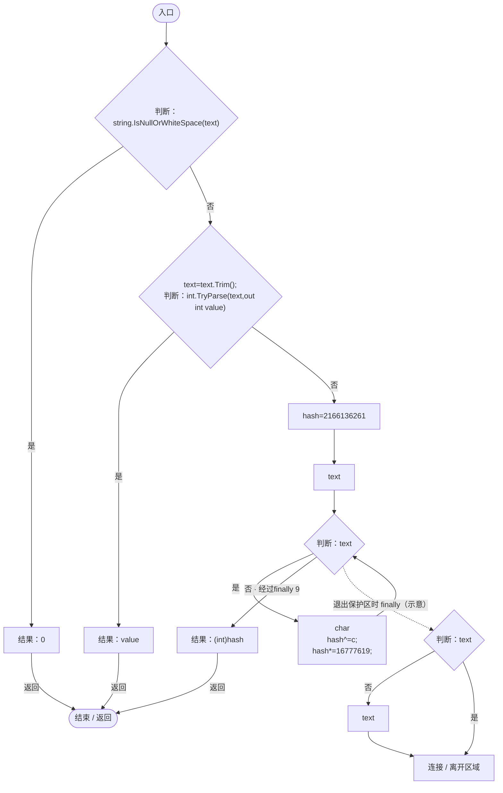

## FileFor · L48

`public static string FileFor(string id)`

### Editor / Player · Roslyn编译器控制流

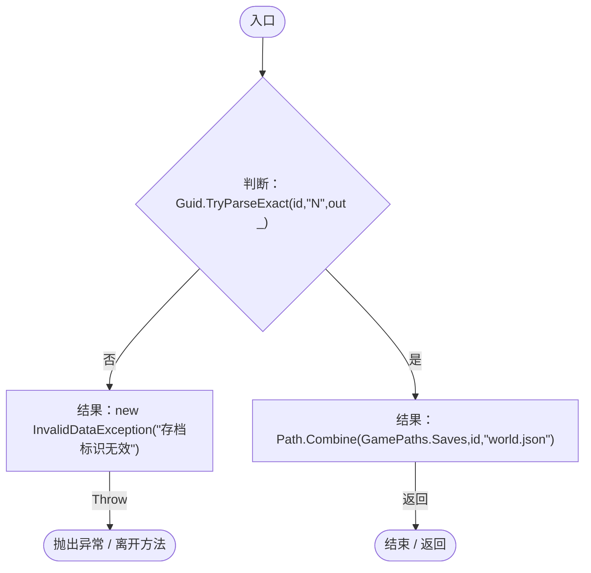

## List · L54

`public static List<WorldSaveEntry> List()`

### Editor / Player · Roslyn编译器控制流

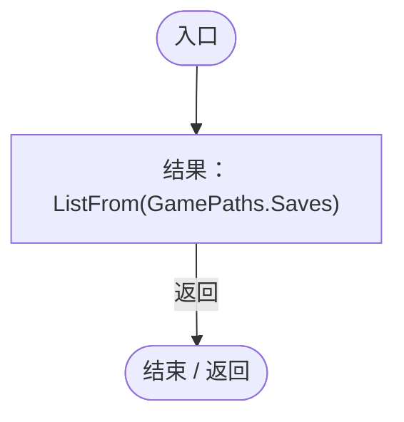

项目内调用/回调引用：

- [WorldSaveStore.ListFrom · L59](d67a35e5e3814c15.md#m378328ae174525db)（方法）

## ListFrom · L59

`public static List<WorldSaveEntry> ListFrom(string root)`

★ 适配：同时发现新目录和旧单文件；同一世界优先显示新格式，损坏文件仍明确列出。

### Editor / Player · Roslyn编译器控制流

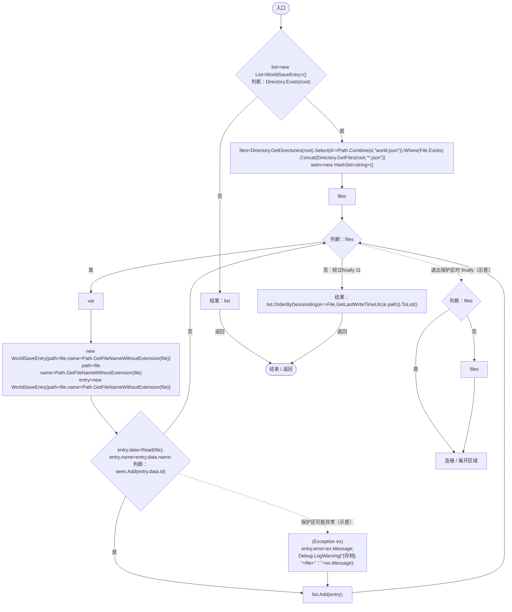

项目内调用/回调引用：

- [WorldSaveStore.Read · L72](d67a35e5e3814c15.md#mca362c7675a5800c)（方法）
- [WorldSaveStore.回调@62 · L62](d67a35e5e3814c15.md#m277fefb856bc1e85)（回调/委托）
- [WorldSaveStore.回调@70 · L70](d67a35e5e3814c15.md#me9019158cb948303)（回调/委托）

## 回调@62 · L62

`d … => 回调`

### Editor / Player · Roslyn编译器控制流

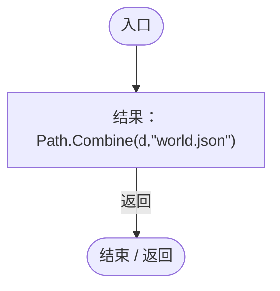

## 回调@70 · L70

`e … => 回调`

### Editor / Player · Roslyn编译器控制流

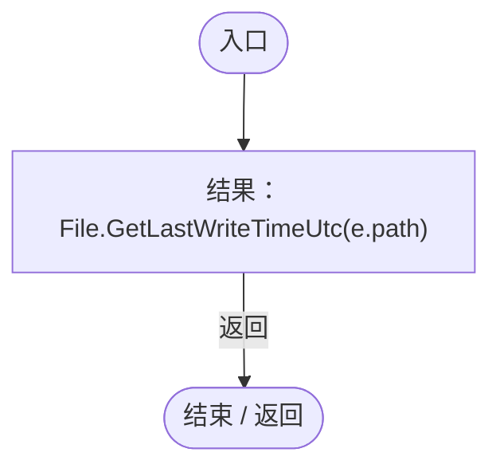

## Read · L72

`public static WorldSaveData Read(string path)`

### Editor / Player · Roslyn编译器控制流

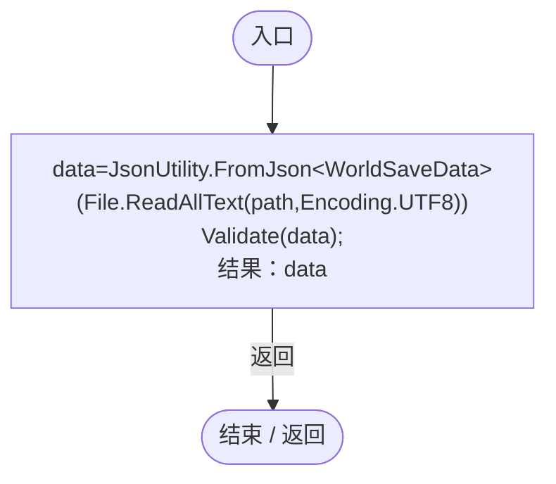

项目内调用/回调引用：

- [WorldSaveStore.Validate · L73](d67a35e5e3814c15.md#mb2f88d55be126f07)（方法）

## Validate · L73

`public static void Validate(WorldSaveData data)`

### Editor / Player · Roslyn编译器控制流

```mermaid
flowchart TD
  b0(["入口"])
  b1{"判断：data==null"}
  b2{"判断：data.version!=1"}
  b3{"判断：Guid.TryParseExact(data.id,&quot;N&quot;,out _)"}
  b4{"判断：string.IsNullOrWhiteSpace(data.name)"}
  b5{"判断：string.IsNullOrWhiteSpace(data.terrainParameters)"}
  b6{"判断：string.IsNullOrWhiteSpace(data.environmentParameters)"}
  b7{"判断：data.entities==null"}
  b8{"判断：data.definitions==null"}
  b9{"判断：data.definitions.Any(d=&gt;d==null&#124;&#124;string.IsNullOrEmpty(d.id))"}
  b10["结果：new InvalidDataException(&quot;存档格式或版本无效&quot;)"]
  x10(["抛出异常 / 离开方法"])
  b11["data.gameSettings=WorldGameSettings.Normalize(data.gameSettings);<br/>data.colony=DarwinPark.Entities.Ecology.EcologyDefaults.PrepareSnapshot(data.colony);<br/>DarwinPark.Entities.Ecology.ColonyWorldState.Validate(data.colony);"]
  b12["data.entities"]
  b13{"判断：data.entities"}
  b14["var"]
  b15{"entity<br/>判断：entity"}
  b16[".ecology"]
  b17{"判断：.ecology"}
  b18[".ant"]
  b19["entity?.ecology?.ant"]
  b20["DarwinPark.Entities.Ecology.ColonyWorldState.ValidateMember(entity?.ecology?.ant);"]
  b21["data.entities"]
  b22["data.entities"]
  b23{"判断：data.entities"}
  b24["var"]
  b25{"entity<br/>判断：entity"}
  b26[".ecology"]
  b27["entity"]
  b28["DarwinPark.Entities.Ecology.ColonyWorldState.ValidateMotion(entity?.ecology);"]
  b29["data.entities"]
  b30{"判断：float.IsNaN(data.gameTime)"}
  b31{"判断：float.IsInfinity(data.gameTime)"}
  b32{"判断：data.gameTime&lt;0"}
  b33["结果：new InvalidDataException(&quot;存档时间无效&quot;)"]
  x33(["抛出异常 / 离开方法"])
  b34{"判断：float.IsNaN(data.timeScale)"}
  b35{"判断：float.IsInfinity(data.timeScale)"}
  b36{"判断：data.timeScale&lt;0"}
  b37["结果：new InvalidDataException(&quot;存档时间倍率无效&quot;)"]
  x37(["抛出异常 / 离开方法"])
  b38{"terrain=JsonUtility.FromJson&lt;TerrainSaveValidation&gt;(data.terrainParameters)<br/>判断：terrain==null"}
  b39{"判断：terrain.subdivisions&lt;2"}
  b40{"判断：terrain.subdivisions&gt;1024"}
  b41{"判断：Finite(terrain.radius)"}
  b42{"判断：terrain.radius&lt;=0"}
  b43{"判断：Finite(terrain.heightScale)"}
  b44{"判断：Finite(terrain.continentRatio)"}
  b45{"判断：terrain.continentRatio&lt;=0"}
  b46{"判断：terrain.continentRatio&gt;=1"}
  b47["结果：new InvalidDataException(&quot;地形参数无效&quot;)"]
  x47(["抛出异常 / 离开方法"])
  b48{"environment=JsonUtility.FromJson&lt;EnvironmentSaveValidation&gt;(data.environmentParameters)<br/>判断：environment==null"}
  b49{"判断：Finite(environment.BaseTemperature)"}
  b50{"判断：Finite(environment.BaseHumidity)"}
  b51["结果：new InvalidDataException(&quot;环境参数无效&quot;)"]
  x51(["抛出异常 / 离开方法"])
  b52{"catalog=data.definitions.ToDictionary(d=&gt;d.id,d=&gt;d.json)<br/>判断：catalog.Count==0"}
  b53["结果：new InvalidDataException(&quot;存档基因配置为空&quot;)"]
  x53(["抛出异常 / 离开方法"])
  b54["GeneTreeStorage.Validate(data.tree,catalog);<br/>PopulationMaintenance.Validate(data.maintenance,catalog.Keys);"]
  b55{"data.colony<br/>判断：data.colony"}
  b56[".ecologyDefaults"]
  b57["data.colony"]
  b58["DarwinPark.Entities.Ecology.EcologyDefaults.ValidateCatalog(data.colony?.ecologyDefaults,catalog.Keys);"]
  b59["data.definitions"]
  b60{"判断：data.definitions"}
  b61["var<br/>definition.json=catalog[definition.id];"]
  b62["data.definitions"]
  b63["catalog"]
  b64{"判断：catalog"}
  b65{"var<br/>判断：data.definitions.All(d=&gt;d.id!=entry.Key)"}
  b66["data.definitions<br/>new SavedGeneDefinition{id=entry.Key,json=entry.Value}<br/>id=entry.Key<br/>json=entry.Value<br/>data.definitions.Add(new SavedGeneDefinition{id=entry.Key,json=entry.Value});"]
  b67["catalog"]
  b68["catalog"]
  b69{"判断：catalog"}
  b70["var"]
  b71{"gene=JsonUtility.FromJson&lt;GeneDefinitionJson&gt;(definition.Value)<br/>判断：gene==null"}
  b72{"判断：gene.id!=definition.Key"}
  b73{"判断：Enum.TryParse&lt;GeneCategory&gt;(gene.category,true,out _)"}
  b74["结果：new InvalidDataException(&quot;基因配置无效：&quot;+definition.Key)"]
  x74(["抛出异常 / 离开方法"])
  b75["catalog"]
  b76["EntityStateSaveValidation.Validate(data);"]
  b77{"判断：string.IsNullOrWhiteSpace(data.ecologyBalanceSettings)"}
  b78["DarwinPark.Entities.Ecology.EcologyBalanceSettings.ReadConfiguredJson()"]
  b79["data.ecologyBalanceSettings"]
  b80["DarwinPark.Entities.Ecology.EcologyBalanceSettings.Parse(string.IsNullOrWhiteSpace(data.ecologyBalanceSettings)?DarwinPark.Entities.Ecology.EcologyBalanceSettings.ReadConfiguredJson():data.ecologyBalanceSettings);"]
  b81["data.entities"]
  b82{"判断：data.entities"}
  b83["var"]
  b84{"entity<br/>判断：entity"}
  b85[".ecology"]
  b86{"判断：.ecology"}
  b87[".IsEmpty"]
  b88["entity?.ecology?.IsEmpty"]
  b89{"判断：entity?.ecology?.IsEmpty==true"}
  b90["entity.ecology=null;"]
  b91{"判断：entity.genome==null"}
  b92{"判断：entity.genome.Genes==null"}
  b93{"判断：entity.stats==null"}
  b94{"判断：entity.reproduction==null"}
  b95{"判断：entity.traits==null"}
  b96["结果：new InvalidDataException(&quot;实体存档不完整&quot;)"]
  x96(["抛出异常 / 离开方法"])
  b97{"判断：Finite(entity.pendingSimulationTime)"}
  b98{"判断：entity.pendingSimulationTime&lt;0"}
  b99["结果：new InvalidDataException(&quot;实体合并计算时间无效&quot;)"]
  x99(["抛出异常 / 离开方法"])
  b100["entity.reproduction"]
  b101{"判断：entity.reproduction"}
  b102["var"]
  b103{"reproduction<br/>判断：reproduction"}
  b104[".litter"]
  b105["reproduction"]
  b106["DarwinPark.Entities.Logic.MultipleBirthPolicy.Validate(reproduction?.litter);"]
  b107["entity.reproduction"]
  b108{"判断：entity.reproduction.Any(r=&gt;r==null&#124;&#124;!Finite(r.mateWait)&#124;&#124;r.mateWait&lt;0&#124;&#124;!Finite(r.maintenanceWait)&#124;&#124;r.maintenanceWait&lt;0&#124;&#124;r.parthenogenetic&amp;&amp;r.partner?.Genes?.Count&gt;0)"}
  b109["结果：new InvalidDataException(&quot;繁殖等待状态无效&quot;)"]
  x109(["抛出异常 / 离开方法"])
  b110{"判断：entity.genome.Genes.Any(g=&gt;!catalog.ContainsKey(g.DefinitionId))"}
  b111["结果：new InvalidDataException(&quot;实体引用缺失基因&quot;)"]
  x111(["抛出异常 / 离开方法"])
  b112{"DarwinPark.Entities.Ecology.NutritionSaveValidation.Validate(entity.ecology,catalog.Keys);<br/>判断：entity.ecology!=null"}
  b113{"判断：Guid.TryParseExact(entity.ecology.id,&quot;N&quot;,out _)"}
  b114{"判断：Finite(entity.ecology.evictionRemaining)"}
  b115{"判断：Finite(entity.ecology.commandRemaining)"}
  b116{"判断：Finite(entity.ecology.incubationRemaining)"}
  b117["结果：new InvalidDataException(&quot;生态状态或实体标识无效&quot;)"]
  x117(["抛出异常 / 离开方法"])
  b118["data.entities"]
  b119{"ids=data.entities.Where(e=&gt;e.ecology!=null).Select(e=&gt;e.ecology.id).ToList()<br/>判断：ids.Count!=ids.Distinct().Count()"}
  b120["结果：new InvalidDataException(&quot;实体持久化标识重复&quot;)"]
  x120(["抛出异常 / 离开方法"])
  b121{"判断：data.ore!=null"}
  b122{"判断：data.oreResolution&lt;1"}
  b123{"判断：data.ore.Length!=(long)data.oreResolution*data.oreResolution"}
  b124["结果：new InvalidDataException(&quot;矿脉数据不完整&quot;)"]
  x124(["抛出异常 / 离开方法"])
  b125(["结束 / 返回"])
  b0 --> b1
  b1 -->|"否"| b2
  b1 -->|"是"| b10
  b2 -->|"否"| b3
  b2 -->|"是"| b10
  b3 -->|"是"| b4
  b3 -->|"否"| b10
  b4 -->|"否"| b5
  b4 -->|"是"| b10
  b5 -->|"否"| b6
  b5 -->|"是"| b10
  b6 -->|"否"| b7
  b6 -->|"是"| b10
  b7 -->|"否"| b8
  b7 -->|"是"| b10
  b8 -->|"否"| b9
  b8 -->|"是"| b10
  b9 -->|"是"| b10
  b9 -->|"否"| b11
  b10 -->|"Throw"| x10
  b11 --> b12
  b12 --> b13
  b13 -->|"是"| b14
  b13 -->|"否 · 经过finally 21"| b22
  b14 --> b15
  b15 -->|"否"| b16
  b15 -->|"是"| b19
  b16 --> b17
  b17 -->|"否"| b18
  b17 -->|"是"| b19
  b18 --> b20
  b19 --> b20
  b20 --> b13
  b22 --> b23
  b23 -->|"是"| b24
  b23 -->|"否 · 经过finally 29"| b30
  b24 --> b25
  b25 -->|"否"| b26
  b25 -->|"是"| b27
  b26 --> b28
  b27 --> b28
  b28 --> b23
  b30 -->|"否"| b31
  b30 -->|"是"| b33
  b31 -->|"否"| b32
  b31 -->|"是"| b33
  b32 -->|"是"| b33
  b32 -->|"否"| b34
  b33 -->|"Throw"| x33
  b34 -->|"否"| b35
  b34 -->|"是"| b37
  b35 -->|"否"| b36
  b35 -->|"是"| b37
  b36 -->|"是"| b37
  b36 -->|"否"| b38
  b37 -->|"Throw"| x37
  b38 -->|"否"| b39
  b38 -->|"是"| b47
  b39 -->|"否"| b40
  b39 -->|"是"| b47
  b40 -->|"否"| b41
  b40 -->|"是"| b47
  b41 -->|"是"| b42
  b41 -->|"否"| b47
  b42 -->|"否"| b43
  b42 -->|"是"| b47
  b43 -->|"是"| b44
  b43 -->|"否"| b47
  b44 -->|"是"| b45
  b44 -->|"否"| b47
  b45 -->|"否"| b46
  b45 -->|"是"| b47
  b46 -->|"是"| b47
  b46 -->|"否"| b48
  b47 -->|"Throw"| x47
  b48 -->|"否"| b49
  b48 -->|"是"| b51
  b49 -->|"是"| b50
  b49 -->|"否"| b51
  b50 -->|"否"| b51
  b50 -->|"是"| b52
  b51 -->|"Throw"| x51
  b52 -->|"是"| b53
  b52 -->|"否"| b54
  b53 -->|"Throw"| x53
  b54 --> b55
  b55 -->|"否"| b56
  b55 -->|"是"| b57
  b56 --> b58
  b57 --> b58
  b58 --> b59
  b59 --> b60
  b60 -->|"是"| b61
  b60 -->|"否 · 经过finally 62"| b63
  b61 --> b60
  b63 --> b64
  b64 -->|"是"| b65
  b64 -->|"否 · 经过finally 67"| b68
  b65 -->|"是"| b66
  b65 -->|"否"| b64
  b66 --> b64
  b68 --> b69
  b69 -->|"是"| b70
  b69 -->|"否 · 经过finally 75"| b76
  b70 --> b71
  b71 -->|"否"| b72
  b71 -->|"是"| b74
  b72 -->|"否"| b73
  b72 -->|"是"| b74
  b73 -->|"否"| b74
  b73 -->|"是"| b69
  b74 -->|"Throw"| x74
  b76 --> b77
  b77 -->|"是"| b78
  b77 -->|"否"| b79
  b78 --> b80
  b79 --> b80
  b80 --> b81
  b81 --> b82
  b82 -->|"是"| b83
  b82 -->|"否 · 经过finally 118"| b119
  b83 --> b84
  b84 -->|"否"| b85
  b84 -->|"是"| b88
  b85 --> b86
  b86 -->|"否"| b87
  b86 -->|"是"| b88
  b87 --> b89
  b88 --> b89
  b89 -->|"是"| b90
  b89 -->|"否"| b91
  b90 --> b91
  b91 -->|"否"| b92
  b91 -->|"是"| b96
  b92 -->|"否"| b93
  b92 -->|"是"| b96
  b93 -->|"否"| b94
  b93 -->|"是"| b96
  b94 -->|"否"| b95
  b94 -->|"是"| b96
  b95 -->|"是"| b96
  b95 -->|"否"| b97
  b96 -->|"Throw"| x96
  b97 -->|"是"| b98
  b97 -->|"否"| b99
  b98 -->|"是"| b99
  b98 -->|"否"| b100
  b99 -->|"Throw"| x99
  b100 --> b101
  b101 -->|"是"| b102
  b101 -->|"否 · 经过finally 107"| b108
  b102 --> b103
  b103 -->|"否"| b104
  b103 -->|"是"| b105
  b104 --> b106
  b105 --> b106
  b106 --> b101
  b108 -->|"是"| b109
  b108 -->|"否"| b110
  b109 -->|"Throw"| x109
  b110 -->|"是"| b111
  b110 -->|"否"| b112
  b111 -->|"Throw"| x111
  b112 -->|"是"| b113
  b112 -->|"否"| b82
  b113 -->|"是"| b114
  b113 -->|"否"| b117
  b114 -->|"是"| b115
  b114 -->|"否"| b117
  b115 -->|"是"| b116
  b115 -->|"否"| b117
  b116 -->|"否"| b117
  b116 -->|"是"| b82
  b117 -->|"Throw"| x117
  b119 -->|"是"| b120
  b119 -->|"否"| b121
  b120 -->|"Throw"| x120
  b121 -->|"是"| b122
  b121 -->|"否"| b125
  b122 -->|"否"| b123
  b122 -->|"是"| b124
  b123 -->|"是"| b124
  b123 -->|"否"| b125
  b124 -->|"Throw"| x124
  b13 -. "退出保护区时 finally（示意）" .-> b21
  b23 -. "退出保护区时 finally（示意）" .-> b29
  b60 -. "退出保护区时 finally（示意）" .-> b62
  b64 -. "退出保护区时 finally（示意）" .-> b67
  b69 -. "退出保护区时 finally（示意）" .-> b75
  b101 -. "退出保护区时 finally（示意）" .-> b107
  b82 -. "退出保护区时 finally（示意）" .-> b118

```

项目内调用/回调引用：

- [WorldGameSettings.Normalize · L12](44f717c5df79d270.md#m61ad45483cbf0aa2)（方法）
- [EcologyDefaults.PrepareSnapshot · L56](5b565b57de741d98.md#m5d36c2a4736b2a4b)（方法）
- [ColonyWorldState.Validate · L18](50d866ed6b21d869.md#mfed2400744335199)（方法）
- [ColonyWorldState.ValidateMember · L41](50d866ed6b21d869.md#m36cd5f82989daa78)（方法）
- [ColonyWorldState.ValidateMotion · L60](50d866ed6b21d869.md#mb738866be3f25c30)（方法）
- [WorldSaveStore.Finite · L123](d67a35e5e3814c15.md#m2aca126b0d2ab014)（方法）
- [GeneTreeStorage.Validate · L69](a885bad0d7dedee8.md#m6d65229e98b963db)（方法）
- [PopulationMaintenance.Validate · L141](923ccc4e86c4786c.md#mbf373379bf39ce13)（方法）
- [EcologyDefaults.ValidateCatalog · L62](5b565b57de741d98.md#mccd0da6a4d9f3921)（方法）
- [EntityStateSaveValidation.Validate · L12](c02a83cd0790720c.md#md11c937324d810c7)（方法）
- [EcologyBalanceSettings.Parse · L31](5a37bc79f15f6238.md#m044d17a39c22d55a)（方法）
- [EcologyBalanceSettings.ReadConfiguredJson · L23](5a37bc79f15f6238.md#md3cac56b60832ffc)（方法）
- [MultipleBirthPolicy.Validate · L22](337309de03d51a54.md#m7658bbc276e60f89)（方法）
- [NutritionSaveValidation.Validate · L11](f62a3371065beeb4.md#m7f56eaa9737e049c)（方法）
- [WorldSaveStore.回调@75 · L75](d67a35e5e3814c15.md#m2eb22efcf589afd8)（回调/委托）
- [WorldSaveStore.回调@90 · L90](d67a35e5e3814c15.md#m699e1107cf633aa2)（回调/委托）
- [WorldSaveStore.回调@90 · L90](d67a35e5e3814c15.md#mb29646da257829da)（回调/委托）
- [WorldSaveStore.回调@97 · L97](d67a35e5e3814c15.md#m1e73c40c15e3a79a)（回调/委托）
- [WorldSaveStore.回调@111 · L111](d67a35e5e3814c15.md#m12a05c8c187d357c)（回调/委托）
- [WorldSaveStore.回调@112 · L112](d67a35e5e3814c15.md#m28480c83862399d3)（回调/委托）
- [WorldSaveStore.回调@117 · L117](d67a35e5e3814c15.md#m462ccf761f8bbea3)（回调/委托）
- [WorldSaveStore.回调@117 · L117](d67a35e5e3814c15.md#mce7bb67dcc6ccd8b)（回调/委托）

## 回调@75 · L75

`d … => 回调`

### Editor / Player · Roslyn编译器控制流

```mermaid
flowchart TD
  b0(["入口"])
  b1{"判断：d==null"}
  b2["string.IsNullOrEmpty(d.id)"]
  b3["d==null"]
  b4["结果：d==null&#124;&#124;string.IsNullOrEmpty(d.id)"]
  b5(["结束 / 返回"])
  b0 --> b1
  b1 -->|"否"| b2
  b1 -->|"是"| b3
  b2 --> b4
  b3 --> b4
  b4 -->|"返回"| b5

```

## 回调@90 · L90

`d … => 回调`

### Editor / Player · Roslyn编译器控制流

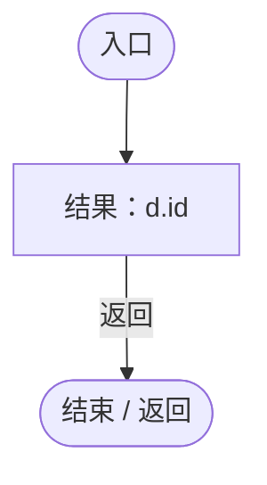

## 回调@90 · L90

`d … => 回调`

### Editor / Player · Roslyn编译器控制流

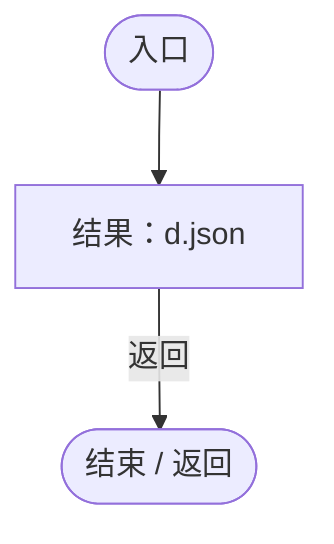

## 回调@97 · L97

`d … => 回调`

### Editor / Player · Roslyn编译器控制流

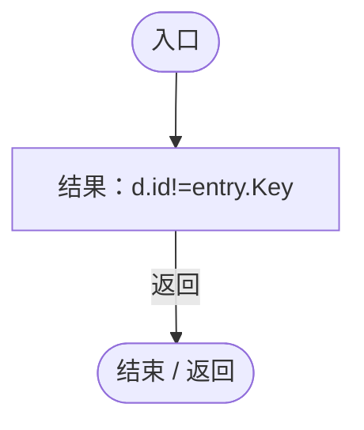

## 回调@111 · L111

`r … => 回调`

### Editor / Player · Roslyn编译器控制流

```mermaid
flowchart TD
  b0(["入口"])
  b1{"判断：r==null"}
  b2{"判断：Finite(r.mateWait)"}
  b3{"判断：r.mateWait&lt;0"}
  b4{"判断：Finite(r.maintenanceWait)"}
  b5{"判断：r.maintenanceWait&lt;0"}
  b6{"判断：r.parthenogenetic"}
  b7{"r.partner<br/>判断：r.partner"}
  b8[".Genes"]
  b9{"判断：.Genes"}
  b10[".Count"]
  b11["r.partner?.Genes?.Count"]
  b12["r.partner?.Genes?.Count&gt;0"]
  b13["r.parthenogenetic"]
  b14["r==null&#124;&#124;!Finite(r.mateWait)&#124;&#124;r.mateWait&lt;0&#124;&#124;!Finite(r.maintenanceWait)&#124;&#124;r.maintenanceWait&lt;0&#124;&#124;r.parthenogenetic&amp;&amp;r.partner?.Genes?.Count&gt;0"]
  b15["结果：r==null&#124;&#124;!Finite(r.mateWait)&#124;&#124;r.mateWait&lt;0&#124;&#124;!Finite(r.maintenanceWait)&#124;&#124;r.maintenanceWait&lt;0&#124;&#124;r.parthenogenetic&amp;&amp;r.partner?.Genes?.Count&gt;0"]
  b16(["结束 / 返回"])
  b0 --> b1
  b1 -->|"否"| b2
  b1 -->|"是"| b14
  b2 -->|"是"| b3
  b2 -->|"否"| b14
  b3 -->|"否"| b4
  b3 -->|"是"| b14
  b4 -->|"是"| b5
  b4 -->|"否"| b14
  b5 -->|"否"| b6
  b5 -->|"是"| b14
  b6 -->|"是"| b7
  b6 -->|"否"| b13
  b7 -->|"否"| b8
  b7 -->|"是"| b11
  b8 --> b9
  b9 -->|"否"| b10
  b9 -->|"是"| b11
  b10 --> b12
  b11 --> b12
  b12 --> b15
  b13 --> b15
  b14 --> b15
  b15 -->|"返回"| b16

```

项目内调用/回调引用：

- [WorldSaveStore.Finite · L123](d67a35e5e3814c15.md#m2aca126b0d2ab014)（方法）

## 回调@112 · L112

`g … => 回调`

### Editor / Player · Roslyn编译器控制流

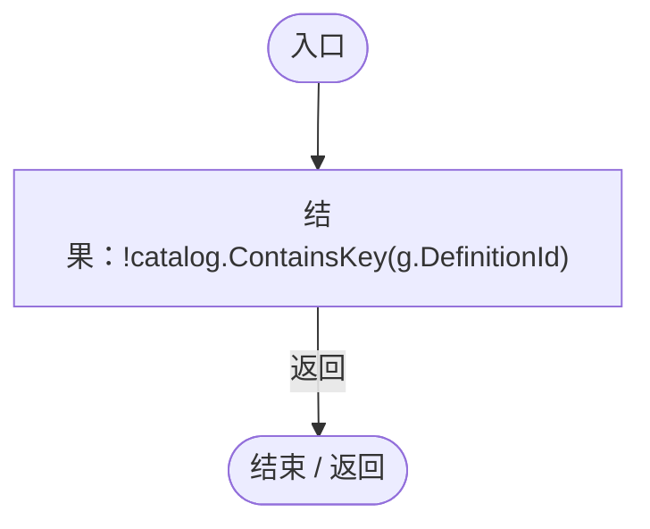

## 回调@117 · L117

`e … => 回调`

### Editor / Player · Roslyn编译器控制流

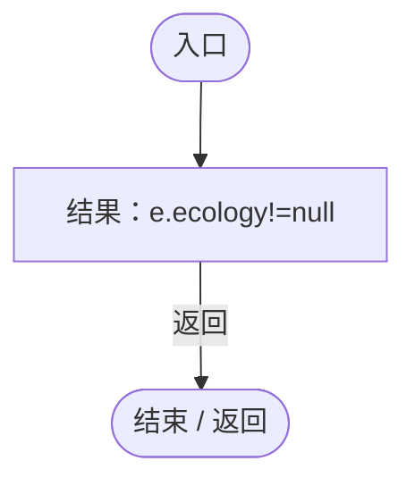

## 回调@117 · L117

`e … => 回调`

### Editor / Player · Roslyn编译器控制流

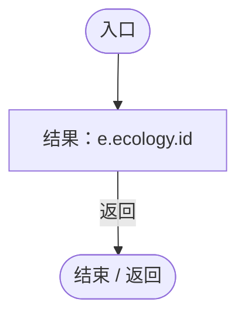

## Finite · L123

`private static bool Finite(float value)`

### Editor / Player · Roslyn编译器控制流

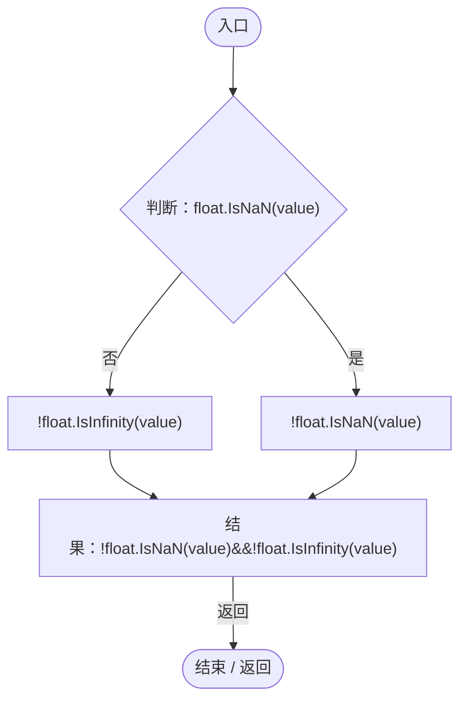

## Write · L124

`public static void Write(WorldSaveData data,string overridePath=null)`

### Editor / Player · Roslyn编译器控制流

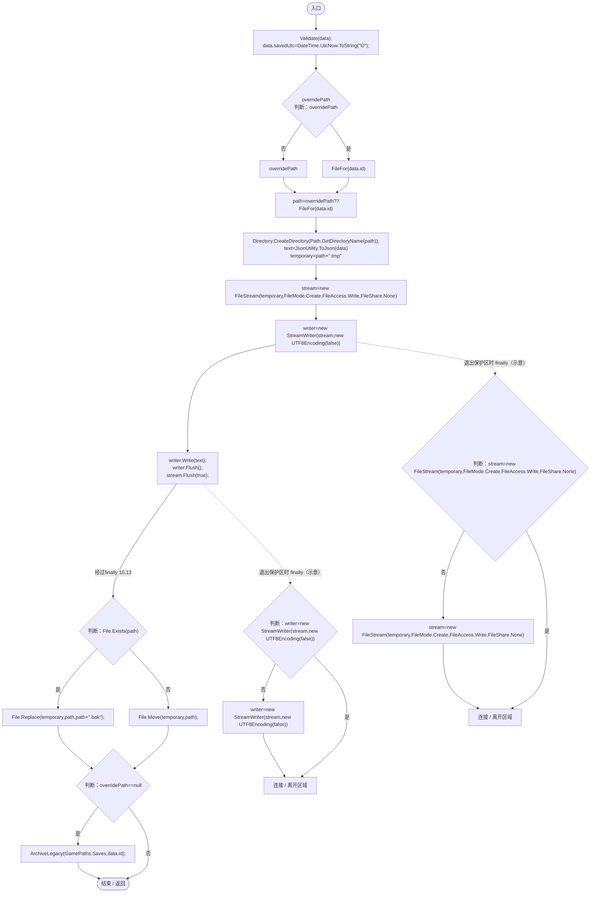

项目内调用/回调引用：

- [WorldSaveStore.Validate · L73](d67a35e5e3814c15.md#mb2f88d55be126f07)（方法）
- [WorldSaveStore.FileFor · L48](d67a35e5e3814c15.md#m419a625e2bcc70f8)（方法）
- [WorldSaveStore.ArchiveLegacy · L134](d67a35e5e3814c15.md#mfbba8334644b6ba6)（方法）

## ArchiveLegacy · L134

`public static void ArchiveLegacy(string root,string id)`

### Editor / Player · Roslyn编译器控制流

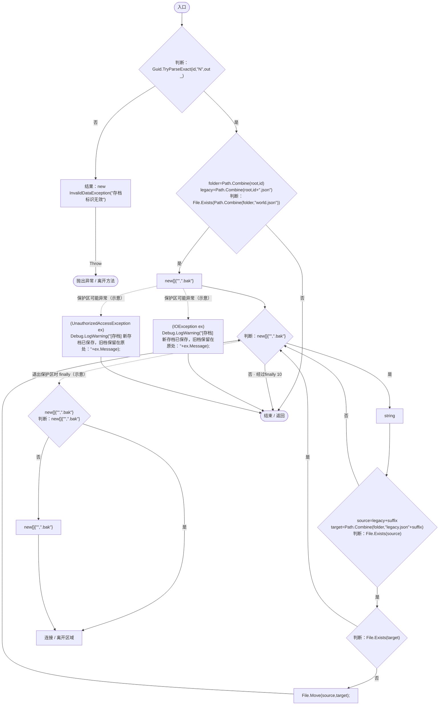
