# WorldSaveStore.cs

[返回总索引](../README.md) · `Runtime` · `Assets/DarwinPark/UI/WorldSaveStore.cs`

[源文件](../../../Assets/DarwinPark/UI/WorldSaveStore.cs) · 源码校验：`20b155059c88364948f11fc7d4800376ef280d236998c625637a489426ac1f34`

方法按源文件位置排列。事件/回调引用不表示立即执行；分支与异常说明见总索引。完整源码与可点击关系图请打开离线手册。

## DefaultName · L40

`public static string DefaultName(int seed)`

### Editor / Player · Roslyn编译器控制流

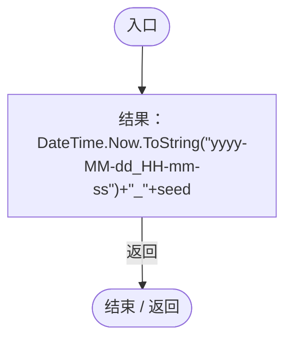

## SeedFromText · L42

`public static int SeedFromText(string text)`

★ 新增：文字种子使用稳定哈希，不能使用跨进程/平台会变化的 string.GetHashCode。

### Editor / Player · Roslyn编译器控制流

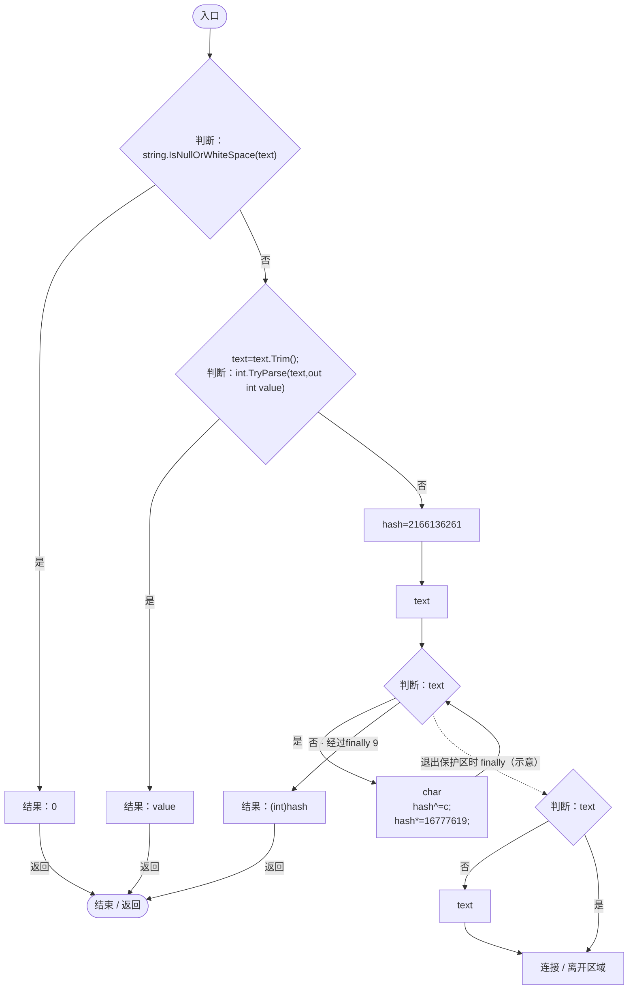

## FileFor · L48

`public static string FileFor(string id)`

### Editor / Player · Roslyn编译器控制流

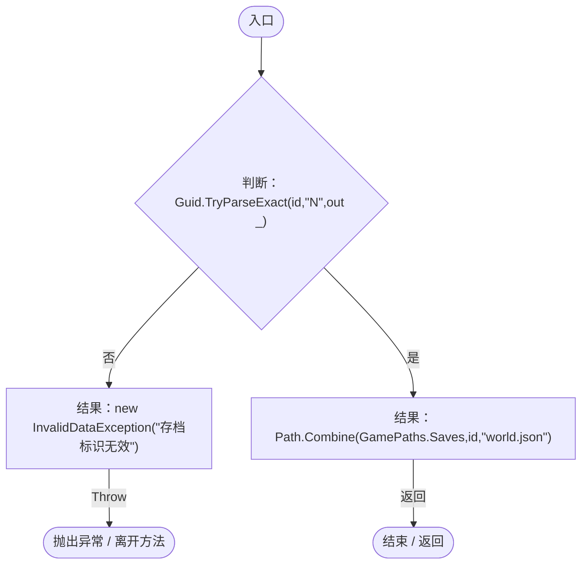

## List · L54

`public static List<WorldSaveEntry> List()`

### Editor / Player · Roslyn编译器控制流

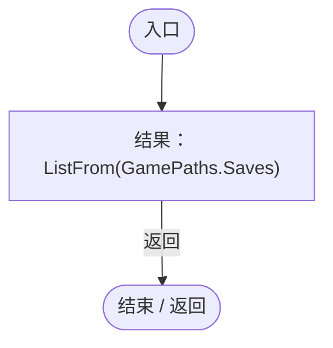

项目内调用/回调引用：

- [WorldSaveStore.ListFrom · L59](d67a35e5e3814c15.md#m378328ae174525db)（方法）

## ListFrom · L59

`public static List<WorldSaveEntry> ListFrom(string root)`

★ 适配：同时发现新目录和旧单文件；同一世界优先显示新格式，损坏文件仍明确列出。

### Editor / Player · Roslyn编译器控制流

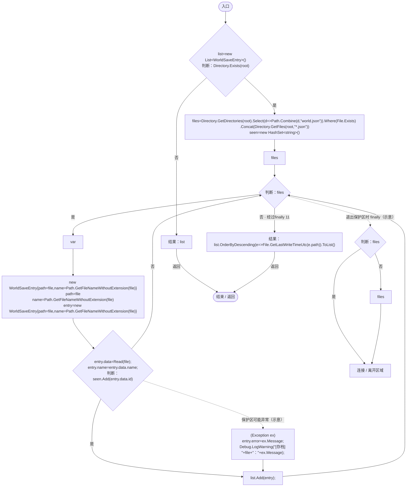

项目内调用/回调引用：

- [WorldSaveStore.Read · L72](d67a35e5e3814c15.md#mca362c7675a5800c)（方法）
- [WorldSaveStore.回调@62 · L62](d67a35e5e3814c15.md#m277fefb856bc1e85)（回调/委托）
- [WorldSaveStore.回调@70 · L70](d67a35e5e3814c15.md#me9019158cb948303)（回调/委托）

## 回调@62 · L62

`d … => 回调`

### Editor / Player · Roslyn编译器控制流

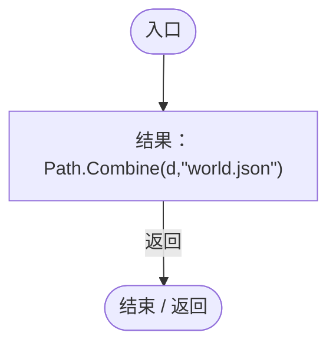

## 回调@70 · L70

`e … => 回调`

### Editor / Player · Roslyn编译器控制流

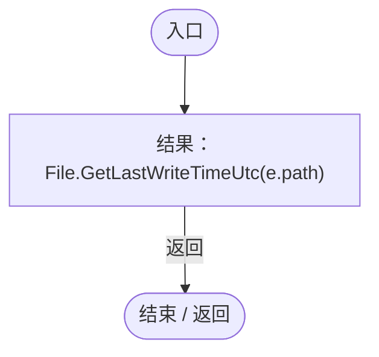

## Read · L72

`public static WorldSaveData Read(string path)`

### Editor / Player · Roslyn编译器控制流

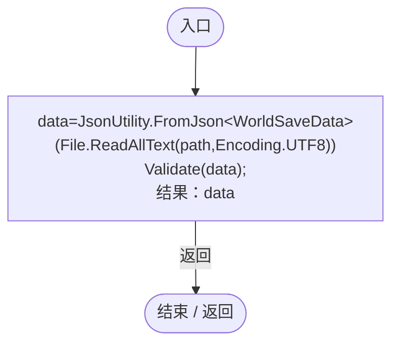

项目内调用/回调引用：

- [WorldSaveStore.Validate · L73](d67a35e5e3814c15.md#mb2f88d55be126f07)（方法）

## Validate · L73

`public static void Validate(WorldSaveData data)`

### Editor / Player · Roslyn编译器控制流

```mermaid
flowchart TD
  b0(["入口"])
  b1{"判断：data==null"}
  b2{"判断：data.version!=1"}
  b3{"判断：Guid.TryParseExact(data.id,&quot;N&quot;,out _)"}
  b4{"判断：string.IsNullOrWhiteSpace(data.name)"}
  b5{"判断：string.IsNullOrWhiteSpace(data.terrainParameters)"}
  b6{"判断：string.IsNullOrWhiteSpace(data.environmentParameters)"}
  b7{"判断：data.entities==null"}
  b8{"判断：data.definitions==null"}
  b9{"判断：data.definitions.Any(d=&gt;d==null&#124;&#124;string.IsNullOrEmpty(d.id))"}
  b10["结果：new InvalidDataException(&quot;存档格式或版本无效&quot;)"]
  x10(["抛出异常 / 离开方法"])
  b11["data.gameSettings=WorldGameSettings.Normalize(data.gameSettings);<br/>DarwinPark.Entities.Ecology.ColonyWorldState.Validate(data.colony);"]
  b12["data.entities"]
  b13{"判断：data.entities"}
  b14["var"]
  b15{"entity<br/>判断：entity"}
  b16[".ecology"]
  b17{"判断：.ecology"}
  b18[".ant"]
  b19["entity?.ecology?.ant"]
  b20["DarwinPark.Entities.Ecology.ColonyWorldState.ValidateMember(entity?.ecology?.ant);"]
  b21["data.entities"]
  b22["data.entities"]
  b23{"判断：data.entities"}
  b24["var"]
  b25{"entity<br/>判断：entity"}
  b26[".ecology"]
  b27["entity"]
  b28["DarwinPark.Entities.Ecology.ColonyWorldState.ValidateMotion(entity?.ecology);"]
  b29["data.entities"]
  b30{"判断：float.IsNaN(data.gameTime)"}
  b31{"判断：float.IsInfinity(data.gameTime)"}
  b32{"判断：data.gameTime&lt;0"}
  b33["结果：new InvalidDataException(&quot;存档时间无效&quot;)"]
  x33(["抛出异常 / 离开方法"])
  b34{"判断：float.IsNaN(data.timeScale)"}
  b35{"判断：float.IsInfinity(data.timeScale)"}
  b36{"判断：data.timeScale&lt;0"}
  b37["结果：new InvalidDataException(&quot;存档时间倍率无效&quot;)"]
  x37(["抛出异常 / 离开方法"])
  b38{"terrain=JsonUtility.FromJson&lt;TerrainSaveValidation&gt;(data.terrainParameters)<br/>判断：terrain==null"}
  b39{"判断：terrain.subdivisions&lt;2"}
  b40{"判断：terrain.subdivisions&gt;1024"}
  b41{"判断：Finite(terrain.radius)"}
  b42{"判断：terrain.radius&lt;=0"}
  b43{"判断：Finite(terrain.heightScale)"}
  b44{"判断：Finite(terrain.continentRatio)"}
  b45{"判断：terrain.continentRatio&lt;=0"}
  b46{"判断：terrain.continentRatio&gt;=1"}
  b47["结果：new InvalidDataException(&quot;地形参数无效&quot;)"]
  x47(["抛出异常 / 离开方法"])
  b48{"environment=JsonUtility.FromJson&lt;EnvironmentSaveValidation&gt;(data.environmentParameters)<br/>判断：environment==null"}
  b49{"判断：Finite(environment.BaseTemperature)"}
  b50{"判断：Finite(environment.BaseHumidity)"}
  b51["结果：new InvalidDataException(&quot;环境参数无效&quot;)"]
  x51(["抛出异常 / 离开方法"])
  b52{"catalog=data.definitions.ToDictionary(d=&gt;d.id,d=&gt;d.json)<br/>判断：catalog.Count==0"}
  b53["结果：new InvalidDataException(&quot;存档基因配置为空&quot;)"]
  x53(["抛出异常 / 离开方法"])
  b54["GeneTreeStorage.Validate(data.tree,catalog);<br/>PopulationMaintenance.Validate(data.maintenance,catalog.Keys);"]
  b55["data.definitions"]
  b56{"判断：data.definitions"}
  b57["var<br/>definition.json=catalog[definition.id];"]
  b58["data.definitions"]
  b59["catalog"]
  b60{"判断：catalog"}
  b61{"var<br/>判断：data.definitions.All(d=&gt;d.id!=entry.Key)"}
  b62["data.definitions<br/>new SavedGeneDefinition{id=entry.Key,json=entry.Value}<br/>id=entry.Key<br/>json=entry.Value<br/>data.definitions.Add(new SavedGeneDefinition{id=entry.Key,json=entry.Value});"]
  b63["catalog"]
  b64["catalog"]
  b65{"判断：catalog"}
  b66["var"]
  b67{"gene=JsonUtility.FromJson&lt;GeneDefinitionJson&gt;(definition.Value)<br/>判断：gene==null"}
  b68{"判断：gene.id!=definition.Key"}
  b69{"判断：Enum.TryParse&lt;GeneCategory&gt;(gene.category,true,out _)"}
  b70["结果：new InvalidDataException(&quot;基因配置无效：&quot;+definition.Key)"]
  x70(["抛出异常 / 离开方法"])
  b71["catalog"]
  b72["EntityStateSaveValidation.Validate(data);"]
  b73{"判断：string.IsNullOrWhiteSpace(data.ecologyBalanceSettings)"}
  b74["DarwinPark.Entities.Ecology.EcologyBalanceSettings.ReadConfiguredJson()"]
  b75["data.ecologyBalanceSettings"]
  b76["DarwinPark.Entities.Ecology.EcologyBalanceSettings.Parse(string.IsNullOrWhiteSpace(data.ecologyBalanceSettings)?DarwinPark.Entities.Ecology.EcologyBalanceSettings.ReadConfiguredJson():data.ecologyBalanceSettings);"]
  b77["data.entities"]
  b78{"判断：data.entities"}
  b79["var"]
  b80{"entity<br/>判断：entity"}
  b81[".ecology"]
  b82{"判断：.ecology"}
  b83[".IsEmpty"]
  b84["entity?.ecology?.IsEmpty"]
  b85{"判断：entity?.ecology?.IsEmpty==true"}
  b86["entity.ecology=null;"]
  b87{"判断：entity.genome==null"}
  b88{"判断：entity.genome.Genes==null"}
  b89{"判断：entity.stats==null"}
  b90{"判断：entity.reproduction==null"}
  b91{"判断：entity.traits==null"}
  b92["结果：new InvalidDataException(&quot;实体存档不完整&quot;)"]
  x92(["抛出异常 / 离开方法"])
  b93{"判断：entity.reproduction.Any(r=&gt;r==null&#124;&#124;!Finite(r.mateWait)&#124;&#124;r.mateWait&lt;0&#124;&#124;!Finite(r.maintenanceWait)&#124;&#124;r.maintenanceWait&lt;0&#124;&#124;r.parthenogenetic&amp;&amp;r.partner?.Genes?.Count&gt;0)"}
  b94["结果：new InvalidDataException(&quot;繁殖等待状态无效&quot;)"]
  x94(["抛出异常 / 离开方法"])
  b95{"判断：entity.genome.Genes.Any(g=&gt;!catalog.ContainsKey(g.DefinitionId))"}
  b96["结果：new InvalidDataException(&quot;实体引用缺失基因&quot;)"]
  x96(["抛出异常 / 离开方法"])
  b97{"DarwinPark.Entities.Ecology.NutritionSaveValidation.Validate(entity.ecology,catalog.Keys);<br/>判断：entity.ecology!=null"}
  b98{"判断：Guid.TryParseExact(entity.ecology.id,&quot;N&quot;,out _)"}
  b99{"判断：Finite(entity.ecology.evictionRemaining)"}
  b100{"判断：Finite(entity.ecology.commandRemaining)"}
  b101{"判断：Finite(entity.ecology.incubationRemaining)"}
  b102["结果：new InvalidDataException(&quot;生态状态或实体标识无效&quot;)"]
  x102(["抛出异常 / 离开方法"])
  b103["data.entities"]
  b104{"ids=data.entities.Where(e=&gt;e.ecology!=null).Select(e=&gt;e.ecology.id).ToList()<br/>判断：ids.Count!=ids.Distinct().Count()"}
  b105["结果：new InvalidDataException(&quot;实体持久化标识重复&quot;)"]
  x105(["抛出异常 / 离开方法"])
  b106{"判断：data.ore!=null"}
  b107{"判断：data.oreResolution&lt;1"}
  b108{"判断：data.ore.Length!=(long)data.oreResolution*data.oreResolution"}
  b109["结果：new InvalidDataException(&quot;矿脉数据不完整&quot;)"]
  x109(["抛出异常 / 离开方法"])
  b110(["结束 / 返回"])
  b0 --> b1
  b1 -->|"否"| b2
  b1 -->|"是"| b10
  b2 -->|"否"| b3
  b2 -->|"是"| b10
  b3 -->|"是"| b4
  b3 -->|"否"| b10
  b4 -->|"否"| b5
  b4 -->|"是"| b10
  b5 -->|"否"| b6
  b5 -->|"是"| b10
  b6 -->|"否"| b7
  b6 -->|"是"| b10
  b7 -->|"否"| b8
  b7 -->|"是"| b10
  b8 -->|"否"| b9
  b8 -->|"是"| b10
  b9 -->|"是"| b10
  b9 -->|"否"| b11
  b10 -->|"Throw"| x10
  b11 --> b12
  b12 --> b13
  b13 -->|"是"| b14
  b13 -->|"否 · 经过finally 21"| b22
  b14 --> b15
  b15 -->|"否"| b16
  b15 -->|"是"| b19
  b16 --> b17
  b17 -->|"否"| b18
  b17 -->|"是"| b19
  b18 --> b20
  b19 --> b20
  b20 --> b13
  b22 --> b23
  b23 -->|"是"| b24
  b23 -->|"否 · 经过finally 29"| b30
  b24 --> b25
  b25 -->|"否"| b26
  b25 -->|"是"| b27
  b26 --> b28
  b27 --> b28
  b28 --> b23
  b30 -->|"否"| b31
  b30 -->|"是"| b33
  b31 -->|"否"| b32
  b31 -->|"是"| b33
  b32 -->|"是"| b33
  b32 -->|"否"| b34
  b33 -->|"Throw"| x33
  b34 -->|"否"| b35
  b34 -->|"是"| b37
  b35 -->|"否"| b36
  b35 -->|"是"| b37
  b36 -->|"是"| b37
  b36 -->|"否"| b38
  b37 -->|"Throw"| x37
  b38 -->|"否"| b39
  b38 -->|"是"| b47
  b39 -->|"否"| b40
  b39 -->|"是"| b47
  b40 -->|"否"| b41
  b40 -->|"是"| b47
  b41 -->|"是"| b42
  b41 -->|"否"| b47
  b42 -->|"否"| b43
  b42 -->|"是"| b47
  b43 -->|"是"| b44
  b43 -->|"否"| b47
  b44 -->|"是"| b45
  b44 -->|"否"| b47
  b45 -->|"否"| b46
  b45 -->|"是"| b47
  b46 -->|"是"| b47
  b46 -->|"否"| b48
  b47 -->|"Throw"| x47
  b48 -->|"否"| b49
  b48 -->|"是"| b51
  b49 -->|"是"| b50
  b49 -->|"否"| b51
  b50 -->|"否"| b51
  b50 -->|"是"| b52
  b51 -->|"Throw"| x51
  b52 -->|"是"| b53
  b52 -->|"否"| b54
  b53 -->|"Throw"| x53
  b54 --> b55
  b55 --> b56
  b56 -->|"是"| b57
  b56 -->|"否 · 经过finally 58"| b59
  b57 --> b56
  b59 --> b60
  b60 -->|"是"| b61
  b60 -->|"否 · 经过finally 63"| b64
  b61 -->|"是"| b62
  b61 -->|"否"| b60
  b62 --> b60
  b64 --> b65
  b65 -->|"是"| b66
  b65 -->|"否 · 经过finally 71"| b72
  b66 --> b67
  b67 -->|"否"| b68
  b67 -->|"是"| b70
  b68 -->|"否"| b69
  b68 -->|"是"| b70
  b69 -->|"否"| b70
  b69 -->|"是"| b65
  b70 -->|"Throw"| x70
  b72 --> b73
  b73 -->|"是"| b74
  b73 -->|"否"| b75
  b74 --> b76
  b75 --> b76
  b76 --> b77
  b77 --> b78
  b78 -->|"是"| b79
  b78 -->|"否 · 经过finally 103"| b104
  b79 --> b80
  b80 -->|"否"| b81
  b80 -->|"是"| b84
  b81 --> b82
  b82 -->|"否"| b83
  b82 -->|"是"| b84
  b83 --> b85
  b84 --> b85
  b85 -->|"是"| b86
  b85 -->|"否"| b87
  b86 --> b87
  b87 -->|"否"| b88
  b87 -->|"是"| b92
  b88 -->|"否"| b89
  b88 -->|"是"| b92
  b89 -->|"否"| b90
  b89 -->|"是"| b92
  b90 -->|"否"| b91
  b90 -->|"是"| b92
  b91 -->|"是"| b92
  b91 -->|"否"| b93
  b92 -->|"Throw"| x92
  b93 -->|"是"| b94
  b93 -->|"否"| b95
  b94 -->|"Throw"| x94
  b95 -->|"是"| b96
  b95 -->|"否"| b97
  b96 -->|"Throw"| x96
  b97 -->|"是"| b98
  b97 -->|"否"| b78
  b98 -->|"是"| b99
  b98 -->|"否"| b102
  b99 -->|"是"| b100
  b99 -->|"否"| b102
  b100 -->|"是"| b101
  b100 -->|"否"| b102
  b101 -->|"否"| b102
  b101 -->|"是"| b78
  b102 -->|"Throw"| x102
  b104 -->|"是"| b105
  b104 -->|"否"| b106
  b105 -->|"Throw"| x105
  b106 -->|"是"| b107
  b106 -->|"否"| b110
  b107 -->|"否"| b108
  b107 -->|"是"| b109
  b108 -->|"是"| b109
  b108 -->|"否"| b110
  b109 -->|"Throw"| x109
  b13 -. "退出保护区时 finally（示意）" .-> b21
  b23 -. "退出保护区时 finally（示意）" .-> b29
  b56 -. "退出保护区时 finally（示意）" .-> b58
  b60 -. "退出保护区时 finally（示意）" .-> b63
  b65 -. "退出保护区时 finally（示意）" .-> b71
  b78 -. "退出保护区时 finally（示意）" .-> b103

```

项目内调用/回调引用：

- [WorldGameSettings.Normalize · L12](44f717c5df79d270.md#m61ad45483cbf0aa2)（方法）
- [ColonyWorldState.Validate · L16](50d866ed6b21d869.md#m8da7d1a3858b9c67)（方法）
- [ColonyWorldState.ValidateMember · L36](50d866ed6b21d869.md#m71ca74d44558d30a)（方法）
- [ColonyWorldState.ValidateMotion · L53](50d866ed6b21d869.md#m5d412c5da3de1783)（方法）
- [WorldSaveStore.Finite · L116](d67a35e5e3814c15.md#mbf3a00da81a0818e)（方法）
- [GeneTreeStorage.Validate · L67](a885bad0d7dedee8.md#m3371bf1e3c5ae267)（方法）
- [PopulationMaintenance.Validate · L122](923ccc4e86c4786c.md#m0c29d6aef903cb75)（方法）
- [EntityStateSaveValidation.Validate · L12](c02a83cd0790720c.md#md11c937324d810c7)（方法）
- [EcologyBalanceSettings.Parse · L31](5a37bc79f15f6238.md#m044d17a39c22d55a)（方法）
- [EcologyBalanceSettings.ReadConfiguredJson · L23](5a37bc79f15f6238.md#md3cac56b60832ffc)（方法）
- [NutritionSaveValidation.Validate · L11](f62a3371065beeb4.md#m7f56eaa9737e049c)（方法）
- [WorldSaveStore.回调@75 · L75](d67a35e5e3814c15.md#m2eb22efcf589afd8)（回调/委托）
- [WorldSaveStore.回调@88 · L88](d67a35e5e3814c15.md#mc4a95436a7e617d9)（回调/委托）
- [WorldSaveStore.回调@88 · L88](d67a35e5e3814c15.md#m74965ca6808e260b)（回调/委托）
- [WorldSaveStore.回调@93 · L93](d67a35e5e3814c15.md#md3d9cc10aa313e23)（回调/委托）
- [WorldSaveStore.回调@104 · L104](d67a35e5e3814c15.md#m1a6b7d666e416cf5)（回调/委托）
- [WorldSaveStore.回调@105 · L105](d67a35e5e3814c15.md#me98ab2de0fdd4cf4)（回调/委托）
- [WorldSaveStore.回调@110 · L110](d67a35e5e3814c15.md#mdb3127b420a91efa)（回调/委托）
- [WorldSaveStore.回调@110 · L110](d67a35e5e3814c15.md#m89107aa29bc47afa)（回调/委托）

## 回调@75 · L75

`d … => 回调`

### Editor / Player · Roslyn编译器控制流

```mermaid
flowchart TD
  b0(["入口"])
  b1{"判断：d==null"}
  b2["string.IsNullOrEmpty(d.id)"]
  b3["d==null"]
  b4["结果：d==null&#124;&#124;string.IsNullOrEmpty(d.id)"]
  b5(["结束 / 返回"])
  b0 --> b1
  b1 -->|"否"| b2
  b1 -->|"是"| b3
  b2 --> b4
  b3 --> b4
  b4 -->|"返回"| b5

```

## 回调@88 · L88

`d … => 回调`

### Editor / Player · Roslyn编译器控制流

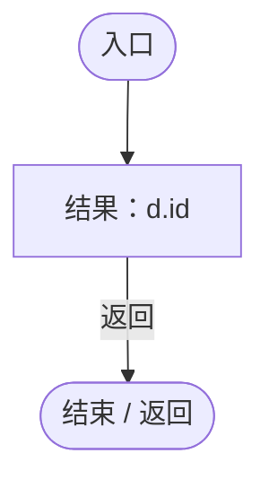

## 回调@88 · L88

`d … => 回调`

### Editor / Player · Roslyn编译器控制流

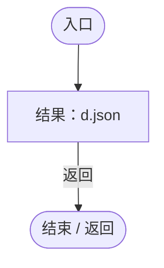

## 回调@93 · L93

`d … => 回调`

### Editor / Player · Roslyn编译器控制流

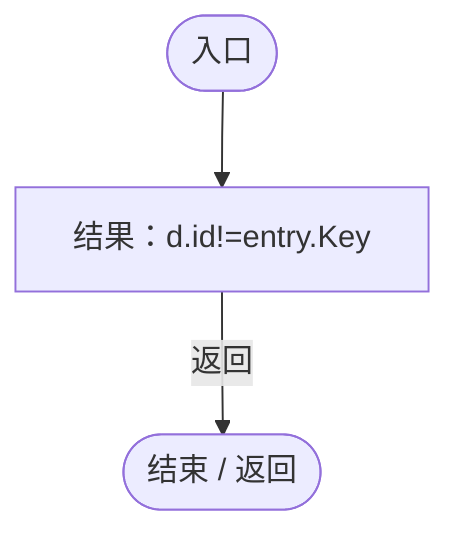

## 回调@104 · L104

`r … => 回调`

### Editor / Player · Roslyn编译器控制流

```mermaid
flowchart TD
  b0(["入口"])
  b1{"判断：r==null"}
  b2{"判断：Finite(r.mateWait)"}
  b3{"判断：r.mateWait&lt;0"}
  b4{"判断：Finite(r.maintenanceWait)"}
  b5{"判断：r.maintenanceWait&lt;0"}
  b6{"判断：r.parthenogenetic"}
  b7{"r.partner<br/>判断：r.partner"}
  b8[".Genes"]
  b9{"判断：.Genes"}
  b10[".Count"]
  b11["r.partner?.Genes?.Count"]
  b12["r.partner?.Genes?.Count&gt;0"]
  b13["r.parthenogenetic"]
  b14["r==null&#124;&#124;!Finite(r.mateWait)&#124;&#124;r.mateWait&lt;0&#124;&#124;!Finite(r.maintenanceWait)&#124;&#124;r.maintenanceWait&lt;0&#124;&#124;r.parthenogenetic&amp;&amp;r.partner?.Genes?.Count&gt;0"]
  b15["结果：r==null&#124;&#124;!Finite(r.mateWait)&#124;&#124;r.mateWait&lt;0&#124;&#124;!Finite(r.maintenanceWait)&#124;&#124;r.maintenanceWait&lt;0&#124;&#124;r.parthenogenetic&amp;&amp;r.partner?.Genes?.Count&gt;0"]
  b16(["结束 / 返回"])
  b0 --> b1
  b1 -->|"否"| b2
  b1 -->|"是"| b14
  b2 -->|"是"| b3
  b2 -->|"否"| b14
  b3 -->|"否"| b4
  b3 -->|"是"| b14
  b4 -->|"是"| b5
  b4 -->|"否"| b14
  b5 -->|"否"| b6
  b5 -->|"是"| b14
  b6 -->|"是"| b7
  b6 -->|"否"| b13
  b7 -->|"否"| b8
  b7 -->|"是"| b11
  b8 --> b9
  b9 -->|"否"| b10
  b9 -->|"是"| b11
  b10 --> b12
  b11 --> b12
  b12 --> b15
  b13 --> b15
  b14 --> b15
  b15 -->|"返回"| b16

```

项目内调用/回调引用：

- [WorldSaveStore.Finite · L116](d67a35e5e3814c15.md#mbf3a00da81a0818e)（方法）

## 回调@105 · L105

`g … => 回调`

### Editor / Player · Roslyn编译器控制流

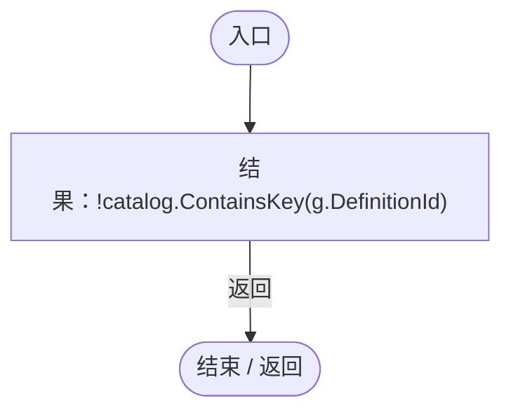

## 回调@110 · L110

`e … => 回调`

### Editor / Player · Roslyn编译器控制流

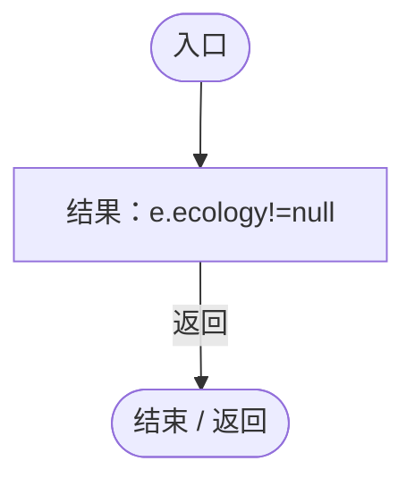

## 回调@110 · L110

`e … => 回调`

### Editor / Player · Roslyn编译器控制流

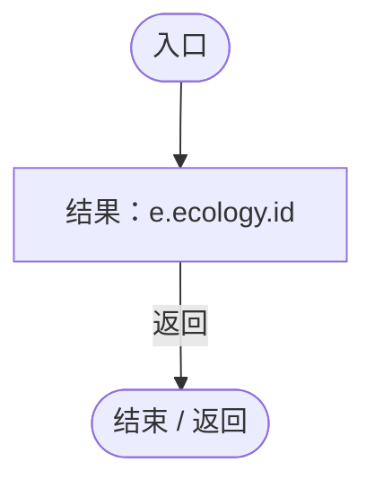

## Finite · L116

`private static bool Finite(float value)`

### Editor / Player · Roslyn编译器控制流

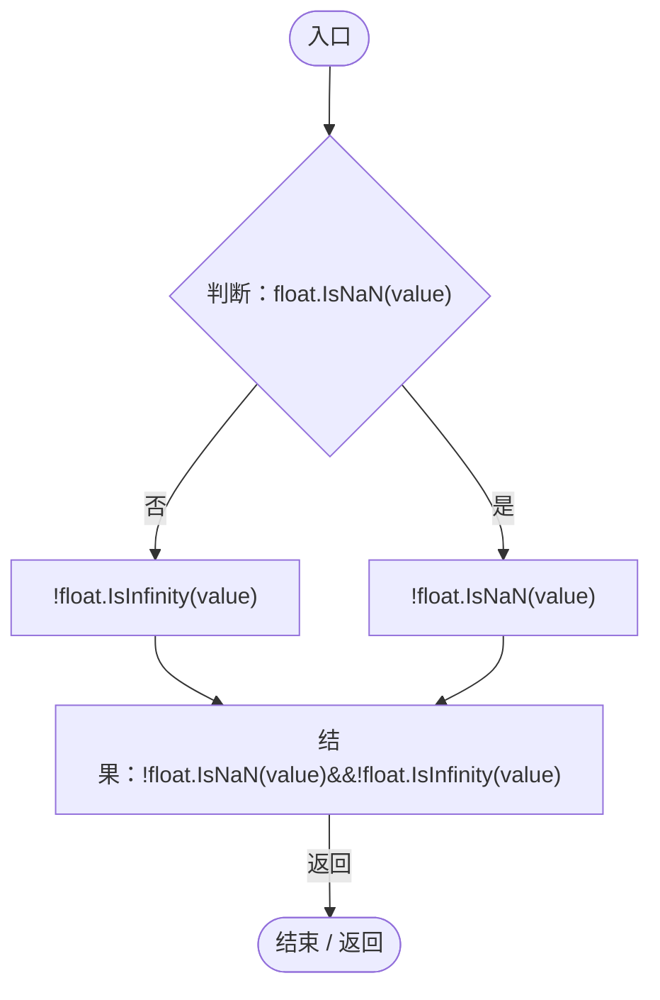

## Write · L117

`public static void Write(WorldSaveData data,string overridePath=null)`

### Editor / Player · Roslyn编译器控制流

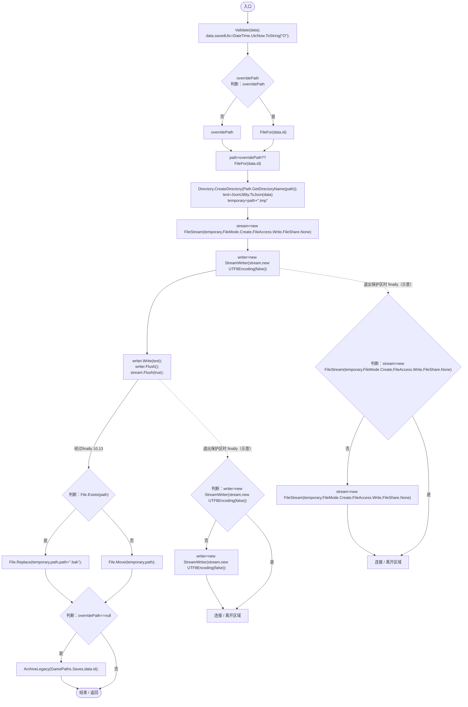

项目内调用/回调引用：

- [WorldSaveStore.Validate · L73](d67a35e5e3814c15.md#mb2f88d55be126f07)（方法）
- [WorldSaveStore.FileFor · L48](d67a35e5e3814c15.md#m419a625e2bcc70f8)（方法）
- [WorldSaveStore.ArchiveLegacy · L127](d67a35e5e3814c15.md#m10a3480fee036783)（方法）

## ArchiveLegacy · L127

`public static void ArchiveLegacy(string root,string id)`

### Editor / Player · Roslyn编译器控制流

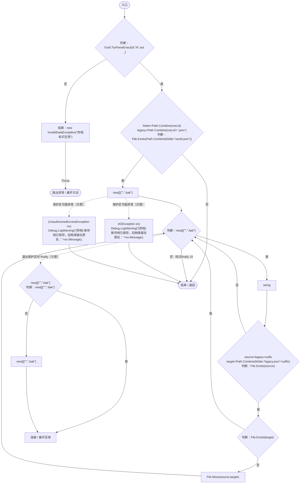
