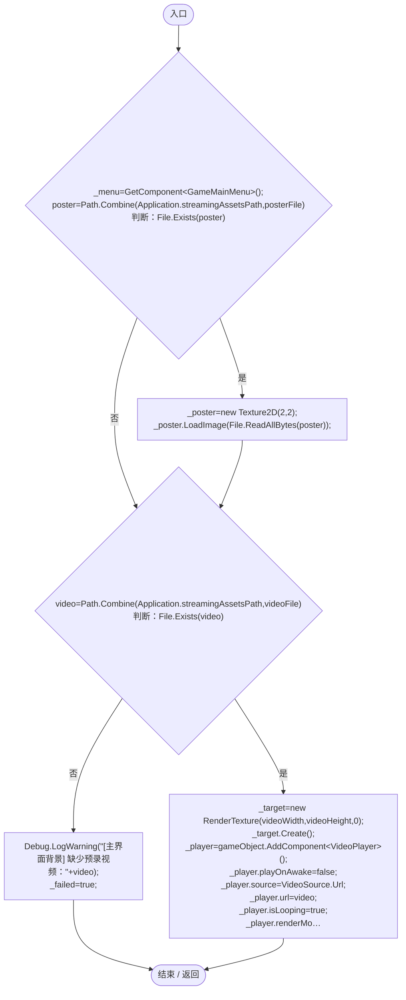
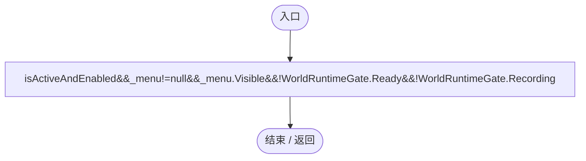
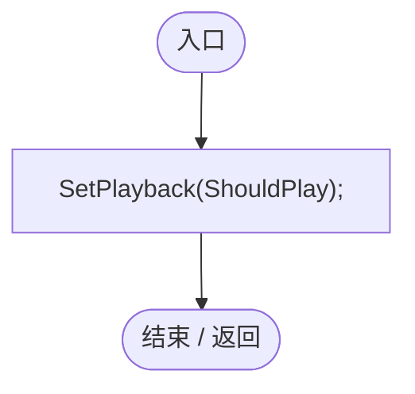
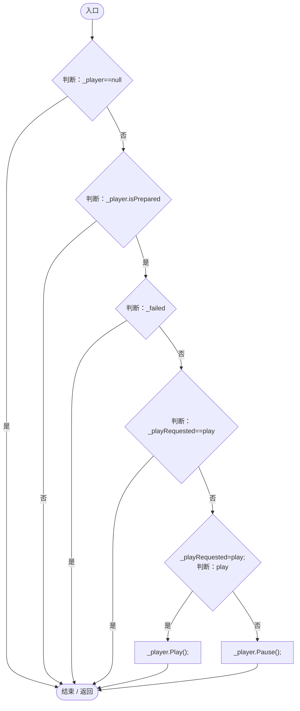
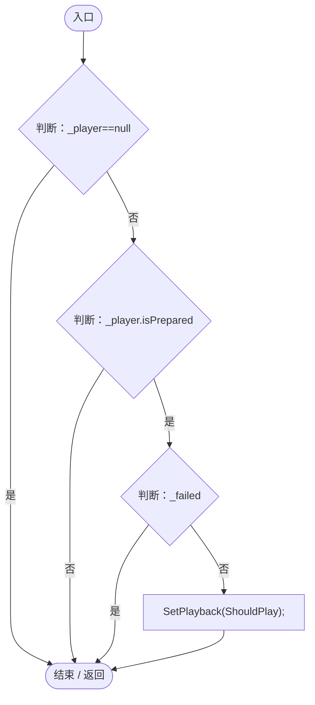
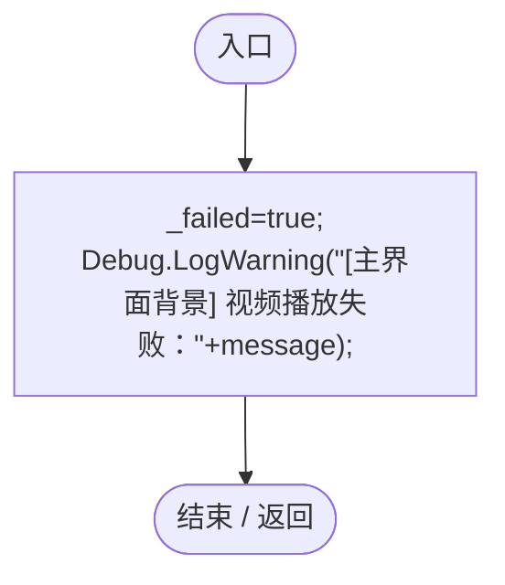
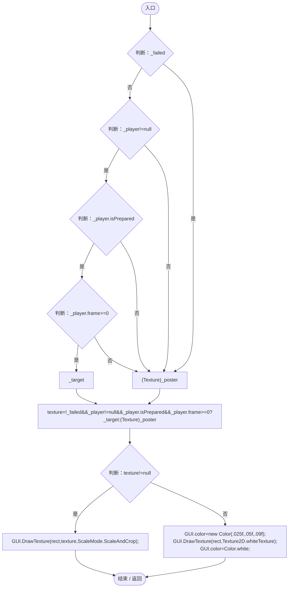
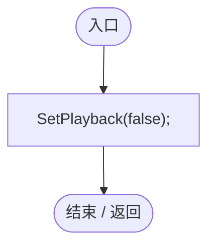
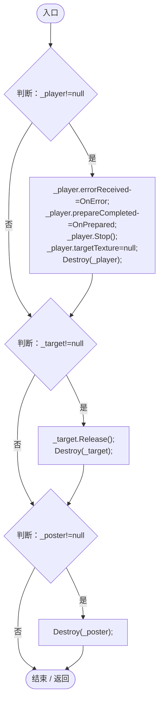

# MainMenuBackground.cs

[返回总索引](../README.md) · `Runtime` · `Assets/DarwinPark/UI/MainMenuBackground.cs`

[源文件](../../../Assets/DarwinPark/UI/MainMenuBackground.cs) · 源码校验：`577f866c120e04e554fe5af19b6e80a62b63122cbbb0ac6627e97725b476b75a`

方法按源文件位置排列。事件/回调引用不表示立即执行；分支与异常说明见总索引。完整源码与可点击关系图请打开离线手册。

## Start · L18

`private void Start()`

### Editor / Player · Roslyn编译器控制流

项目内调用/回调引用：

- [MainMenuBackground.OnError · L45](d7e7fc6417a3da62.md#m5a06a6362fd34ae5)（方法）
- [MainMenuBackground.OnPrepared · L33](d7e7fc6417a3da62.md#mf9af59083c2d01ac)（方法）

## ShouldPlay.get · L32

`private bool ShouldPlay`

### Editor / Player · 语法控制结构 / 声明（非CFG）

## OnPrepared · L33

`private void OnPrepared(VideoPlayer player)`

### Editor / Player · Roslyn编译器控制流

项目内调用/回调引用：

- [MainMenuBackground.SetPlayback · L35](d7e7fc6417a3da62.md#m3cac74be6bde3fa5)（方法）

## SetPlayback · L35

`private void SetPlayback(bool play)`

★ 修复（防Bug回归）：只在播放意图变化时调用解码器，循环/首帧尚未输出时不能每帧重复Play。

### Editor / Player · Roslyn编译器控制流

## Update · L40

`private void Update()`

### Editor / Player · Roslyn编译器控制流

项目内调用/回调引用：

- [MainMenuBackground.SetPlayback · L35](d7e7fc6417a3da62.md#m3cac74be6bde3fa5)（方法）

## OnError · L45

`private void OnError(VideoPlayer player,string message)`

### Editor / Player · Roslyn编译器控制流

## Draw · L46

`public void Draw(Rect rect)`

### Editor / Player · Roslyn编译器控制流

## OnDisable · L52

`private void OnDisable()`

### Editor / Player · Roslyn编译器控制流

项目内调用/回调引用：

- [MainMenuBackground.SetPlayback · L35](d7e7fc6417a3da62.md#m3cac74be6bde3fa5)（方法）

## OnDestroy · L53

`private void OnDestroy()`

### Editor / Player · Roslyn编译器控制流

项目内调用/回调引用：

- [MainMenuBackground.OnError · L45](d7e7fc6417a3da62.md#m5a06a6362fd34ae5)（方法）
- [MainMenuBackground.OnPrepared · L33](d7e7fc6417a3da62.md#mf9af59083c2d01ac)（方法）
