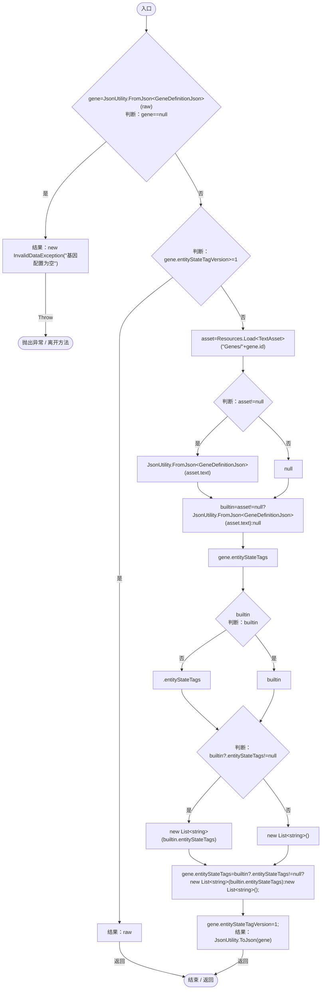
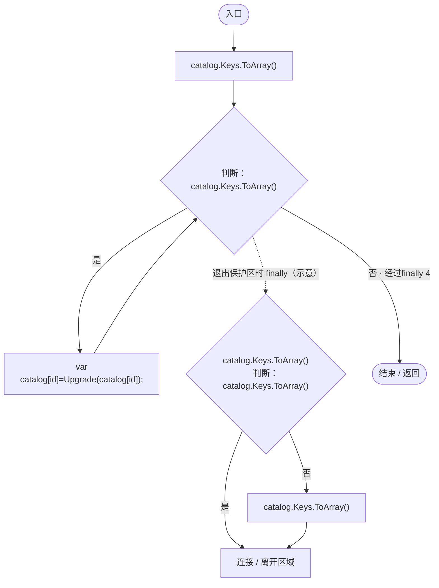
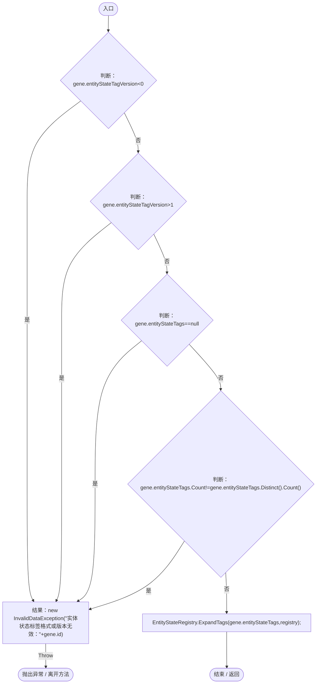
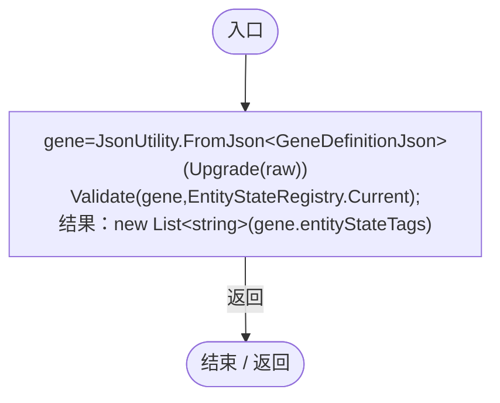

# GeneEntityStateTags.cs

[返回总索引](../README.md) · `Runtime` · `Assets/DarwinPark/Genetics/GeneEntityStateTags.cs`

[源文件](../../../Assets/DarwinPark/Genetics/GeneEntityStateTags.cs) · 源码校验：`fdd7bb804bb6c2ece74b02a6a91867ce338179f3e9874e03b6d20f75eff70b5a`

方法按源文件位置排列。事件/回调引用不表示立即执行；分支与异常说明见总索引。完整源码与可点击关系图请打开离线手册。

## Upgrade · L11

`public static string Upgrade(string raw)`

### Editor / Player · Roslyn编译器控制流

## UpgradeCatalog · L22

`public static void UpgradeCatalog(Dictionary<string,string> catalog)`

### Editor / Player · Roslyn编译器控制流

项目内调用/回调引用：

- [GeneEntityStateTags.Upgrade · L11](d87d75eb0b331d5c.md#m2462e83f788e9dea)（方法）

## Validate · L24

`public static void Validate(GeneDefinitionJson gene,EntityStateDocument registry)`

### Editor / Player · Roslyn编译器控制流

项目内调用/回调引用：

- [EntityStateRegistry.ExpandTags · L89](440408d2db5c7d96.md#m5528990748fa1dfb)（方法）

## Read · L29

`public static List<string> Read(string raw)`

### Editor / Player · Roslyn编译器控制流

项目内调用/回调引用：

- [GeneEntityStateTags.Upgrade · L11](d87d75eb0b331d5c.md#m2462e83f788e9dea)（方法）
- [GeneEntityStateTags.Validate · L24](d87d75eb0b331d5c.md#m07abded73ee4a80f)（方法）
- [EntityStateRegistry.Current.get · L41](440408d2db5c7d96.md#m61b7aa1a54b9a56c)（访问器）
