# DiagnosticFiles.cs

[返回总索引](../README.md) · `Runtime` · `Assets/DarwinPark/Core/Logging/DiagnosticFiles.cs`

[源文件](../../../Assets/DarwinPark/Core/Logging/DiagnosticFiles.cs) · 源码校验：`1385a79f8c34fbd4365d35af290f929ca4fa46c08280443fa2903c739144c342`

方法按源文件位置排列。事件/回调引用不表示立即执行；分支与异常说明见总索引。完整源码与可点击关系图请打开离线手册。

## AtomicText · L13

`public static void AtomicText(string file,string text)`

### Editor / Player · Roslyn编译器控制流

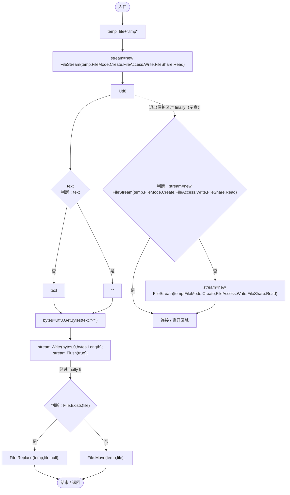

## Tail · L20

`public static byte[] Tail(string file,int maximum)`

### Editor / Player · Roslyn编译器控制流

```mermaid
flowchart TD
  b0(["入口"])
  b1["stream=new FileStream(file,FileMode.Open,FileAccess.Read,FileShare.ReadWrite&#124;FileShare.Delete)"]
  b2["count=(int)Math.Min(stream.Length,maximum)<br/>trimmed=stream.Length&gt;count<br/>stream.Seek(-count,SeekOrigin.End);<br/>bytes=new byte[count]<br/>read=0"]
  b3{"判断：read&lt;count"}
  b4{"判断：(n=stream.Read(bytes,read,count-read))&gt;0"}
  b5["read+=n;"]
  b6{"判断：trimmed"}
  b7["Array.IndexOf(bytes,(byte)'\n',0,read)+1"]
  b8["0"]
  b9["start=trimmed?Array.IndexOf(bytes,(byte)'\n',0,read)+1:0"]
  b10["结果：bytes.Skip(start).Take(read-start).ToArray()"]
  b11{"判断：stream=new FileStream(file,FileMode.Open,FileAccess.Read,FileShare.ReadWrite&#124;FileShare.Delete)"}
  b12["stream=new FileStream(file,FileMode.Open,FileAccess.Read,FileShare.ReadWrite&#124;FileShare.Delete)"]
  b13["连接 / 离开区域"]
  b14(["结束 / 返回"])
  b0 --> b1
  b1 --> b2
  b2 --> b3
  b3 -->|"是"| b4
  b3 -->|"否"| b6
  b4 -->|"是"| b5
  b4 -->|"否"| b6
  b5 --> b3
  b6 -->|"是"| b7
  b6 -->|"否"| b8
  b7 --> b9
  b8 --> b9
  b9 --> b10
  b10 -->|"返回 · 经过finally 11"| b14
  b11 -->|"否"| b12
  b11 -->|"是"| b13
  b12 --> b13
  b2 -. "退出保护区时 finally（示意）" .-> b11

```

## IsOwnedRun · L31

`public static bool IsOwnedRun(string directory)`

### Editor / Player · Roslyn编译器控制流

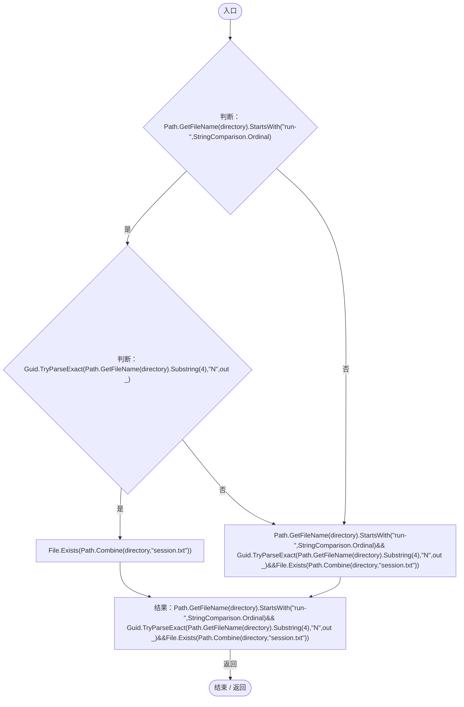

## IsInactive · L33

`public static bool IsInactive(string directory)`

### Editor / Player · Roslyn编译器控制流

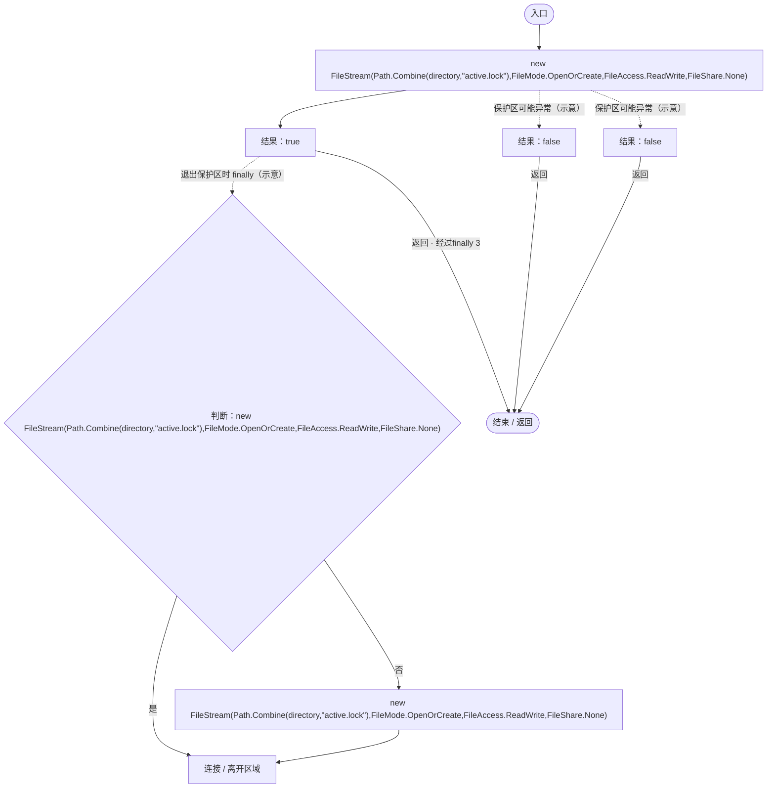

## Runs · L38

`public static string[] Runs(string root)`

### Editor / Player · Roslyn编译器控制流

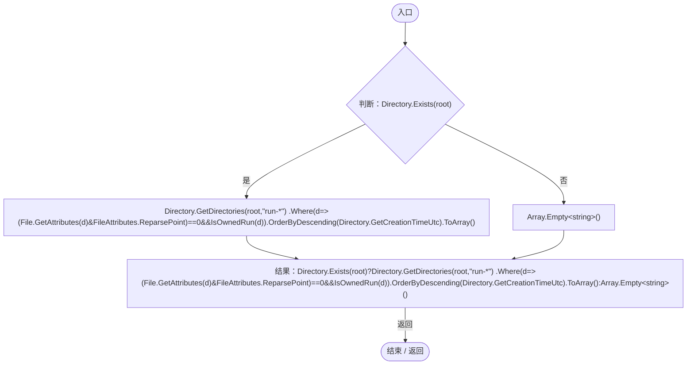

项目内调用/回调引用：

- [DiagnosticFiles.回调@39 · L39](d8a018f478416f7b.md#m3dcf0df80d205fef)（回调/委托）

## 回调@39 · L39

`d … => 回调`

### Editor / Player · Roslyn编译器控制流

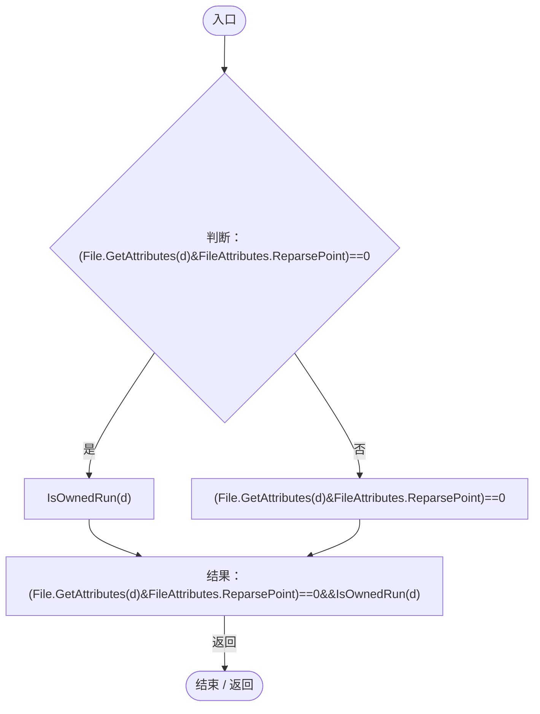

项目内调用/回调引用：

- [DiagnosticFiles.IsOwnedRun · L31](d8a018f478416f7b.md#ma508f8fe3a1d6ed2)（方法）

## RetainRuns · L40

`public static void RetainRuns(string root,int retained)`

### Editor / Player · Roslyn编译器控制流

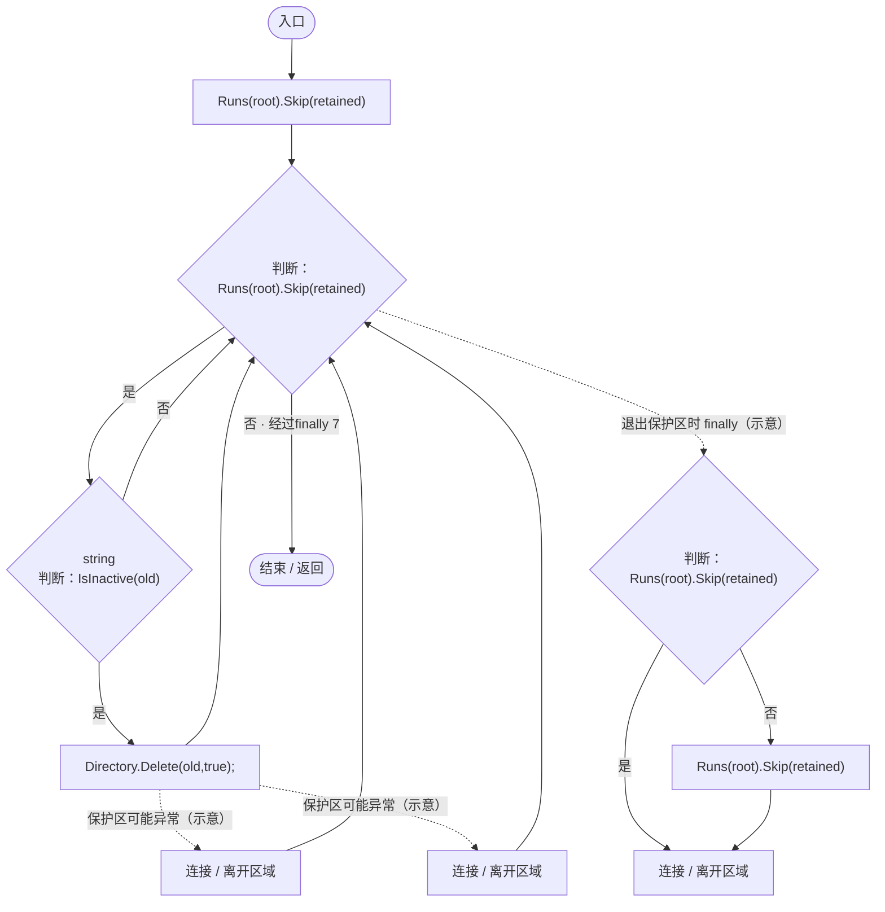

项目内调用/回调引用：

- [DiagnosticFiles.Runs · L38](d8a018f478416f7b.md#m60809bf5627f2c91)（方法）
- [DiagnosticFiles.IsInactive · L33](d8a018f478416f7b.md#ma71f0b50f516e79b)（方法）

## Export · L45

`public static string Export(string root,string nativeDirectory,RuntimeDiagnosticSettings settings)`

### Editor / Player · Roslyn编译器控制流

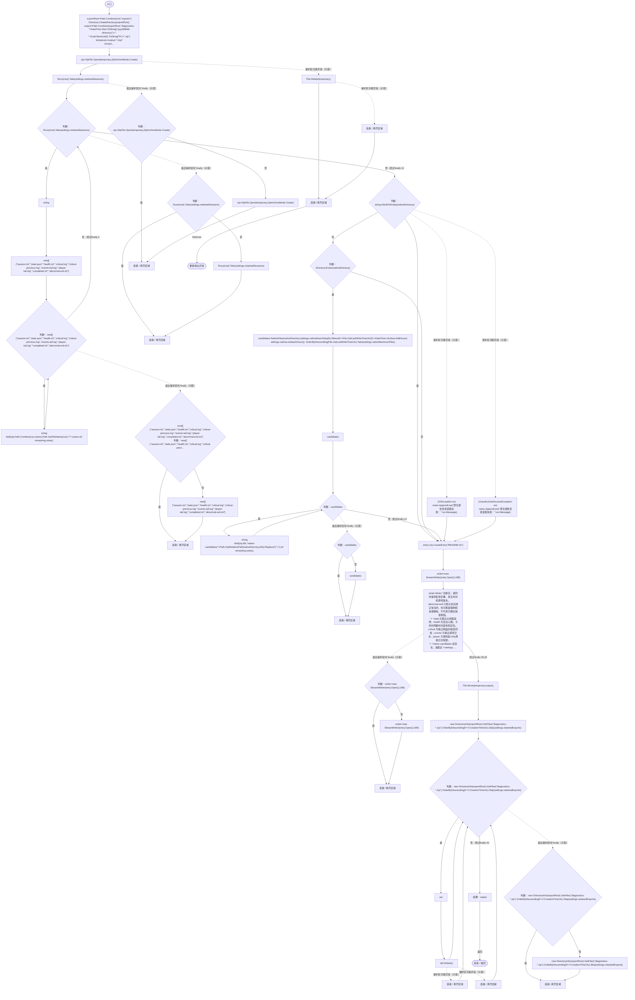

项目内调用/回调引用：

- [DiagnosticFiles.Runs · L38](d8a018f478416f7b.md#m60809bf5627f2c91)（方法）
- [DiagnosticFiles.Add · L92](d8a018f478416f7b.md#m2a7b6bf095590e13)（方法）
- [DiagnosticFiles.NativeFiles · L85](d8a018f478416f7b.md#m7812906ef62b62be)（方法）
- [DiagnosticFiles.回调@65 · L65](d8a018f478416f7b.md#m900b2027e005abfa)（回调/委托）
- [DiagnosticFiles.回调@79 · L79](d8a018f478416f7b.md#ma2f0315bd39d6238)（回调/委托）

## 回调@65 · L65

`f … => 回调`

### Editor / Player · Roslyn编译器控制流

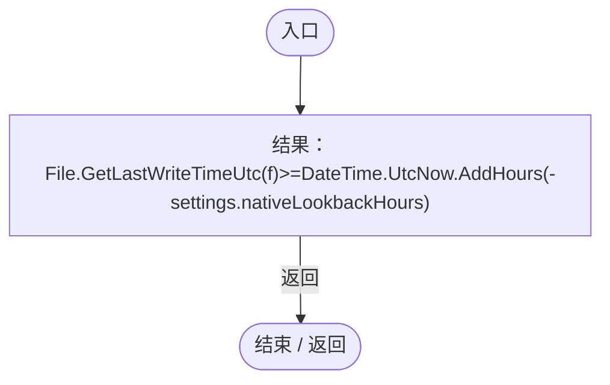

## 回调@79 · L79

`f … => 回调`

### Editor / Player · Roslyn编译器控制流

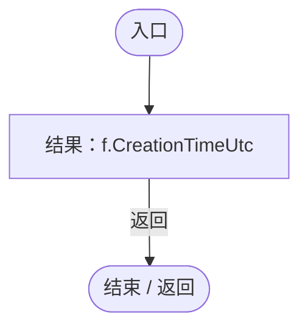

## NativeFiles · L85

`private static System.Collections.Generic.IEnumerable<string> NativeFiles(string root,int depth)`

### Editor / Player · Roslyn编译器控制流

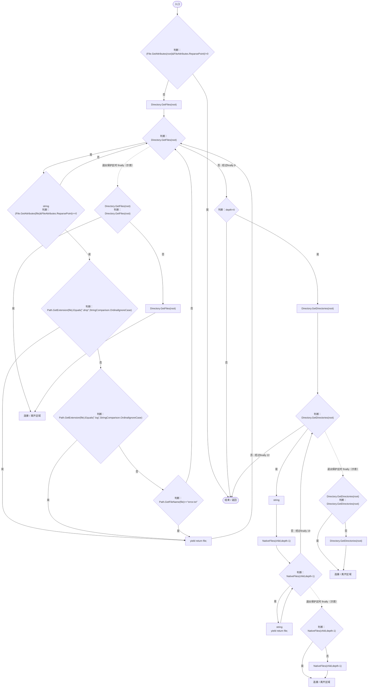

项目内调用/回调引用：

- [DiagnosticFiles.NativeFiles · L85](d8a018f478416f7b.md#m7812906ef62b62be)（方法）

## Add · L92

`private static void Add(ZipArchive zip,string file,string name,ref long remaining,StringBuilder notes)`

### Editor / Player · Roslyn编译器控制流

```mermaid
flowchart TD
  b0(["入口"])
  b1{"判断：File.Exists(file)"}
  b2["input=new FileStream(file,FileMode.Open,FileAccess.Read,FileShare.ReadWrite&#124;FileShare.Delete)"]
  b3{"length=input.Length<br/>判断：length&gt;remaining"}
  b4["notes.AppendLine(&quot;预算不足，未包含：&quot;+name+&quot; (&quot;+length+&quot; bytes)&quot;);"]
  b5["output=zip.CreateEntry(name,CompressionLevel.Fastest).Open()"]
  b6["buffer=new byte[8192]<br/>left=length"]
  b7{"判断：left&gt;0"}
  b8{"n=input.Read(buffer,0,(int)Math.Min(buffer.Length,left))<br/>判断：n==0"}
  b9["output.Write(buffer,0,n);<br/>left-=n;"]
  b10{"判断：output=zip.CreateEntry(name,CompressionLevel.Fastest).Open()"}
  b11["output=zip.CreateEntry(name,CompressionLevel.Fastest).Open()"]
  b12["连接 / 离开区域"]
  b13["remaining-=length;"]
  b14{"判断：input=new FileStream(file,FileMode.Open,FileAccess.Read,FileShare.ReadWrite&#124;FileShare.Delete)"}
  b15["input=new FileStream(file,FileMode.Open,FileAccess.Read,FileShare.ReadWrite&#124;FileShare.Delete)"]
  b16["连接 / 离开区域"]
  b17["(IOException ex)<br/>notes.AppendLine(&quot;读取失败：&quot;+name+&quot;：&quot;+ex.Message);"]
  b18["(UnauthorizedAccessException ex)<br/>notes.AppendLine(&quot;读取失败：&quot;+name+&quot;：&quot;+ex.Message);"]
  b19(["结束 / 返回"])
  b0 --> b1
  b1 -->|"否"| b19
  b1 -->|"是"| b2
  b2 --> b3
  b3 -->|"是"| b4
  b3 -->|"否"| b5
  b4 -->|"经过finally 14"| b19
  b5 --> b6
  b6 --> b7
  b7 -->|"是"| b8
  b7 -->|"否 · 经过finally 10"| b13
  b8 -->|"是 · 经过finally 10"| b13
  b8 -->|"否"| b9
  b9 --> b7
  b10 -->|"否"| b11
  b10 -->|"是"| b12
  b11 --> b12
  b13 -->|"经过finally 14"| b19
  b14 -->|"否"| b15
  b14 -->|"是"| b16
  b15 --> b16
  b17 --> b19
  b18 --> b19
  b6 -. "退出保护区时 finally（示意）" .-> b10
  b3 -. "退出保护区时 finally（示意）" .-> b14
  b2 -. "保护区可能异常（示意）" .-> b17
  b2 -. "保护区可能异常（示意）" .-> b18

```
