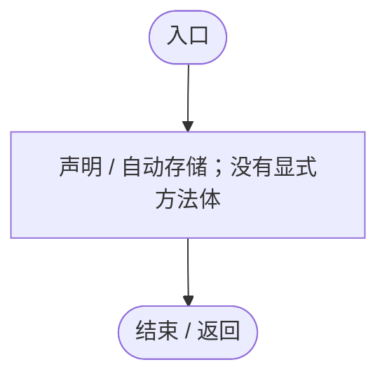
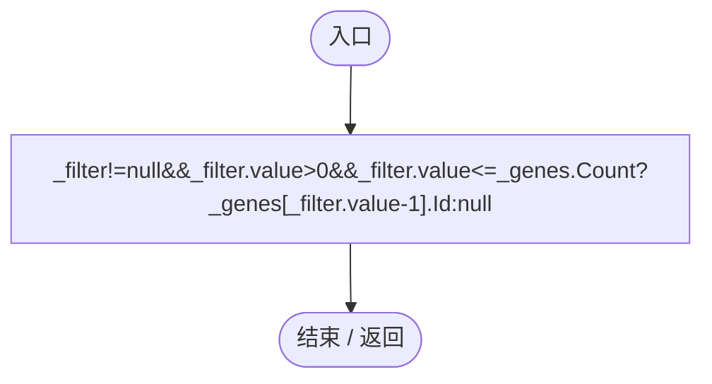
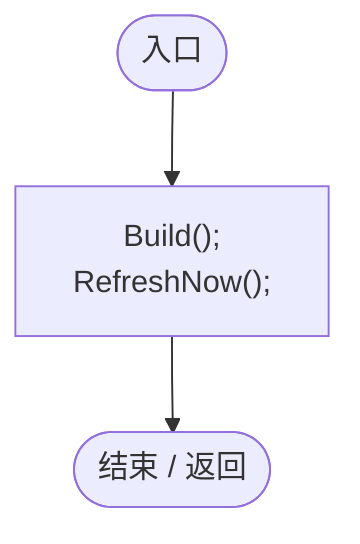
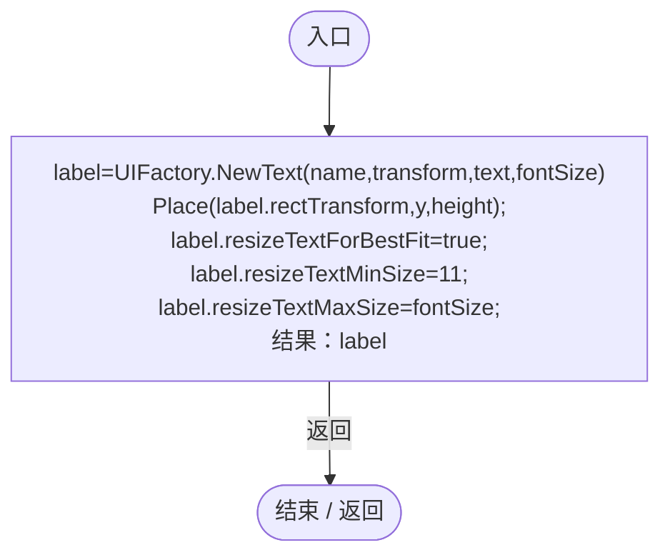
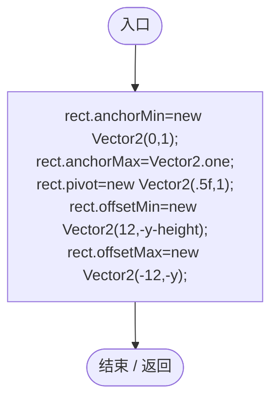
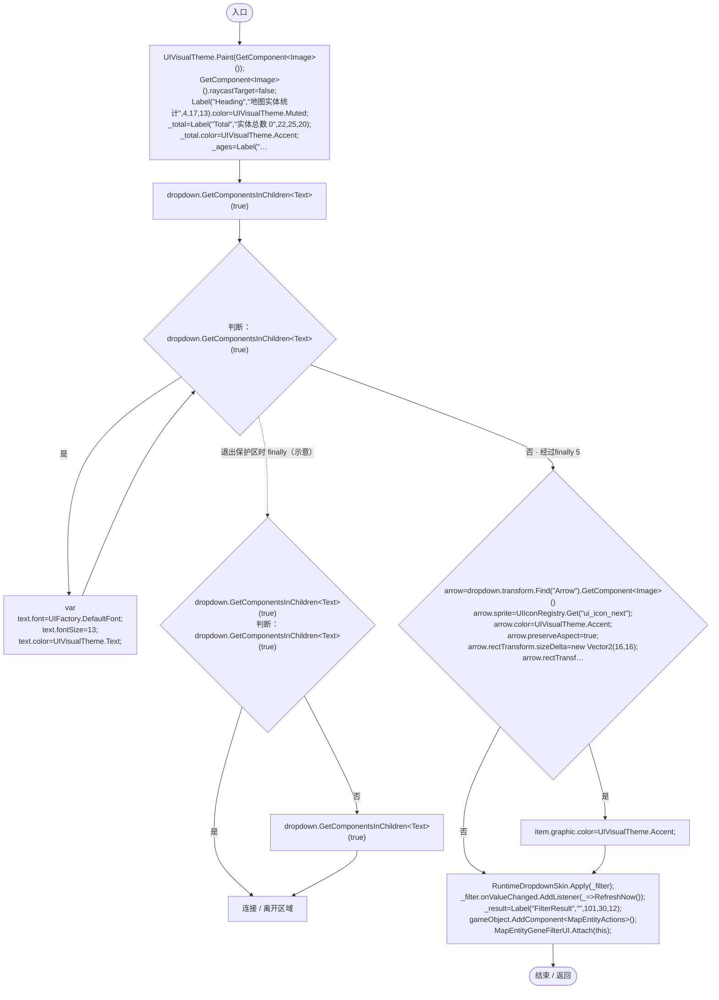
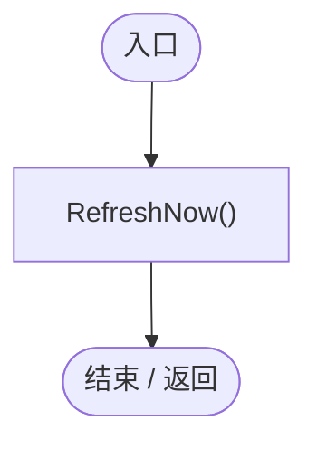
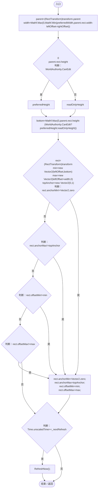
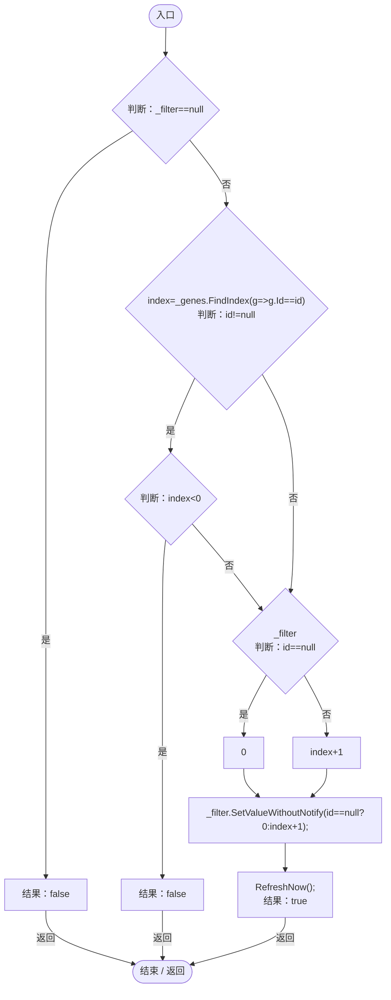

# MapEntityStatisticsUI.cs

[返回总索引](../README.md) · `Runtime` · `Assets/DarwinPark/UI/MapEntityStatisticsUI.cs`

[源文件](../../../Assets/DarwinPark/UI/MapEntityStatisticsUI.cs) · 源码校验：`2eea46b938703d537bd62e1717926faa5d455ba3453907788d5e4823312ef7ea`

方法按源文件位置排列。事件/回调引用不表示立即执行；分支与异常说明见总索引。完整源码与可点击关系图请打开离线手册。

<a id="m2b470c44fd65b06c"></a>

## Total.get · L16

`get`


### Editor / Player · 语法控制结构 / 声明（非CFG）


<a id="m3ff2ae3a978a6343"></a>

## Total.set · L16

`private set`


### Editor / Player · 语法控制结构 / 声明（非CFG）


<a id="m3360c926666cd49d"></a>

## Carriers.get · L17

`get`


### Editor / Player · 语法控制结构 / 声明（非CFG）


<a id="ma581fce2fd5a8752"></a>

## Carriers.set · L17

`private set`


### Editor / Player · 语法控制结构 / 声明（非CFG）


<a id="m3a1b8654b32e9613"></a>

## Expressed.get · L18

`get`


### Editor / Player · 语法控制结构 / 声明（非CFG）


<a id="m7d09cb3ef0ff99bc"></a>

## Expressed.set · L18

`private set`


### Editor / Player · 语法控制结构 / 声明（非CFG）


<a id="mfe12709c5b2225b8"></a>

## Infants.get · L19

`get`


### Editor / Player · 语法控制结构 / 声明（非CFG）


<a id="m558bd381ed8f1a31"></a>

## Infants.set · L19

`private set`


### Editor / Player · 语法控制结构 / 声明（非CFG）


<a id="md976fc4d6329ac17"></a>

## Adults.get · L20

`get`


### Editor / Player · 语法控制结构 / 声明（非CFG）


<a id="m20605c8db71ac393"></a>

## Adults.set · L20

`private set`


### Editor / Player · 语法控制结构 / 声明（非CFG）



<a id="m8c693bbebb13bd6e"></a>

## Elders.get · L21

`get`


### Editor / Player · 语法控制结构 / 声明（非CFG）


<a id="madb142292cf68c28"></a>

## Elders.set · L21

`private set`


### Editor / Player · 语法控制结构 / 声明（非CFG）


<a id="m42a7a75d74b6bb2c"></a>

## FilterGeneId.get · L22

`public string FilterGeneId`


### Editor / Player · 语法控制结构 / 声明（非CFG）



<a id="m744daa88cd781f82"></a>

## Start · L25

`private void Start()`


### Editor / Player · Roslyn编译器控制流



项目内调用/回调引用：

- [MapEntityStatisticsUI.Build · L36](da03211264cb6014.md#m7c7ff8fc85d839c2)（方法）
- [MapEntityStatisticsUI.RefreshNow · L74](da03211264cb6014.md#ma30ab70fe8c10f4f)（方法）

<a id="m2ab32528d6f09133"></a>

## Label · L26

`private Text Label(string name,string text,float y,float height,int fontSize)`


### Editor / Player · Roslyn编译器控制流



项目内调用/回调引用：

- [UIFactory.NewText · L57](dd1096a6995423db.md#m9dbccb5f0c38189e)（方法）
- [MapEntityStatisticsUI.Place · L31](da03211264cb6014.md#m36fb18d6c200cfa3)（方法）

<a id="m36fb18d6c200cfa3"></a>

## Place · L31

`private static void Place(RectTransform rect,float y,float height)`


### Editor / Player · Roslyn编译器控制流



<a id="m7c7ff8fc85d839c2"></a>

## Build · L36

`private void Build()`


### Editor / Player · Roslyn编译器控制流



项目内调用/回调引用：

- [UIVisualTheme.Paint · L58](ca525a798a08f966.md#m2d61a6b26ab24980)（方法）
- [MapEntityStatisticsUI.Label · L26](da03211264cb6014.md#m2ab32528d6f09133)（方法）
- [MapEntityStatisticsUI.Place · L31](da03211264cb6014.md#m36fb18d6c200cfa3)（方法）
- [UIFactory.DefaultFont.get · L17](dd1096a6995423db.md#m89af6843ae7629d3)（访问器）
- [UIIconRegistry.Get · L38](5e97f4545b48cac2.md#m95da89c0db2bbab9)（方法）
- [RuntimeDropdownSkin.Apply · L10](4e9d66f8395f54ec.md#m2b589d708f286228)（方法）
- [MapEntityGeneFilterUI.Attach · L33](c2cd33111de06171.md#mff50a4605701578a)（方法）
- [MapEntityStatisticsUI.回调@50 · L50](da03211264cb6014.md#md304fa09155e93b1)（回调/委托）

<a id="md304fa09155e93b1"></a>

## 回调@50 · L50

`_ … => 回调`


### Editor / Player · Roslyn编译器控制流



项目内调用/回调引用：

- [MapEntityStatisticsUI.RefreshNow · L74](da03211264cb6014.md#ma30ab70fe8c10f4f)（方法）

<a id="m08fb61ab2cf5d4ba"></a>

## LateUpdate · L56

`private void LateUpdate()`


### Editor / Player · Roslyn编译器控制流



项目内调用/回调引用：

- [MapEntityStatisticsUI.RefreshNow · L74](da03211264cb6014.md#ma30ab70fe8c10f4f)（方法）

<a id="me708d870d6cec0dd"></a>

## SelectGene · L69

`public bool SelectGene(string id)`


### Editor / Player · Roslyn编译器控制流



项目内调用/回调引用：

- [MapEntityStatisticsUI.RefreshNow · L74](da03211264cb6014.md#ma30ab70fe8c10f4f)（方法）
- [MapEntityStatisticsUI.回调@71 · L71](da03211264cb6014.md#mdc98e3b590bd8ef4)（回调/委托）

<a id="mdc98e3b590bd8ef4"></a>

## 回调@71 · L71

`g … => 回调`


### Editor / Player · Roslyn编译器控制流

```mermaid
flowchart TD
  b0(["入口"])
  b1["结果：g.Id==id"]
  b2(["结束 / 返回"])
  b0 --> b1
  b1 -->|"返回"| b2

```

<a id="ma30ab70fe8c10f4f"></a>

## RefreshNow · L74

`public void RefreshNow()`


### Editor / Player · Roslyn编译器控制流

```mermaid
flowchart TD
  b0(["入口"])
  b1{"判断：_filter==null"}
  b2{"_nextRefresh=Time.unscaledTime+Mathf.Max(.1f,refreshInterval);<br/>selected=FilterGeneId<br/>catalog=GeneDatabase.All.ToArray()<br/>signature=string.Join(&quot;&#124;&quot;,catalog.Select(g=&gt;g.Id+&quot;:&quot;+g.DisplayName))<br/>判断：_catalog!=signature"}
  b3["_catalog=signature;<br/>_genes.Clear();<br/>_genes.AddRange(catalog.OrderBy(g=&gt;g.Tier).ThenBy(g=&gt;g.Id));<br/>_filter.ClearOptions();"]
  b4["new List&lt;string&gt;{&quot;基因筛选：全部实体&quot;}<br/>&quot;基因筛选：全部实体&quot;<br/>labels=new List&lt;string&gt;{&quot;基因筛选：全部实体&quot;}"]
  b5["labels.AddRange(_genes.Select(g=&gt;&quot;基因：&quot;+g.DisplayName));<br/>_filter.AddOptions(labels);"]
  b6{"_filter<br/>判断：selected==null"}
  b7["0"]
  b8["Mathf.Max(0,_genes.FindIndex(g=&gt;g.Id==selected)+1)"]
  b9["_filter.SetValueWithoutNotify(selected==null?0:Mathf.Max(0,_genes.FindIndex(g=&gt;g.Id==selected)+1));"]
  b10["_filter.RefreshShownValue();"]
  b11{"Total=Carriers=Expressed=Infants=Adults=Elders=0;<br/>selected=FilterGeneId;<br/>判断：WorldRuntimeGate.Ready"}
  b12["EntityRegistry.All"]
  b13{"判断：EntityRegistry.All"}
  b14["var"]
  b15{"判断：EcologyQueries.Alive(entity)"}
  b16{"判断：entity.Genes==null"}
  b17["Total++;"]
  b18{"entity.Genes.CurrentAge<br/>判断：AgeState.Infant"}
  b19["Infants++;"]
  b20{"判断：AgeState.Adult"}
  b21["Adults++;"]
  b22{"判断：AgeState.Elder"}
  b23["Elders++;"]
  b24{"判断：selected==null"}
  b25["carries=false<br/>active=false"]
  b26["entity.Genes.Genome.Genes"]
  b27{"判断：entity.Genes.Genome.Genes"}
  b28{"var<br/>判断：gene.DefinitionId==selected"}
  b29["carries=true;"]
  b30["entity.Genes.Genome.Genes"]
  b31{"判断：carries"}
  b32["Carriers++;"]
  b33{"判断：entity.Genes.Evaluation!=null"}
  b34["entity.Genes.Evaluation.Genes"]
  b35{"判断：entity.Genes.Evaluation.Genes"}
  b36{"var<br/>判断：gene.Gene.DefinitionId==selected"}
  b37{"判断：gene.IsActive"}
  b38["active=true;"]
  b39["entity.Genes.Evaluation.Genes"]
  b40{"判断：active"}
  b41["Expressed++;"]
  b42{"判断：EntityRegistry.All"}
  b43["EntityRegistry.All"]
  b44["连接 / 离开区域"]
  b45["_total.text=&quot;实体总数 &quot;+Total;<br/>_ages.text=$&quot;幼年 {Infants} 成年 {Adults} 老年 {Elders}&quot;;"]
  b46{"_result.text<br/>判断：selected==null"}
  b47["&quot;全地图存活个体 · 可筛选基因&quot;"]
  b48{"Carriers<br/>Expressed<br/>判断：Total&gt;0"}
  b49["Carriers*100f/Total"]
  b50["0"]
  b51["$&quot;携带 {Carriers} 生效 {Expressed}\n占比 {(Total&gt;0?Carriers*100f/Total:0):F1}%&quot;"]
  b52["_result.text=selected==null?&quot;全地图存活个体 · 可筛选基因&quot;:$&quot;携带 {Carriers} 生效 {Expressed}\n占比 {(Total&gt;0?Carriers*100f/Total:0):F1}%&quot;;"]
  b53(["结束 / 返回"])
  b0 --> b1
  b1 -->|"是"| b53
  b1 -->|"否"| b2
  b2 -->|"是"| b3
  b2 -->|"否"| b11
  b3 --> b4
  b4 --> b5
  b5 --> b6
  b6 -->|"是"| b7
  b6 -->|"否"| b8
  b7 --> b9
  b8 --> b9
  b9 --> b10
  b10 --> b11
  b11 -->|"是"| b12
  b11 -->|"否"| b45
  b12 --> b13
  b13 -->|"是"| b14
  b13 -->|"否 · 经过finally 42"| b45
  b14 --> b15
  b15 -->|"是"| b16
  b15 -->|"否"| b13
  b16 -->|"是"| b13
  b16 -->|"否"| b17
  b17 --> b18
  b18 -->|"是"| b19
  b18 -->|"否"| b20
  b19 --> b24
  b20 -->|"是"| b21
  b20 -->|"否"| b22
  b21 --> b24
  b22 -->|"是"| b23
  b22 -->|"否"| b24
  b23 --> b24
  b24 -->|"是"| b13
  b24 -->|"否"| b25
  b25 --> b26
  b26 --> b27
  b27 -->|"是"| b28
  b27 -->|"否 · 经过finally 30"| b31
  b28 -->|"是"| b29
  b28 -->|"否"| b27
  b29 -->|"经过finally 30"| b31
  b31 -->|"是"| b32
  b31 -->|"否"| b33
  b32 --> b33
  b33 -->|"是"| b34
  b33 -->|"否"| b40
  b34 --> b35
  b35 -->|"是"| b36
  b35 -->|"否 · 经过finally 39"| b40
  b36 -->|"是"| b37
  b36 -->|"否"| b35
  b37 -->|"是"| b38
  b37 -->|"否"| b35
  b38 -->|"经过finally 39"| b40
  b40 -->|"是"| b41
  b40 -->|"否"| b13
  b41 --> b13
  b42 -->|"否"| b43
  b42 -->|"是"| b44
  b43 --> b44
  b45 --> b46
  b46 -->|"是"| b47
  b46 -->|"否"| b48
  b47 --> b52
  b48 -->|"是"| b49
  b48 -->|"否"| b50
  b49 --> b51
  b50 --> b51
  b51 --> b52
  b52 --> b53
  b27 -. "退出保护区时 finally（示意）" .-> b30
  b35 -. "退出保护区时 finally（示意）" .-> b39
  b13 -. "退出保护区时 finally（示意）" .-> b42

```

项目内调用/回调引用：

- [GeneDatabase.All.get · L128](ec0a03483435a863.md#m0a367ed24734f426)（访问器）
- [MapEntityStatisticsUI.Total.set · L16](da03211264cb6014.md#m3ff2ae3a978a6343)（访问器）
- [MapEntityStatisticsUI.Carriers.set · L17](da03211264cb6014.md#ma581fce2fd5a8752)（访问器）
- [MapEntityStatisticsUI.Expressed.set · L18](da03211264cb6014.md#m7d09cb3ef0ff99bc)（访问器）
- [MapEntityStatisticsUI.Infants.set · L19](da03211264cb6014.md#m558bd381ed8f1a31)（访问器）
- [MapEntityStatisticsUI.Adults.set · L20](da03211264cb6014.md#m20605c8db71ac393)（访问器）
- [MapEntityStatisticsUI.Elders.set · L21](da03211264cb6014.md#madb142292cf68c28)（访问器）
- [EcologyQueries.Alive · L38](bdf7ccc2c9c0452f.md#mb2877c487f449970)（方法）
- [DarwinEntity.Genes.get · L14](70798dde169f2e8b.md#m622eb1adf401d431)（访问器）
- [MapEntityStatisticsUI.Total.get · L16](da03211264cb6014.md#m2b470c44fd65b06c)（访问器）
- [EntityGeneController.CurrentAge.get · L35](7494d53178552f0e.md#mf5bc28691dd4a0f3)（访问器）
- [MapEntityStatisticsUI.Infants.get · L19](da03211264cb6014.md#mfe12709c5b2225b8)（访问器）
- [MapEntityStatisticsUI.Adults.get · L20](da03211264cb6014.md#md976fc4d6329ac17)（访问器）
- [MapEntityStatisticsUI.Elders.get · L21](da03211264cb6014.md#m8c693bbebb13bd6e)（访问器）
- [MapEntityStatisticsUI.Carriers.get · L17](da03211264cb6014.md#m3360c926666cd49d)（访问器）
- [EntityGeneController.Evaluation.get · L19](7494d53178552f0e.md#m2cb74e57d810ca42)（访问器）
- [MapEntityStatisticsUI.Expressed.get · L18](da03211264cb6014.md#m3a1b8654b32e9613)（访问器）
- [MapEntityStatisticsUI.回调@77 · L77](da03211264cb6014.md#m72878ca5435fe7c3)（回调/委托）
- [MapEntityStatisticsUI.回调@80 · L80](da03211264cb6014.md#m8c221160e63c47f0)（回调/委托）
- [MapEntityStatisticsUI.回调@80 · L80](da03211264cb6014.md#m5cfcda8d6f5f0741)（回调/委托）
- [MapEntityStatisticsUI.回调@81 · L81](da03211264cb6014.md#m4a779d1011739420)（回调/委托）
- [MapEntityStatisticsUI.回调@82 · L82](da03211264cb6014.md#md1e2b52eda0e8020)（回调/委托）

<a id="m72878ca5435fe7c3"></a>

## 回调@77 · L77

`g … => 回调`


### Editor / Player · Roslyn编译器控制流

```mermaid
flowchart TD
  b0(["入口"])
  b1["结果：g.Id+&quot;:&quot;+g.DisplayName"]
  b2(["结束 / 返回"])
  b0 --> b1
  b1 -->|"返回"| b2

```

<a id="m8c221160e63c47f0"></a>

## 回调@80 · L80

`g … => 回调`


### Editor / Player · Roslyn编译器控制流

```mermaid
flowchart TD
  b0(["入口"])
  b1["结果：g.Tier"]
  b2(["结束 / 返回"])
  b0 --> b1
  b1 -->|"返回"| b2

```

<a id="m5cfcda8d6f5f0741"></a>

## 回调@80 · L80

`g … => 回调`


### Editor / Player · Roslyn编译器控制流

```mermaid
flowchart TD
  b0(["入口"])
  b1["结果：g.Id"]
  b2(["结束 / 返回"])
  b0 --> b1
  b1 -->|"返回"| b2

```

<a id="m4a779d1011739420"></a>

## 回调@81 · L81

`g … => 回调`


### Editor / Player · Roslyn编译器控制流

```mermaid
flowchart TD
  b0(["入口"])
  b1["结果：&quot;基因：&quot;+g.DisplayName"]
  b2(["结束 / 返回"])
  b0 --> b1
  b1 -->|"返回"| b2

```

<a id="md1e2b52eda0e8020"></a>

## 回调@82 · L82

`g … => 回调`


### Editor / Player · Roslyn编译器控制流

```mermaid
flowchart TD
  b0(["入口"])
  b1["结果：g.Id==selected"]
  b2(["结束 / 返回"])
  b0 --> b1
  b1 -->|"返回"| b2

```
