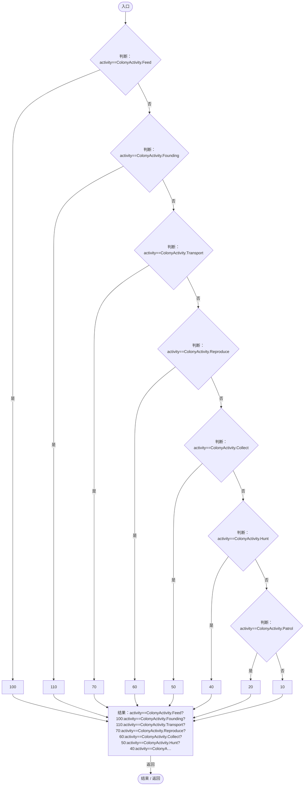
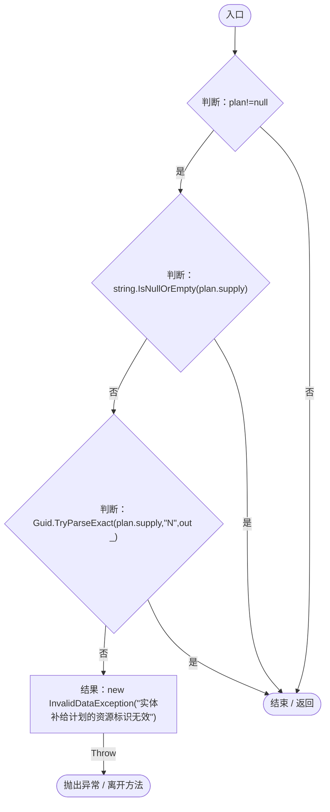

# EntityTaskPlan.cs

[返回总索引](../README.md) · `Runtime` · `Assets/DarwinPark/Entities/Ecology/EntityTaskPlan.cs`

[源文件](../../../Assets/DarwinPark/Entities/Ecology/EntityTaskPlan.cs) · 源码校验：`f2a1cdc9f740def64a662b1d36b6f2c0cc603fa2e2fa430f10eb82755ec6ee3e`

方法按源文件位置排列。事件/回调引用不表示立即执行；分支与异常说明见总索引。完整源码与可点击关系图请打开离线手册。

## Priority · L16

`public static int Priority(ColonyActivity activity)`

### Editor / Player · Roslyn编译器控制流

## Feeding · L17

`public static bool Feeding(AntColonyMember member)`

### Editor / Player · Roslyn编译器控制流

```mermaid
flowchart TD
  b0(["入口"])
  b1{"判断：member==null"}
  b2{"判断：member.Active"}
  b3{"member.GetComponent&lt;EggIncubation&gt;()<br/>判断：member.GetComponent&lt;EggIncubation&gt;()"}
  b4[".Incubating"]
  b5["member.GetComponent&lt;EggIncubation&gt;()"]
  b6{"判断：member.GetComponent&lt;EggIncubation&gt;()?.Incubating==true"}
  b7["结果：false"]
  b8{"member.State.plan<br/>判断：member.State.plan"}
  b9["member.State.plan"]
  b10["member.State.plan=new EntityTaskPlanSave()"]
  b11["plan=member.State.plan??(member.State.plan=new EntityTaskPlanSave())"]
  b12{"stats=member.GetComponent&lt;EntityStats&gt;()<br/>判断：stats==null"}
  b13{"判断：stats.TryGet(&quot;nutrient&quot;,out var food)"}
  b14["结果：false"]
  b15["stats.TryGet(&quot;storedNutrient&quot;,out var reserve);<br/>settings=AntColonySettings.Current<br/>tuning=GameplayTuning.Current<br/>queen=member.Role==AntRole.Queen"]
  b16{"food<br/>判断：queen"}
  b17["settings.queenFeedThreshold"]
  b18["settings.memberFeedThreshold"]
  b19{"判断：food&lt;(queen?settings.queenFeedThreshold:settings.memberFeedThreshold)"}
  b20{"判断：queen"}
  b21["reserve&lt;settings.queenReserveTarget"]
  b22["queen"]
  b23["food&lt;(queen?settings.queenFeedThreshold:settings.memberFeedThreshold)"]
  b24["hungry=food&lt;(queen?settings.queenFeedThreshold:settings.memberFeedThreshold)&#124;&#124;queen&amp;&amp;reserve&lt;settings.queenReserveTarget"]
  b25{"food<br/>food+stats.CapacityRemaining(&quot;nutrient&quot;)<br/>tuning.memberFeedResume<br/>判断：queen"}
  b26["settings.queenFeedThreshold"]
  b27["settings.memberFeedThreshold"]
  b28{"判断：food&gt;=Math.Min(food+stats.CapacityRemaining(&quot;nutrient&quot;),Math.Max(tuning.memberFeedResume,queen?settings.queenFeedThreshold:settings.memberFeedThreshold))"}
  b29{"判断：queen"}
  b30["reserve&gt;=Math.Min(reserve+stats.CapacityRemaining(&quot;storedNutrient&quot;),settings.queenReserveTarget+tuning.queenReserveBuffer)"]
  b31["!queen"]
  b32["food&gt;=Math.Min(food+stats.CapacityRemaining(&quot;nutrient&quot;),Math.Max(tuning.memberFeedResume,queen?settings.queenFeedThreshold:settings.memberFeedThreshold))"]
  b33["satisfied=food&gt;=Math.Min(food+stats.CapacityRemaining(&quot;nutrient&quot;),Math.Max(tuning.memberFeedResume,queen?settings.queenFeedThreshold:settings.memberFeedThreshold))&amp;&amp;(!queen&#124;&#124;reserve&gt;=Math.Min(reserve+stats.CapacityRemaining(&quot;storedNutrie…"]
  b34{"判断：plan.feeding"}
  b35{"判断：satisfied"}
  b36["plan.feeding=false;<br/>plan.supply=null;"]
  b37{"判断：plan.feeding"}
  b38{"判断：hungry"}
  b39["plan.feeding=true;"]
  b40["结果：plan.feeding"]
  b41(["结束 / 返回"])
  b0 --> b1
  b1 -->|"否"| b2
  b1 -->|"是"| b7
  b2 -->|"是"| b3
  b2 -->|"否"| b7
  b3 -->|"否"| b4
  b3 -->|"是"| b5
  b4 --> b6
  b5 --> b6
  b6 -->|"是"| b7
  b6 -->|"否"| b8
  b7 -->|"返回"| b41
  b8 -->|"否"| b9
  b8 -->|"是"| b10
  b9 --> b11
  b10 --> b11
  b11 --> b12
  b12 -->|"否"| b13
  b12 -->|"是"| b14
  b13 -->|"否"| b14
  b13 -->|"是"| b15
  b14 -->|"返回"| b41
  b15 --> b16
  b16 -->|"是"| b17
  b16 -->|"否"| b18
  b17 --> b19
  b18 --> b19
  b19 -->|"否"| b20
  b19 -->|"是"| b23
  b20 -->|"是"| b21
  b20 -->|"否"| b22
  b21 --> b24
  b22 --> b24
  b23 --> b24
  b24 --> b25
  b25 -->|"是"| b26
  b25 -->|"否"| b27
  b26 --> b28
  b27 --> b28
  b28 -->|"是"| b29
  b28 -->|"否"| b32
  b29 -->|"是"| b30
  b29 -->|"否"| b31
  b30 --> b33
  b31 --> b33
  b32 --> b33
  b33 --> b34
  b34 -->|"是"| b35
  b34 -->|"否"| b37
  b35 -->|"是"| b36
  b35 -->|"否"| b37
  b36 --> b40
  b37 -->|"否"| b38
  b37 -->|"是"| b40
  b38 -->|"是"| b39
  b38 -->|"否"| b40
  b39 --> b40
  b40 -->|"返回"| b41

```

项目内调用/回调引用：

- [AntColonyMember.State.get · L32](baebd85c05598377.md#m426db6a7c12dd7aa)（访问器）
- [EntityStats.TryGet · L90](75aa86a368efdf24.md#m24ee1433e4a70d94)（方法）
- [AntColonySettings.Current.get · L31](cb0a937e97c8fbb3.md#mcd121159f407ccdf)（访问器）
- [GameplayTuning.Current.get · L31](db546e5713b32d53.md#m557c9ecc76cc372d)（访问器）
- [AntColonyMember.Role.get · L38](baebd85c05598377.md#mab30d459d599e4df)（访问器）
- [EntityStats.CapacityRemaining · L92](75aa86a368efdf24.md#m574f0a6509120d00)（方法）

## Validate · L32

`public static void Validate(EntityTaskPlanSave plan)`

### Editor / Player · Roslyn编译器控制流

