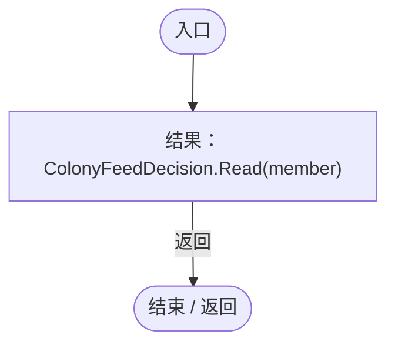
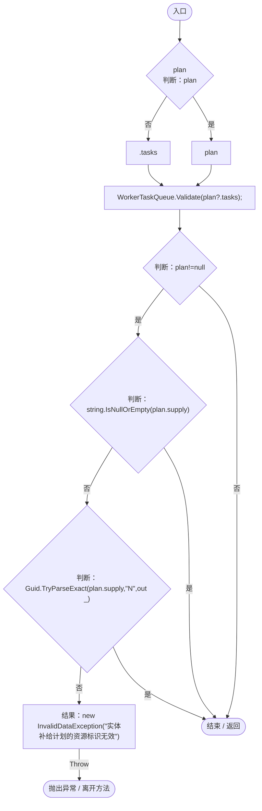

```mermaid
flowchart TD
  b0(["入口"])
  b1{"member.State.plan<br/>判断：member.State.plan"}
  b2["member.State.plan"]
  b3["member.State.plan=new EntityTaskPlanSave()"]
  b4["plan=member.State.plan??(member.State.plan=new EntityTaskPlanSave())"]
  b5{"判断：stats.TryGet(&quot;nutrient&quot;,out var food)"}
  b6["结果：false"]
  b7["stats.TryGet(&quot;storedNutrient&quot;,out var reserve);<br/>settings=AntColonySettings.Current<br/>tuning=GameplayTuning.Current<br/>queen=member.Role==AntRole.Queen"]
  b8{"food<br/>判断：queen"}
  b9["settings.queenFeedThreshold"]
  b10["settings.memberFeedThreshold"]
  b11{"判断：food&lt;(queen?settings.queenFeedThreshold:settings.memberFeedThreshold)"}
  b12{"判断：queen"}
  b13["reserve&lt;settings.queenReserveTarget"]
  b14["queen"]
  b15["food&lt;(queen?settings.queenFeedThreshold:settings.memberFeedThreshold)"]
  b16["hungry=food&lt;(queen?settings.queenFeedThreshold:settings.memberFeedThreshold)&#124;&#124;queen&amp;&amp;reserve&lt;settings.queenReserveTarget"]
  b17{"food<br/>food+stats.CapacityRemaining(&quot;nutrient&quot;)<br/>tuning.memberFeedResume<br/>判断：queen"}
  b18["settings.queenFeedThreshold"]
  b19["settings.memberFeedThreshold"]
  b20{"判断：food&gt;=Math.Min(food+stats.CapacityRemaining(&quot;nutrient&quot;),Math.Max(tuning.memberFeedResume,queen?settings.queenFeedThreshold:settings.memberFeedThreshold))"}
  b21{"判断：queen"}
  b22["reserve&gt;=Math.Min(reserve+stats.CapacityRemaining(&quot;storedNutrient&quot;),settings.queenReserveTarget+tuning.queenReserveBuffer)"]
  b23["!queen"]
  b24["food&gt;=Math.Min(food+stats.CapacityRemaining(&quot;nutrient&quot;),Math.Max(tuning.memberFeedResume,queen?settings.queenFeedThreshold:settings.memberFeedThreshold))"]
  b25["satisfied=food&gt;=Math.Min(food+stats.CapacityRemaining(&quot;nutrient&quot;),Math.Max(tuning.memberFeedResume,queen?settings.queenFeedThreshold:settings.memberFeedThreshold))&amp;&amp;(!queen&#124;&#124;reserve&gt;=Math.Min(reserve+stats.CapacityRemaining(&quot;storedNutrie…"]
  b26{"判断：plan.feeding"}
  b27{"判断：satisfied"}
  b28["plan.feeding=false;<br/>plan.supply=null;"]
  b29{"判断：plan.feeding"}
  b30{"判断：hungry"}
  b31["plan.feeding=true;"]
  b32{"判断：plan.tasks!=null"}
  b33{"判断：plan.tasks.Count&gt;0"}
  b34["plan.tasks[0].kind==PlannedTaskKind.Feed"]
  b35["plan.tasks!=null&amp;&amp;plan.tasks.Count&gt;0&amp;&amp;plan.tasks[0].kind==PlannedTaskKind.Feed"]
  b36["queued=plan.tasks!=null&amp;&amp;plan.tasks.Count&gt;0&amp;&amp;plan.tasks[0].kind==PlannedTaskKind.Feed"]
  b37{"判断：queued!=plan.feeding"}
  b38["WorkerTaskQueue.Feeding(member,plan.feeding);"]
  b39["结果：plan.feeding"]
  b40(["结束 / 返回"])
  b0 --> b1
  b1 -->|"否"| b2
  b1 -->|"是"| b3
  b2 --> b4
  b3 --> b4
  b4 --> b5
  b5 -->|"否"| b6
  b5 -->|"是"| b7
  b6 -->|"返回"| b40
  b7 --> b8
  b8 -->|"是"| b9
  b8 -->|"否"| b10
  b9 --> b11
  b10 --> b11
  b11 -->|"否"| b12
  b11 -->|"是"| b15
  b12 -->|"是"| b13
  b12 -->|"否"| b14
  b13 --> b16
  b14 --> b16
  b15 --> b16
  b16 --> b17
  b17 -->|"是"| b18
  b17 -->|"否"| b19
  b18 --> b20
  b19 --> b20
  b20 -->|"是"| b21
  b20 -->|"否"| b24
  b21 -->|"是"| b22
  b21 -->|"否"| b23
  b22 --> b25
  b23 --> b25
  b24 --> b25
  b25 --> b26
  b26 -->|"是"| b27
  b26 -->|"否"| b29
  b27 -->|"是"| b28
  b27 -->|"否"| b29
  b28 --> b32
  b29 -->|"否"| b30
  b29 -->|"是"| b32
  b30 -->|"是"| b31
  b30 -->|"否"| b32
  b31 --> b32
  b32 -->|"是"| b33
  b32 -->|"否"| b35
  b33 -->|"是"| b34
  b33 -->|"否"| b35
  b34 --> b36
  b35 --> b36
  b36 --> b37
  b37 -->|"是"| b38
  b37 -->|"否"| b39
  b38 --> b39
  b39 -->|"返回"| b40

```

# EntityTaskPlan.cs

[返回总索引](../README.md) · `Runtime` · `Assets/DarwinPark/Entities/Ecology/EntityTaskPlan.cs`

[源文件](../../../Assets/DarwinPark/Entities/Ecology/EntityTaskPlan.cs) · 源码校验：`626a90c9020570d2771746d246d172e99ffbd5ab53cd5972b6d6b71fb73dd693`

方法按源文件位置排列。事件/回调引用不表示立即执行；分支与异常说明见总索引。完整源码与可点击关系图请打开离线手册。

## Priority · L19

`public static int Priority(ColonyActivity activity)`

★ 修复（防Bug回归）：补给也高于迁居，维持生命后才能继续建群。

### Editor / Player · Roslyn编译器控制流

## Feeding · L20

`public static bool Feeding(AntColonyMember member)`

### Editor / Player · Roslyn编译器控制流

项目内调用/回调引用：

- [ColonyFeedDecision.Read · L21](e6b738dfaf434f21.md#m096205a33e40ba5c)（方法）

## EvaluateFeeding · L22

`internal static bool EvaluateFeeding(AntColonyMember member,EntityStats stats)`

★ 适配：纯判断仅由版本缓存的唯一入口调用，插队和恢复逻辑保持原语义。

### Editor / Player · Roslyn编译器控制流

项目内调用/回调引用：

- [AntColonyMember.State.get · L34](baebd85c05598377.md#m64745194ab46f363)（访问器）
- [EntityStats.TryGet · L93](75aa86a368efdf24.md#m03cef847022eee28)（方法）
- [AntColonySettings.Current.get · L31](cb0a937e97c8fbb3.md#mcd121159f407ccdf)（访问器）
- [GameplayTuning.Current.get · L46](db546e5713b32d53.md#m4fa691bd8a3b9618)（访问器）
- [AntColonyMember.Role.get · L40](baebd85c05598377.md#m382545c3d4092bf1)（访问器）
- [EntityStats.CapacityRemaining · L95](75aa86a368efdf24.md#mf5014bafb4b29341)（方法）
- [WorkerTaskQueue.Feeding · L17](dc0692495776be10.md#mb78e6fc083b136b4)（方法）

## Validate · L40

`public static void Validate(EntityTaskPlanSave plan)`

### Editor / Player · Roslyn编译器控制流

项目内调用/回调引用：

- [WorkerTaskQueue.Validate · L61](dc0692495776be10.md#mdca1e660b92076bc)（方法）
