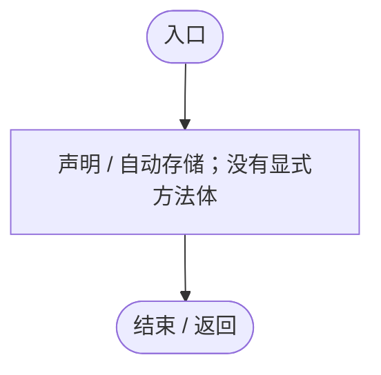
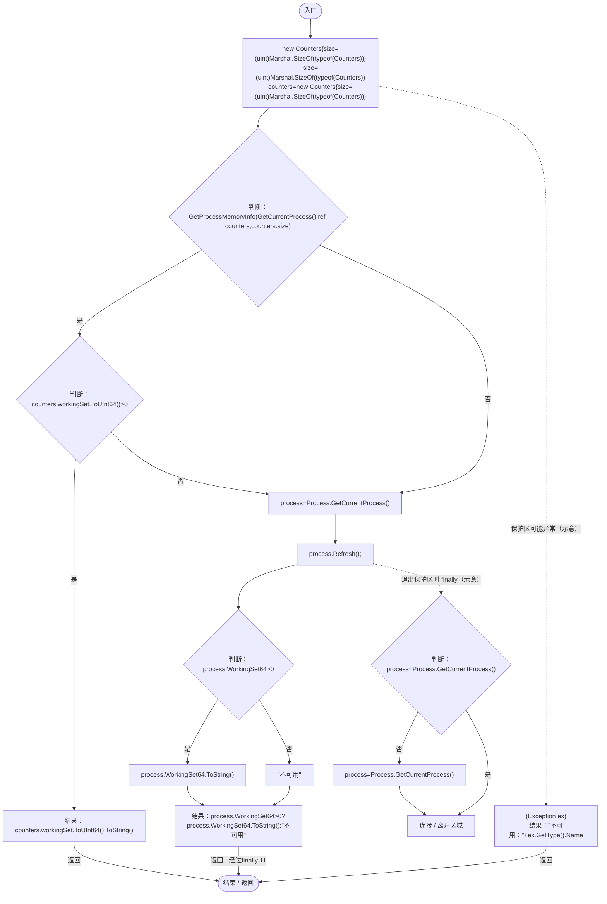

# DiagnosticMemory.cs

[返回总索引](../README.md) · `Runtime` · `Assets/DarwinPark/Core/Logging/DiagnosticMemory.cs`

[源文件](../../../Assets/DarwinPark/Core/Logging/DiagnosticMemory.cs) · 源码校验：`dd32f044582affb586f9e6e2ef8161877fddb04d4f79916ce0bc18cfb43eabf4`

方法按源文件位置排列。事件/回调引用不表示立即执行；分支与异常说明见总索引。完整源码与可点击关系图请打开离线手册。

## GetCurrentProcess · L16

`[DllImport("kernel32.dll")] private static extern IntPtr GetCurrentProcess()`

### Editor / Player · 语法控制结构 / 声明（非CFG）

## GetProcessMemoryInfo · L17

`[DllImport("psapi.dll",SetLastError=true)] [return:MarshalAs(UnmanagedType.Bool)] private static extern bool GetProcessMemoryInfo(IntPtr process,ref Counters counters,uint size)`

### Editor / Player · 语法控制结构 / 声明（非CFG）

## WorkingSetBytes · L20

`public static string WorkingSetBytes()`

### Editor / Player · Roslyn编译器控制流

项目内调用/回调引用：

- [DiagnosticMemory.GetProcessMemoryInfo · L17](da5a4e8a86332124.md#m5f2f99f66c141851)（方法）
- [DiagnosticMemory.GetCurrentProcess · L16](da5a4e8a86332124.md#m844f481798133dc7)（方法）
