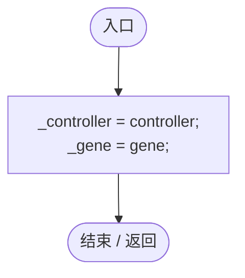
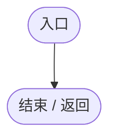
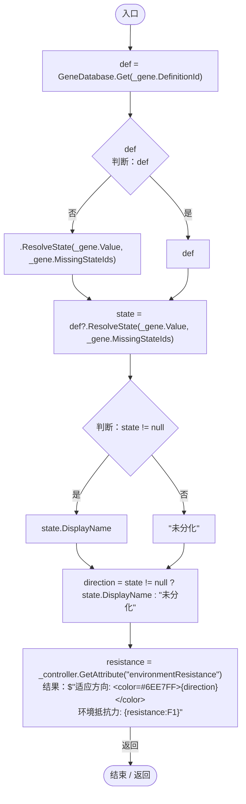

# EnvironmentAdaptationGeneLogic.cs

[返回总索引](../README.md) · `Runtime` · `Assets/DarwinPark/Entities/Logic/EnvironmentAdaptationGeneLogic.cs`

[源文件](../../../Assets/DarwinPark/Entities/Logic/EnvironmentAdaptationGeneLogic.cs) · 源码校验：`b29286b9627864f01b8fc2d6fe579033017d6ba1aafbf1445c4f51a8b9f6227e`

方法按源文件位置排列。事件/回调引用不表示立即执行；分支与异常说明见总索引。完整源码与可点击关系图请打开离线手册。

## Initialize · L17

`public void Initialize(EntityGeneController controller, GeneInstance gene)`

### Editor / Player · Roslyn编译器控制流

## OnUpdate · L23

`public void OnUpdate(float deltaTime)`

### Editor / Player · Roslyn编译器控制流

## GetTooltipInfo · L28

`public string GetTooltipInfo()`

### Editor / Player · Roslyn编译器控制流

项目内调用/回调引用：

- [GeneDatabase.Get · L135](ec0a03483435a863.md#m8f3bbfb35f3ca397)（方法）
- [GeneDefinition.ResolveState · L83](07f99d5784e3dadb.md#mbaf2c5b1eb1045c5)（方法）
- [EntityGeneController.GetAttribute · L225](7494d53178552f0e.md#mc707943b1138a009)（方法）
