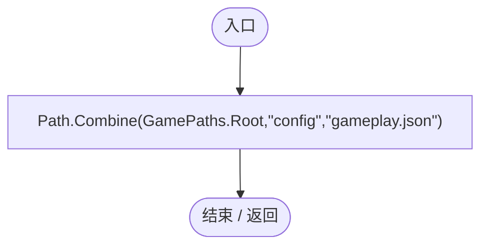
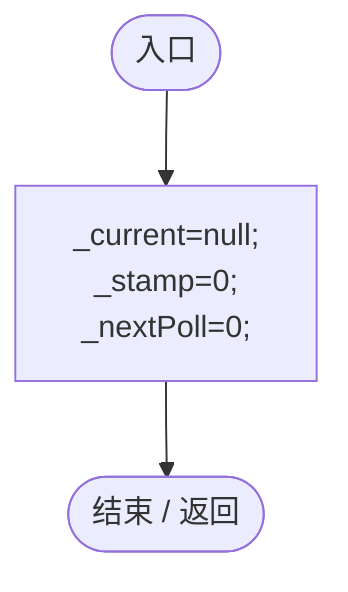

```mermaid
flowchart TD
  b0(["入口"])
  b1{"value=JsonUtility.FromJson&lt;GameplayTuning&gt;(CommentedJson.Strip(json))<br/>判断：value==null"}
  b2{"判断：value.version!=1"}
  b3["结果：new InvalidDataException(&quot;游戏数值配置版本无效&quot;)"]
  x3(["抛出异常 / 离开方法"])
  b4{"判断：value.mergePhaseBuckets&lt;1"}
  b5{"判断：value.mergePhaseBuckets&gt;256"}
  b6["结果：new InvalidDataException(&quot;合并错峰批次数必须为1到256&quot;)"]
  x6(["抛出异常 / 离开方法"])
  b7["typeof(GameplayTuning).GetFields()"]
  b8{"判断：typeof(GameplayTuning).GetFields()"}
  b9{"var<br/>判断：field.FieldType==typeof(float)"}
  b10{"n=(float)field.GetValue(value)<br/>判断：float.IsNaN(n)"}
  b11{"判断：float.IsInfinity(n)"}
  b12{"判断：n&lt;0"}
  b13["结果：new InvalidDataException(&quot;数值必须为非负有限数：&quot;+field.Name)"]
  x13(["抛出异常 / 离开方法"])
  b14{"typeof(GameplayTuning).GetFields()<br/>判断：typeof(GameplayTuning).GetFields()"}
  b15["typeof(GameplayTuning).GetFields()"]
  b16["连接 / 离开区域"]
  b17{"判断：value.manualHitboxScale&lt;1"}
  b18{"判断：value.supplyActivityRadiusRatio&lt;=0"}
  b19{"判断：value.colonyActivityRadiusMultiplier&lt;=0"}
  b20{"判断：value.populationFillOpacity&gt;1"}
  b21["结果：new InvalidDataException(&quot;判定框倍率至少为1，活动半径倍率必须大于0，透明度须在0到1之间&quot;)"]
  x21(["抛出异常 / 离开方法"])
  b22{"判断：value.mergeMaximumCatchupSeconds&lt;value.mergeInterval"}
  b23{"判断：value.mergeMaximumCatchupSeconds&gt;30"}
  b24{"判断：value.colonyBirthReservedSlots&gt;32"}
  b25{"判断：value.colonySuccessorPopulation&lt;1"}
  b26{"判断：value.colonySuccessorPopulation&gt;100000"}
  b27{"判断：value.mergeFoodTolerance&lt;.001f"}
  b28{"判断：value.mergeFoodTolerance&gt;10"}
  b29{"判断：value.mergeReserveTolerance&lt;.001f"}
  b30{"判断：value.mergeWakeDistance&lt;=0"}
  b31{"判断：value.memberFeedResume&gt;10"}
  b32{"判断：value.mergeRadius&lt;=0"}
  b33{"判断：value.mergeInterval&lt;.1f"}
  b34{"判断：value.mergeInterval&gt;2"}
  b35{"判断：value.mergeMaximumMembers&lt;1"}
  b36{"判断：value.mergeMaximumMembers&gt;128"}
  b37{"判断：value.mergeGroupsPerFrame&lt;1"}
  b38{"判断：value.mergeGroupsPerFrame&gt;100000"}
  b39{"判断：value.mutationAttemptsPerFrame&lt;1"}
  b40{"判断：value.mutationAttemptsPerFrame&gt;100000"}
  b41{"判断：value.mergedMutationFraction&gt;1"}
  b42{"判断：value.multipleBirthMaximum&lt;1"}
  b43{"判断：value.multipleBirthMaximum&gt;16"}
  b44["结果：new InvalidDataException(&quot;任务或合并计算数值超出有效范围&quot;)"]
  x44(["抛出异常 / 离开方法"])
  b45["结果：value"]
  b46(["结束 / 返回"])
  b0 --> b1
  b1 -->|"否"| b2
  b1 -->|"是"| b3
  b2 -->|"是"| b3
  b2 -->|"否"| b4
  b3 -->|"Throw"| x3
  b4 -->|"否"| b5
  b4 -->|"是"| b6
  b5 -->|"是"| b6
  b5 -->|"否"| b7
  b6 -->|"Throw"| x6
  b7 --> b8
  b8 -->|"是"| b9
  b8 -->|"否 · 经过finally 14"| b17
  b9 -->|"是"| b10
  b9 -->|"否"| b8
  b10 -->|"否"| b11
  b10 -->|"是"| b13
  b11 -->|"否"| b12
  b11 -->|"是"| b13
  b12 -->|"是"| b13
  b12 -->|"否"| b8
  b13 -->|"Throw"| x13
  b14 -->|"否"| b15
  b14 -->|"是"| b16
  b15 --> b16
  b17 -->|"否"| b18
  b17 -->|"是"| b21
  b18 -->|"否"| b19
  b18 -->|"是"| b21
  b19 -->|"否"| b20
  b19 -->|"是"| b21
  b20 -->|"是"| b21
  b20 -->|"否"| b22
  b21 -->|"Throw"| x21
  b22 -->|"否"| b23
  b22 -->|"是"| b44
  b23 -->|"否"| b24
  b23 -->|"是"| b44
  b24 -->|"否"| b25
  b24 -->|"是"| b44
  b25 -->|"否"| b26
  b25 -->|"是"| b44
  b26 -->|"否"| b27
  b26 -->|"是"| b44
  b27 -->|"否"| b28
  b27 -->|"是"| b44
  b28 -->|"否"| b29
  b28 -->|"是"| b44
  b29 -->|"否"| b30
  b29 -->|"是"| b44
  b30 -->|"否"| b31
  b30 -->|"是"| b44
  b31 -->|"否"| b32
  b31 -->|"是"| b44
  b32 -->|"否"| b33
  b32 -->|"是"| b44
  b33 -->|"否"| b34
  b33 -->|"是"| b44
  b34 -->|"否"| b35
  b34 -->|"是"| b44
  b35 -->|"否"| b36
  b35 -->|"是"| b44
  b36 -->|"否"| b37
  b36 -->|"是"| b44
  b37 -->|"否"| b38
  b37 -->|"是"| b44
  b38 -->|"否"| b39
  b38 -->|"是"| b44
  b39 -->|"否"| b40
  b39 -->|"是"| b44
  b40 -->|"否"| b41
  b40 -->|"是"| b44
  b41 -->|"否"| b42
  b41 -->|"是"| b44
  b42 -->|"否"| b43
  b42 -->|"是"| b44
  b43 -->|"是"| b44
  b43 -->|"否"| b45
  b44 -->|"Throw"| x44
  b45 -->|"返回"| b46
  b8 -. "退出保护区时 finally（示意）" .-> b14

```

# GameplayTuning.cs

[返回总索引](../README.md) · `Runtime` · `Assets/DarwinPark/Core/GameplayTuning.cs`

[源文件](../../../Assets/DarwinPark/Core/GameplayTuning.cs) · 源码校验：`e3f7ea073e167be706a1659fcfd00a052929ec6d20fb43936c25c56ee2c549b2`

方法按源文件位置排列。事件/回调引用不表示立即执行；分支与异常说明见总索引。完整源码与可点击关系图请打开离线手册。

## FilePath.get · L33

`public static string FilePath`

### Editor / Player · 语法控制结构 / 声明（非CFG）

## Current.get · L34

`get`

### Editor / Player · Roslyn编译器控制流

项目内调用/回调引用：

- [GameplayTuning.Reload · L46](db546e5713b32d53.md#me5cd082ee3f8bdfb)（方法）

## Parse · L35

`public static GameplayTuning Parse(string json)`

### Editor / Player · Roslyn编译器控制流

项目内调用/回调引用：

- [CommentedJson.Strip · L9](f72593057d514ce3.md#mc9c02edd5a7f0a4d)（方法）

## Reload · L46

`public static void Reload()`

### Editor / Player · Roslyn编译器控制流

项目内调用/回调引用：

- [GameplayTuning.Parse · L35](db546e5713b32d53.md#m0324e5328634c9b2)（方法）

## Poll · L58

`public static void Poll()`

### Editor / Player · Roslyn编译器控制流

项目内调用/回调引用：

- [GameplayTuning.Reload · L46](db546e5713b32d53.md#me5cd082ee3f8bdfb)（方法）

## Reset · L64

`[RuntimeInitializeOnLoadMethod(RuntimeInitializeLoadType.SubsystemRegistration)] private static void Reset()`

### Editor / Player · Roslyn编译器控制流

