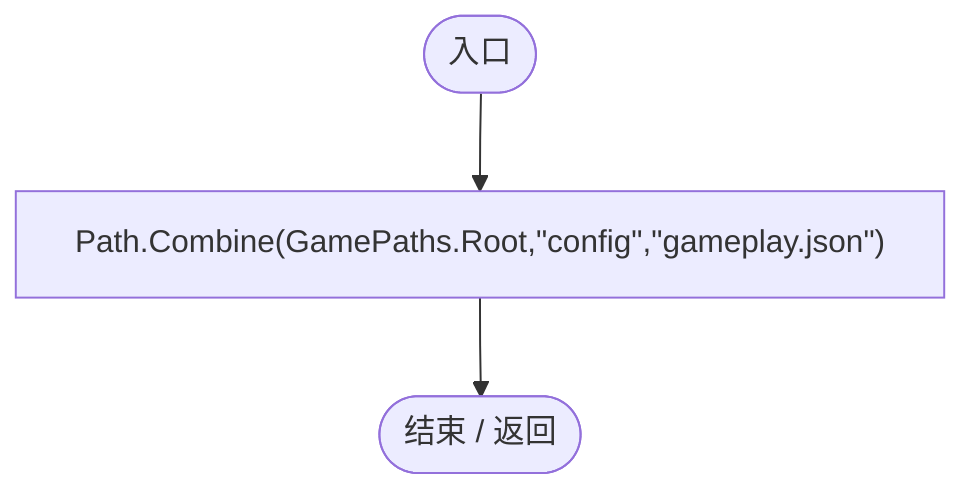
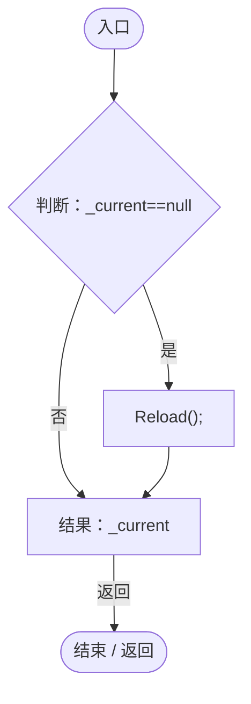
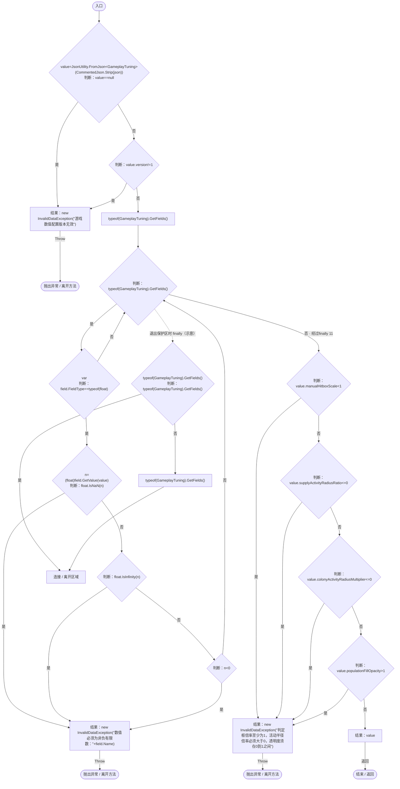
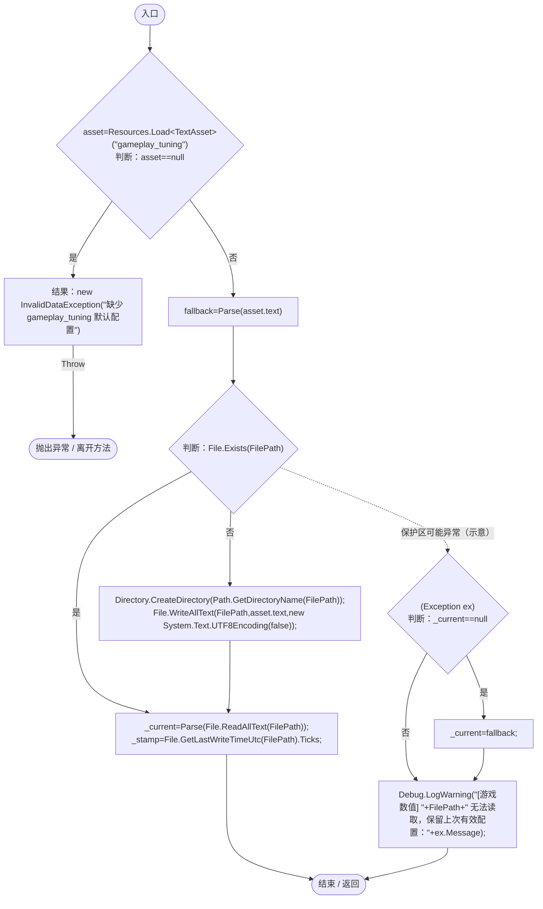
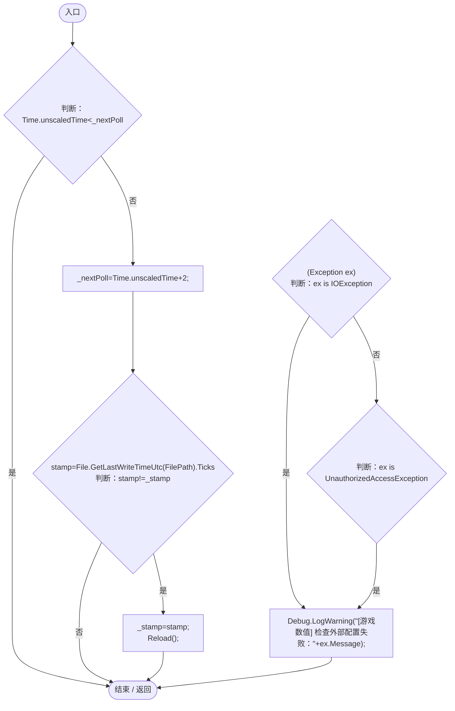
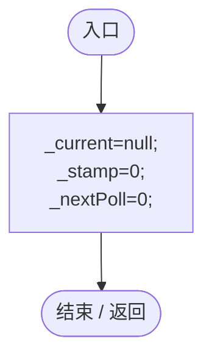

# GameplayTuning.cs

[返回总索引](../README.md) · `Runtime` · `Assets/DarwinPark/Core/GameplayTuning.cs`

[源文件](../../../Assets/DarwinPark/Core/GameplayTuning.cs) · 源码校验：`e5c49569f906607f835dfd6db136d1fc95da0de5257551667a6495d37a0d1f91`

方法按源文件位置排列。事件/回调引用不表示立即执行；分支与异常说明见总索引。完整源码与可点击关系图请打开离线手册。

## FilePath.get · L20

`public static string FilePath`

### Editor / Player · 语法控制结构 / 声明（非CFG）

## Current.get · L21

`get`

### Editor / Player · Roslyn编译器控制流

项目内调用/回调引用：

- [GameplayTuning.Reload · L31](db546e5713b32d53.md#m10cbcd3bcb0856d1)（方法）

## Parse · L22

`public static GameplayTuning Parse(string json)`

### Editor / Player · Roslyn编译器控制流

项目内调用/回调引用：

- [CommentedJson.Strip · L9](f72593057d514ce3.md#mc9c02edd5a7f0a4d)（方法）

## Reload · L31

`public static void Reload()`

### Editor / Player · Roslyn编译器控制流

项目内调用/回调引用：

- [GameplayTuning.Parse · L22](db546e5713b32d53.md#madb718db2cbbddee)（方法）

## Poll · L43

`public static void Poll()`

### Editor / Player · Roslyn编译器控制流

项目内调用/回调引用：

- [GameplayTuning.Reload · L31](db546e5713b32d53.md#m10cbcd3bcb0856d1)（方法）

## Reset · L49

`[RuntimeInitializeOnLoadMethod(RuntimeInitializeLoadType.SubsystemRegistration)] private static void Reset()`

### Editor / Player · Roslyn编译器控制流

