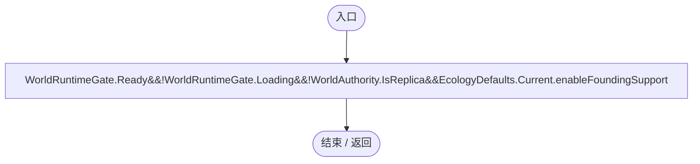
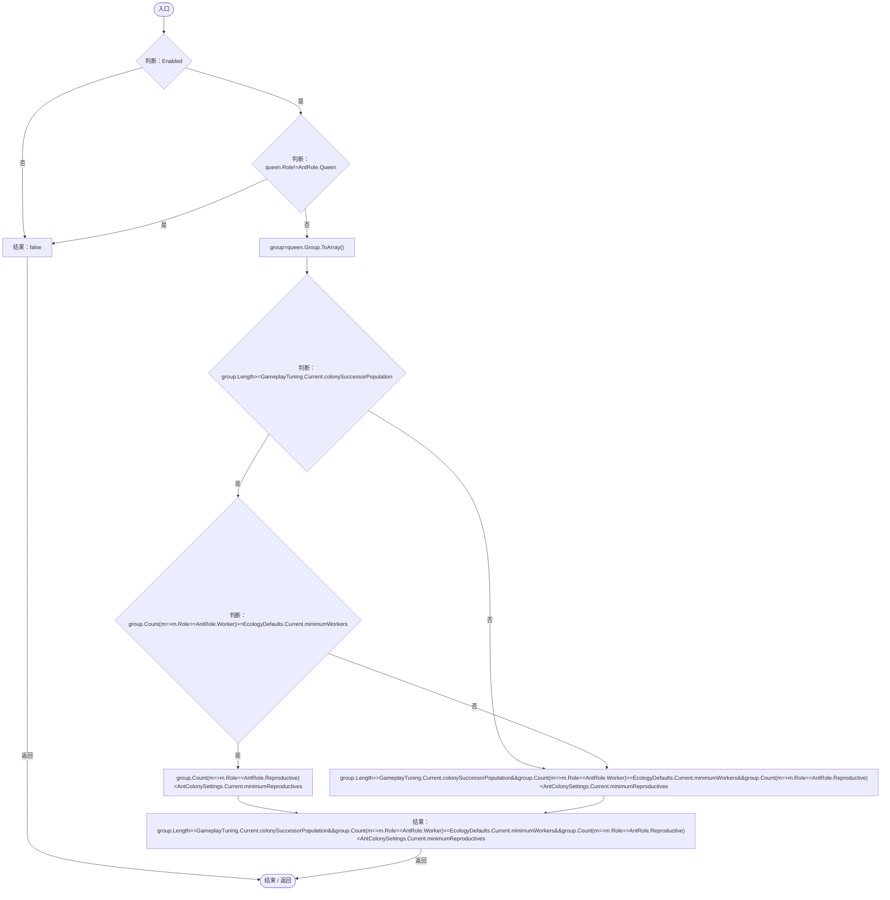
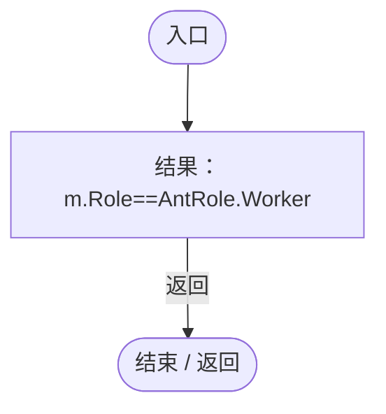
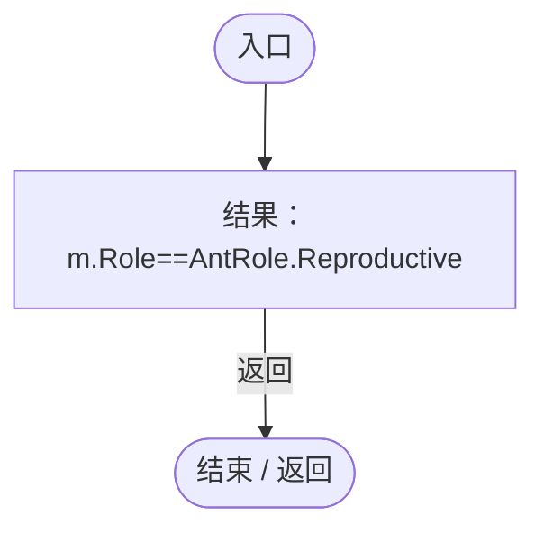
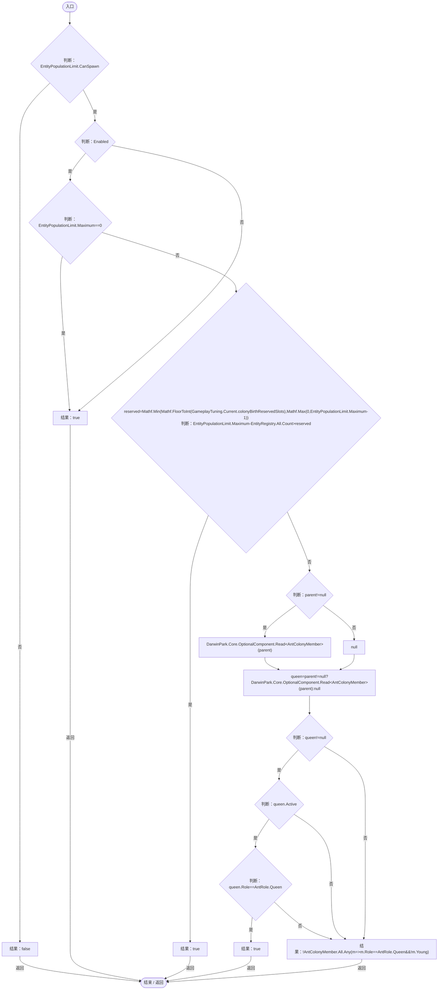
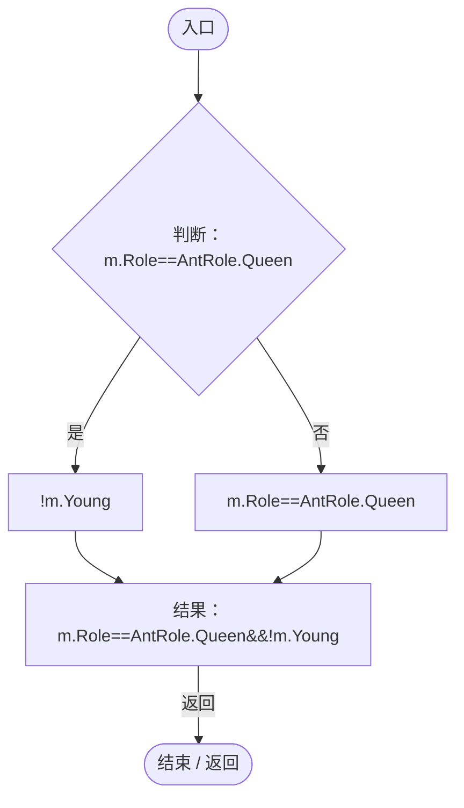

# ColonyContinuityPriority.cs

[返回总索引](../README.md) · `Runtime` · `Assets/DarwinPark/Entities/Ecology/ColonyContinuityPriority.cs`

[源文件](../../../Assets/DarwinPark/Entities/Ecology/ColonyContinuityPriority.cs) · 源码校验：`a3940c17184dc2b87b5a1aa8a2a5b7010892da9fff40371e35d99ffcf62a99a4`

方法按源文件位置排列。事件/回调引用不表示立即执行；分支与异常说明见总索引。完整源码与可点击关系图请打开离线手册。

## Enabled.get · L11

`private static bool Enabled`

### Editor / Player · 语法控制结构 / 声明（非CFG）

项目内调用/回调引用：

- [EcologyDefaults.Current.get · L35](5b565b57de741d98.md#m75cb60b88e3cc1c7)（访问器）

## NeedsSuccessor · L12

`public static bool NeedsSuccessor(AntColonyMember queen)`

### Editor / Player · Roslyn编译器控制流

项目内调用/回调引用：

- [AntColonyMember.Role.get · L40](baebd85c05598377.md#m382545c3d4092bf1)（访问器）
- [GameplayTuning.Current.get · L46](db546e5713b32d53.md#m4fa691bd8a3b9618)（访问器）
- [EcologyDefaults.Current.get · L35](5b565b57de741d98.md#m75cb60b88e3cc1c7)（访问器）
- [AntColonySettings.Current.get · L31](cb0a937e97c8fbb3.md#mcd121159f407ccdf)（访问器）
- [ColonyContinuityPriority.回调@16 · L16](dbd1eb8a8137aa05.md#mfa7bc952e9221a3b)（回调/委托）
- [ColonyContinuityPriority.回调@16 · L16](dbd1eb8a8137aa05.md#me3a59cc141d4cd4c)（回调/委托）

## 回调@16 · L16

`m … => 回调`

### Editor / Player · Roslyn编译器控制流

项目内调用/回调引用：

- [AntColonyMember.Role.get · L40](baebd85c05598377.md#m382545c3d4092bf1)（访问器）

## 回调@16 · L16

`m … => 回调`

### Editor / Player · Roslyn编译器控制流

项目内调用/回调引用：

- [AntColonyMember.Role.get · L40](baebd85c05598377.md#m382545c3d4092bf1)（访问器）

## CanSpawn · L18

`public static bool CanSpawn(EntityGeneController parent=null)`

### Editor / Player · Roslyn编译器控制流

项目内调用/回调引用：

- [GameplayTuning.Current.get · L46](db546e5713b32d53.md#m4fa691bd8a3b9618)（访问器）
- [OptionalComponent.Read · L7](806c46b42ced4d36.md#m69622a4dee165c5a)（方法）
- [AntColonyMember.Role.get · L40](baebd85c05598377.md#m382545c3d4092bf1)（访问器）
- [ColonyContinuityPriority.回调@27 · L27](dbd1eb8a8137aa05.md#m89db2d4ee8e118c6)（回调/委托）

## 回调@27 · L27

`m … => 回调`

### Editor / Player · Roslyn编译器控制流

项目内调用/回调引用：

- [AntColonyMember.Role.get · L40](baebd85c05598377.md#m382545c3d4092bf1)（访问器）
