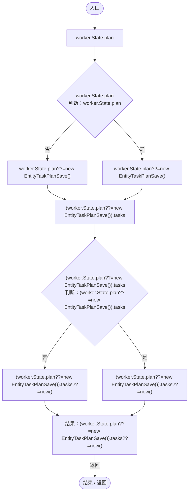
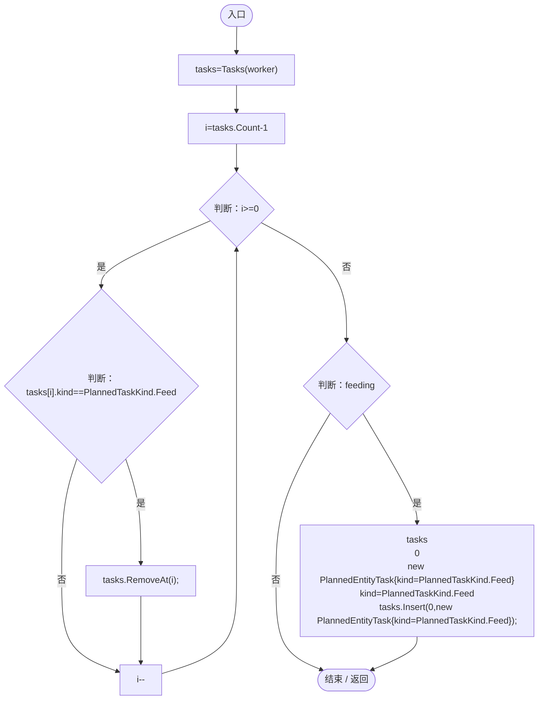
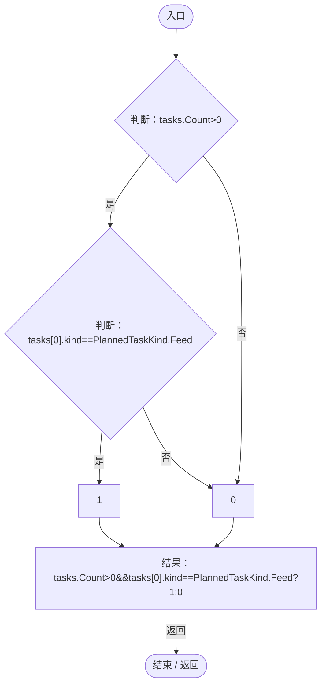
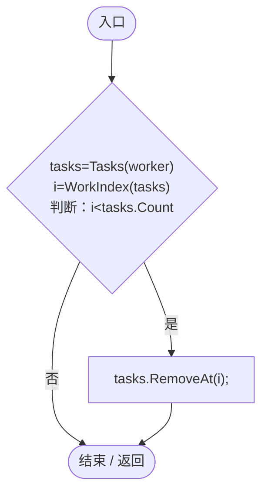
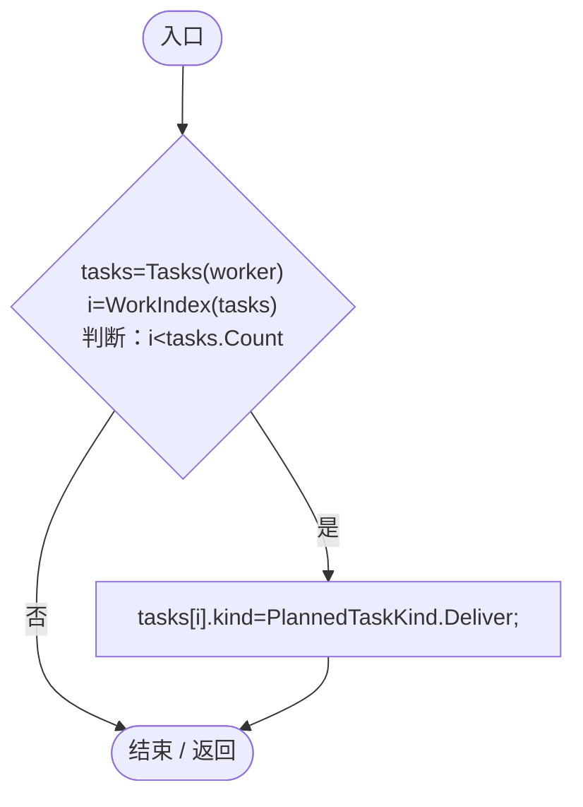
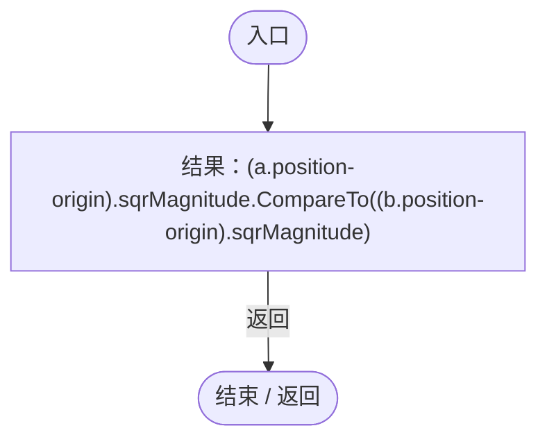
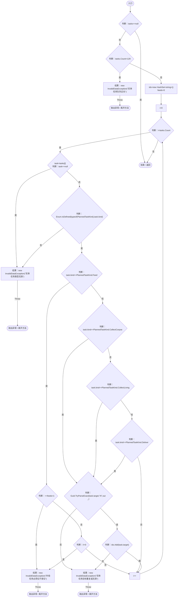

```mermaid
flowchart TD
  b0(["入口"])
  b1["state=worker.State<br/>tasks=Tasks(worker)<br/>current=WorkIndex(tasks)"]
  b2{"判断：string.IsNullOrEmpty(state.resourceTarget)"}
  b3["state.resourceTarget"]
  b4["state.livingTarget"]
  b5["selected=!string.IsNullOrEmpty(state.resourceTarget)?state.resourceTarget:state.livingTarget"]
  b6{"判断：string.IsNullOrEmpty(selected)"}
  b7{"判断：current==tasks.Count"}
  b8{"判断：tasks[current].target!=selected"}
  b9{"判断：string.IsNullOrEmpty(state.carriedResource)"}
  b10{"判断：string.IsNullOrEmpty(state.carriedLiving)"}
  b11["i=tasks.Count-1"]
  b12{"判断：i&gt;=current"}
  b13{"判断：tasks[i].target==selected"}
  b14["tasks.RemoveAt(i);"]
  b15["i--"]
  b16["tasks<br/>current<br/>new PlannedEntityTask{kind=!string.IsNullOrEmpty(state.resourceTarget)?PlannedTaskKind.CollectCorpse:PlannedTaskKind.CollectLiving,target=selected}"]
  b17{"判断：string.IsNullOrEmpty(state.resourceTarget)"}
  b18["PlannedTaskKind.CollectCorpse"]
  b19["PlannedTaskKind.CollectLiving"]
  b20["kind=!string.IsNullOrEmpty(state.resourceTarget)?PlannedTaskKind.CollectCorpse:PlannedTaskKind.CollectLiving"]
  b21["target=selected<br/>tasks.Insert(current,new PlannedEntityTask{kind=!string.IsNullOrEmpty(state.resourceTarget)?PlannedTaskKind.CollectCorpse:PlannedTaskKind.CollectLiving,target=selected});"]
  b22{"判断：SimulationOptimization.Current.taskQueue"}
  b23["SimulationOptimization.Current.workerQueueLimit"]
  b24["1"]
  b25["maximum=(SimulationOptimization.Current.taskQueue?SimulationOptimization.Current.workerQueueLimit:1)+current"]
  b26{"判断：tasks.Count&gt;maximum"}
  b27["tasks.RemoveAt(tasks.Count-1);"]
  b28{"判断：current&lt;tasks.Count"}
  b29{"task=tasks[current]<br/>判断：task.kind==PlannedTaskKind.Deliver"}
  b30{"判断：string.IsNullOrEmpty(state.carriedResource)"}
  b31{"判断：string.IsNullOrEmpty(state.carriedLiving)"}
  b32{"判断：task.kind==PlannedTaskKind.CollectCorpse"}
  b33["ColonyResource.Find(task.target)"]
  b34["null"]
  b35["resource=task.kind==PlannedTaskKind.CollectCorpse?ColonyResource.Find(task.target):null"]
  b36{"判断：task.kind==PlannedTaskKind.CollectLiving"}
  b37["EcologyIdentity.Find(task.target)"]
  b38["null"]
  b39["entity=task.kind==PlannedTaskKind.CollectLiving?EcologyIdentity.Find(task.target):null"]
  b40{"判断：resource!=null"}
  b41{"判断：ColonyCorpseAccess.Available(resource,worker)"}
  b42{"判断：ColonyActivityRange.Contains(worker.Population,resource.transform.position)"}
  b43{"判断：resource.Claim(worker)"}
  b44["state.resourceTarget=task.target;<br/>state.livingTarget=null;"]
  b45{"判断：entity!=null"}
  b46{"判断：AntColonyWorker.Valid(entity,worker)"}
  b47{"判断：AntColonyWorker.Claimed(entity,worker)"}
  b48["state.livingTarget=task.target;<br/>state.resourceTarget=null;"]
  b49["tasks.RemoveAt(current);<br/>state.resourceTarget=state.livingTarget=null;"]
  b50{"判断：state.scan&gt;0"}
  b51["state.scan=AntColonySettings.Current.scanInterval;<br/>Circles.Clear();"]
  b52["ColonyActivityRange.Circles(worker.Population)"]
  b53{"判断：ColonyActivityRange.Circles(worker.Population)"}
  b54["var<br/>Circles.Add(circle);"]
  b55{"判断：ColonyActivityRange.Circles(worker.Population)"}
  b56["ColonyActivityRange.Circles(worker.Population)"]
  b57["连接 / 离开区域"]
  b58["Included.Clear();"]
  b59["tasks"]
  b60{"判断：tasks"}
  b61{"var<br/>判断：task.target!=null"}
  b62["Included.Add(task.target);"]
  b63["tasks"]
  b64["origin=worker.transform.position<br/>settings=AntColonySettings.Current"]
  b65{"判断：SimulationOptimization.Current.taskQueue"}
  b66["SimulationOptimization.Current.workerQueueLimit"]
  b67["1"]
  b68["limit=SimulationOptimization.Current.taskQueue?SimulationOptimization.Current.workerQueueLimit:1"]
  b69["ResourceCoordinates.Query(origin,settings.transportSearchRadius,true,true,Resources);<br/>Resources.Sort((a,b)=&gt;(a.position-origin).sqrMagnitude.CompareTo((b.position-origin).sqrMagnitude));"]
  b70["Resources"]
  b71{"判断：Resources"}
  b72["var"]
  b73{"r=item.resource<br/>判断：tasks.Count&gt;=limit"}
  b74{"判断：ColonyCorpseAccess.Available(r,worker)"}
  b75{"判断：r.HasLiveClaim"}
  b76{"判断：ColonyActivityRange.Contains(Circles,item.position)"}
  b77{"判断：Included.Add(r.State.id)"}
  b78["tasks<br/>new PlannedEntityTask{kind=PlannedTaskKind.CollectCorpse,target=r.State.id}<br/>kind=PlannedTaskKind.CollectCorpse<br/>target=r.State.id<br/>tasks.Add(new PlannedEntityTask{kind=PlannedTaskKind.CollectCorpse,target=r.State.id});"]
  b79["Resources"]
  b80["Resources.Clear();<br/>EntityCoordinateGrid.Query(origin,ResourceCoordinates.BroadRadius(origin,settings.transportSearchRadius),Entities);<br/>Entities.Sort((a,b)=&gt;(a.position-origin).sqrMagnitude.CompareTo((b.position-origin).sqrMagnitude));"]
  b81["Entities"]
  b82{"判断：Entities"}
  b83["var"]
  b84{"e=item.entity<br/>判断：tasks.Count&gt;=limit"}
  b85{"判断：EcologyQueries.Distance(origin,item.position)&lt;=settings.transportSearchRadius"}
  b86{"判断：ColonyActivityRange.Contains(Circles,item.position)"}
  b87{"判断：AntColonyWorker.Valid(e,worker,Circles)"}
  b88{"判断：AntColonyWorker.Claimed(e,worker)"}
  b89{"id=EcologyIdentity.Of(e)<br/>判断：Included.Add(id)"}
  b90["tasks<br/>new PlannedEntityTask{kind=PlannedTaskKind.CollectLiving,target=id}<br/>kind=PlannedTaskKind.CollectLiving<br/>target=id<br/>tasks.Add(new PlannedEntityTask{kind=PlannedTaskKind.CollectLiving,target=id});"]
  b91["Entities"]
  b92{"Entities.Clear();<br/>Included.Clear();<br/>Circles.Clear();<br/>判断：current&lt;tasks.Count"}
  b93["Select(worker);"]
  b94(["结束 / 返回"])
  b0 --> b1
  b1 --> b2
  b2 -->|"否"| b3
  b2 -->|"是"| b4
  b3 --> b5
  b4 --> b5
  b5 --> b6
  b6 -->|"否"| b7
  b6 -->|"是"| b28
  b7 -->|"否"| b8
  b7 -->|"是"| b9
  b8 -->|"是"| b9
  b8 -->|"否"| b28
  b9 -->|"是"| b10
  b9 -->|"否"| b28
  b10 -->|"是"| b11
  b10 -->|"否"| b28
  b11 --> b12
  b12 -->|"是"| b13
  b12 -->|"否"| b16
  b13 -->|"是"| b14
  b13 -->|"否"| b15
  b14 --> b15
  b15 --> b12
  b16 --> b17
  b17 -->|"否"| b18
  b17 -->|"是"| b19
  b18 --> b20
  b19 --> b20
  b20 --> b21
  b21 --> b22
  b22 -->|"是"| b23
  b22 -->|"否"| b24
  b23 --> b25
  b24 --> b25
  b25 --> b26
  b26 -->|"是"| b27
  b26 -->|"否"| b28
  b27 --> b26
  b28 -->|"是"| b29
  b28 -->|"否"| b50
  b29 -->|"是"| b30
  b29 -->|"否"| b32
  b30 -->|"是"| b31
  b30 -->|"否"| b94
  b31 -->|"否"| b94
  b31 -->|"是"| b32
  b32 -->|"是"| b33
  b32 -->|"否"| b34
  b33 --> b35
  b34 --> b35
  b35 --> b36
  b36 -->|"是"| b37
  b36 -->|"否"| b38
  b37 --> b39
  b38 --> b39
  b39 --> b40
  b40 -->|"是"| b41
  b40 -->|"否"| b45
  b41 -->|"是"| b42
  b41 -->|"否"| b45
  b42 -->|"是"| b43
  b42 -->|"否"| b45
  b43 -->|"是"| b44
  b43 -->|"否"| b45
  b44 --> b94
  b45 -->|"是"| b46
  b45 -->|"否"| b49
  b46 -->|"是"| b47
  b46 -->|"否"| b49
  b47 -->|"否"| b48
  b47 -->|"是"| b49
  b48 --> b94
  b49 --> b28
  b50 -->|"是"| b94
  b50 -->|"否"| b51
  b51 --> b52
  b52 --> b53
  b53 -->|"是"| b54
  b53 -->|"否 · 经过finally 55"| b58
  b54 --> b53
  b55 -->|"否"| b56
  b55 -->|"是"| b57
  b56 --> b57
  b58 --> b59
  b59 --> b60
  b60 -->|"是"| b61
  b60 -->|"否 · 经过finally 63"| b64
  b61 -->|"是"| b62
  b61 -->|"否"| b60
  b62 --> b60
  b64 --> b65
  b65 -->|"是"| b66
  b65 -->|"否"| b67
  b66 --> b68
  b67 --> b68
  b68 --> b69
  b69 --> b70
  b70 --> b71
  b71 -->|"是"| b72
  b71 -->|"否 · 经过finally 79"| b80
  b72 --> b73
  b73 -->|"是 · 经过finally 79"| b80
  b73 -->|"否"| b74
  b74 -->|"是"| b75
  b74 -->|"否"| b71
  b75 -->|"否"| b76
  b75 -->|"是"| b71
  b76 -->|"是"| b77
  b76 -->|"否"| b71
  b77 -->|"是"| b78
  b77 -->|"否"| b71
  b78 --> b71
  b80 --> b81
  b81 --> b82
  b82 -->|"是"| b83
  b82 -->|"否 · 经过finally 91"| b92
  b83 --> b84
  b84 -->|"是 · 经过finally 91"| b92
  b84 -->|"否"| b85
  b85 -->|"是"| b86
  b85 -->|"否"| b82
  b86 -->|"是"| b87
  b86 -->|"否"| b82
  b87 -->|"是"| b88
  b87 -->|"否"| b82
  b88 -->|"否"| b89
  b88 -->|"是"| b82
  b89 -->|"是"| b90
  b89 -->|"否"| b82
  b90 --> b82
  b92 -->|"是"| b93
  b92 -->|"否"| b94
  b93 --> b94
  b53 -. "退出保护区时 finally（示意）" .-> b55
  b60 -. "退出保护区时 finally（示意）" .-> b63
  b71 -. "退出保护区时 finally（示意）" .-> b79
  b82 -. "退出保护区时 finally（示意）" .-> b91

```

# WorkerTaskQueue.cs

[返回总索引](../README.md) · `Runtime` · `Assets/DarwinPark/Entities/Ecology/WorkerTaskQueue.cs`

[源文件](../../../Assets/DarwinPark/Entities/Ecology/WorkerTaskQueue.cs) · 源码校验：`2637f869cb5e1c66ad87e3aa5e09582de33c717b9a1b29eddf7b014671485b46`

方法按源文件位置排列。事件/回调引用不表示立即执行；分支与异常说明见总索引。完整源码与可点击关系图请打开离线手册。

## Tasks · L16

`public static List<PlannedEntityTask> Tasks(AntColonyMember worker)`

### Editor / Player · Roslyn编译器控制流

项目内调用/回调引用：

- [AntColonyMember.State.get · L33](baebd85c05598377.md#ma804eb9f68138343)（访问器）

## Feeding · L17

`public static void Feeding(AntColonyMember worker,bool feeding)`

### Editor / Player · Roslyn编译器控制流

项目内调用/回调引用：

- [WorkerTaskQueue.Tasks · L16](dc0692495776be10.md#m39e1f5f7df33e56c)（方法）

## WorkIndex · L22

`private static int WorkIndex(List<PlannedEntityTask> tasks)`

### Editor / Player · Roslyn编译器控制流

## Complete · L23

`public static void Complete(AntColonyMember worker)`

### Editor / Player · Roslyn编译器控制流

项目内调用/回调引用：

- [WorkerTaskQueue.Tasks · L16](dc0692495776be10.md#m39e1f5f7df33e56c)（方法）
- [WorkerTaskQueue.WorkIndex · L22](dc0692495776be10.md#mc6fef7402bae4000)（方法）

## PickedUp · L25

`public static void PickedUp(AntColonyMember worker)`

### Editor / Player · Roslyn编译器控制流

项目内调用/回调引用：

- [WorkerTaskQueue.Tasks · L16](dc0692495776be10.md#m39e1f5f7df33e56c)（方法）
- [WorkerTaskQueue.WorkIndex · L22](dc0692495776be10.md#mc6fef7402bae4000)（方法）

## Select · L27

`public static void Select(AntColonyMember worker)`

### Editor / Player · Roslyn编译器控制流

项目内调用/回调引用：

- [AntColonyMember.State.get · L33](baebd85c05598377.md#ma804eb9f68138343)（访问器）
- [WorkerTaskQueue.Tasks · L16](dc0692495776be10.md#m39e1f5f7df33e56c)（方法）
- [WorkerTaskQueue.WorkIndex · L22](dc0692495776be10.md#mc6fef7402bae4000)（方法）
- [SimulationOptimization.Current.get · L25](11c9091e70893352.md#mde7abfdc18429e4a)（访问器）
- [ColonyResource.Find · L28](293dbaecfff4b585.md#m1324285ab40ac6f4)（方法）
- [EcologyIdentity.Find · L21](bdf7ccc2c9c0452f.md#mb670b64dc2baff58)（方法）
- [ColonyCorpseAccess.Available · L6](f6ef68cc68f39eea.md#m8ffa84bc06beaed6)（方法）
- [ColonyActivityRange.Contains · L21](e8d854132f563257.md#m535d817473d6a256)（方法）
- [AntColonyMember.Population.get · L36](baebd85c05598377.md#m3fa1d6d15c7c95ba)（访问器）
- [ColonyResource.Claim · L73](293dbaecfff4b585.md#mb3770aae779ba387)（方法）
- [AntColonyWorker.Valid · L37](8a0cca2020271b6f.md#mdeeb29672bb0d9fa)（方法）
- [AntColonyWorker.Claimed · L29](8a0cca2020271b6f.md#mff9a0d119103c9ed)（方法）
- [AntColonySettings.Current.get · L31](cb0a937e97c8fbb3.md#mcd121159f407ccdf)（访问器）
- [ColonyActivityRange.Circles · L16](e8d854132f563257.md#md27786d1fb691b16)（方法）
- [ResourceCoordinates.Query · L58](93d731ac01e3af48.md#md13e92bc2b759c8f)（方法）
- [ColonyActivityRange.Contains · L27](e8d854132f563257.md#m75fd40dfa1ab2aec)（方法）
- [ColonyResource.State.get · L24](293dbaecfff4b585.md#m41824f1a0e160aa5)（访问器）
- [EntityCoordinateGrid.Query · L26](f6d0404a662a5d5c.md#mb223b609771bd310)（方法）
- [ResourceCoordinates.BroadRadius · L57](93d731ac01e3af48.md#m692adbf9beded476)（方法）
- [EcologyQueries.Distance · L43](bdf7ccc2c9c0452f.md#m6e395dce655ebcac)（方法）
- [EcologyIdentity.Of · L22](bdf7ccc2c9c0452f.md#mb23020fe763aafd3)（方法）
- [WorkerTaskQueue.Select · L27](dc0692495776be10.md#mf7061cdad05e5c0f)（方法）
- [WorkerTaskQueue.回调@53 · L53](dc0692495776be10.md#mde2011a3852b2341)（回调/委托）
- [WorkerTaskQueue.回调@56 · L56](dc0692495776be10.md#me04551a8e824d1ee)（回调/委托）

## 回调@53 · L53

`( … => 回调`

### Editor / Player · Roslyn编译器控制流

## 回调@56 · L56

`( … => 回调`

### Editor / Player · Roslyn编译器控制流

## Validate · L61

`public static void Validate(List<PlannedEntityTask> tasks)`

### Editor / Player · Roslyn编译器控制流

