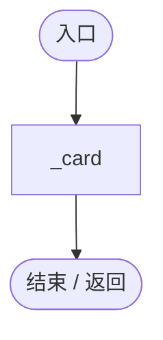
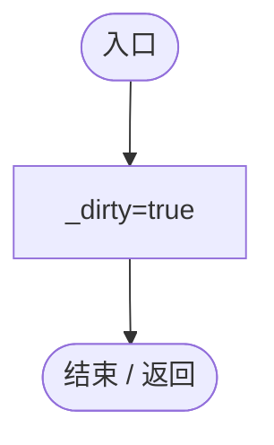
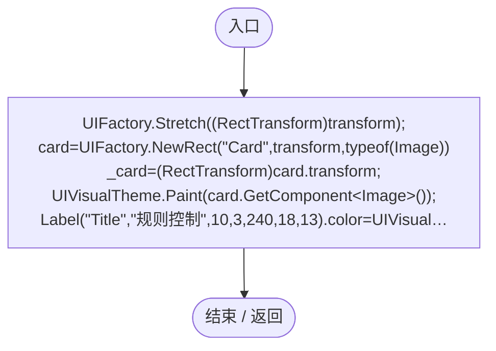
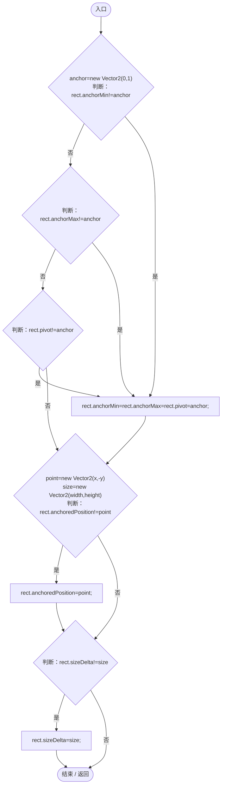
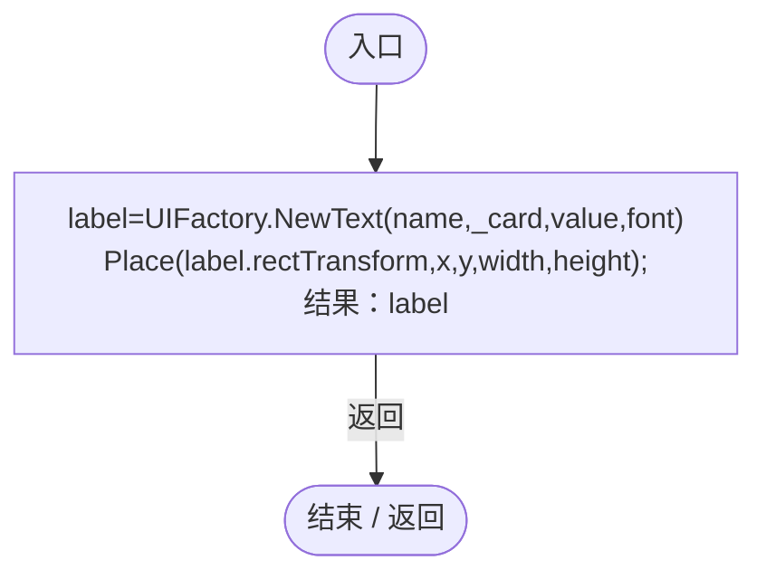
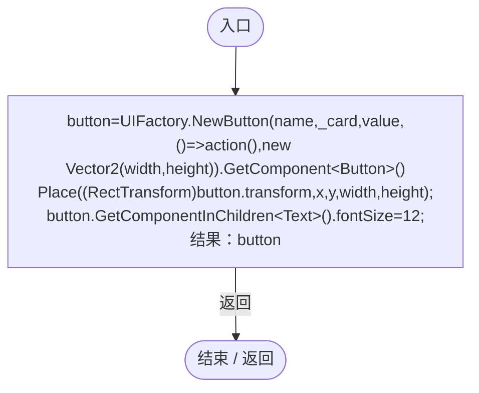
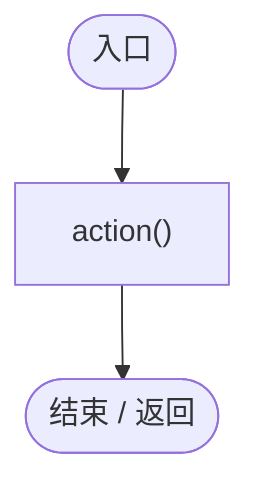
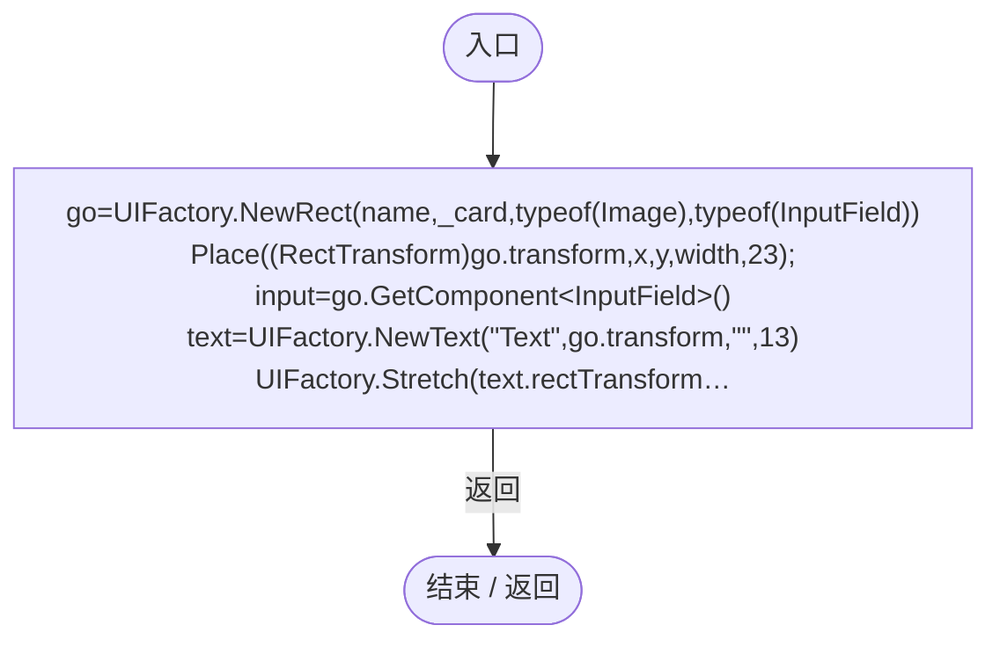
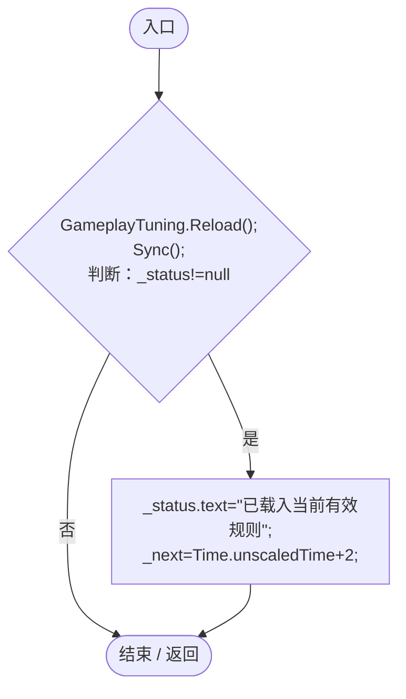

```mermaid
flowchart TD
  b0(["入口"])
  b1{"判断：_card==null"}
  b2{"判断：_status==null"}
  b3["parent=(RectTransform)transform.parent<br/>wide=parent.rect.width&gt;=leftOffset+cardWidth+12<br/>_launch.gameObject.SetActive(!wide);<br/>launch=(RectTransform)_launch.transform<br/>launch.anchorMin=launch.anchorMax=launch.pivot=new Vector2(1,1);<br/>launch.a…"]
  b4{"_card.gameObject<br/>判断：wide"}
  b5["_floating"]
  b6["wide"]
  b7["_card.gameObject.SetActive(wide&#124;&#124;_floating);"]
  b8{"_card<br/>判断：wide"}
  b9["leftOffset"]
  b10["Mathf.Max(12,parent.rect.width-cardWidth-12)"]
  b11{"判断：wide"}
  b12["0"]
  b13["-2*cardHeight-18"]
  b14["Place(_card,wide?leftOffset:Mathf.Max(12,parent.rect.width-cardWidth-12),wide?0:-2*cardHeight-18,cardWidth,cardHeight);"]
  b15{"判断：WorldAuthority.CanEdit"}
  b16{"判断：WorldAuthority.IsReplica"}
  b17{"判断：WorldRuntimeGate.Ready"}
  b18["!WorldRuntimeGate.Loading"]
  b19["WorldAuthority.CanEdit&amp;&amp;!WorldAuthority.IsReplica&amp;&amp;WorldRuntimeGate.Ready&amp;&amp;!WorldRuntimeGate.Loading"]
  b20["editable=WorldAuthority.CanEdit&amp;&amp;!WorldAuthority.IsReplica&amp;&amp;WorldRuntimeGate.Ready&amp;&amp;!WorldRuntimeGate.Loading"]
  b21["_toggle.interactable=_apply.interactable=_fraction.interactable=_seconds.interactable=editable;"]
  b22{"_seconds.interactable<br/>判断：editable"}
  b23["_extensions.SecondsEditable"]
  b24["editable"]
  b25["_seconds.interactable=editable&amp;&amp;_extensions.SecondsEditable;"]
  b26{"_extensions.SetEditable(editable);<br/>判断：_floating"}
  b27{"判断：UnityEngine.Input.GetKeyDown(KeyCode.Escape)"}
  b28["GameInputGate.ConsumeEscape();<br/>_floating=false;"]
  b29{"判断：Time.unscaledTime&lt;_next"}
  b30{"_next=Time.unscaledTime+.5f;<br/>判断：ReferenceEquals(_seen,GameplayTuning.Current)"}
  b31{"判断：_dirty"}
  b32{"判断：_fraction.isFocused"}
  b33{"判断：_seconds.isFocused"}
  b34["Sync();"]
  b35{"_status.text<br/>判断：editable"}
  b36["&quot;规则由房主本机控制&quot;"]
  b37{"判断：_dirty"}
  b38["&quot;尚未保存&quot;"]
  b39["_extensions.Status()"]
  b40["_status.text=!editable?&quot;规则由房主本机控制&quot;:_dirty?&quot;尚未保存&quot;:_extensions.Status();"]
  b41(["结束 / 返回"])
  b0 --> b1
  b1 -->|"否"| b2
  b1 -->|"是"| b41
  b2 -->|"是"| b41
  b2 -->|"否"| b3
  b3 --> b4
  b4 -->|"否"| b5
  b4 -->|"是"| b6
  b5 --> b7
  b6 --> b7
  b7 --> b8
  b8 -->|"是"| b9
  b8 -->|"否"| b10
  b9 --> b11
  b10 --> b11
  b11 -->|"是"| b12
  b11 -->|"否"| b13
  b12 --> b14
  b13 --> b14
  b14 --> b15
  b15 -->|"是"| b16
  b15 -->|"否"| b19
  b16 -->|"否"| b17
  b16 -->|"是"| b19
  b17 -->|"是"| b18
  b17 -->|"否"| b19
  b18 --> b20
  b19 --> b20
  b20 --> b21
  b21 --> b22
  b22 -->|"是"| b23
  b22 -->|"否"| b24
  b23 --> b25
  b24 --> b25
  b25 --> b26
  b26 -->|"是"| b27
  b26 -->|"否"| b29
  b27 -->|"是"| b28
  b27 -->|"否"| b29
  b28 --> b29
  b29 -->|"是"| b41
  b29 -->|"否"| b30
  b30 -->|"否"| b31
  b30 -->|"是"| b35
  b31 -->|"否"| b32
  b31 -->|"是"| b35
  b32 -->|"否"| b33
  b32 -->|"是"| b35
  b33 -->|"否"| b34
  b33 -->|"是"| b35
  b34 --> b35
  b35 -->|"否"| b36
  b35 -->|"是"| b37
  b36 --> b40
  b37 -->|"是"| b38
  b37 -->|"否"| b39
  b38 --> b40
  b39 --> b40
  b40 --> b41

```

# SimulationRulesPanel.cs

[返回总索引](../README.md) · `Runtime` · `Assets/DarwinPark/UI/SimulationRulesPanel.cs`

[源文件](../../../Assets/DarwinPark/UI/SimulationRulesPanel.cs) · 源码校验：`f3a73fa03a7dd8d3cb73e938aec1d5fe93666bf5d59a39ccc3f0d60bc4abfa7a`

方法按源文件位置排列。事件/回调引用不表示立即执行；分支与异常说明见总索引。完整源码与可点击关系图请打开离线手册。

## Card.get · L14

`public RectTransform Card`

### Editor / Player · 语法控制结构 / 声明（非CFG）

## MarkRuleDirty · L17

`public void MarkRuleDirty()`

### Editor / Player · Roslyn编译器控制流

## Start · L18

`private void Start()`

### Editor / Player · Roslyn编译器控制流

项目内调用/回调引用：

- [UIFactory.Stretch · L150](dd1096a6995423db.md#m11d8f6c6d00cc047)（方法）
- [UIFactory.NewRect · L33](dd1096a6995423db.md#med612116f3152344)（方法）
- [UIVisualTheme.Paint · L58](ca525a798a08f966.md#m2d61a6b26ab24980)（方法）
- [SimulationRulesPanel.Label · L32](dd1021765f4bd253.md#md878b44dce729e91)（方法）
- [SimulationRulesPanel.Button · L33](dd1021765f4bd253.md#m2079f852ca2e69b2)（方法）
- [SimulationRulesPanel.Input · L34](dd1021765f4bd253.md#mc16a586ebf00430c)（方法）
- [UIFactory.NewButton · L73](dd1096a6995423db.md#m5896f1b097c8bdde)（方法）
- [RuleCardExtensions.Bind · L16](92d59cd12a5696c3.md#m7f4cd63f8d532ca6)（方法）
- [SimulationRulesPanel.Sync · L41](dd1021765f4bd253.md#m678d554257fd45cb)（方法）
- [SimulationRulesPanel.回调@28 · L28](dd1021765f4bd253.md#m57dc4cafcd1c9aa2)（回调/委托）
- [SimulationRulesPanel.Toggle · L38](dd1021765f4bd253.md#m00d1891cdc0ed393)（方法）
- [SimulationRulesPanel.Apply · L45](dd1021765f4bd253.md#m60499461d27c81f8)（方法）
- [SimulationRulesPanel.Reload · L39](dd1021765f4bd253.md#me8000d5409edac90)（方法）

## 回调@28 · L28

`( … => 回调`

### Editor / Player · Roslyn编译器控制流

## Place · L31

`private static void Place(RectTransform rect,float x,float y,float width,float height)`

### Editor / Player · Roslyn编译器控制流

## Label · L32

`private Text Label(string name,string value,float x,float y,float width,float height,int font)`

### Editor / Player · Roslyn编译器控制流

项目内调用/回调引用：

- [UIFactory.NewText · L57](dd1096a6995423db.md#m9dbccb5f0c38189e)（方法）
- [SimulationRulesPanel.Place · L31](dd1021765f4bd253.md#m196d8da975c0e901)（方法）

## Button · L33

`private Button Button(string name,string value,UnityEngine.Events.UnityAction action,float x,float y,float width,float height)`

### Editor / Player · Roslyn编译器控制流

项目内调用/回调引用：

- [UIFactory.NewButton · L73](dd1096a6995423db.md#m5896f1b097c8bdde)（方法）
- [SimulationRulesPanel.Place · L31](dd1021765f4bd253.md#m196d8da975c0e901)（方法）
- [SimulationRulesPanel.回调@33 · L33](dd1021765f4bd253.md#m0da56564f4f26778)（回调/委托）

## 回调@33 · L33

`( … => 回调`

### Editor / Player · Roslyn编译器控制流

## Input · L34

`private InputField Input(string name,float x,float y,float width)`

### Editor / Player · Roslyn编译器控制流

项目内调用/回调引用：

- [UIFactory.NewRect · L33](dd1096a6995423db.md#med612116f3152344)（方法）
- [SimulationRulesPanel.Place · L31](dd1021765f4bd253.md#m196d8da975c0e901)（方法）
- [UIFactory.NewText · L57](dd1096a6995423db.md#m9dbccb5f0c38189e)（方法）
- [UIFactory.Stretch · L150](dd1096a6995423db.md#m11d8f6c6d00cc047)（方法）
- [SimulationRulesPanel.回调@36 · L36](dd1021765f4bd253.md#ma340c2d10c0254f8)（回调/委托）

## 回调@36 · L36

`_ … => 回调`

### Editor / Player · Roslyn编译器控制流

## Toggle · L38

`private void Toggle()`

### Editor / Player · Roslyn编译器控制流

项目内调用/回调引用：

- [RuleCardExtensions.Toggle · L38](92d59cd12a5696c3.md#mc02d99e1a588a601)（方法）

## Reload · L39

`public void Reload()`

### Editor / Player · Roslyn编译器控制流

项目内调用/回调引用：

- [GameplayTuning.Reload · L59](db546e5713b32d53.md#m08a291b1e79e7088)（方法）
- [SimulationRulesPanel.Sync · L41](dd1021765f4bd253.md#m678d554257fd45cb)（方法）

## Sync · L41

`private void Sync()`

### Editor / Player · Roslyn编译器控制流

项目内调用/回调引用：

- [GameplayTuning.Current.get · L44](db546e5713b32d53.md#m5713e7f86902b6fa)（访问器）
- [RuleCardExtensions.Sync · L29](92d59cd12a5696c3.md#m17ca0efb23286f22)（方法）

## Apply · L45

`public void Apply()`

### Editor / Player · Roslyn编译器控制流

项目内调用/回调引用：

- [RuleCardExtensions.Save · L52](92d59cd12a5696c3.md#m860cc247d85adbd9)（方法）
- [SimulationRulesPanel.Sync · L41](dd1021765f4bd253.md#m678d554257fd45cb)（方法）

## LateUpdate · L50

`private void LateUpdate()`

### Editor / Player · Roslyn编译器控制流

项目内调用/回调引用：

- [SimulationRulesPanel.Place · L31](dd1021765f4bd253.md#m196d8da975c0e901)（方法）
- [RuleCardExtensions.SetEditable · L58](92d59cd12a5696c3.md#mabeb8a71e5cf03d7)（方法）
- [GameInputGate.ConsumeEscape · L9](52955daae7e592ab.md#m5b050ac6f014de67)（方法）
- [GameplayTuning.Current.get · L44](db546e5713b32d53.md#m5713e7f86902b6fa)（访问器）
- [SimulationRulesPanel.Sync · L41](dd1021765f4bd253.md#m678d554257fd45cb)（方法）
- [RuleCardExtensions.Status · L59](92d59cd12a5696c3.md#mf7e83cb1985b8e0c)（方法）

## OnDisable · L63

`private void OnDisable()`

### Editor / Player · Roslyn编译器控制流

