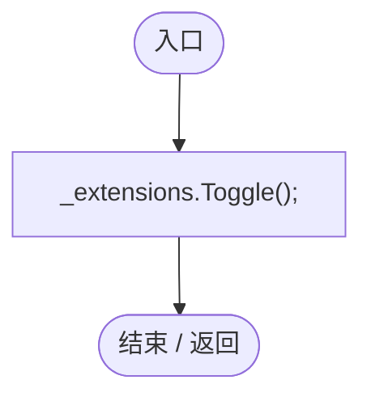
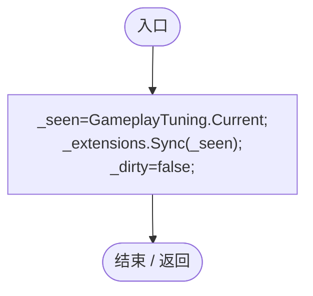
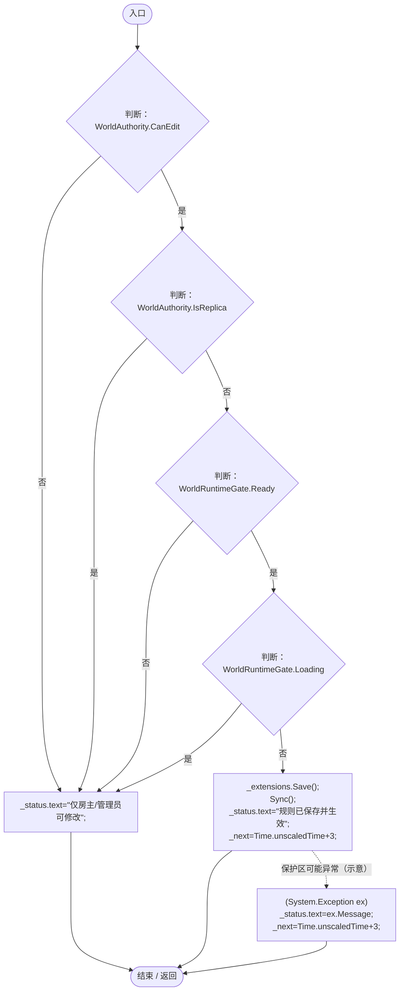
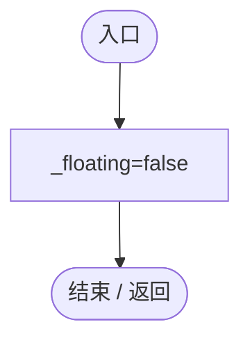

```mermaid
flowchart TD
  b0(["入口"])
  b1{"判断：_card==null"}
  b2{"判断：_status==null"}
  b3{"parent=(RectTransform)transform.parent<br/>判断：_statistics==null"}
  b4["_statistics=transform.parent.GetComponentInChildren&lt;MapEntityStatisticsUI&gt;();"]
  b5{"判断：_statistics!=null"}
  b6["((RectTransform)_statistics.transform).offsetMax.x+10"]
  b7["leftOffset"]
  b8["left=_statistics!=null?((RectTransform)_statistics.transform).offsetMax.x+10:leftOffset"]
  b9["wide=parent.rect.width&gt;=left+cardWidth+12<br/>_launch.gameObject.SetActive(!wide);<br/>launch=(RectTransform)_launch.transform<br/>launch.anchorMin=launch.anchorMax=launch.pivot=new Vector2(1,1);<br/>launch.anchoredPosition=new Vector2(-8,31);"]
  b10{"_card.gameObject<br/>判断：wide"}
  b11["_floating"]
  b12["wide"]
  b13["_card.gameObject.SetActive(wide&#124;&#124;_floating);"]
  b14{"_card<br/>判断：wide"}
  b15["left"]
  b16["Mathf.Max(12,parent.rect.width-cardWidth-12)"]
  b17{"判断：wide"}
  b18["0"]
  b19["-2*cardHeight-18"]
  b20["Place(_card,wide?left:Mathf.Max(12,parent.rect.width-cardWidth-12),wide?0:-2*cardHeight-18,cardWidth,cardHeight);"]
  b21{"判断：WorldAuthority.CanEdit"}
  b22{"判断：WorldAuthority.IsReplica"}
  b23{"判断：WorldRuntimeGate.Ready"}
  b24["!WorldRuntimeGate.Loading"]
  b25["WorldAuthority.CanEdit&amp;&amp;!WorldAuthority.IsReplica&amp;&amp;WorldRuntimeGate.Ready&amp;&amp;!WorldRuntimeGate.Loading"]
  b26["editable=WorldAuthority.CanEdit&amp;&amp;!WorldAuthority.IsReplica&amp;&amp;WorldRuntimeGate.Ready&amp;&amp;!WorldRuntimeGate.Loading"]
  b27["_toggle.interactable=_apply.interactable=_fraction.interactable=_seconds.interactable=editable;"]
  b28{"_seconds.interactable<br/>判断：editable"}
  b29["_extensions.SecondsEditable"]
  b30["editable"]
  b31["_seconds.interactable=editable&amp;&amp;_extensions.SecondsEditable;"]
  b32{"_extensions.SetEditable(editable);<br/>判断：_floating"}
  b33{"判断：UnityEngine.Input.GetKeyDown(KeyCode.Escape)"}
  b34["GameInputGate.ConsumeEscape();<br/>_floating=false;"]
  b35{"判断：Time.unscaledTime&lt;_next"}
  b36{"_next=Time.unscaledTime+.5f;<br/>判断：ReferenceEquals(_seen,GameplayTuning.Current)"}
  b37{"判断：_dirty"}
  b38{"判断：_fraction.isFocused"}
  b39{"判断：_seconds.isFocused"}
  b40["Sync();"]
  b41{"_status.text<br/>判断：editable"}
  b42["&quot;规则由房主本机控制&quot;"]
  b43{"判断：_dirty"}
  b44["&quot;尚未保存&quot;"]
  b45["_extensions.Status()"]
  b46["_status.text=!editable?&quot;规则由房主本机控制&quot;:_dirty?&quot;尚未保存&quot;:_extensions.Status();"]
  b47(["结束 / 返回"])
  b0 --> b1
  b1 -->|"否"| b2
  b1 -->|"是"| b47
  b2 -->|"是"| b47
  b2 -->|"否"| b3
  b3 -->|"是"| b4
  b3 -->|"否"| b5
  b4 --> b5
  b5 -->|"是"| b6
  b5 -->|"否"| b7
  b6 --> b8
  b7 --> b8
  b8 --> b9
  b9 --> b10
  b10 -->|"否"| b11
  b10 -->|"是"| b12
  b11 --> b13
  b12 --> b13
  b13 --> b14
  b14 -->|"是"| b15
  b14 -->|"否"| b16
  b15 --> b17
  b16 --> b17
  b17 -->|"是"| b18
  b17 -->|"否"| b19
  b18 --> b20
  b19 --> b20
  b20 --> b21
  b21 -->|"是"| b22
  b21 -->|"否"| b25
  b22 -->|"否"| b23
  b22 -->|"是"| b25
  b23 -->|"是"| b24
  b23 -->|"否"| b25
  b24 --> b26
  b25 --> b26
  b26 --> b27
  b27 --> b28
  b28 -->|"是"| b29
  b28 -->|"否"| b30
  b29 --> b31
  b30 --> b31
  b31 --> b32
  b32 -->|"是"| b33
  b32 -->|"否"| b35
  b33 -->|"是"| b34
  b33 -->|"否"| b35
  b34 --> b35
  b35 -->|"是"| b47
  b35 -->|"否"| b36
  b36 -->|"否"| b37
  b36 -->|"是"| b41
  b37 -->|"否"| b38
  b37 -->|"是"| b41
  b38 -->|"否"| b39
  b38 -->|"是"| b41
  b39 -->|"否"| b40
  b39 -->|"是"| b41
  b40 --> b41
  b41 -->|"否"| b42
  b41 -->|"是"| b43
  b42 --> b46
  b43 -->|"是"| b44
  b43 -->|"否"| b45
  b44 --> b46
  b45 --> b46
  b46 --> b47

```

# SimulationRulesPanel.cs

[返回总索引](../README.md) · `Runtime` · `Assets/DarwinPark/UI/SimulationRulesPanel.cs`

[源文件](../../../Assets/DarwinPark/UI/SimulationRulesPanel.cs) · 源码校验：`58d777a866cf4016f2731e81e87bb25c5a2c39520744d56db772b10fd018431c`

方法按源文件位置排列。事件/回调引用不表示立即执行；分支与异常说明见总索引。完整源码与可点击关系图请打开离线手册。

## Card.get · L15

`public RectTransform Card`

### Editor / Player · 语法控制结构 / 声明（非CFG）

## MarkRuleDirty · L18

`public void MarkRuleDirty()`

### Editor / Player · Roslyn编译器控制流

## Start · L19

`private void Start()`

### Editor / Player · Roslyn编译器控制流

项目内调用/回调引用：

- [UIFactory.Stretch · L150](dd1096a6995423db.md#m11d8f6c6d00cc047)（方法）
- [UIFactory.NewRect · L33](dd1096a6995423db.md#med612116f3152344)（方法）
- [UIVisualTheme.Paint · L58](ca525a798a08f966.md#m2d61a6b26ab24980)（方法）
- [SimulationRulesPanel.Label · L33](dd1021765f4bd253.md#mc91e3553c15449db)（方法）
- [SimulationRulesPanel.Button · L34](dd1021765f4bd253.md#m365a147cd4f79396)（方法）
- [SimulationRulesPanel.Input · L35](dd1021765f4bd253.md#m0db031ad9341aba6)（方法）
- [UIFactory.NewButton · L73](dd1096a6995423db.md#m5896f1b097c8bdde)（方法）
- [RuleCardExtensions.Bind · L19](92d59cd12a5696c3.md#mb084d0e1d91f5190)（方法）
- [SimulationRulesPanel.Sync · L42](dd1021765f4bd253.md#m9b4c631690b61851)（方法）
- [SimulationRulesPanel.回调@29 · L29](dd1021765f4bd253.md#m9e2c28289beb398e)（回调/委托）
- [SimulationRulesPanel.Toggle · L39](dd1021765f4bd253.md#maa9ce2241742cdc1)（方法）
- [SimulationRulesPanel.Apply · L46](dd1021765f4bd253.md#m941ed6e6973ca7d3)（方法）
- [SimulationRulesPanel.Reload · L40](dd1021765f4bd253.md#m05a949ad01c8f870)（方法）

## 回调@29 · L29

`( … => 回调`

### Editor / Player · Roslyn编译器控制流

## Place · L32

`private static void Place(RectTransform rect,float x,float y,float width,float height)`

### Editor / Player · Roslyn编译器控制流

## Label · L33

`private Text Label(string name,string value,float x,float y,float width,float height,int font)`

### Editor / Player · Roslyn编译器控制流

项目内调用/回调引用：

- [UIFactory.NewText · L57](dd1096a6995423db.md#m9dbccb5f0c38189e)（方法）
- [SimulationRulesPanel.Place · L32](dd1021765f4bd253.md#m0df19299b42c88ee)（方法）

## Button · L34

`private Button Button(string name,string value,UnityEngine.Events.UnityAction action,float x,float y,float width,float height)`

### Editor / Player · Roslyn编译器控制流

项目内调用/回调引用：

- [UIFactory.NewButton · L73](dd1096a6995423db.md#m5896f1b097c8bdde)（方法）
- [SimulationRulesPanel.Place · L32](dd1021765f4bd253.md#m0df19299b42c88ee)（方法）
- [SimulationRulesPanel.回调@34 · L34](dd1021765f4bd253.md#mf57aea1fd9947a74)（回调/委托）

## 回调@34 · L34

`( … => 回调`

### Editor / Player · Roslyn编译器控制流

## Input · L35

`private InputField Input(string name,float x,float y,float width)`

### Editor / Player · Roslyn编译器控制流

项目内调用/回调引用：

- [UIFactory.NewRect · L33](dd1096a6995423db.md#med612116f3152344)（方法）
- [SimulationRulesPanel.Place · L32](dd1021765f4bd253.md#m0df19299b42c88ee)（方法）
- [UIFactory.NewText · L57](dd1096a6995423db.md#m9dbccb5f0c38189e)（方法）
- [UIFactory.Stretch · L150](dd1096a6995423db.md#m11d8f6c6d00cc047)（方法）
- [SimulationRulesPanel.回调@37 · L37](dd1021765f4bd253.md#m61e424744e42bb33)（回调/委托）

## 回调@37 · L37

`_ … => 回调`

### Editor / Player · Roslyn编译器控制流

## Toggle · L39

`private void Toggle()`

### Editor / Player · Roslyn编译器控制流

项目内调用/回调引用：

- [RuleCardExtensions.Toggle · L44](92d59cd12a5696c3.md#ma2a7615b1e3f98aa)（方法）

## Reload · L40

`public void Reload()`

### Editor / Player · Roslyn编译器控制流

项目内调用/回调引用：

- [GameplayTuning.Reload · L61](db546e5713b32d53.md#ma781fa66f3a16705)（方法）
- [SimulationRulesPanel.Sync · L42](dd1021765f4bd253.md#m9b4c631690b61851)（方法）

## Sync · L42

`private void Sync()`

### Editor / Player · Roslyn编译器控制流

项目内调用/回调引用：

- [GameplayTuning.Current.get · L46](db546e5713b32d53.md#m4fa691bd8a3b9618)（访问器）
- [RuleCardExtensions.Sync · L34](92d59cd12a5696c3.md#m8ff48eb58108d550)（方法）

## Apply · L46

`public void Apply()`

### Editor / Player · Roslyn编译器控制流

项目内调用/回调引用：

- [RuleCardExtensions.Save · L63](92d59cd12a5696c3.md#m1aaeb4d5ef4a4aa7)（方法）
- [SimulationRulesPanel.Sync · L42](dd1021765f4bd253.md#m9b4c631690b61851)（方法）

## LateUpdate · L51

`private void LateUpdate()`

### Editor / Player · Roslyn编译器控制流

项目内调用/回调引用：

- [SimulationRulesPanel.Place · L32](dd1021765f4bd253.md#m0df19299b42c88ee)（方法）
- [RuleCardExtensions.SetEditable · L69](92d59cd12a5696c3.md#m804dbba504bbbb8b)（方法）
- [GameInputGate.ConsumeEscape · L9](52955daae7e592ab.md#m5b050ac6f014de67)（方法）
- [GameplayTuning.Current.get · L46](db546e5713b32d53.md#m4fa691bd8a3b9618)（访问器）
- [SimulationRulesPanel.Sync · L42](dd1021765f4bd253.md#m9b4c631690b61851)（方法）
- [RuleCardExtensions.Status · L70](92d59cd12a5696c3.md#m7940f1790c7e58d4)（方法）

## OnDisable · L67

`private void OnDisable()`

### Editor / Player · Roslyn编译器控制流

