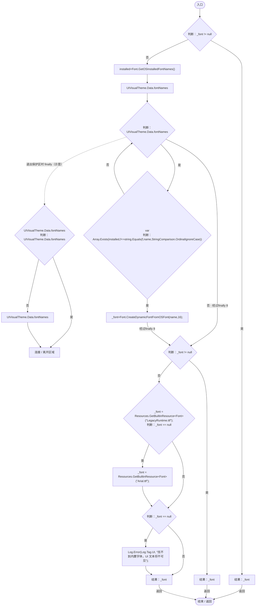
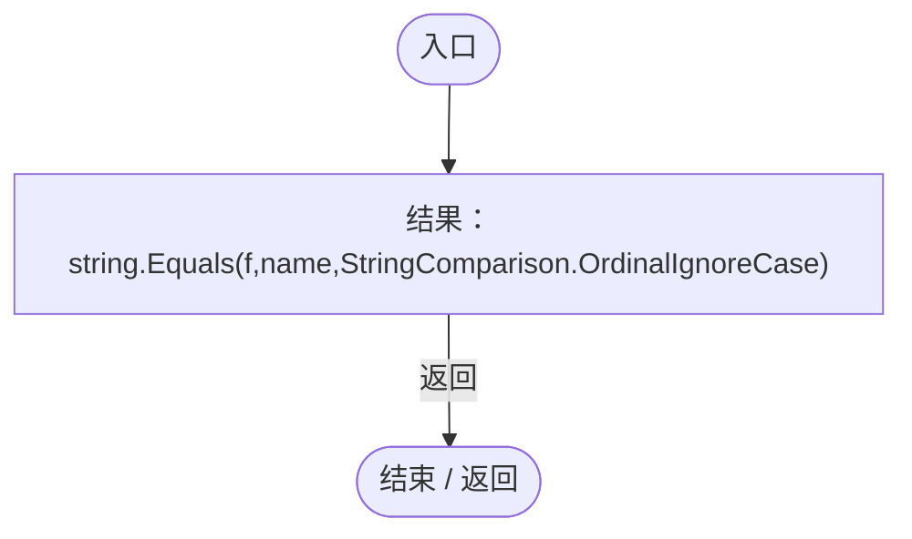
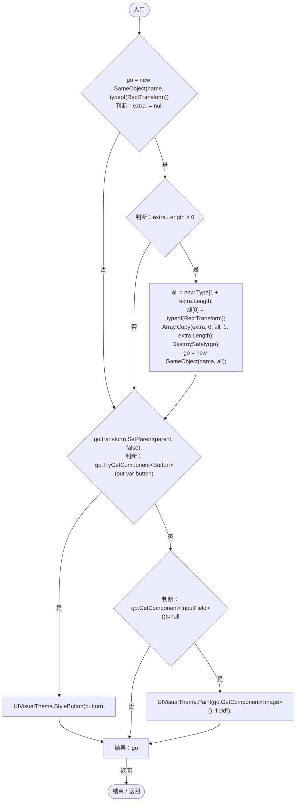
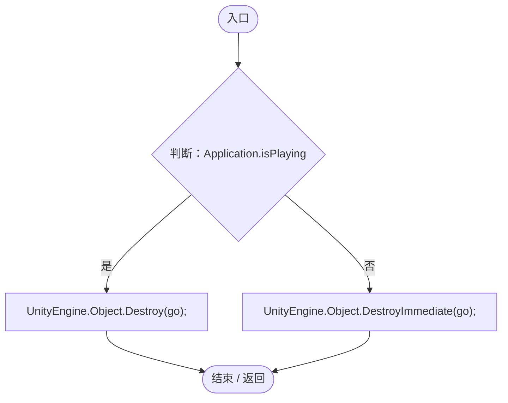
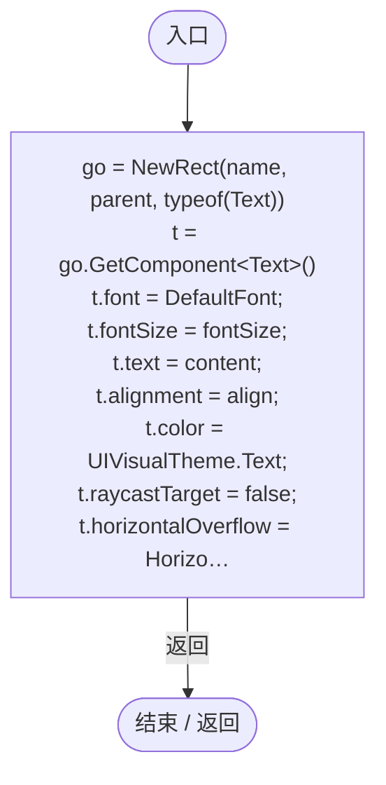
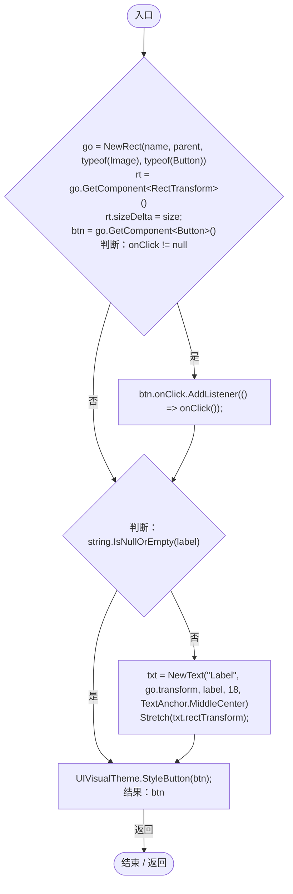
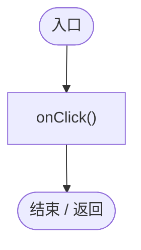
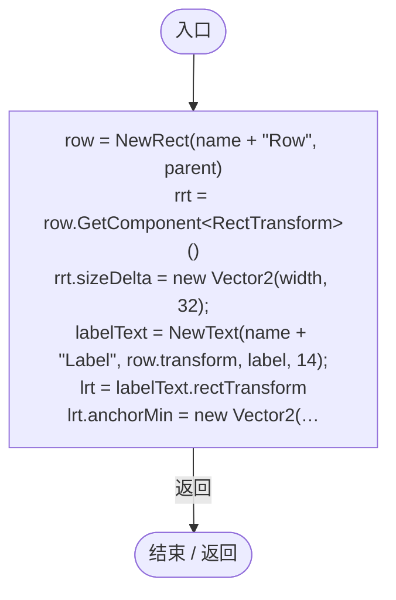
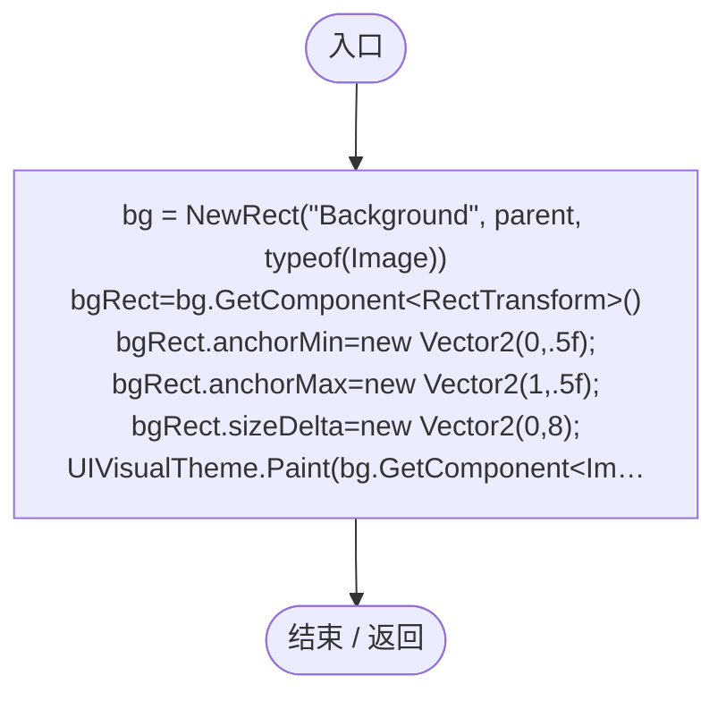
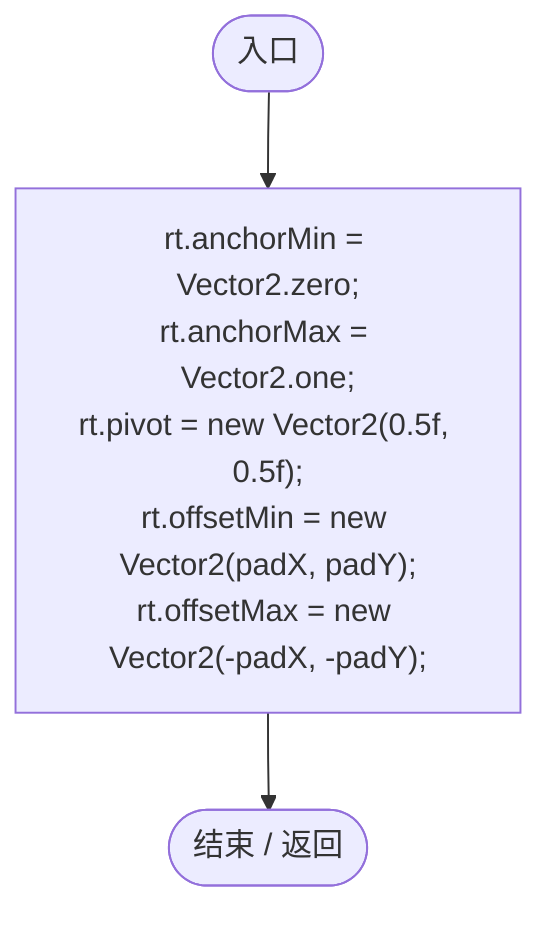

# UIFactory.cs

[返回总索引](../README.md) · `Runtime` · `Assets/DarwinPark/Core/UI/UIFactory.cs`

[源文件](../../../Assets/DarwinPark/Core/UI/UIFactory.cs) · 源码校验：`ad6023fb21638d0d05de75e06c6b41576264ac99f5e16c148a24724e3fcfccb6`

方法按源文件位置排列。事件/回调引用不表示立即执行；分支与异常说明见总索引。完整源码与可点击关系图请打开离线手册。

## DefaultFont.get · L17

`get`

### Editor / Player · Roslyn编译器控制流

项目内调用/回调引用：

- [UIVisualTheme.Data.get · L26](ca525a798a08f966.md#m6c42bdb45a1d9916)（访问器）
- [Log.Error · L43](735e5abf0df2bddc.md#m2addd5e1d74b000d)（方法）
- [UIFactory.回调@23 · L23](dd1096a6995423db.md#m659ee3632bb5ea8d)（回调/委托）

## 回调@23 · L23

`f … => 回调`

### Editor / Player · Roslyn编译器控制流

## NewRect · L33

`public static GameObject NewRect(string name, Transform parent, params Type[] extra)`

### Editor / Player · Roslyn编译器控制流

项目内调用/回调引用：

- [UIFactory.DestroySafely · L51](dd1096a6995423db.md#mf3f6f53227be9d6f)（方法）
- [UIVisualTheme.StyleButton · L67](ca525a798a08f966.md#mf2e64598de5115f3)（方法）
- [UIVisualTheme.Paint · L58](ca525a798a08f966.md#m2d61a6b26ab24980)（方法）

## DestroySafely · L51

`private static void DestroySafely(GameObject go)`

### Editor / Player · Roslyn编译器控制流

## NewText · L57

`public static Text NewText(string name, Transform parent, string content, int fontSize = 16, TextAnchor align = TextAnchor.MiddleLeft)`

### Editor / Player · Roslyn编译器控制流

项目内调用/回调引用：

- [UIFactory.NewRect · L33](dd1096a6995423db.md#med612116f3152344)（方法）
- [UIFactory.DefaultFont.get · L17](dd1096a6995423db.md#m89af6843ae7629d3)（访问器）

## NewButton · L73

`public static Button NewButton(string name, Transform parent, string label, Action onClick, Vector2 size)`

### Editor / Player · Roslyn编译器控制流

项目内调用/回调引用：

- [UIFactory.NewRect · L33](dd1096a6995423db.md#med612116f3152344)（方法）
- [UIFactory.NewText · L57](dd1096a6995423db.md#m9dbccb5f0c38189e)（方法）
- [UIFactory.Stretch · L150](dd1096a6995423db.md#m11d8f6c6d00cc047)（方法）
- [UIVisualTheme.StyleButton · L67](ca525a798a08f966.md#mf2e64598de5115f3)（方法）
- [UIFactory.回调@81 · L81](dd1096a6995423db.md#m5e6407709e2733c2)（回调/委托）

## 回调@81 · L81

`( … => 回调`

### Editor / Player · Roslyn编译器控制流

## NewSlider · L92

`public static Slider NewSlider(string name, Transform parent, string label, float min, float max, float value, float width, out Text labelText)`

### Editor / Player · Roslyn编译器控制流

项目内调用/回调引用：

- [UIFactory.NewRect · L33](dd1096a6995423db.md#med612116f3152344)（方法）
- [UIFactory.NewText · L57](dd1096a6995423db.md#m9dbccb5f0c38189e)（方法）
- [UIFactory.BuildSliderVisuals · L123](dd1096a6995423db.md#mecf40cbea41839c5)（方法）

## BuildSliderVisuals · L123

`private static void BuildSliderVisuals(Transform parent, Slider slider)`

### Editor / Player · Roslyn编译器控制流

项目内调用/回调引用：

- [UIFactory.NewRect · L33](dd1096a6995423db.md#med612116f3152344)（方法）
- [UIVisualTheme.Paint · L58](ca525a798a08f966.md#m2d61a6b26ab24980)（方法）
- [UIFactory.Stretch · L150](dd1096a6995423db.md#m11d8f6c6d00cc047)（方法）

## Stretch · L150

`public static void Stretch(RectTransform rt, float padX = 0, float padY = 0)`

### Editor / Player · Roslyn编译器控制流

