```mermaid
flowchart TD
  b0(["入口"])
  b1["new EcologySaveState{id=EcologyIdentity.Of(entity)}<br/>id=EcologyIdentity.Of(entity)<br/>state=new EcologySaveState{id=EcologyIdentity.Of(entity)}"]
  b2{"territory=DarwinPark.Core.OptionalComponent.Read&lt;TerritoryBehavior&gt;(entity)<br/>判断：territory!=null"}
  b3["state.hasCenter=territory.HasCenter;<br/>state.center=territory.CenterLocal;<br/>state.threat=territory.ThreatLocal;<br/>state.evictionRemaining=territory.EvictionRemaining;"]
  b4{"pop=DarwinPark.Core.OptionalComponent.Read&lt;PopulationBehavior&gt;(entity)<br/>判断：pop!=null"}
  b5["state.groupId=pop.GroupId;<br/>state.joinOrder=pop.JoinOrder;<br/>state.leader=pop.IsLeader;<br/>state.mode=pop.Mode;<br/>state.command=pop.Command;<br/>state.commandRemaining=pop.CommandRemaining;<br/>state.commandPoint=pop.CommandPointLocal;<br/>state.manualRemai…"]
  b6{"state.targetId<br/>判断：pop.Target!=null"}
  b7["EcologyIdentity.Of(pop.Target)"]
  b8["null"]
  b9["state.targetId=pop.Target!=null?EcologyIdentity.Of(pop.Target):null;"]
  b10{"parasite=DarwinPark.Core.OptionalComponent.Read&lt;ParasiteBehavior&gt;(entity)<br/>判断：parasite!=null"}
  b11{"判断：parasite.Host!=null"}
  b12["state.hostId=EcologyIdentity.Of(parasite.Host);<br/>state.hostOffset=parasite.Offset;<br/>state.hostKinematic=parasite.OriginalKinematic;<br/>state.hostDetected=parasite.DetectedByHost;<br/>state.hostDetectionRemaining=parasite.DetectionRemaining;"]
  b13["state.nutritionParasite"]
  b14{"DarwinPark.Core.OptionalComponent.Read&lt;NutritionParasite&gt;(entity)<br/>判断：DarwinPark.Core.OptionalComponent.Read&lt;NutritionParasite&gt;(entity)"}
  b15[".Capture()"]
  b16["DarwinPark.Core.OptionalComponent.Read&lt;NutritionParasite&gt;(entity)"]
  b17["state.nutritionParasite=DarwinPark.Core.OptionalComponent.Read&lt;NutritionParasite&gt;(entity)?.Capture();"]
  b18["state.nutritionParasiteCount=NutritionParasite.CountOn(entity);"]
  b19["state.foreignEggs"]
  b20{"entity.GetComponent&lt;EggHostPregnancy&gt;()<br/>判断：entity.GetComponent&lt;EggHostPregnancy&gt;()"}
  b21[".Capture()"]
  b22["entity.GetComponent&lt;EggHostPregnancy&gt;()"]
  b23["state.foreignEggs=entity.GetComponent&lt;EggHostPregnancy&gt;()?.Capture();"]
  b24["state.entityStateId"]
  b25{"DarwinPark.Core.OptionalComponent.Read&lt;EntityStateController&gt;(entity)<br/>判断：DarwinPark.Core.OptionalComponent.Read&lt;EntityStateController&gt;(entity)"}
  b26[".Current.id"]
  b27["DarwinPark.Core.OptionalComponent.Read&lt;EntityStateController&gt;(entity)"]
  b28["state.entityStateId=DarwinPark.Core.OptionalComponent.Read&lt;EntityStateController&gt;(entity)?.Current.id;"]
  b29["state.ant"]
  b30{"DarwinPark.Core.OptionalComponent.Read&lt;AntColonyMember&gt;(entity)<br/>判断：DarwinPark.Core.OptionalComponent.Read&lt;AntColonyMember&gt;(entity)"}
  b31[".Capture()"]
  b32["DarwinPark.Core.OptionalComponent.Read&lt;AntColonyMember&gt;(entity)"]
  b33["state.ant=DarwinPark.Core.OptionalComponent.Read&lt;AntColonyMember&gt;(entity)?.Capture();"]
  b34["state.patrol"]
  b35{"DarwinPark.Core.OptionalComponent.Read&lt;PatrolRhythm&gt;(entity)<br/>判断：DarwinPark.Core.OptionalComponent.Read&lt;PatrolRhythm&gt;(entity)"}
  b36[".Capture()"]
  b37["DarwinPark.Core.OptionalComponent.Read&lt;PatrolRhythm&gt;(entity)"]
  b38["state.patrol=DarwinPark.Core.OptionalComponent.Read&lt;PatrolRhythm&gt;(entity)?.Capture();"]
  b39["state.combat"]
  b40{"DarwinPark.Core.OptionalComponent.Read&lt;CombatIntent&gt;(entity)<br/>判断：DarwinPark.Core.OptionalComponent.Read&lt;CombatIntent&gt;(entity)"}
  b41[".Capture()"]
  b42["DarwinPark.Core.OptionalComponent.Read&lt;CombatIntent&gt;(entity)"]
  b43["state.combat=DarwinPark.Core.OptionalComponent.Read&lt;CombatIntent&gt;(entity)?.Capture();"]
  b44["state.resourcePlan=EntityResourcePlan.Capture(entity.Genes);"]
  b45["state.rts"]
  b46{"DarwinPark.Core.OptionalComponent.Read&lt;RtsOrderController&gt;(entity)<br/>判断：DarwinPark.Core.OptionalComponent.Read&lt;RtsOrderController&gt;(entity)"}
  b47[".Capture()"]
  b48["DarwinPark.Core.OptionalComponent.Read&lt;RtsOrderController&gt;(entity)"]
  b49["state.rts=DarwinPark.Core.OptionalComponent.Read&lt;RtsOrderController&gt;(entity)?.Capture();"]
  b50["state.incubationRemaining"]
  b51{"DarwinPark.Core.OptionalComponent.Read&lt;EggIncubation&gt;(entity)<br/>判断：DarwinPark.Core.OptionalComponent.Read&lt;EggIncubation&gt;(entity)"}
  b52[".Remaining"]
  b53["DarwinPark.Core.OptionalComponent.Read&lt;EggIncubation&gt;(entity)"]
  b54{"判断：DarwinPark.Core.OptionalComponent.Read&lt;EggIncubation&gt;(entity)?.Remaining"}
  b55["DarwinPark.Core.OptionalComponent.Read&lt;EggIncubation&gt;(entity)?.Remaining"]
  b56["0"]
  b57["state.incubationRemaining=DarwinPark.Core.OptionalComponent.Read&lt;EggIncubation&gt;(entity)?.Remaining??0;"]
  b58["结果：state"]
  b59(["结束 / 返回"])
  b0 --> b1
  b1 --> b2
  b2 -->|"是"| b3
  b2 -->|"否"| b4
  b3 --> b4
  b4 -->|"是"| b5
  b4 -->|"否"| b10
  b5 --> b6
  b6 -->|"是"| b7
  b6 -->|"否"| b8
  b7 --> b9
  b8 --> b9
  b9 --> b10
  b10 -->|"是"| b11
  b10 -->|"否"| b13
  b11 -->|"是"| b12
  b11 -->|"否"| b13
  b12 --> b13
  b13 --> b14
  b14 -->|"否"| b15
  b14 -->|"是"| b16
  b15 --> b17
  b16 --> b17
  b17 --> b18
  b18 --> b19
  b19 --> b20
  b20 -->|"否"| b21
  b20 -->|"是"| b22
  b21 --> b23
  b22 --> b23
  b23 --> b24
  b24 --> b25
  b25 -->|"否"| b26
  b25 -->|"是"| b27
  b26 --> b28
  b27 --> b28
  b28 --> b29
  b29 --> b30
  b30 -->|"否"| b31
  b30 -->|"是"| b32
  b31 --> b33
  b32 --> b33
  b33 --> b34
  b34 --> b35
  b35 -->|"否"| b36
  b35 -->|"是"| b37
  b36 --> b38
  b37 --> b38
  b38 --> b39
  b39 --> b40
  b40 -->|"否"| b41
  b40 -->|"是"| b42
  b41 --> b43
  b42 --> b43
  b43 --> b44
  b44 --> b45
  b45 --> b46
  b46 -->|"否"| b47
  b46 -->|"是"| b48
  b47 --> b49
  b48 --> b49
  b49 --> b50
  b50 --> b51
  b51 -->|"否"| b52
  b51 -->|"是"| b53
  b52 --> b54
  b53 --> b54
  b54 -->|"否"| b55
  b54 -->|"是"| b56
  b55 --> b57
  b56 --> b57
  b57 --> b58
  b58 -->|"返回"| b59

```

```mermaid
flowchart TD
  b0(["入口"])
  b1["EcologyIdentity.Ensure(entity.gameObject).Restore(id);<br/>EntityResourcePlan.Restore(entity.Genes,resourcePlan);"]
  b2{"foreignEggs<br/>判断：foreignEggs"}
  b3[".Count"]
  b4["foreignEggs"]
  b5{"判断：foreignEggs?.Count&gt;0"}
  b6{"entity.GetComponent&lt;EggHostPregnancy&gt;()<br/>判断：entity.GetComponent&lt;EggHostPregnancy&gt;()"}
  b7["entity.GetComponent&lt;EggHostPregnancy&gt;()"]
  b8["entity.gameObject.AddComponent&lt;EggHostPregnancy&gt;()"]
  b9["(entity.GetComponent&lt;EggHostPregnancy&gt;()??entity.gameObject.AddComponent&lt;EggHostPregnancy&gt;()).Restore(foreignEggs);"]
  b10{"rts<br/>判断：rts"}
  b11[".active"]
  b12["rts"]
  b13{"判断：rts?.active==true"}
  b14["RtsOrderController.Ensure(entity).Restore(rts);"]
  b15{"DarwinPark.Core.OptionalComponent.Read&lt;TerritoryBehavior&gt;(entity)<br/>判断：DarwinPark.Core.OptionalComponent.Read&lt;TerritoryBehavior&gt;(entity)"}
  b16["DarwinPark.Core.OptionalComponent.Read&lt;TerritoryBehavior&gt;(entity)?.Restore(center,hasCenter,evictionRemaining,threat);"]
  b17{"DarwinPark.Core.OptionalComponent.Read&lt;PopulationBehavior&gt;(entity)<br/>判断：DarwinPark.Core.OptionalComponent.Read&lt;PopulationBehavior&gt;(entity)"}
  b18["DarwinPark.Core.OptionalComponent.Read&lt;PopulationBehavior&gt;(entity)?.Restore(this);"]
  b19{"ant<br/>判断：ant"}
  b20[".HasData"]
  b21["ant"]
  b22{"判断：ant?.HasData==true"}
  b23{"DarwinPark.Core.OptionalComponent.Read&lt;PopulationBehavior&gt;(entity)<br/>判断：DarwinPark.Core.OptionalComponent.Read&lt;PopulationBehavior&gt;(entity)"}
  b24["DarwinPark.Core.OptionalComponent.Read&lt;PopulationBehavior&gt;(entity)"]
  b25["entity.gameObject.AddComponent&lt;PopulationBehavior&gt;()"]
  b26["population=DarwinPark.Core.OptionalComponent.Read&lt;PopulationBehavior&gt;(entity)??entity.gameObject.AddComponent&lt;PopulationBehavior&gt;()"]
  b27["population.Restore(this);<br/>AntColonyMember.Ensure(population).Restore(ant);"]
  b28{"判断：patrol!=null"}
  b29["PatrolRhythm.Ensure(entity.gameObject).Restore(patrol);"]
  b30{"判断：incubationRemaining&gt;0"}
  b31{"DarwinPark.Core.OptionalComponent.Read&lt;EggIncubation&gt;(entity)<br/>判断：DarwinPark.Core.OptionalComponent.Read&lt;EggIncubation&gt;(entity)"}
  b32["DarwinPark.Core.OptionalComponent.Read&lt;EggIncubation&gt;(entity)"]
  b33["entity.gameObject.AddComponent&lt;EggIncubation&gt;()"]
  b34["(DarwinPark.Core.OptionalComponent.Read&lt;EggIncubation&gt;(entity)??entity.gameObject.AddComponent&lt;EggIncubation&gt;()).Begin(incubationRemaining);"]
  b35{"entity.GetComponent&lt;EntityLifeCycle&gt;()<br/>判断：entity.GetComponent&lt;EntityLifeCycle&gt;()"}
  b36["entity.GetComponent&lt;EntityLifeCycle&gt;()?.WaitForHatch();"]
  b37{"DarwinPark.Core.OptionalComponent.Read&lt;EntityStateController&gt;(entity)<br/>判断：DarwinPark.Core.OptionalComponent.Read&lt;EntityStateController&gt;(entity)"}
  b38["DarwinPark.Core.OptionalComponent.Read&lt;EntityStateController&gt;(entity)?.Restore(entityStateId);"]
  b39(["结束 / 返回"])
  b0 --> b1
  b1 --> b2
  b2 -->|"否"| b3
  b2 -->|"是"| b4
  b3 --> b5
  b4 --> b5
  b5 -->|"是"| b6
  b5 -->|"否"| b10
  b6 -->|"否"| b7
  b6 -->|"是"| b8
  b7 --> b9
  b8 --> b9
  b9 --> b10
  b10 -->|"否"| b11
  b10 -->|"是"| b12
  b11 --> b13
  b12 --> b13
  b13 -->|"是"| b14
  b13 -->|"否"| b15
  b14 --> b15
  b15 -->|"否"| b16
  b15 -->|"是"| b17
  b16 --> b17
  b17 -->|"否"| b18
  b17 -->|"是"| b19
  b18 --> b19
  b19 -->|"否"| b20
  b19 -->|"是"| b21
  b20 --> b22
  b21 --> b22
  b22 -->|"是"| b23
  b22 -->|"否"| b28
  b23 -->|"否"| b24
  b23 -->|"是"| b25
  b24 --> b26
  b25 --> b26
  b26 --> b27
  b27 --> b28
  b28 -->|"是"| b29
  b28 -->|"否"| b30
  b29 --> b30
  b30 -->|"是"| b31
  b30 -->|"否"| b37
  b31 -->|"否"| b32
  b31 -->|"是"| b33
  b32 --> b34
  b33 --> b34
  b34 --> b35
  b35 -->|"否"| b36
  b35 -->|"是"| b37
  b36 --> b37
  b37 -->|"否"| b38
  b37 -->|"是"| b39
  b38 --> b39

```

```mermaid
flowchart TD
  b0(["入口"])
  b1["entities"]
  b2{"targetId<br/>判断：targetId"}
  b3["targetId"]
  b4["&quot;&quot;"]
  b5["entities.TryGetValue(targetId??&quot;&quot;,out var target);"]
  b6{"DarwinPark.Core.OptionalComponent.Read&lt;PopulationBehavior&gt;(entity)<br/>判断：DarwinPark.Core.OptionalComponent.Read&lt;PopulationBehavior&gt;(entity)"}
  b7["DarwinPark.Core.OptionalComponent.Read&lt;PopulationBehavior&gt;(entity)?.RestoreTarget(target);"]
  b8{"判断：combat!=null"}
  b9["entities"]
  b10{"combat.target<br/>判断：combat.target"}
  b11["combat.target"]
  b12["&quot;&quot;"]
  b13["entities.TryGetValue(combat.target??&quot;&quot;,out var attacker);"]
  b14{"DarwinPark.Core.OptionalComponent.Read&lt;CombatIntent&gt;(entity)<br/>判断：DarwinPark.Core.OptionalComponent.Read&lt;CombatIntent&gt;(entity)"}
  b15["DarwinPark.Core.OptionalComponent.Read&lt;CombatIntent&gt;(entity)"]
  b16["entity.gameObject.AddComponent&lt;CombatIntent&gt;()"]
  b17["(DarwinPark.Core.OptionalComponent.Read&lt;CombatIntent&gt;(entity)??entity.gameObject.AddComponent&lt;CombatIntent&gt;()).Restore(attacker,combat.remaining);"]
  b18{"判断：string.IsNullOrEmpty(hostId)"}
  b19{"判断：entities.TryGetValue(hostId,out var host)"}
  b20{"parasite=DarwinPark.Core.OptionalComponent.Read&lt;ParasiteBehavior&gt;(entity)<br/>判断：parasite!=null"}
  b21{"判断：parasite.TryAttach(host,true,hostOffset,hostKinematic)"}
  b22["parasite.RestoreDetection(hostDetected,hostDetectionRemaining);"]
  b23{"nutritionParasite<br/>判断：nutritionParasite"}
  b24[".host"]
  b25["nutritionParasite"]
  b26{"判断：string.IsNullOrEmpty(nutritionParasite?.host)"}
  b27{"判断：entities.TryGetValue(nutritionParasite.host,out var feedingHost)"}
  b28{"DarwinPark.Core.OptionalComponent.Read&lt;NutritionParasite&gt;(entity)<br/>判断：DarwinPark.Core.OptionalComponent.Read&lt;NutritionParasite&gt;(entity)"}
  b29["DarwinPark.Core.OptionalComponent.Read&lt;NutritionParasite&gt;(entity)?.TryAttach(feedingHost,nutritionParasite);"]
  b30(["结束 / 返回"])
  b0 --> b1
  b1 --> b2
  b2 -->|"否"| b3
  b2 -->|"是"| b4
  b3 --> b5
  b4 --> b5
  b5 --> b6
  b6 -->|"否"| b7
  b6 -->|"是"| b8
  b7 --> b8
  b8 -->|"是"| b9
  b8 -->|"否"| b18
  b9 --> b10
  b10 -->|"否"| b11
  b10 -->|"是"| b12
  b11 --> b13
  b12 --> b13
  b13 --> b14
  b14 -->|"否"| b15
  b14 -->|"是"| b16
  b15 --> b17
  b16 --> b17
  b17 --> b18
  b18 -->|"否"| b19
  b18 -->|"是"| b23
  b19 -->|"是"| b20
  b19 -->|"否"| b23
  b20 -->|"是"| b21
  b20 -->|"否"| b23
  b21 -->|"是"| b22
  b21 -->|"否"| b23
  b22 --> b23
  b23 -->|"否"| b24
  b23 -->|"是"| b25
  b24 --> b26
  b25 --> b26
  b26 -->|"否"| b27
  b26 -->|"是"| b30
  b27 -->|"是"| b28
  b27 -->|"否"| b30
  b28 -->|"否"| b29
  b28 -->|"是"| b30
  b29 --> b30

```

# EcologySaveState.cs

[返回总索引](../README.md) · `Runtime` · `Assets/DarwinPark/Entities/Ecology/EcologySaveState.cs`

[源文件](../../../Assets/DarwinPark/Entities/Ecology/EcologySaveState.cs) · 源码校验：`c99fe6931c2353c6250640a23b12b0a186f755452d8e24b834e1433dbfae37c4`

方法按源文件位置排列。事件/回调引用不表示立即执行；分支与异常说明见总索引。完整源码与可点击关系图请打开离线手册。

## IsEmpty.get · L28

`public bool IsEmpty`

★ 修复（防Bug回归）：Unity 内联类缺字段时可能生成空对象；仅完全空的生态记录视作旧档无此字段。

### Editor / Player · 语法控制结构 / 声明（非CFG）

```mermaid
flowchart TD
  n2(["入口"])
  n1["string.IsNullOrEmpty(id)&amp;&amp;string.IsNullOrEmpty(groupId)&amp;&amp;string.IsNullOrEmpty(mode)&amp;&amp;string.IsNullOrEmpty(targetId)&amp;&amp;string.IsNullOrEmpty(hostId)&amp;&amp; (resourcePlan==null&#124;&#124;resourcePlan.IsEmpty)&amp;&amp;string.IsNullOrEmpty(entityStateId)&amp;&amp;joinOrde…"]
  n0(["结束 / 返回"])
  n1 --> n0
  n2 --> n1

```

## Capture · L32

`public static EcologySaveState Capture(DarwinEntity entity)`

★ 新增：先保存本体与稳定标识，再在所有实体创建后恢复群体目标和宿主引用，不依赖加载先后顺序。

### Editor / Player · Roslyn编译器控制流

项目内调用/回调引用：

- [EcologyIdentity.Of · L22](bdf7ccc2c9c0452f.md#mb23020fe763aafd3)（方法）
- [OptionalComponent.Read · L7](806c46b42ced4d36.md#m69622a4dee165c5a)（方法）
- [TerritoryBehavior.HasCenter.get · L11](19d504dcdc8bc624.md#meb62e210ced1fe2d)（访问器）
- [TerritoryBehavior.CenterLocal.get · L10](19d504dcdc8bc624.md#m88cc30456d76375a)（访问器）
- [TerritoryBehavior.ThreatLocal.get · L13](19d504dcdc8bc624.md#m09b6b3fc491be4b7)（访问器）
- [TerritoryBehavior.EvictionRemaining.get · L12](19d504dcdc8bc624.md#m737a47b8e966cdb5)（访问器）
- [PopulationBehavior.GroupId.get · L22](21e4f62f75a9a80f.md#me471d0106be463ca)（访问器）
- [PopulationBehavior.JoinOrder.get · L23](21e4f62f75a9a80f.md#m3a083590c84efb2c)（访问器）
- [PopulationBehavior.Command.get · L25](21e4f62f75a9a80f.md#m9d9e3eebbb011253)（访问器）
- [PopulationBehavior.CommandRemaining.get · L26](21e4f62f75a9a80f.md#m9a62f39175293942)（访问器）
- [PopulationBehavior.CommandPointLocal.get · L27](21e4f62f75a9a80f.md#ma729870d83902751)（访问器）
- [PopulationBehavior.Target.get · L28](21e4f62f75a9a80f.md#m08021e2a2a15f867)（访问器）
- [ParasiteBehavior.Host.get · L18](ec21ecbd299caaed.md#m26d7e4af4cdffdbb)（访问器）
- [NutritionParasite.Capture · L70](4a18785b7c1e1484.md#m8988a2a91e01b433)（方法）
- [NutritionParasite.CountOn · L25](4a18785b7c1e1484.md#m103dd60591d93a11)（方法）
- [EggHostPregnancy.Capture · L45](b0ff4b8259f98b85.md#mdd733d4631c10767)（方法）
- [AntColonyMember.Capture · L207](baebd85c05598377.md#m3ee0278ea269bf15)（方法）
- [PatrolRhythm.Capture · L35](f55940fd5773d413.md#m5e97aeb0526e9015)（方法）
- [CombatIntent.Capture · L28](34193b994b2c0894.md#mfc6c4c5cf8ca0391)（方法）
- [EntityResourcePlan.Capture · L56](569e8e31d0634370.md#mf278ec899873544f)（方法）
- [DarwinEntity.Genes.get · L14](70798dde169f2e8b.md#m622eb1adf401d431)（访问器）
- [RtsOrderController.Capture · L64](cac3b6501f41ca35.md#m9f24a83433e8bd1c)（方法）
- [EggIncubation.Remaining.get · L7](f5a647fca719706f.md#m0ecf83a56f86b68f)（访问器）

## Restore · L46

`public void Restore(DarwinEntity entity)`

### Editor / Player · Roslyn编译器控制流

项目内调用/回调引用：

- [EcologyIdentity.Restore · L19](bdf7ccc2c9c0452f.md#m4b6a41779b342bc3)（方法）
- [EcologyIdentity.Ensure · L23](bdf7ccc2c9c0452f.md#m8adfd15f583f225a)（方法）
- [EntityResourcePlan.Restore · L57](569e8e31d0634370.md#mf4d9479209b1adf0)（方法）
- [DarwinEntity.Genes.get · L14](70798dde169f2e8b.md#m622eb1adf401d431)（访问器）
- [EggHostPregnancy.Restore · L47](b0ff4b8259f98b85.md#mf422c440c64cc367)（方法）
- [RtsOrderController.Restore · L65](cac3b6501f41ca35.md#mf14e59f7b0320f0e)（方法）
- [RtsOrderController.Ensure · L19](cac3b6501f41ca35.md#mb6925942cada4db0)（方法）
- [OptionalComponent.Read · L7](806c46b42ced4d36.md#m69622a4dee165c5a)（方法）
- [TerritoryBehavior.Restore · L77](19d504dcdc8bc624.md#mf15d2bca17e464ce)（方法）
- [PopulationBehavior.Restore · L206](21e4f62f75a9a80f.md#mdc64033ecfe51523)（方法）
- [AntColonyMember.Restore · L209](baebd85c05598377.md#m27934d3fe7c00262)（方法）
- [AntColonyMember.Ensure · L61](baebd85c05598377.md#m4e1194d3f46affcd)（方法）
- [PatrolRhythm.Restore · L36](f55940fd5773d413.md#m66eb6fa23f369cda)（方法）
- [PatrolRhythm.Ensure · L14](f55940fd5773d413.md#mfe51a369852bf3eb)（方法）
- [EggIncubation.Begin · L9](f5a647fca719706f.md#md45ae9ffbcf543e9)（方法）
- [EntityLifeCycle.WaitForHatch · L55](9f4138bfbae654b7.md#m6dc5cdf38903df50)（方法）
- [EntityStateController.Restore · L107](0f8869eb7018091e.md#m7a40a097ad98b909)（方法）

## Resolve · L61

`public void Resolve(DarwinEntity entity,Dictionary<string,DarwinEntity> entities)`

### Editor / Player · Roslyn编译器控制流

项目内调用/回调引用：

- [OptionalComponent.Read · L7](806c46b42ced4d36.md#m69622a4dee165c5a)（方法）
- [PopulationBehavior.RestoreTarget · L213](21e4f62f75a9a80f.md#m52a6dd95238c056a)（方法）
- [CombatIntent.Restore · L29](34193b994b2c0894.md#md69ae8a8224b3125)（方法）
- [ParasiteBehavior.TryAttach · L78](ec21ecbd299caaed.md#m8473a35a233ea83d)（方法）
- [ParasiteBehavior.RestoreDetection · L23](ec21ecbd299caaed.md#m5047a40ae90aa091)（方法）
- [NutritionParasite.TryAttach · L58](4a18785b7c1e1484.md#m57fa9d307af33128)（方法）
