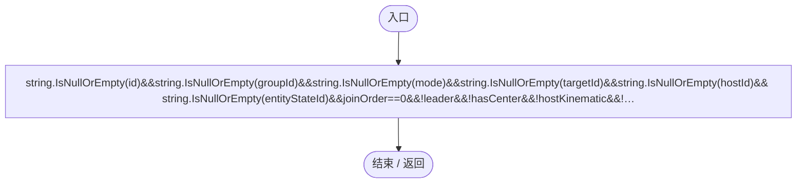

```mermaid
flowchart TD
  b0(["入口"])
  b1["new EcologySaveState{id=EcologyIdentity.Of(entity)}<br/>id=EcologyIdentity.Of(entity)<br/>state=new EcologySaveState{id=EcologyIdentity.Of(entity)}"]
  b2{"territory=entity.GetComponent&lt;TerritoryBehavior&gt;()<br/>判断：territory!=null"}
  b3["state.hasCenter=territory.HasCenter;<br/>state.center=territory.CenterLocal;<br/>state.threat=territory.ThreatLocal;<br/>state.evictionRemaining=territory.EvictionRemaining;"]
  b4{"pop=entity.GetComponent&lt;PopulationBehavior&gt;()<br/>判断：pop!=null"}
  b5["state.groupId=pop.GroupId;<br/>state.joinOrder=pop.JoinOrder;<br/>state.leader=pop.IsLeader;<br/>state.mode=pop.Mode;<br/>state.command=pop.Command;<br/>state.commandRemaining=pop.CommandRemaining;<br/>state.commandPoint=pop.CommandPointLocal;<br/>state.manualRemai…"]
  b6{"state.targetId<br/>判断：pop.Target!=null"}
  b7["EcologyIdentity.Of(pop.Target)"]
  b8["null"]
  b9["state.targetId=pop.Target!=null?EcologyIdentity.Of(pop.Target):null;"]
  b10{"parasite=entity.GetComponent&lt;ParasiteBehavior&gt;()<br/>判断：parasite!=null"}
  b11{"判断：parasite.Host!=null"}
  b12["state.hostId=EcologyIdentity.Of(parasite.Host);<br/>state.hostOffset=parasite.Offset;<br/>state.hostKinematic=parasite.OriginalKinematic;<br/>state.hostDetected=parasite.DetectedByHost;<br/>state.hostDetectionRemaining=parasite.DetectionRemaining;"]
  b13["state.nutritionParasite"]
  b14{"entity.GetComponent&lt;NutritionParasite&gt;()<br/>判断：entity.GetComponent&lt;NutritionParasite&gt;()"}
  b15[".Capture()"]
  b16["entity.GetComponent&lt;NutritionParasite&gt;()"]
  b17["state.nutritionParasite=entity.GetComponent&lt;NutritionParasite&gt;()?.Capture();"]
  b18["state.nutritionParasiteCount=NutritionParasite.CountOn(entity);"]
  b19["state.foreignEggs"]
  b20{"entity.GetComponent&lt;EggHostPregnancy&gt;()<br/>判断：entity.GetComponent&lt;EggHostPregnancy&gt;()"}
  b21[".Capture()"]
  b22["entity.GetComponent&lt;EggHostPregnancy&gt;()"]
  b23["state.foreignEggs=entity.GetComponent&lt;EggHostPregnancy&gt;()?.Capture();"]
  b24["state.entityStateId"]
  b25{"entity.GetComponent&lt;EntityStateController&gt;()<br/>判断：entity.GetComponent&lt;EntityStateController&gt;()"}
  b26[".Current.id"]
  b27["entity.GetComponent&lt;EntityStateController&gt;()"]
  b28["state.entityStateId=entity.GetComponent&lt;EntityStateController&gt;()?.Current.id;"]
  b29["state.ant"]
  b30{"entity.GetComponent&lt;AntColonyMember&gt;()<br/>判断：entity.GetComponent&lt;AntColonyMember&gt;()"}
  b31[".Capture()"]
  b32["entity.GetComponent&lt;AntColonyMember&gt;()"]
  b33["state.ant=entity.GetComponent&lt;AntColonyMember&gt;()?.Capture();"]
  b34["state.patrol"]
  b35{"entity.GetComponent&lt;PatrolRhythm&gt;()<br/>判断：entity.GetComponent&lt;PatrolRhythm&gt;()"}
  b36[".Capture()"]
  b37["entity.GetComponent&lt;PatrolRhythm&gt;()"]
  b38["state.patrol=entity.GetComponent&lt;PatrolRhythm&gt;()?.Capture();"]
  b39["state.combat"]
  b40{"entity.GetComponent&lt;CombatIntent&gt;()<br/>判断：entity.GetComponent&lt;CombatIntent&gt;()"}
  b41[".Capture()"]
  b42["entity.GetComponent&lt;CombatIntent&gt;()"]
  b43["state.combat=entity.GetComponent&lt;CombatIntent&gt;()?.Capture();"]
  b44["state.rts"]
  b45{"entity.GetComponent&lt;RtsOrderController&gt;()<br/>判断：entity.GetComponent&lt;RtsOrderController&gt;()"}
  b46[".Capture()"]
  b47["entity.GetComponent&lt;RtsOrderController&gt;()"]
  b48["state.rts=entity.GetComponent&lt;RtsOrderController&gt;()?.Capture();"]
  b49["state.incubationRemaining"]
  b50{"entity.GetComponent&lt;EggIncubation&gt;()<br/>判断：entity.GetComponent&lt;EggIncubation&gt;()"}
  b51[".Remaining"]
  b52["entity.GetComponent&lt;EggIncubation&gt;()"]
  b53{"判断：entity.GetComponent&lt;EggIncubation&gt;()?.Remaining"}
  b54["entity.GetComponent&lt;EggIncubation&gt;()?.Remaining"]
  b55["0"]
  b56["state.incubationRemaining=entity.GetComponent&lt;EggIncubation&gt;()?.Remaining??0;"]
  b57["结果：state"]
  b58(["结束 / 返回"])
  b0 --> b1
  b1 --> b2
  b2 -->|"是"| b3
  b2 -->|"否"| b4
  b3 --> b4
  b4 -->|"是"| b5
  b4 -->|"否"| b10
  b5 --> b6
  b6 -->|"是"| b7
  b6 -->|"否"| b8
  b7 --> b9
  b8 --> b9
  b9 --> b10
  b10 -->|"是"| b11
  b10 -->|"否"| b13
  b11 -->|"是"| b12
  b11 -->|"否"| b13
  b12 --> b13
  b13 --> b14
  b14 -->|"否"| b15
  b14 -->|"是"| b16
  b15 --> b17
  b16 --> b17
  b17 --> b18
  b18 --> b19
  b19 --> b20
  b20 -->|"否"| b21
  b20 -->|"是"| b22
  b21 --> b23
  b22 --> b23
  b23 --> b24
  b24 --> b25
  b25 -->|"否"| b26
  b25 -->|"是"| b27
  b26 --> b28
  b27 --> b28
  b28 --> b29
  b29 --> b30
  b30 -->|"否"| b31
  b30 -->|"是"| b32
  b31 --> b33
  b32 --> b33
  b33 --> b34
  b34 --> b35
  b35 -->|"否"| b36
  b35 -->|"是"| b37
  b36 --> b38
  b37 --> b38
  b38 --> b39
  b39 --> b40
  b40 -->|"否"| b41
  b40 -->|"是"| b42
  b41 --> b43
  b42 --> b43
  b43 --> b44
  b44 --> b45
  b45 -->|"否"| b46
  b45 -->|"是"| b47
  b46 --> b48
  b47 --> b48
  b48 --> b49
  b49 --> b50
  b50 -->|"否"| b51
  b50 -->|"是"| b52
  b51 --> b53
  b52 --> b53
  b53 -->|"否"| b54
  b53 -->|"是"| b55
  b54 --> b56
  b55 --> b56
  b56 --> b57
  b57 -->|"返回"| b58

```

```mermaid
flowchart TD
  b0(["入口"])
  b1["EcologyIdentity.Ensure(entity.gameObject).Restore(id);"]
  b2{"foreignEggs<br/>判断：foreignEggs"}
  b3[".Count"]
  b4["foreignEggs"]
  b5{"判断：foreignEggs?.Count&gt;0"}
  b6{"entity.GetComponent&lt;EggHostPregnancy&gt;()<br/>判断：entity.GetComponent&lt;EggHostPregnancy&gt;()"}
  b7["entity.GetComponent&lt;EggHostPregnancy&gt;()"]
  b8["entity.gameObject.AddComponent&lt;EggHostPregnancy&gt;()"]
  b9["(entity.GetComponent&lt;EggHostPregnancy&gt;()??entity.gameObject.AddComponent&lt;EggHostPregnancy&gt;()).Restore(foreignEggs);"]
  b10{"rts<br/>判断：rts"}
  b11[".active"]
  b12["rts"]
  b13{"判断：rts?.active==true"}
  b14["RtsOrderController.Ensure(entity).Restore(rts);"]
  b15{"entity.GetComponent&lt;TerritoryBehavior&gt;()<br/>判断：entity.GetComponent&lt;TerritoryBehavior&gt;()"}
  b16["entity.GetComponent&lt;TerritoryBehavior&gt;()?.Restore(center,hasCenter,evictionRemaining,threat);"]
  b17{"entity.GetComponent&lt;PopulationBehavior&gt;()<br/>判断：entity.GetComponent&lt;PopulationBehavior&gt;()"}
  b18["entity.GetComponent&lt;PopulationBehavior&gt;()?.Restore(this);"]
  b19{"ant<br/>判断：ant"}
  b20[".HasData"]
  b21["ant"]
  b22{"判断：ant?.HasData==true"}
  b23{"entity.GetComponent&lt;PopulationBehavior&gt;()<br/>判断：entity.GetComponent&lt;PopulationBehavior&gt;()"}
  b24["entity.GetComponent&lt;PopulationBehavior&gt;()"]
  b25["entity.gameObject.AddComponent&lt;PopulationBehavior&gt;()"]
  b26["population=entity.GetComponent&lt;PopulationBehavior&gt;()??entity.gameObject.AddComponent&lt;PopulationBehavior&gt;()"]
  b27["population.Restore(this);<br/>AntColonyMember.Ensure(population).Restore(ant);"]
  b28{"判断：patrol!=null"}
  b29["PatrolRhythm.Ensure(entity.gameObject).Restore(patrol);"]
  b30{"判断：incubationRemaining&gt;0"}
  b31{"entity.GetComponent&lt;EggIncubation&gt;()<br/>判断：entity.GetComponent&lt;EggIncubation&gt;()"}
  b32["entity.GetComponent&lt;EggIncubation&gt;()"]
  b33["entity.gameObject.AddComponent&lt;EggIncubation&gt;()"]
  b34["(entity.GetComponent&lt;EggIncubation&gt;()??entity.gameObject.AddComponent&lt;EggIncubation&gt;()).Begin(incubationRemaining);"]
  b35{"entity.GetComponent&lt;EntityLifeCycle&gt;()<br/>判断：entity.GetComponent&lt;EntityLifeCycle&gt;()"}
  b36["entity.GetComponent&lt;EntityLifeCycle&gt;()?.WaitForHatch();"]
  b37{"entity.GetComponent&lt;EntityStateController&gt;()<br/>判断：entity.GetComponent&lt;EntityStateController&gt;()"}
  b38["entity.GetComponent&lt;EntityStateController&gt;()?.Restore(entityStateId);"]
  b39(["结束 / 返回"])
  b0 --> b1
  b1 --> b2
  b2 -->|"否"| b3
  b2 -->|"是"| b4
  b3 --> b5
  b4 --> b5
  b5 -->|"是"| b6
  b5 -->|"否"| b10
  b6 -->|"否"| b7
  b6 -->|"是"| b8
  b7 --> b9
  b8 --> b9
  b9 --> b10
  b10 -->|"否"| b11
  b10 -->|"是"| b12
  b11 --> b13
  b12 --> b13
  b13 -->|"是"| b14
  b13 -->|"否"| b15
  b14 --> b15
  b15 -->|"否"| b16
  b15 -->|"是"| b17
  b16 --> b17
  b17 -->|"否"| b18
  b17 -->|"是"| b19
  b18 --> b19
  b19 -->|"否"| b20
  b19 -->|"是"| b21
  b20 --> b22
  b21 --> b22
  b22 -->|"是"| b23
  b22 -->|"否"| b28
  b23 -->|"否"| b24
  b23 -->|"是"| b25
  b24 --> b26
  b25 --> b26
  b26 --> b27
  b27 --> b28
  b28 -->|"是"| b29
  b28 -->|"否"| b30
  b29 --> b30
  b30 -->|"是"| b31
  b30 -->|"否"| b37
  b31 -->|"否"| b32
  b31 -->|"是"| b33
  b32 --> b34
  b33 --> b34
  b34 --> b35
  b35 -->|"否"| b36
  b35 -->|"是"| b37
  b36 --> b37
  b37 -->|"否"| b38
  b37 -->|"是"| b39
  b38 --> b39

```

```mermaid
flowchart TD
  b0(["入口"])
  b1["entities"]
  b2{"targetId<br/>判断：targetId"}
  b3["targetId"]
  b4["&quot;&quot;"]
  b5["entities.TryGetValue(targetId??&quot;&quot;,out var target);"]
  b6{"entity.GetComponent&lt;PopulationBehavior&gt;()<br/>判断：entity.GetComponent&lt;PopulationBehavior&gt;()"}
  b7["entity.GetComponent&lt;PopulationBehavior&gt;()?.RestoreTarget(target);"]
  b8{"判断：combat!=null"}
  b9["entities"]
  b10{"combat.target<br/>判断：combat.target"}
  b11["combat.target"]
  b12["&quot;&quot;"]
  b13["entities.TryGetValue(combat.target??&quot;&quot;,out var attacker);"]
  b14{"entity.GetComponent&lt;CombatIntent&gt;()<br/>判断：entity.GetComponent&lt;CombatIntent&gt;()"}
  b15["entity.GetComponent&lt;CombatIntent&gt;()"]
  b16["entity.gameObject.AddComponent&lt;CombatIntent&gt;()"]
  b17["(entity.GetComponent&lt;CombatIntent&gt;()??entity.gameObject.AddComponent&lt;CombatIntent&gt;()).Restore(attacker,combat.remaining);"]
  b18{"判断：string.IsNullOrEmpty(hostId)"}
  b19{"判断：entities.TryGetValue(hostId,out var host)"}
  b20{"parasite=entity.GetComponent&lt;ParasiteBehavior&gt;()<br/>判断：parasite!=null"}
  b21{"判断：parasite.TryAttach(host,true,hostOffset,hostKinematic)"}
  b22["parasite.RestoreDetection(hostDetected,hostDetectionRemaining);"]
  b23{"nutritionParasite<br/>判断：nutritionParasite"}
  b24[".host"]
  b25["nutritionParasite"]
  b26{"判断：string.IsNullOrEmpty(nutritionParasite?.host)"}
  b27{"判断：entities.TryGetValue(nutritionParasite.host,out var feedingHost)"}
  b28{"entity.GetComponent&lt;NutritionParasite&gt;()<br/>判断：entity.GetComponent&lt;NutritionParasite&gt;()"}
  b29["entity.GetComponent&lt;NutritionParasite&gt;()?.TryAttach(feedingHost,nutritionParasite);"]
  b30(["结束 / 返回"])
  b0 --> b1
  b1 --> b2
  b2 -->|"否"| b3
  b2 -->|"是"| b4
  b3 --> b5
  b4 --> b5
  b5 --> b6
  b6 -->|"否"| b7
  b6 -->|"是"| b8
  b7 --> b8
  b8 -->|"是"| b9
  b8 -->|"否"| b18
  b9 --> b10
  b10 -->|"否"| b11
  b10 -->|"是"| b12
  b11 --> b13
  b12 --> b13
  b13 --> b14
  b14 -->|"否"| b15
  b14 -->|"是"| b16
  b15 --> b17
  b16 --> b17
  b17 --> b18
  b18 -->|"否"| b19
  b18 -->|"是"| b23
  b19 -->|"是"| b20
  b19 -->|"否"| b23
  b20 -->|"是"| b21
  b20 -->|"否"| b23
  b21 -->|"是"| b22
  b21 -->|"否"| b23
  b22 --> b23
  b23 -->|"否"| b24
  b23 -->|"是"| b25
  b24 --> b26
  b25 --> b26
  b26 -->|"否"| b27
  b26 -->|"是"| b30
  b27 -->|"是"| b28
  b27 -->|"否"| b30
  b28 -->|"否"| b29
  b28 -->|"是"| b30
  b29 --> b30

```

# EcologySaveState.cs

[返回总索引](../README.md) · `Runtime` · `Assets/DarwinPark/Entities/Ecology/EcologySaveState.cs`

[源文件](../../../Assets/DarwinPark/Entities/Ecology/EcologySaveState.cs) · 源码校验：`0d3b6f55942a142324ea2fe2de38d16e251305929c52402f78cd631b270a69e6`

方法按源文件位置排列。事件/回调引用不表示立即执行；分支与异常说明见总索引。完整源码与可点击关系图请打开离线手册。

## IsEmpty.get · L25

`public bool IsEmpty`

★ 修复（防Bug回归）：Unity 内联类缺字段时可能生成空对象；仅完全空的生态记录视作旧档无此字段。

### Editor / Player · 语法控制结构 / 声明（非CFG）

## Capture · L29

`public static EcologySaveState Capture(DarwinEntity entity)`

★ 新增：先保存本体与稳定标识，再在所有实体创建后恢复群体目标和宿主引用，不依赖加载先后顺序。

### Editor / Player · Roslyn编译器控制流

项目内调用/回调引用：

- [EcologyIdentity.Of · L21](bdf7ccc2c9c0452f.md#m1143cf9570a93b72)（方法）
- [TerritoryBehavior.HasCenter.get · L10](19d504dcdc8bc624.md#m45c71ab11052b836)（访问器）
- [TerritoryBehavior.CenterLocal.get · L9](19d504dcdc8bc624.md#ma6c3ca66e73f2c95)（访问器）
- [TerritoryBehavior.ThreatLocal.get · L12](19d504dcdc8bc624.md#m76a872f994e82613)（访问器）
- [TerritoryBehavior.EvictionRemaining.get · L11](19d504dcdc8bc624.md#m412b89a669c39b71)（访问器）
- [PopulationBehavior.GroupId.get · L20](21e4f62f75a9a80f.md#m5145936fa914ba8c)（访问器）
- [PopulationBehavior.JoinOrder.get · L21](21e4f62f75a9a80f.md#m83871a50fb1160fd)（访问器）
- [PopulationBehavior.Command.get · L23](21e4f62f75a9a80f.md#md6a4209cecb72885)（访问器）
- [PopulationBehavior.CommandRemaining.get · L24](21e4f62f75a9a80f.md#mc458143b2632d239)（访问器）
- [PopulationBehavior.CommandPointLocal.get · L25](21e4f62f75a9a80f.md#m9cbc18c34603d875)（访问器）
- [PopulationBehavior.Target.get · L26](21e4f62f75a9a80f.md#m03405306fd2aca34)（访问器）
- [ParasiteBehavior.Host.get · L16](ec21ecbd299caaed.md#m854b55763184d078)（访问器）
- [NutritionParasite.Capture · L65](4a18785b7c1e1484.md#mb0923e1fa1c58d69)（方法）
- [NutritionParasite.CountOn · L22](4a18785b7c1e1484.md#m3b1e8683dc9deed4)（方法）
- [EggHostPregnancy.Capture · L44](b0ff4b8259f98b85.md#mb7562dd5d24d11a7)（方法）
- [AntColonyMember.Capture · L189](baebd85c05598377.md#mdfb4ace9299cbaf0)（方法）
- [PatrolRhythm.Capture · L34](f55940fd5773d413.md#m8b9b54a026695e10)（方法）
- [CombatIntent.Capture · L27](34193b994b2c0894.md#m336cb4e2ee1286b2)（方法）
- [RtsOrderController.Capture · L63](cac3b6501f41ca35.md#mfab2bb7d4c899448)（方法）
- [EggIncubation.Remaining.get · L7](f5a647fca719706f.md#m0ecf83a56f86b68f)（访问器）

## Restore · L42

`public void Restore(DarwinEntity entity)`

### Editor / Player · Roslyn编译器控制流

项目内调用/回调引用：

- [EcologyIdentity.Restore · L18](bdf7ccc2c9c0452f.md#m393d203b2d4098fb)（方法）
- [EcologyIdentity.Ensure · L22](bdf7ccc2c9c0452f.md#m40609054a6d444d0)（方法）
- [EggHostPregnancy.Restore · L46](b0ff4b8259f98b85.md#m90917f3e7cd1b5f1)（方法）
- [RtsOrderController.Restore · L64](cac3b6501f41ca35.md#mdeebce85c44da972)（方法）
- [RtsOrderController.Ensure · L18](cac3b6501f41ca35.md#mcd94009017493347)（方法）
- [TerritoryBehavior.Restore · L76](19d504dcdc8bc624.md#m46f7e3f781d6bee3)（方法）
- [PopulationBehavior.Restore · L200](21e4f62f75a9a80f.md#mdd16dcf178120002)（方法）
- [AntColonyMember.Restore · L191](baebd85c05598377.md#m7bfd664ed689f5c9)（方法）
- [AntColonyMember.Ensure · L51](baebd85c05598377.md#m408f716118716988)（方法）
- [PatrolRhythm.Restore · L35](f55940fd5773d413.md#md5ed7e3a5cd3b705)（方法）
- [PatrolRhythm.Ensure · L13](f55940fd5773d413.md#m47ee8c1a397958a4)（方法）
- [EggIncubation.Begin · L9](f5a647fca719706f.md#md45ae9ffbcf543e9)（方法）
- [EntityLifeCycle.WaitForHatch · L50](9f4138bfbae654b7.md#m650ce767858e877c)（方法）
- [EntityStateController.Restore · L100](0f8869eb7018091e.md#m5c730db919104ae6)（方法）

## Resolve · L56

`public void Resolve(DarwinEntity entity,Dictionary<string,DarwinEntity> entities)`

### Editor / Player · Roslyn编译器控制流

项目内调用/回调引用：

- [PopulationBehavior.RestoreTarget · L207](21e4f62f75a9a80f.md#mbf07a82260d133c6)（方法）
- [CombatIntent.Restore · L28](34193b994b2c0894.md#m49343ff8909cd7a6)（方法）
- [ParasiteBehavior.TryAttach · L70](ec21ecbd299caaed.md#mbdecb89dac39aa1f)（方法）
- [ParasiteBehavior.RestoreDetection · L21](ec21ecbd299caaed.md#m40a5d06b41539454)（方法）
- [NutritionParasite.TryAttach · L53](4a18785b7c1e1484.md#mb366b3d9a5de3d82)（方法）
