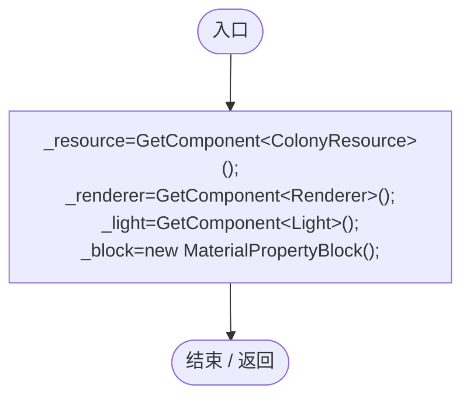
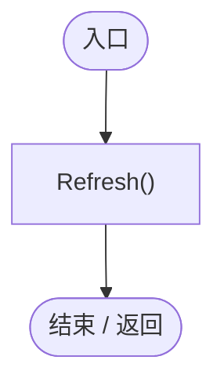
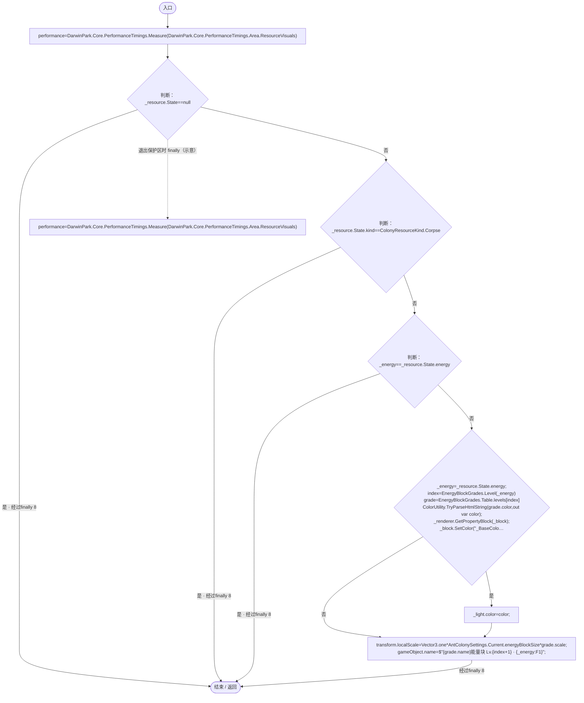

# EnergyBlockGradeVisual.cs

[返回总索引](../README.md) · `Runtime` · `Assets/DarwinPark/Entities/Ecology/EnergyBlockGradeVisual.cs`

[源文件](../../../Assets/DarwinPark/Entities/Ecology/EnergyBlockGradeVisual.cs) · 源码校验：`a46b532c7fdde7ac208d638a4f881e9a1f3d70215b3889777ec1cf66afb765d5`

方法按源文件位置排列。事件/回调引用不表示立即执行；分支与异常说明见总索引。完整源码与可点击关系图请打开离线手册。

## Awake · L10

`private void Awake()`

### Editor / Player · Roslyn编译器控制流

## LateUpdate · L11

`private void LateUpdate()`

### Editor / Player · Roslyn编译器控制流

项目内调用/回调引用：

- [EnergyBlockGradeVisual.Refresh · L12](dd689a3df9b53e75.md#mdc871697ce28f8db)（方法）

## Refresh · L12

`public void Refresh()`

### Editor / Player · Roslyn编译器控制流

项目内调用/回调引用：

- [PerformanceTimings.Measure · L24](a8403a4c7503726d.md#mbef9e348df638730)（方法）
- [ColonyResource.State.get · L24](293dbaecfff4b585.md#m41824f1a0e160aa5)（访问器）
- [EnergyBlockGrades.Level · L50](1251b395f5845255.md#m7c2ca1d753bc064a)（方法）
- [EnergyBlockGrades.Table.get · L16](1251b395f5845255.md#m5883f4b3fcdf870b)（访问器）
- [AntColonySettings.Current.get · L31](cb0a937e97c8fbb3.md#mcd121159f407ccdf)（访问器）
