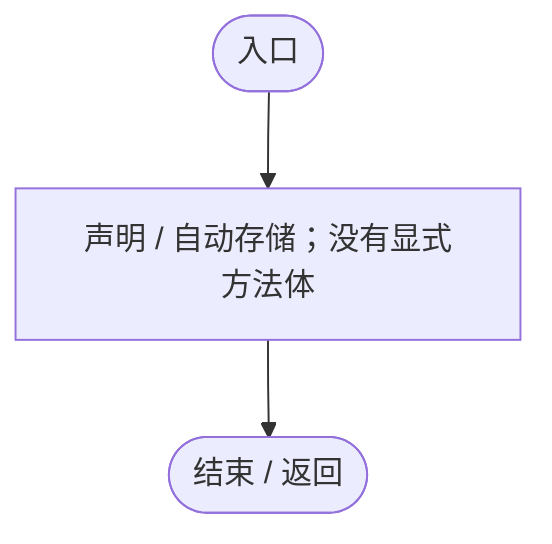
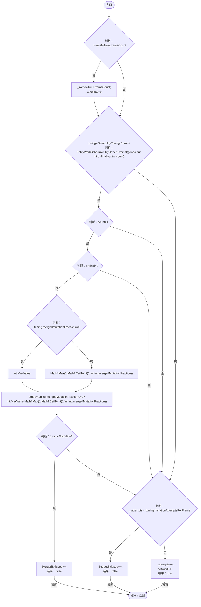
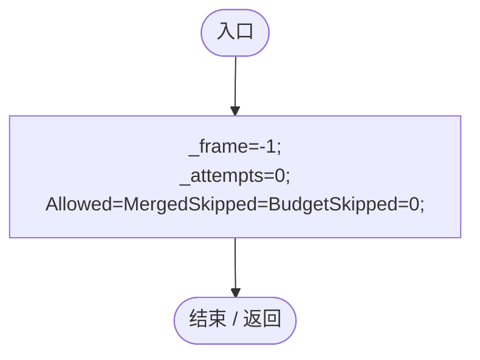

# GlobalMutationManager.cs

[返回总索引](../README.md) · `Runtime` · `Assets/DarwinPark/Entities/Simulation/GlobalMutationManager.cs`

[源文件](../../../Assets/DarwinPark/Entities/Simulation/GlobalMutationManager.cs) · 源码校验：`1a6b80685267d92026a188e21a280f0e33e5b62c6edbf8741849d6ebac522bde`

方法按源文件位置排列。事件/回调引用不表示立即执行；分支与异常说明见总索引。完整源码与可点击关系图请打开离线手册。

## Allowed.get · L10

`get`

### Editor / Player · 语法控制结构 / 声明（非CFG）

## Allowed.set · L10

`private set`

### Editor / Player · 语法控制结构 / 声明（非CFG）

## MergedSkipped.get · L11

`get`

### Editor / Player · 语法控制结构 / 声明（非CFG）

## MergedSkipped.set · L11

`private set`

### Editor / Player · 语法控制结构 / 声明（非CFG）

## BudgetSkipped.get · L12

`get`

### Editor / Player · 语法控制结构 / 声明（非CFG）

## BudgetSkipped.set · L12

`private set`

### Editor / Player · 语法控制结构 / 声明（非CFG）

## Permit · L13

`public static bool Permit(EntityGeneController genes)`

### Editor / Player · Roslyn编译器控制流

项目内调用/回调引用：

- [GameplayTuning.Current.get · L31](db546e5713b32d53.md#m557c9ecc76cc372d)（访问器）
- [EntityWorkScheduler.TryCohortOrdinal · L78](465ccdbb260bcac2.md#mb819ba724b68267a)（方法）
- [GlobalMutationManager.MergedSkipped.set · L11](debf58c0eabf33e3.md#m729fec21f34fd1a6)（访问器）
- [GlobalMutationManager.MergedSkipped.get · L11](debf58c0eabf33e3.md#m380d4fa8cff8bd88)（访问器）
- [GlobalMutationManager.BudgetSkipped.set · L12](debf58c0eabf33e3.md#m1d09a05b22718d06)（访问器）
- [GlobalMutationManager.BudgetSkipped.get · L12](debf58c0eabf33e3.md#m957f818f0882d2b9)（访问器）
- [GlobalMutationManager.Allowed.set · L10](debf58c0eabf33e3.md#m96facc28b4573bac)（访问器）
- [GlobalMutationManager.Allowed.get · L10](debf58c0eabf33e3.md#m61fe7ce485547f4f)（访问器）

## Reset · L25

`[RuntimeInitializeOnLoadMethod(RuntimeInitializeLoadType.SubsystemRegistration)] private static void Reset()`

### Editor / Player · Roslyn编译器控制流

项目内调用/回调引用：

- [GlobalMutationManager.Allowed.set · L10](debf58c0eabf33e3.md#m96facc28b4573bac)（访问器）
- [GlobalMutationManager.MergedSkipped.set · L11](debf58c0eabf33e3.md#m729fec21f34fd1a6)（访问器）
- [GlobalMutationManager.BudgetSkipped.set · L12](debf58c0eabf33e3.md#m1d09a05b22718d06)（访问器）
