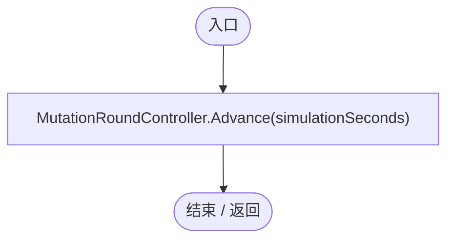

# GlobalMutationManager.cs

[返回总索引](../README.md) · `Runtime` · `Assets/DarwinPark/Entities/Simulation/GlobalMutationManager.cs`

[源文件](../../../Assets/DarwinPark/Entities/Simulation/GlobalMutationManager.cs) · 源码校验：`8e3fb4ef4397d8fef8b565f3889a8e7c83a9c06026396c7c73907ce75117073d`

方法按源文件位置排列。事件/回调引用不表示立即执行；分支与异常说明见总索引。完整源码与可点击关系图请打开离线手册。

## Advance · L6

`public static void Advance(float simulationSeconds)`

### Editor / Player · Roslyn编译器控制流

项目内调用/回调引用：

- [MutationRoundController.Advance · L33](3a238ee75b15c52c.md#m4bb6ac2885317579)（方法）
