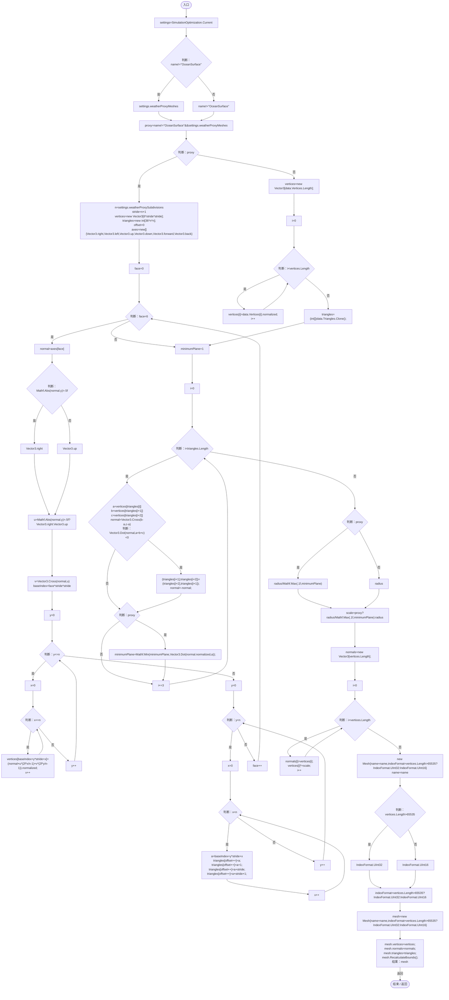

# WeatherShellGeometry.cs

[返回总索引](../README.md) · `Runtime` · `Assets/DarwinPark/Planet/Terrain/WeatherShellGeometry.cs`

[源文件](../../../Assets/DarwinPark/Planet/Terrain/WeatherShellGeometry.cs) · 源码校验：`3f498e0151ae732bf77dbd7db3b267954a14ecc0a0ea0fe44a895ba6b612214e`

方法按源文件位置排列。事件/回调引用不表示立即执行；分支与异常说明见总索引。完整源码与可点击关系图请打开离线手册。

## Create · L9

`public static Mesh Create(PlanetTerrainData data,float radius,string name)`

### Editor / Player · Roslyn编译器控制流

项目内调用/回调引用：

- [SimulationOptimization.Current.get · L30](11c9091e70893352.md#mcfa8eb2e650e57b1)（访问器）
