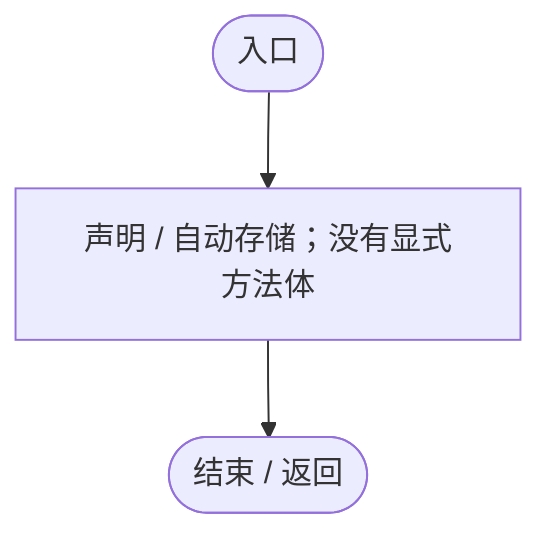
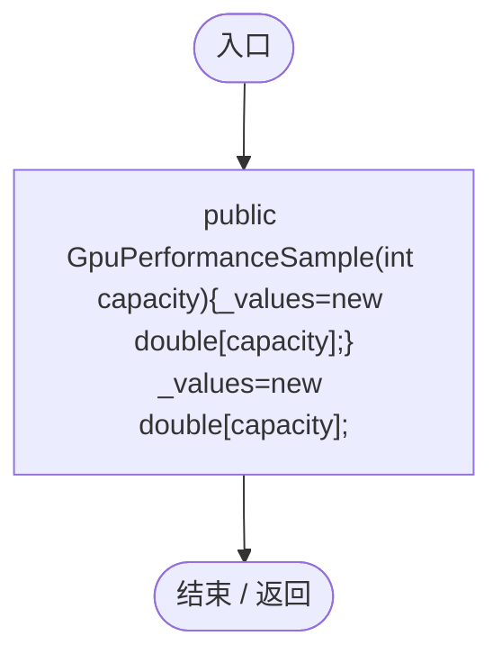
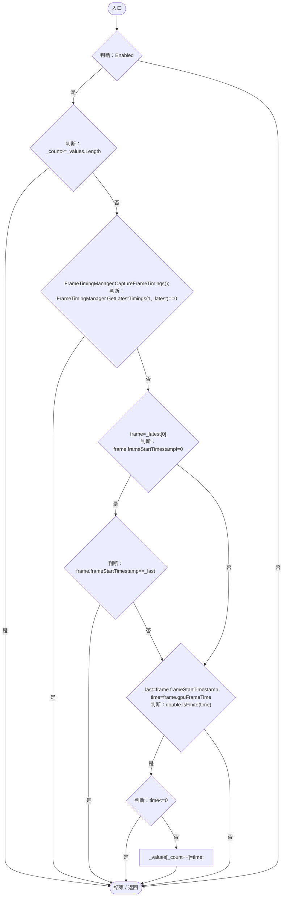
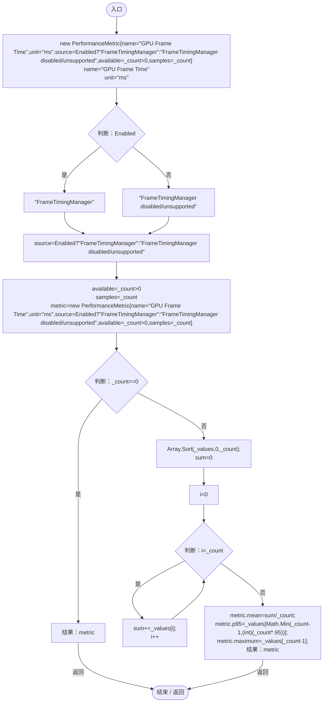
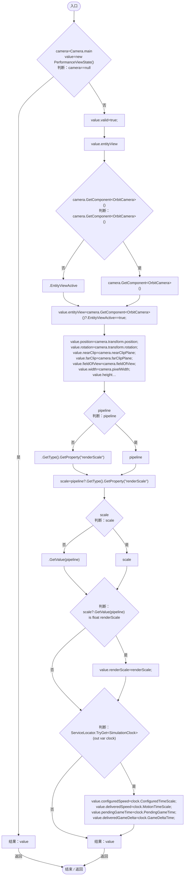

# GpuPerformanceSample.cs

[返回总索引](../README.md) · `Runtime` · `Assets/DarwinPark/Core/GpuPerformanceSample.cs`

[源文件](../../../Assets/DarwinPark/Core/GpuPerformanceSample.cs) · 源码校验：`ae6c38f5bd3d0a89570bd1b07bdb62d65581c322147978f6d99bce4ed541cffd`

方法按源文件位置排列。事件/回调引用不表示立即执行；分支与异常说明见总索引。完整源码与可点击关系图请打开离线手册。

## Enabled.get · L10

`get`

### Editor / Player · 语法控制结构 / 声明（非CFG）

## GpuPerformanceSample.ctor · L11

`public GpuPerformanceSample(int capacity)`

### Editor / Player · Roslyn编译器控制流

## Record · L12

`public void Record()`

### Editor / Player · Roslyn编译器控制流

项目内调用/回调引用：

- [GpuPerformanceSample.Enabled.get · L10](df1a6456e756b7d5.md#m99a00b4fcfa38c49)（访问器）

## Finish · L17

`public PerformanceMetric Finish()`

### Editor / Player · Roslyn编译器控制流

项目内调用/回调引用：

- [GpuPerformanceSample.Enabled.get · L10](df1a6456e756b7d5.md#m99a00b4fcfa38c49)（访问器）

## Capture · L27

`public static PerformanceViewState Capture()`

### Editor / Player · Roslyn编译器控制流

项目内调用/回调引用：

- [OrbitCamera.EntityViewActive.get · L39](42eb429559b42bcb.md#m4b320edff61e06a5)（访问器）
- [ServiceLocator.TryGet · L26](f2fdbe9f9ccd93cb.md#m143b24e6d58471b0)（方法）
- [SimulationClock.GameDeltaTime.get · L26](a8f444aec9614b0a.md#me7f11abae18a4f2d)（访问器）
