# WorldControlsRegression.cs

[返回总索引](../README.md) · `Editor` · `Assets/DarwinPark/Editor/WorldControlsRegression.cs`

[源文件](../../../Assets/DarwinPark/Editor/WorldControlsRegression.cs) · 源码校验：`b6fe02c17dfa3a34624cae6faae6fc6300dea1199eccc9c14cd9f161591eeedf`

方法按源文件位置排列。事件/回调引用不表示立即执行；分支与异常说明见总索引。完整源码与可点击关系图请打开离线手册。

## Folder.get · L28

`private static string Folder`

### Editor · 语法控制结构 / 声明（非CFG）

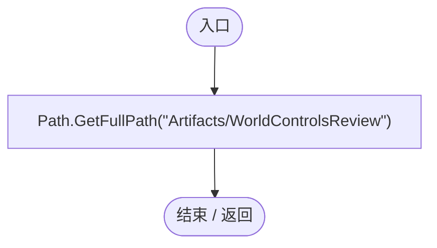

## WorldControlsRegression.ctor · L29

`static WorldControlsRegression()`

### Editor · Roslyn编译器控制流

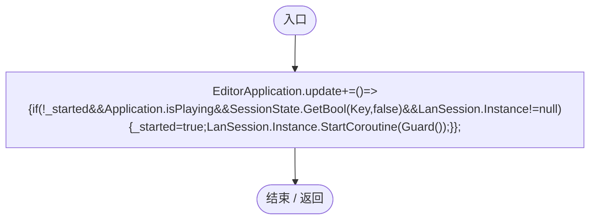

项目内调用/回调引用：

- [WorldControlsRegression.回调@29 · L29](df3cc9cf0a2f6e97.md#mc4e89b46d9c79168)（回调/委托）

## 回调@29 · L29

`( … => 回调`

### Editor · Roslyn编译器控制流

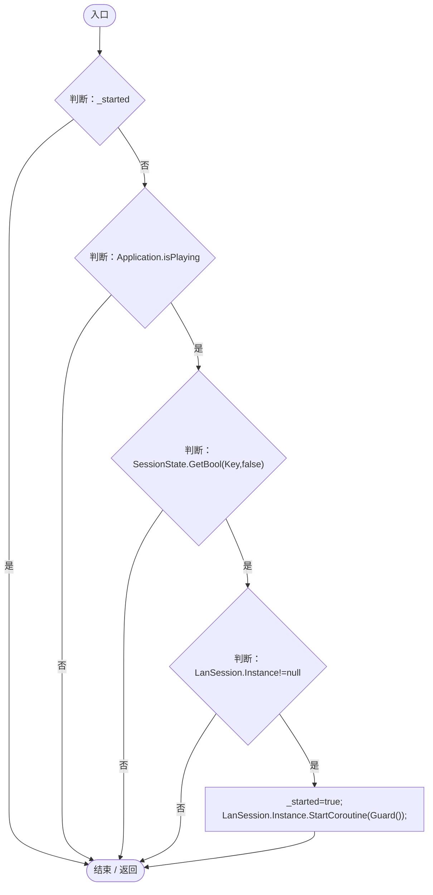

项目内调用/回调引用：

- [LanSession.Instance.get · L23](9fb633eebffe669c.md#mbf83306994878383)（访问器）
- [WorldControlsRegression.Guard · L32](df3cc9cf0a2f6e97.md#mc4699c873b0cb028)（方法）

## RunBatch · L30

`public static void RunBatch()`

### Editor · Roslyn编译器控制流

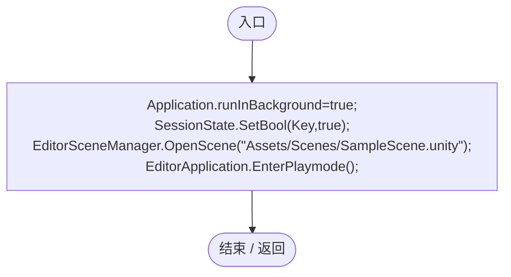

## Check · L31

`private static void Check(bool condition,string text)`

### Editor · Roslyn编译器控制流

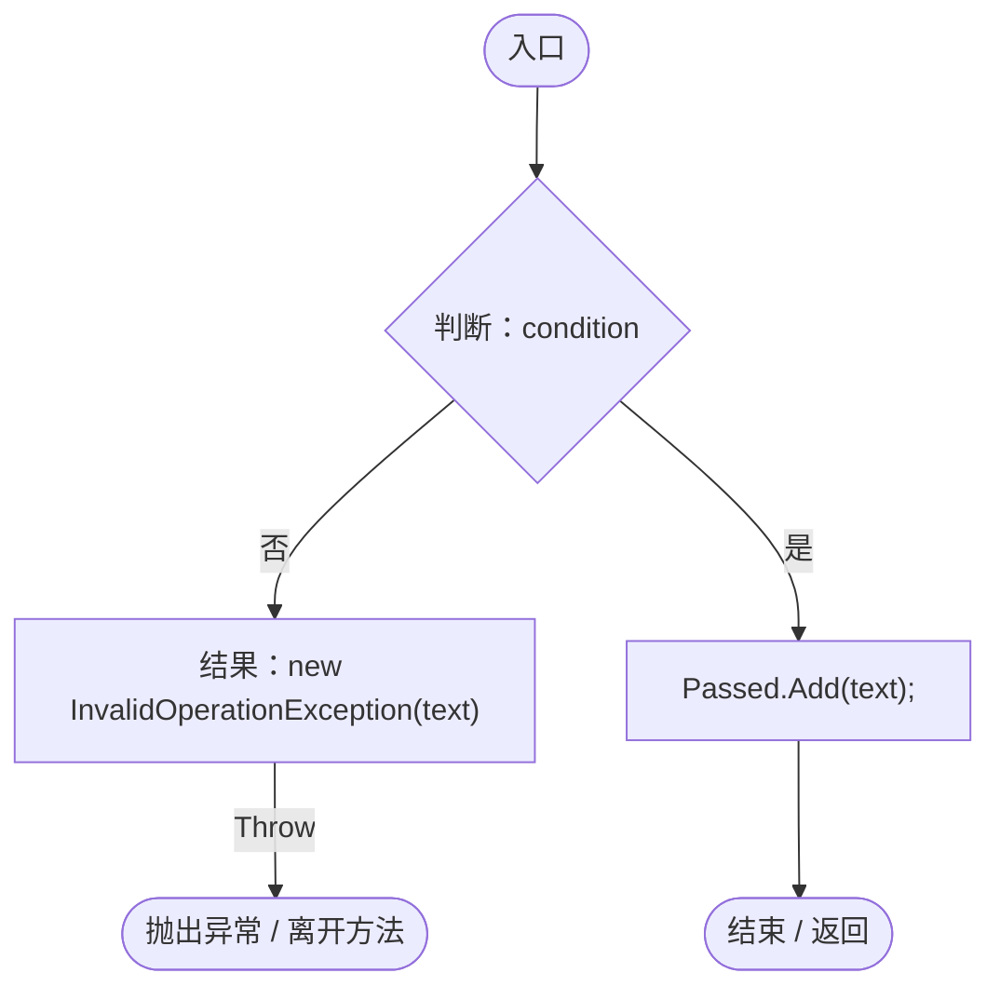

## Guard · L32

`private static IEnumerator Guard()`

### Editor · Roslyn编译器控制流

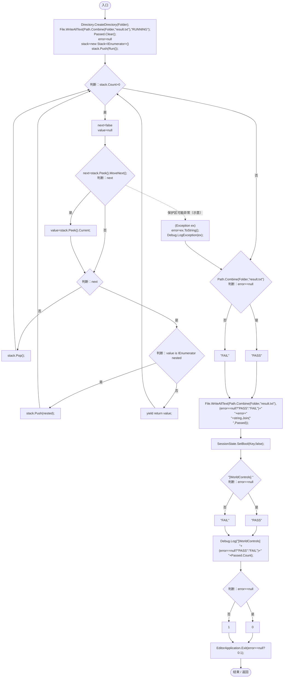

项目内调用/回调引用：

- [WorldControlsRegression.Run · L48](df3cc9cf0a2f6e97.md#m0e827c29f2f40102)（方法）

## Spawn · L38

`private static DarwinEntity Spawn(Vector3 point)`

### Editor · Roslyn编译器控制流

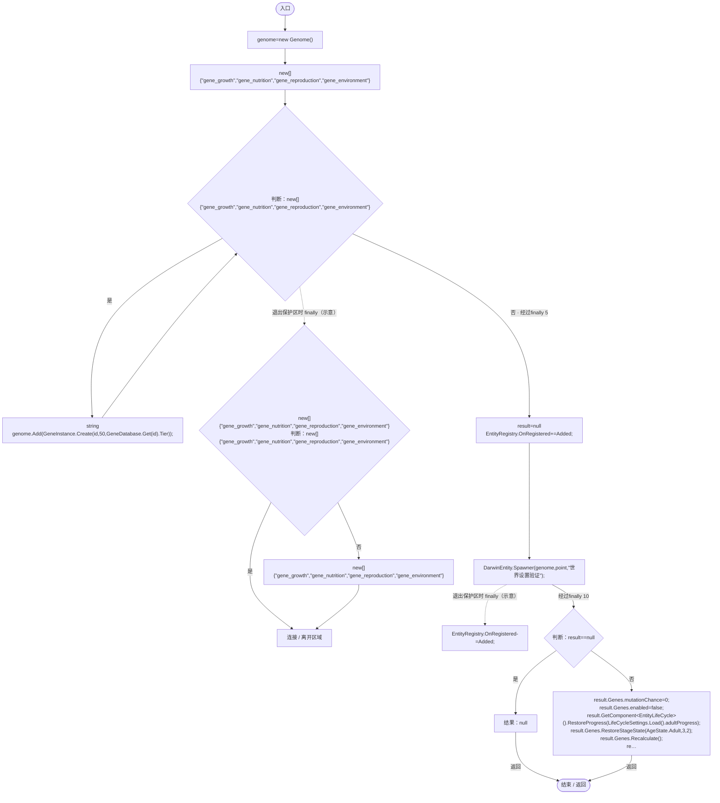

项目内调用/回调引用：

- [Genome.Add · L19](a2ef23f865bc7ee8.md#md9cfdc94b8b8d40f)（方法）
- [GeneInstance.Create · L20](f82e1498d67f5afd.md#m72e94c278de3cf8b)（方法）
- [GeneDatabase.Get · L135](ec0a03483435a863.md#m8f3bbfb35f3ca397)（方法）
- [DarwinEntity.Genes.get · L14](70798dde169f2e8b.md#m622eb1adf401d431)（访问器）
- [EntityLifeCycle.RestoreProgress · L48](9f4138bfbae654b7.md#mfc75121476d49679)（方法）
- [LifeCycleSettings.Load · L16](ace76969fe8f61de.md#mbd2925785484f343)（方法）
- [EntityGeneController.RestoreStageState · L45](7494d53178552f0e.md#m49489af39061f1a1)（方法）
- [EntityGeneController.Recalculate · L90](7494d53178552f0e.md#m93744c8f3039b93c)（方法）
- [WorldControlsRegression.Added · L41](df3cc9cf0a2f6e97.md#md1ac202b5275de8f)（局部函数）

## Added · L41

`void Added(DarwinEntity e)`

### Editor · Roslyn编译器控制流

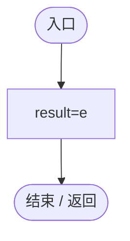

## Capture · L45

`private static IEnumerator Capture(string name)`

### Editor · Roslyn编译器控制流

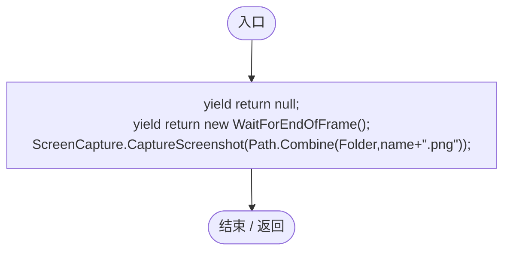

## WaitForUpdate · L46

`private static IEnumerator WaitForUpdate(WorldParameterUpdate update)`

### Editor · Roslyn编译器控制流

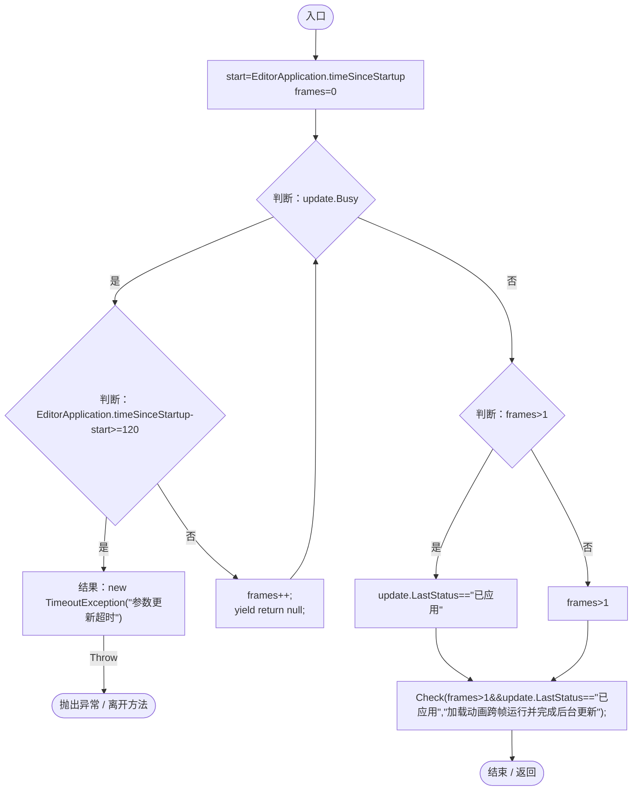

项目内调用/回调引用：

- [WorldParameterUpdate.Busy.get · L20](4087d9be2a65e96f.md#mec2ac85b8ff3f127)（访问器）
- [WorldControlsRegression.Check · L31](df3cc9cf0a2f6e97.md#mc0b7eac680c69043)（方法）
- [WorldParameterUpdate.LastStatus.get · L21](4087d9be2a65e96f.md#m9aff979be84ce935)（访问器）

## Run · L48

`private static IEnumerator Run()`

### Editor · Roslyn编译器控制流

```mermaid
flowchart TD
  b0(["入口"])
  b1["yield return null;<br/>world=Object.FindFirstObjectByType&lt;WorldSessionManager&gt;()<br/>builder=Object.FindFirstObjectByType&lt;PlanetTerrainMeshBuilder&gt;()<br/>climate=PlanetClimateMap.Instance<br/>clock=ServiceLocator.Get&lt;SimulationClock&gt;()<br/>builder.subdivisi…"]
  b2{"判断：world.Busy"}
  b3["yield return null;"]
  b4["clock.Pause();<br/>root=ServiceLocator.Get&lt;UIRoot&gt;()<br/>control=Object.FindFirstObjectByType&lt;SimulationControlPanel&gt;()<br/>page=typeof(SimulationControlPanel).GetMethod(&quot;SwitchPage&quot;,Private)<br/>stats=root.MainCanvas.transform.Find(&quot;BottomPanel/Content…"]
  b5{"判断：stats.gameObject.activeInHierarchy"}
  b6["stats.GetComponent&lt;MapEntityActions&gt;()!=null"]
  b7["stats.gameObject.activeInHierarchy"]
  b8["Check(stats.gameObject.activeInHierarchy&amp;&amp;stats.GetComponent&lt;MapEntityActions&gt;()!=null,&quot;实体统计和动作只放在第一页&quot;);"]
  b9["Check(stats.transform.Find(&quot;WorldSettings/ThemeIcon&quot;).GetComponent&lt;Image&gt;().sprite!=null,&quot;统计右上角齿轮实际加载图标&quot;);<br/>home=EcologyQueries.Surface(builder.transform.position+Vector3.up*400)<br/>a=Spawn(home)<br/>b=Spawn(home+Vector3.right*3)<br/>c=Spawn(home+Ve…"]
  b10{"判断：settings!=null"}
  b11{"判断：settings.Visible"}
  b12["GameInputGate.Blocked"]
  b13["settings!=null&amp;&amp;settings.Visible&amp;&amp;GameInputGate.Blocked"]
  b14["Check(settings!=null&amp;&amp;settings.Visible&amp;&amp;GameInputGate.Blocked,&quot;齿轮打开本存档设置并拦截背景输入&quot;);"]
  b15["overlay=root.MainCanvas.transform.Find(&quot;WorldGameSettingsOverlay/Panel&quot;)<br/>overlay.Find(&quot;EntityLimit&quot;).GetComponent&lt;InputField&gt;().text=&quot;3&quot;;<br/>overlay.Find(&quot;Apply&quot;).GetComponent&lt;Button&gt;().onClick.Invoke();"]
  b16{"判断：EntityPopulationLimit.Maximum==3"}
  b17["WorldSaveStore.Read(WorldSaveStore.FileFor(world.Current.id)).gameSettings.entityLimit==3"]
  b18["EntityPopulationLimit.Maximum==3"]
  b19["Check(EntityPopulationLimit.Maximum==3&amp;&amp;WorldSaveStore.Read(WorldSaveStore.FileFor(world.Current.id)).gameSettings.entityLimit==3,&quot;实体上限实际写盘读取，属于当前存档&quot;);"]
  b20["yield return Capture(&quot;world-settings&quot;);<br/>settings.Close();"]
  b21{"判断：Spawn(home+Vector3.right*8)==null"}
  b22["EntityRegistry.All.Count==3"]
  b23["Spawn(home+Vector3.right*8)==null"]
  b24["Check(Spawn(home+Vector3.right*8)==null&amp;&amp;EntityRegistry.All.Count==3,&quot;工厂在创建前拒绝超额实体&quot;);"]
  b25["Check(!LanEditActions.Spawn(a.Genes.Genome,home),&quot;手动放置同样受上限约束&quot;);<br/>Check(!RandomPlanetSpawner.Ensure(clock.gameObject).StartBatch(a.Genes.Genome,10,true),&quot;随机生成在满额时有界停止&quot;);<br/>reproduction=(ReproductionGeneLogic)a.Genes.GetLogic(a.Genes.Genome.…"]
  b26{"判断：a.Genes.IsGestating"}
  b27["reserve==after"]
  b28["!a.Genes.IsGestating"]
  b29["Check(!a.Genes.IsGestating&amp;&amp;reserve==after,&quot;达到上限不启动新孕育、不扣储粮&quot;);"]
  b30["a.Genes.IsGestating=true;<br/>a.Genes.Recalculate();"]
  b31["reproduction<br/>new ReproductionSaveState{gestation=0}<br/>gestation=0<br/>reproduction.RestoreState(new ReproductionSaveState{gestation=0});"]
  b32["reproduction.OnUpdate(.1f);"]
  b33{"判断：a.Genes.IsGestating"}
  b34["EntityRegistry.All.Count==3"]
  b35["a.Genes.IsGestating"]
  b36["Check(a.Genes.IsGestating&amp;&amp;EntityRegistry.All.Count==3,&quot;完成孕育在满额时保留并等待空位&quot;);"]
  b37["Object.DestroyImmediate(c.gameObject);<br/>reproduction.OnUpdate(.1f);"]
  b38{"判断：a.Genes.IsGestating"}
  b39["EntityRegistry.All.Count==3"]
  b40["!a.Genes.IsGestating"]
  b41["Check(!a.Genes.IsGestating&amp;&amp;EntityRegistry.All.Count==3,&quot;空位释放后真实出生且不突破上限&quot;);"]
  b42{"判断：WorldEntityActions.SetLimit(1,false)"}
  b43["EntityRegistry.All.Count==3"]
  b44["WorldEntityActions.SetLimit(1,false)"]
  b45["Check(WorldEntityActions.SetLimit(1,false)&amp;&amp;EntityRegistry.All.Count==3,&quot;降低上限保留已有实体&quot;);"]
  b46["EntityPopulationLimit.RestoreScope()"]
  b47["Check(Spawn(home+Vector3.right*9)!=null,&quot;读档豁免完整恢复超过上限的已有实体&quot;);"]
  b48{"判断：EntityPopulationLimit.RestoreScope()"}
  b49["EntityPopulationLimit.RestoreScope()"]
  b50["连接 / 离开区域"]
  b51["Check(!EntityPopulationLimit.CanSpawn,&quot;读档作用域结束立即恢复上限&quot;);<br/>world.SaveNow(false);<br/>overCap=WorldSaveStore.Read(WorldSaveStore.FileFor(world.Current.id))<br/>world.Open(overCap);"]
  b52{"判断：world.Busy"}
  b53["yield return null;"]
  b54{"判断：EntityRegistry.All.Count==4"}
  b55{"判断：EntityPopulationLimit.Maximum==1"}
  b56["!clock.IsRunning"]
  b57["EntityRegistry.All.Count==4&amp;&amp;EntityPopulationLimit.Maximum==1&amp;&amp;!clock.IsRunning"]
  b58["Check(EntityRegistry.All.Count==4&amp;&amp;EntityPopulationLimit.Maximum==1&amp;&amp;!clock.IsRunning,&quot;实际读档完整恢复超上限的四个实体并保持暂停&quot;);"]
  b59["WorldAuthority.CanEdit=false;<br/>yield return null;<br/>page.Invoke(control,new object[]{1});<br/>Check(!root.MainCanvas.transform.Find(&quot;BottomPanel/ContentArea/Page2/EntitySpawnPanel&quot;).gameObject.activeSelf,&quot;成员第二页隐藏创造控件&quot;);<br/>page.Invoke(control,new …"]
  b60{"判断：stats.gameObject.activeInHierarchy"}
  b61["!root.MainCanvas.transform.Find(&quot;BottomPanel/ContentArea/Page2/EntitySpawnPanel&quot;).gameObject.activeSelf"]
  b62["stats.gameObject.activeInHierarchy"]
  b63["Check(stats.gameObject.activeInHierarchy&amp;&amp;!root.MainCanvas.transform.Find(&quot;BottomPanel/ContentArea/Page2/EntitySpawnPanel&quot;).gameObject.activeSelf,&quot;普通成员能看第一页统计但看不到创造功能&quot;);"]
  b64{"判断：stats.transform.Find(&quot;WorldSettings&quot;).gameObject.activeSelf"}
  b65["!stats.transform.Find(&quot;ClearAllEntities&quot;).gameObject.activeSelf"]
  b66["!stats.transform.Find(&quot;WorldSettings&quot;).gameObject.activeSelf"]
  b67["Check(!stats.transform.Find(&quot;WorldSettings&quot;).gameObject.activeSelf&amp;&amp;!stats.transform.Find(&quot;ClearAllEntities&quot;).gameObject.activeSelf,&quot;普通成员隐藏设置和清除按钮&quot;);"]
  b68{"判断：WorldEntityActions.ClearAll()"}
  b69["!WorldEntityActions.SetLimit(0,false)"]
  b70["!WorldEntityActions.ClearAll()"]
  b71["Check(!WorldEntityActions.ClearAll()&amp;&amp;!WorldEntityActions.SetLimit(0,false),&quot;直接调用管理入口也拒绝无权限操作&quot;);"]
  b72["WorldAuthority.CanEdit=true;<br/>yield return null;"]
  b73{"判断：WorldEntityActions.SetLimit(0,false)"}
  b74["EntityPopulationLimit.CanSpawn"]
  b75["WorldEntityActions.SetLimit(0,false)"]
  b76["Check(WorldEntityActions.SetLimit(0,false)&amp;&amp;EntityPopulationLimit.CanSpawn,&quot;0可明确设置为不限&quot;);"]
  b77["identities=EntityRegistry.All.ToDictionary(EcologyIdentity.Of,e=&gt;e)<br/>camera=Camera.main<br/>cameraPosition=camera.transform.position<br/>cameraRotation=camera.transform.rotation<br/>time=clock.GameTime<br/>worldId=world.Current.id<br/>terrainData=builder.Dat…"]
  b78{"判断：update.Busy"}
  b79{"判断：WorldRuntimeGate.Loading"}
  b80{"判断：GameInputGate.Blocked"}
  b81{"判断：root.MainCanvas.enabled"}
  b82["!clock.IsRunning"]
  b83["update.Busy&amp;&amp;WorldRuntimeGate.Loading&amp;&amp;GameInputGate.Blocked&amp;&amp;!root.MainCanvas.enabled&amp;&amp;!clock.IsRunning"]
  b84["Check(update.Busy&amp;&amp;WorldRuntimeGate.Loading&amp;&amp;GameInputGate.Blocked&amp;&amp;!root.MainCanvas.enabled&amp;&amp;!clock.IsRunning,&quot;更新期间进度界面接管输入并暂停模拟&quot;);"]
  b85["yield return Capture(&quot;parameter-loading&quot;);<br/>yield return WaitForUpdate(update);"]
  b86{"判断：ReferenceEquals(builder.Data,terrainData)"}
  b87["Mathf.Abs(ClimateDataHub.BaseTemperature-priorTemperature-1)&lt;.001f"]
  b88["ReferenceEquals(builder.Data,terrainData)"]
  b89["Check(ReferenceEquals(builder.Data,terrainData)&amp;&amp;Mathf.Abs(ClimateDataHub.BaseTemperature-priorTemperature-1)&lt;.001f,&quot;只改温度不重建地形&quot;);"]
  b90{"判断：world.Current.id==worldId"}
  b91{"判断：clock.GameTime==time"}
  b92["identities.All(p=&gt;EcologyIdentity.Find(p.Key)==p.Value)"]
  b93["world.Current.id==worldId&amp;&amp;clock.GameTime==time&amp;&amp;identities.All(p=&gt;EcologyIdentity.Find(p.Key)==p.Value)"]
  b94["Check(world.Current.id==worldId&amp;&amp;clock.GameTime==time&amp;&amp;identities.All(p=&gt;EcologyIdentity.Find(p.Key)==p.Value),&quot;原世界身份、实体对象与游戏时间完整保留&quot;);"]
  b95{"判断：Vector3.Distance(camera.transform.position,cameraPosition)&lt;.001f"}
  b96["Quaternion.Angle(camera.transform.rotation,cameraRotation)&lt;.01f"]
  b97["Vector3.Distance(camera.transform.position,cameraPosition)&lt;.001f"]
  b98["Check(Vector3.Distance(camera.transform.position,cameraPosition)&lt;.001f&amp;&amp;Quaternion.Angle(camera.transform.rotation,cameraRotation)&lt;.01f,&quot;参数加载后返回原镜头位置&quot;);"]
  b99{"判断：WorldRuntimeGate.Loading"}
  b100{"判断：GameInputGate.Blocked"}
  b101{"判断：root.MainCanvas.enabled"}
  b102["!clock.IsRunning"]
  b103["!WorldRuntimeGate.Loading&amp;&amp;!GameInputGate.Blocked&amp;&amp;root.MainCanvas.enabled&amp;&amp;!clock.IsRunning"]
  b104["Check(!WorldRuntimeGate.Loading&amp;&amp;!GameInputGate.Blocked&amp;&amp;root.MainCanvas.enabled&amp;&amp;!clock.IsRunning,&quot;原本暂停的世界仍保持暂停，界面与输入恢复&quot;);"]
  b105["clock.Play();<br/>yield return null;<br/>Check(update.Request(&quot;btn_param_hum&quot;,&quot;45&quot;,out _),&quot;运行中也可修改湿度&quot;);<br/>yield return WaitForUpdate(update);"]
  b106{"判断：clock.IsRunning"}
  b107["!GameInputGate.Blocked"]
  b108["clock.IsRunning"]
  b109["Check(clock.IsRunning&amp;&amp;!GameInputGate.Blocked,&quot;更新后恢复原本运行状态&quot;);"]
  b110["clock.Pause();<br/>Check(update.Request(&quot;btn_param_seed&quot;,&quot;2147483647&quot;,out _),&quot;最大32位整数种子不经float丢失精度&quot;);<br/>yield return WaitForUpdate(update);"]
  b111{"判断：builder.seed==int.MaxValue"}
  b112{"判断：ReferenceEquals(terrainData,builder.Data)"}
  b113["identities.All(p=&gt;EcologyIdentity.Find(p.Key)==p.Value)"]
  b114["builder.seed==int.MaxValue&amp;&amp;!ReferenceEquals(terrainData,builder.Data)&amp;&amp;identities.All(p=&gt;EcologyIdentity.Find(p.Key)==p.Value)"]
  b115["Check(builder.seed==int.MaxValue&amp;&amp;!ReferenceEquals(terrainData,builder.Data)&amp;&amp;identities.All(p=&gt;EcologyIdentity.Find(p.Key)==p.Value),&quot;种子重建地形且保留原实体对象&quot;);"]
  b116["Check(update.Request(&quot;btn_param_terrain&quot;,&quot;60&quot;,out _),&quot;地形参数正确映射为陆地比例&quot;);<br/>yield return WaitForUpdate(update);<br/>Check(Mathf.Abs(builder.continentRatio-.6f)&lt;.0001f,&quot;地形参数不会误改成湿度&quot;);"]
  b117{"判断：update.Request(&quot;btn_param_seed&quot;,&quot;2147483648&quot;,out _)"}
  b118["!update.Busy"]
  b119["!update.Request(&quot;btn_param_seed&quot;,&quot;2147483648&quot;,out _)"]
  b120["Check(!update.Request(&quot;btn_param_seed&quot;,&quot;2147483648&quot;,out _)&amp;&amp;!update.Busy,&quot;无效种子不启动加载、不污染世界&quot;);"]
  b121["world.SaveNow(false);<br/>saved=WorldSaveStore.Read(WorldSaveStore.FileFor(world.Current.id))"]
  b122{"判断：saved.seed==int.MaxValue"}
  b123["saved.gameSettings.entityLimit==0"]
  b124["saved.seed==int.MaxValue"]
  b125["Check(saved.seed==int.MaxValue&amp;&amp;saved.gameSettings.entityLimit==0,&quot;参数与存档设置同次持久化&quot;);"]
  b126["stats.SelectGene(&quot;gene_growth&quot;);<br/>stats.RefreshNow();<br/>Check(stats.Total&gt;0,&quot;清理前有真实实体供按钮清除&quot;);<br/>yield return Capture(&quot;page2-actions&quot;);<br/>stats.transform.Find(&quot;ClearAllEntities&quot;).GetComponent&lt;Button&gt;().onClick.Invoke();<br/>yield return null;"]
  b127{"判断：EntityRegistry.All.Count==0"}
  b128["stats.Total==0"]
  b129["EntityRegistry.All.Count==0"]
  b130["Check(EntityRegistry.All.Count==0&amp;&amp;stats.Total==0,&quot;一键清除全部实体并即时更新统计&quot;);"]
  b131["Check(WorldSaveStore.Read(WorldSaveStore.FileFor(world.Current.id)).entities.Count==0,&quot;清除结果已保存，不会读档复活&quot;);<br/>old=JsonUtility.FromJson&lt;WorldSaveData&gt;(JsonUtility.ToJson(saved))<br/>old.gameSettings=null;<br/>WorldSaveStore.Validate(old);"]
  b132{"判断：old.gameSettings.version==1"}
  b133["old.gameSettings.entityLimit==3000"]
  b134["old.gameSettings.version==1"]
  b135["Check(old.gameSettings.version==1&amp;&amp;old.gameSettings.entityLimit==3000,&quot;旧档缺少设置时补齐资源默认值&quot;);"]
  b136(["结束 / 返回"])
  b0 --> b1
  b1 --> b2
  b2 -->|"是"| b3
  b2 -->|"否"| b4
  b3 --> b2
  b4 --> b5
  b5 -->|"是"| b6
  b5 -->|"否"| b7
  b6 --> b8
  b7 --> b8
  b8 --> b9
  b9 --> b10
  b10 -->|"是"| b11
  b10 -->|"否"| b13
  b11 -->|"是"| b12
  b11 -->|"否"| b13
  b12 --> b14
  b13 --> b14
  b14 --> b15
  b15 --> b16
  b16 -->|"是"| b17
  b16 -->|"否"| b18
  b17 --> b19
  b18 --> b19
  b19 --> b20
  b20 --> b21
  b21 -->|"是"| b22
  b21 -->|"否"| b23
  b22 --> b24
  b23 --> b24
  b24 --> b25
  b25 --> b26
  b26 -->|"否"| b27
  b26 -->|"是"| b28
  b27 --> b29
  b28 --> b29
  b29 --> b30
  b30 --> b31
  b31 --> b32
  b32 --> b33
  b33 -->|"是"| b34
  b33 -->|"否"| b35
  b34 --> b36
  b35 --> b36
  b36 --> b37
  b37 --> b38
  b38 -->|"否"| b39
  b38 -->|"是"| b40
  b39 --> b41
  b40 --> b41
  b41 --> b42
  b42 -->|"是"| b43
  b42 -->|"否"| b44
  b43 --> b45
  b44 --> b45
  b45 --> b46
  b46 --> b47
  b47 -->|"经过finally 48"| b51
  b48 -->|"否"| b49
  b48 -->|"是"| b50
  b49 --> b50
  b51 --> b52
  b52 -->|"是"| b53
  b52 -->|"否"| b54
  b53 --> b52
  b54 -->|"是"| b55
  b54 -->|"否"| b57
  b55 -->|"是"| b56
  b55 -->|"否"| b57
  b56 --> b58
  b57 --> b58
  b58 --> b59
  b59 --> b60
  b60 -->|"是"| b61
  b60 -->|"否"| b62
  b61 --> b63
  b62 --> b63
  b63 --> b64
  b64 -->|"否"| b65
  b64 -->|"是"| b66
  b65 --> b67
  b66 --> b67
  b67 --> b68
  b68 -->|"否"| b69
  b68 -->|"是"| b70
  b69 --> b71
  b70 --> b71
  b71 --> b72
  b72 --> b73
  b73 -->|"是"| b74
  b73 -->|"否"| b75
  b74 --> b76
  b75 --> b76
  b76 --> b77
  b77 --> b78
  b78 -->|"是"| b79
  b78 -->|"否"| b83
  b79 -->|"是"| b80
  b79 -->|"否"| b83
  b80 -->|"是"| b81
  b80 -->|"否"| b83
  b81 -->|"否"| b82
  b81 -->|"是"| b83
  b82 --> b84
  b83 --> b84
  b84 --> b85
  b85 --> b86
  b86 -->|"是"| b87
  b86 -->|"否"| b88
  b87 --> b89
  b88 --> b89
  b89 --> b90
  b90 -->|"是"| b91
  b90 -->|"否"| b93
  b91 -->|"是"| b92
  b91 -->|"否"| b93
  b92 --> b94
  b93 --> b94
  b94 --> b95
  b95 -->|"是"| b96
  b95 -->|"否"| b97
  b96 --> b98
  b97 --> b98
  b98 --> b99
  b99 -->|"否"| b100
  b99 -->|"是"| b103
  b100 -->|"否"| b101
  b100 -->|"是"| b103
  b101 -->|"是"| b102
  b101 -->|"否"| b103
  b102 --> b104
  b103 --> b104
  b104 --> b105
  b105 --> b106
  b106 -->|"是"| b107
  b106 -->|"否"| b108
  b107 --> b109
  b108 --> b109
  b109 --> b110
  b110 --> b111
  b111 -->|"是"| b112
  b111 -->|"否"| b114
  b112 -->|"否"| b113
  b112 -->|"是"| b114
  b113 --> b115
  b114 --> b115
  b115 --> b116
  b116 --> b117
  b117 -->|"否"| b118
  b117 -->|"是"| b119
  b118 --> b120
  b119 --> b120
  b120 --> b121
  b121 --> b122
  b122 -->|"是"| b123
  b122 -->|"否"| b124
  b123 --> b125
  b124 --> b125
  b125 --> b126
  b126 --> b127
  b127 -->|"是"| b128
  b127 -->|"否"| b129
  b128 --> b130
  b129 --> b130
  b130 --> b131
  b131 --> b132
  b132 -->|"是"| b133
  b132 -->|"否"| b134
  b133 --> b135
  b134 --> b135
  b135 --> b136
  b47 -. "退出保护区时 finally（示意）" .-> b48

```

项目内调用/回调引用：

- [PlanetClimateMap.Instance.get · L16](b4e9726c1bcf4c37.md#m3add54a419aeef9f)（访问器）
- [ServiceLocator.Get · L33](f2fdbe9f9ccd93cb.md#m2ae625299520c56d)（方法）
- [WorldSessionManager.Create · L41](08741c7b7b9d9344.md#m6aadfeee8b90aacd)（方法）
- [WorldSessionManager.Busy.get · L24](08741c7b7b9d9344.md#m4483e2e4f28f7c85)（访问器）
- [SimulationClock.Pause · L79](a8f444aec9614b0a.md#m30929d45a885d0f1)（方法）
- [UIRoot.MainCanvas.get · L14](9c1421378791f0e0.md#maa2cc9baf1248477)（访问器）
- [WorldControlsRegression.Check · L31](df3cc9cf0a2f6e97.md#mc0b7eac680c69043)（方法）
- [WorldControlsRegression.Capture · L45](df3cc9cf0a2f6e97.md#m974146b009019aa5)（方法）
- [EcologyQueries.Surface · L47](bdf7ccc2c9c0452f.md#m2f1f6873ee5fc8df)（方法）
- [WorldControlsRegression.Spawn · L38](df3cc9cf0a2f6e97.md#mfbfd05229d9bc7a3)（方法）
- [MapEntityStatisticsUI.RefreshNow · L74](da03211264cb6014.md#ma30ab70fe8c10f4f)（方法）
- [MapEntityStatisticsUI.Total.get · L16](da03211264cb6014.md#m2b470c44fd65b06c)（访问器）
- [WorldGameSettingsPanel.Instance.get · L11](6df051f7f7177d08.md#mcccf01908bb54d27)（访问器）
- [GameInputGate.Blocked.get · L8](52955daae7e592ab.md#m765763b665829633)（访问器）
- [WorldSaveStore.Read · L72](d67a35e5e3814c15.md#mca362c7675a5800c)（方法）
- [WorldSaveStore.FileFor · L48](d67a35e5e3814c15.md#m419a625e2bcc70f8)（方法）
- [WorldSessionManager.Current.get · L21](08741c7b7b9d9344.md#m5d26a5eb846a8504)（访问器）
- [WorldGameSettingsPanel.Close · L39](6df051f7f7177d08.md#m019774ab8575ddd2)（方法）
- [LanEditActions.Spawn · L21](2816321496f6360e.md#mbc8b29c9f546988e)（方法）
- [DarwinEntity.Genes.get · L14](70798dde169f2e8b.md#m622eb1adf401d431)（访问器）
- [RandomPlanetSpawner.StartBatch · L25](1c13222a547b265c.md#m0e4af90b5fa8372e)（方法）
- [RandomPlanetSpawner.Ensure · L24](1c13222a547b265c.md#mccefd1367aa9ded3)（方法）
- [EntityGeneController.GetLogic · L184](7494d53178552f0e.md#m4f4e58e1a4abadfc)（方法）
- [EntityStats.Feed · L95](75aa86a368efdf24.md#mc025822ff1eb86a0)（方法）
- [EntityStats.TryGet · L90](75aa86a368efdf24.md#m24ee1433e4a70d94)（方法）
- [ReproductionGeneLogic.OnUpdate · L36](ac319ea70bd8b723.md#mf050ec0ba2694604)（方法）
- [EntityGeneController.Recalculate · L90](7494d53178552f0e.md#m93744c8f3039b93c)（方法）
- [ReproductionGeneLogic.RestoreState · L35](ac319ea70bd8b723.md#m2e3c6341cef3b9c0)（方法）
- [WorldEntityActions.SetLimit · L12](afe657f09857fa47.md#md5c2fa4e19f790fe)（方法）
- [EntityPopulationLimit.RestoreScope · L32](44f717c5df79d270.md#m58883b4959fd76ed)（方法）
- [WorldSessionManager.SaveNow · L157](08741c7b7b9d9344.md#mbecd8b5c222ba46b)（方法）
- [WorldSessionManager.Open · L58](08741c7b7b9d9344.md#m0a8e69a8a4fbc512)（方法）
- [SimulationClock.IsRunning.get · L22](a8f444aec9614b0a.md#m10f4fe307faca0f0)（访问器）
- [WorldEntityActions.ClearAll · L23](afe657f09857fa47.md#m6f4e8f1fb05f5b38)（方法）
- [SimulationClock.GameTime.get · L23](a8f444aec9614b0a.md#m74adfa39a896652f)（访问器）
- [PlanetTerrainMeshBuilder.Data.get · L78](415285cf043354a9.md#m8382f579717fbc6d)（访问器）
- [WorldParameterUpdate.Ensure · L27](4087d9be2a65e96f.md#mcefc896cc38899a6)（方法）
- [WorldParameterUpdate.Request · L28](4087d9be2a65e96f.md#m942de54d110fe265)（方法）
- [WorldParameterUpdate.Busy.get · L20](4087d9be2a65e96f.md#mec2ac85b8ff3f127)（访问器）
- [WorldControlsRegression.WaitForUpdate · L46](df3cc9cf0a2f6e97.md#m4d67a246025ba1a7)（方法）
- [SimulationClock.Play · L78](a8f444aec9614b0a.md#m7aa9e64b7de60ed0)（方法）
- [MapEntityStatisticsUI.SelectGene · L69](da03211264cb6014.md#me708d870d6cec0dd)（方法）
- [WorldSaveStore.Validate · L73](d67a35e5e3814c15.md#mb2f88d55be126f07)（方法）
- [WorldControlsRegression.回调@63 · L63](df3cc9cf0a2f6e97.md#m8002cc9a6391c193)（回调/委托）
- [WorldControlsRegression.回调@74 · L74](df3cc9cf0a2f6e97.md#me4659b6632234020)（回调/委托）
- [WorldControlsRegression.回调@79 · L79](df3cc9cf0a2f6e97.md#mc5f09efc878c8364)（回调/委托）
- [WorldControlsRegression.回调@83 · L83](df3cc9cf0a2f6e97.md#me4cb90bd177600d2)（回调/委托）
- [EcologyIdentity.Of · L21](bdf7ccc2c9c0452f.md#m1143cf9570a93b72)（方法）

## 回调@63 · L63

`g … => 回调`

### Editor · Roslyn编译器控制流

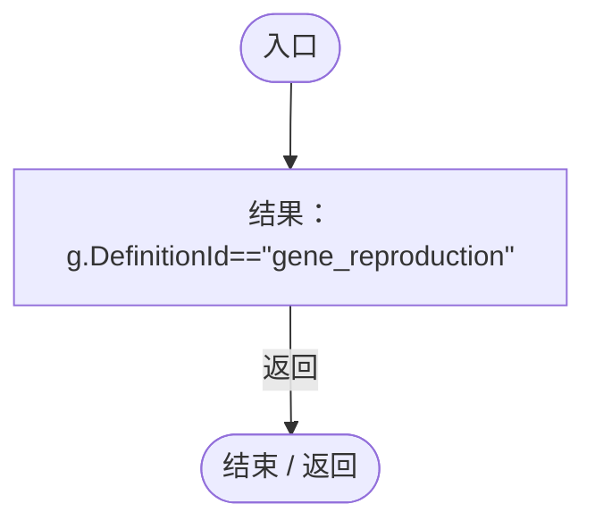

## 回调@74 · L74

`e … => 回调`

### Editor · Roslyn编译器控制流

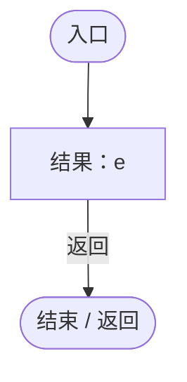

## 回调@79 · L79

`p … => 回调`

### Editor · Roslyn编译器控制流

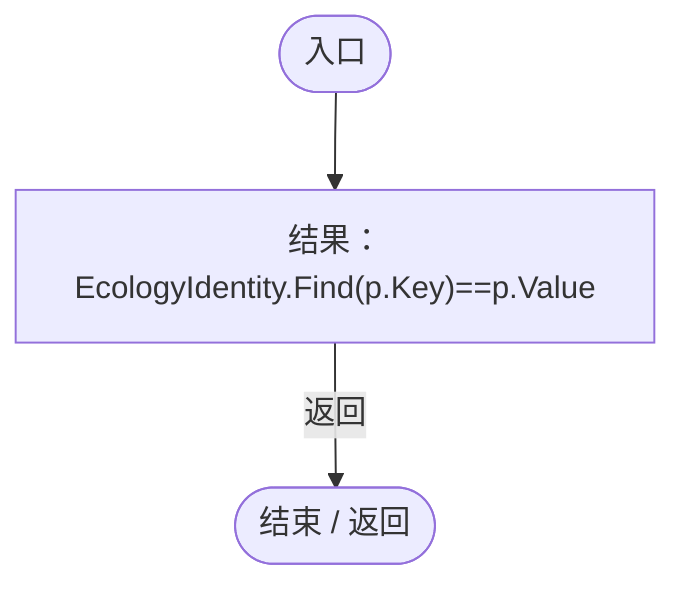

项目内调用/回调引用：

- [EcologyIdentity.Find · L20](bdf7ccc2c9c0452f.md#m58f756a3ba9ec990)（方法）

## 回调@83 · L83

`p … => 回调`

### Editor · Roslyn编译器控制流

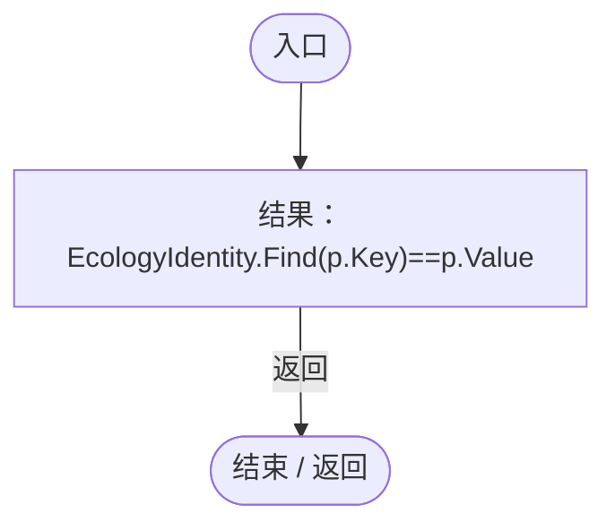

项目内调用/回调引用：

- [EcologyIdentity.Find · L20](bdf7ccc2c9c0452f.md#m58f756a3ba9ec990)（方法）
