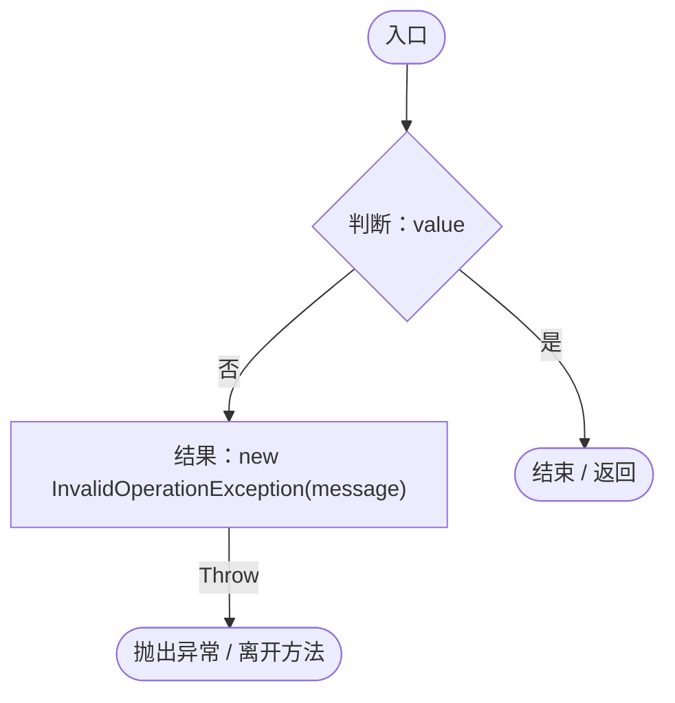
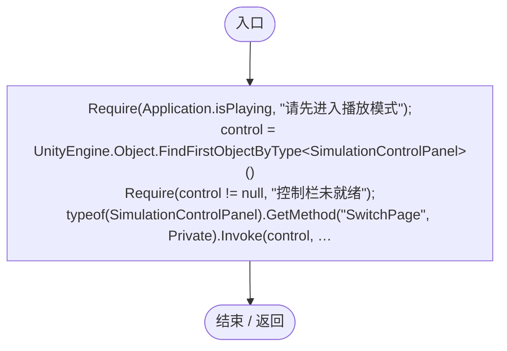
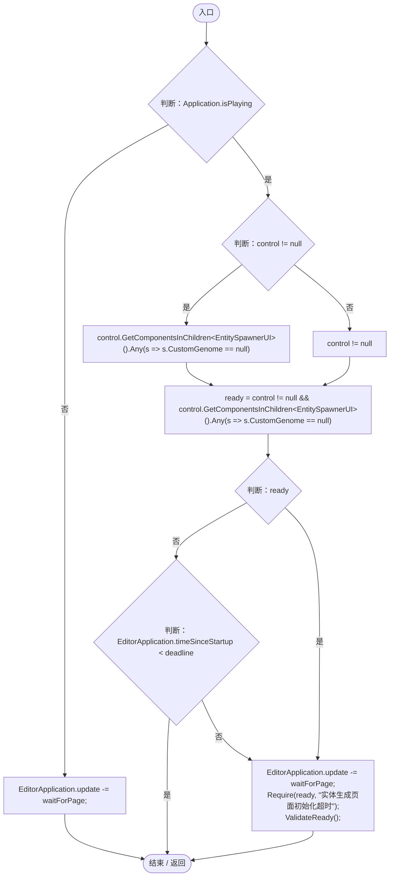
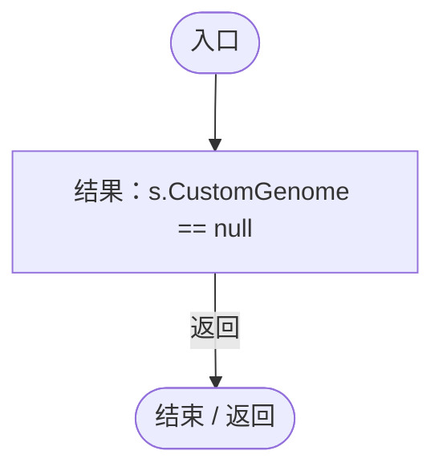
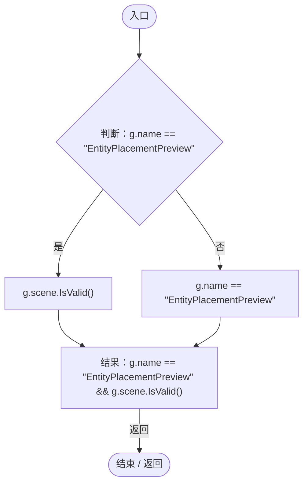
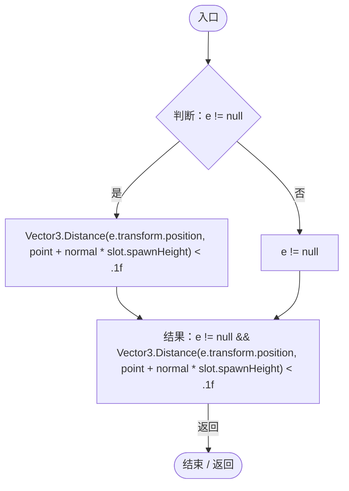
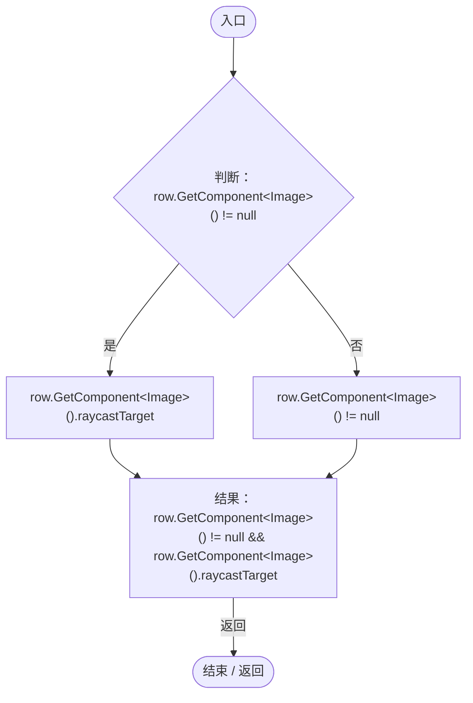
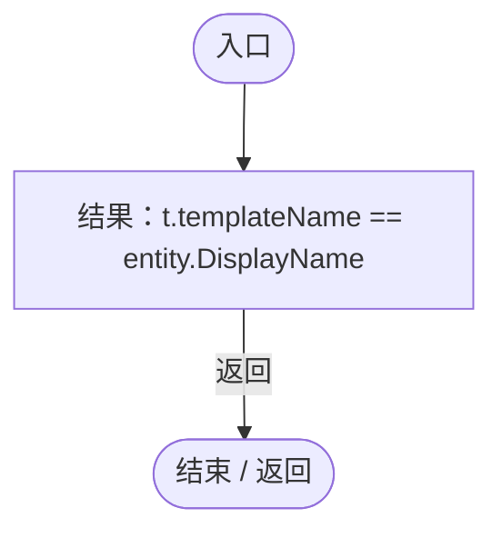

```mermaid
flowchart TD
  b0(["入口"])
  b1["report = new StringBuilder()<br/>builder = UnityEngine.Object.FindFirstObjectByType&lt;PlanetTerrainMeshBuilder&gt;()<br/>old = builder.GetComponent&lt;OreGenerator&gt;()"]
  b2{"判断：old == null"}
  b3["!old.enabled"]
  b4["old == null"]
  b5["Require(old == null &#124;&#124; !old.enabled, &quot;旧矿石生成器仍启用&quot;);"]
  b6["Require(UnityEngine.Object.FindObjectsByType&lt;OreNode&gt;(FindObjectsSortMode.None).Length == 0, &quot;场景还存在旧方块矿石&quot;);<br/>ore = builder.GetComponent&lt;PlanetOreSystem&gt;()"]
  b7{"判断：ore != null"}
  b8{"判断：ore.enabled"}
  b9{"判断：ore == PlanetOreSystem.Instance"}
  b10["ore.OreMapTexture != null"]
  b11["ore != null &amp;&amp; ore.enabled &amp;&amp; ore == PlanetOreSystem.Instance &amp;&amp; ore.OreMapTexture != null"]
  b12["Require(ore != null &amp;&amp; ore.enabled &amp;&amp; ore == PlanetOreSystem.Instance &amp;&amp; ore.OreMapTexture != null, &quot;矿脉系统未挂载/未就绪&quot;);"]
  b13["report.AppendLine(&quot;PASS: legacy OreGenerator disabled, OreNode count=0, PlanetOreSystem ready&quot;);<br/>available = 0<br/>orePoint = default"]
  b14["i = 0"]
  b15{"判断：i &lt; 128"}
  b16{"判断：available &lt; 1"}
  b17["phi = i * 2.39996323f<br/>y = 1f - 2f * (i + .5f) / 128f<br/>d = new Vector3(Mathf.Sqrt(1-y*y)*Mathf.Cos(phi), y, Mathf.Sqrt(1-y*y)*Mathf.Sin(phi))<br/>orePoint = builder.transform.TransformPoint(d * builder.WaterRadius);<br/>available = ore.GetOreAmoun…"]
  b18["i++"]
  b19["Require(available &gt;= 1, &quot;矿图未产生可采矿量&quot;);<br/>extracted = ore.ConsumeOre(orePoint, .5f)"]
  b20{"判断：extracted &gt; 0"}
  b21["Mathf.Abs(available - extracted - ore.GetOreAmount(orePoint)) &lt; .01f"]
  b22["extracted &gt; 0"]
  b23["Require(extracted &gt; 0 &amp;&amp; Mathf.Abs(available - extracted - ore.GetOreAmount(orePoint)) &lt; .01f, &quot;矿量查询/消耗不一致&quot;);"]
  b24["report.AppendLine(&quot;PASS: mineral query/consumption uses PlanetOreSystem&quot;);<br/>control = UnityEngine.Object.FindFirstObjectByType&lt;SimulationControlPanel&gt;()<br/>typeof(SimulationControlPanel).GetMethod(&quot;SwitchPage&quot;, Private).Invoke(control, new o…"]
  b25{"判断：initialList != null"}
  b26["initialList.gameObject.activeInHierarchy"]
  b27["initialList != null"]
  b28["Require(initialList != null &amp;&amp; initialList.gameObject.activeInHierarchy, &quot;收藏按钮未打开列表&quot;);"]
  b29{"判断：initialList.GetComponentsInChildren&lt;Button&gt;().Length == 0"}
  b30["Require(initialList.Find(&quot;Content/Empty&quot;) != null, &quot;首次空列表没有提示&quot;);"]
  b31["initialFavorites.TogglePanel();<br/>report.AppendLine(&quot;PASS: favorites opens/closes with an explicit empty state&quot;);<br/>before = EntityRegistry.All.Count"]
  b32["slot<br/>new PointerEventData(EventSystem.current) {button=PointerEventData.InputButton.Left}<br/>button=PointerEventData.InputButton.Left<br/>slot.OnPointerClick(new PointerEventData(EventSystem.current) {button=PointerEventData.InputButton.Left});"]
  b33["tool = EntityPlacementTool.Instance"]
  b34{"判断：tool != null"}
  b35{"判断：tool.IsPlacing"}
  b36["EntityRegistry.All.Count == before"]
  b37["tool != null &amp;&amp; tool.IsPlacing &amp;&amp; EntityRegistry.All.Count == before"]
  b38["Require(tool != null &amp;&amp; tool.IsPlacing &amp;&amp; EntityRegistry.All.Count == before, &quot;单击未进入投放或预览错误注册实体&quot;);"]
  b39{"preview = GameObject.Find(&quot;EntityPlacementPreview&quot;)<br/>判断：preview == null"}
  b40["preview = Resources.FindObjectsOfTypeAll&lt;GameObject&gt;().First(g =&gt; g.name == &quot;EntityPlacementPreview&quot; &amp;&amp; g.scene.IsValid());"]
  b41{"判断：preview.GetComponentsInChildren&lt;Collider&gt;(true).Length == 0"}
  b42["preview.GetComponentsInChildren&lt;DarwinEntity&gt;(true).Length == 0"]
  b43["preview.GetComponentsInChildren&lt;Collider&gt;(true).Length == 0"]
  b44["Require(preview.GetComponentsInChildren&lt;Collider&gt;(true).Length == 0 &amp;&amp; preview.GetComponentsInChildren&lt;DarwinEntity&gt;(true).Length == 0, &quot;虚影包含实体/碰撞逻辑&quot;);"]
  b45["tool.CancelPlacement();"]
  b46{"判断：tool.IsPlacing"}
  b47["!OrbitCamera.IsDraggingUI"]
  b48["!tool.IsPlacing"]
  b49["Require(!tool.IsPlacing &amp;&amp; !OrbitCamera.IsDraggingUI, &quot;取消后输入锁未清理&quot;);"]
  b50["report.AppendLine(&quot;PASS: click arms placement; preview has no collider/entity; cancel restores camera input&quot;);<br/>camera = Camera.main<br/>Require(EntityPlacementUtility.TryGetSurface(camera, new Vector2(camera.pixelWidth*.5f, camera.pixelHeigh…"]
  b51{"判断：EntityRegistry.All.Count == before + 1"}
  b52["entity.GetComponent&lt;EntityGeneController&gt;().Genome.Genes.Count &gt; 0"]
  b53["EntityRegistry.All.Count == before + 1"]
  b54["Require(EntityRegistry.All.Count == before + 1 &amp;&amp; entity.GetComponent&lt;EntityGeneController&gt;().Genome.Genes.Count &gt; 0, &quot;默认生成缺少初始基因&quot;);"]
  b55["source = entity.GetComponent&lt;EntityGeneController&gt;().Genome<br/>copy = EntityPlacementUtility.CopyGenome(source)"]
  b56{"判断：copy != source"}
  b57{"判断：copy.Genes[0] != source.Genes[0]"}
  b58["copy.Genes[0].InstanceId != source.Genes[0].InstanceId"]
  b59["copy != source &amp;&amp; copy.Genes[0] != source.Genes[0] &amp;&amp; copy.Genes[0].InstanceId != source.Genes[0].InstanceId"]
  b60["Require(copy != source &amp;&amp; copy.Genes[0] != source.Genes[0] &amp;&amp; copy.Genes[0].InstanceId != source.Genes[0].InstanceId, &quot;模板基因未独立复制&quot;);"]
  b61["report.AppendLine(&quot;PASS: placement spawns exactly one default entity with genes; template genomes are independent&quot;);<br/>beforeDrag = EntityRegistry.All.Count"]
  b62["new PointerEventData(EventSystem.current) { button = PointerEventData.InputButton.Left, position = new Vector2(camera.pixelWidth*.5f, camera.pixelHeight*.5f), pointerId = -999 }<br/>button = PointerEventData.InputButton.Left<br/>position = new V…"]
  b63["slot.OnBeginDrag(drag);<br/>slot.OnDrag(drag);<br/>Require(EntityRegistry.All.Count == beforeDrag, &quot;拖拽预览错误注册真实实体&quot;);<br/>slot.OnEndDrag(drag);"]
  b64{"判断：EntityRegistry.All.Count == beforeDrag + 1"}
  b65["!OrbitCamera.IsDraggingUI"]
  b66["EntityRegistry.All.Count == beforeDrag + 1"]
  b67["Require(EntityRegistry.All.Count == beforeDrag + 1 &amp;&amp; !OrbitCamera.IsDraggingUI, &quot;拖拽松手没有生成唯一实体或输入未恢复&quot;);"]
  b68["report.AppendLine(&quot;PASS: drag preview is visual-only; drop spawns exactly one entity and releases input&quot;);<br/>inspector = UnityEngine.Object.FindFirstObjectByType&lt;GeneInspectorUI&gt;()<br/>inspector.ShowEntityInfo(entity);<br/>panel = (GameObject)type…"]
  b69{"判断：panel.activeInHierarchy"}
  b70["panel.transform.parent == root.MainCanvas.transform"]
  b71["panel.activeInHierarchy"]
  b72["Require(panel.activeInHierarchy &amp;&amp; panel.transform.parent == root.MainCanvas.transform, &quot;基因面板不在屏幕 HUD 上&quot;);"]
  b73["geneRows = panel.GetComponentsInChildren&lt;EventTrigger&gt;()"]
  b74{"判断：geneRows.Length &gt; 0"}
  b75["geneRows.All(row =&gt; row.GetComponent&lt;Image&gt;() != null &amp;&amp; row.GetComponent&lt;Image&gt;().raycastTarget)"]
  b76["geneRows.Length &gt; 0"]
  b77["Require(geneRows.Length &gt; 0 &amp;&amp; geneRows.All(row =&gt; row.GetComponent&lt;Image&gt;() != null &amp;&amp; row.GetComponent&lt;Image&gt;().raycastTarget), &quot;基因行无悬浮/双击命中面&quot;);"]
  b78["((Button)typeof(GeneInspectorUI).GetField(&quot;_favBtn&quot;, Private).GetValue(inspector)).onClick.Invoke();<br/>favorites = EntityFavoritesManager.Instance<br/>Require(favorites.IsFavorite(entity), &quot;基因面板收藏按钮无效&quot;);<br/>favorites.TogglePanel();<br/>list = root.Ma…"]
  b79{"判断：list != null"}
  b80{"判断：list.gameObject.activeInHierarchy"}
  b81["list.GetComponentsInChildren&lt;Button&gt;().Length &gt; 0"]
  b82["list != null &amp;&amp; list.gameObject.activeInHierarchy &amp;&amp; list.GetComponentsInChildren&lt;Button&gt;().Length &gt; 0"]
  b83["Require(list != null &amp;&amp; list.gameObject.activeInHierarchy &amp;&amp; list.GetComponentsInChildren&lt;Button&gt;().Length &gt; 0, &quot;收藏列表未显示条目&quot;);"]
  b84["Canvas.ForceUpdateCanvases();<br/>favoriteRow = list.GetComponentsInChildren&lt;Button&gt;().First()<br/>Require(favoriteRow.GetComponent&lt;RectTransform&gt;().rect.height &gt;= 25f, &quot;收藏条目被布局压成零高度&quot;);<br/>row = geneRows.First()<br/>ExecuteEvents.Execute&lt;IPointerEnterH…"]
  b85{"判断：tooltip.activeInHierarchy"}
  b86["!tooltip.GetComponent&lt;Image&gt;().raycastTarget"]
  b87["tooltip.activeInHierarchy"]
  b88["Require(tooltip.activeInHierarchy &amp;&amp; !tooltip.GetComponent&lt;Image&gt;().raycastTarget, &quot;悬浮提示未显示或拦截自身射线&quot;);"]
  b89["row.gameObject<br/>new PointerEventData(EventSystem.current) {clickCount=2}<br/>clickCount=2<br/>ExecuteEvents.Execute&lt;IPointerClickHandler&gt;(row.gameObject, new PointerEventData(EventSystem.current) {clickCount=2}, ExecuteEvents.pointerClickHandler);"]
  b90["tree = (GameObject)typeof(GeneInspectorUI).GetField(&quot;_treePanel&quot;, Private).GetValue(inspector)"]
  b91{"判断：tree.activeInHierarchy"}
  b92["tree.transform.GetSiblingIndex() &gt; panel.transform.GetSiblingIndex()"]
  b93["tree.activeInHierarchy"]
  b94["Require(tree.activeInHierarchy &amp;&amp; tree.transform.GetSiblingIndex() &gt; panel.transform.GetSiblingIndex(), &quot;双击基因树未显示在主面板上方&quot;);"]
  b95["tree.SetActive(false);<br/>tooltip.SetActive(false);<br/>panel.transform.Find(&quot;TitleBg/SaveTplBtn&quot;).GetComponent&lt;Button&gt;().onClick.Invoke();<br/>Require(EntityTemplateManager.Templates.Any(t =&gt; t.templateName == entity.DisplayName), &quot;保存模板按钮无效&quot;);<br/>rep…"]
  b96(["结束 / 返回"])
  b0 --> b1
  b1 --> b2
  b2 -->|"否"| b3
  b2 -->|"是"| b4
  b3 --> b5
  b4 --> b5
  b5 --> b6
  b6 --> b7
  b7 -->|"是"| b8
  b7 -->|"否"| b11
  b8 -->|"是"| b9
  b8 -->|"否"| b11
  b9 -->|"是"| b10
  b9 -->|"否"| b11
  b10 --> b12
  b11 --> b12
  b12 --> b13
  b13 --> b14
  b14 --> b15
  b15 -->|"是"| b16
  b15 -->|"否"| b19
  b16 -->|"是"| b17
  b16 -->|"否"| b19
  b17 --> b18
  b18 --> b15
  b19 --> b20
  b20 -->|"是"| b21
  b20 -->|"否"| b22
  b21 --> b23
  b22 --> b23
  b23 --> b24
  b24 --> b25
  b25 -->|"是"| b26
  b25 -->|"否"| b27
  b26 --> b28
  b27 --> b28
  b28 --> b29
  b29 -->|"是"| b30
  b29 -->|"否"| b31
  b30 --> b31
  b31 --> b32
  b32 --> b33
  b33 --> b34
  b34 -->|"是"| b35
  b34 -->|"否"| b37
  b35 -->|"是"| b36
  b35 -->|"否"| b37
  b36 --> b38
  b37 --> b38
  b38 --> b39
  b39 -->|"是"| b40
  b39 -->|"否"| b41
  b40 --> b41
  b41 -->|"是"| b42
  b41 -->|"否"| b43
  b42 --> b44
  b43 --> b44
  b44 --> b45
  b45 --> b46
  b46 -->|"否"| b47
  b46 -->|"是"| b48
  b47 --> b49
  b48 --> b49
  b49 --> b50
  b50 --> b51
  b51 -->|"是"| b52
  b51 -->|"否"| b53
  b52 --> b54
  b53 --> b54
  b54 --> b55
  b55 --> b56
  b56 -->|"是"| b57
  b56 -->|"否"| b59
  b57 -->|"是"| b58
  b57 -->|"否"| b59
  b58 --> b60
  b59 --> b60
  b60 --> b61
  b61 --> b62
  b62 --> b63
  b63 --> b64
  b64 -->|"是"| b65
  b64 -->|"否"| b66
  b65 --> b67
  b66 --> b67
  b67 --> b68
  b68 --> b69
  b69 -->|"是"| b70
  b69 -->|"否"| b71
  b70 --> b72
  b71 --> b72
  b72 --> b73
  b73 --> b74
  b74 -->|"是"| b75
  b74 -->|"否"| b76
  b75 --> b77
  b76 --> b77
  b77 --> b78
  b78 --> b79
  b79 -->|"是"| b80
  b79 -->|"否"| b82
  b80 -->|"是"| b81
  b80 -->|"否"| b82
  b81 --> b83
  b82 --> b83
  b83 --> b84
  b84 --> b85
  b85 -->|"是"| b86
  b85 -->|"否"| b87
  b86 --> b88
  b87 --> b88
  b88 --> b89
  b89 --> b90
  b90 --> b91
  b91 -->|"是"| b92
  b91 -->|"否"| b93
  b92 --> b94
  b93 --> b94
  b94 --> b95
  b95 --> b96

```

# EntityUIRegression.cs

[返回总索引](../README.md) · `Editor` · `Assets/DarwinPark/Editor/EntityUIRegression.cs`

[源文件](../../../Assets/DarwinPark/Editor/EntityUIRegression.cs) · 源码校验：`1c8103a8c0f71e417204e0a94ba7ce9aa143ab6057a3950b34aed22e6c47ce80`

方法按源文件位置排列。事件/回调引用不表示立即执行；分支与异常说明见总索引。完整源码与可点击关系图请打开离线手册。

## Require · L22

`private static void Require(bool value, string message)`

### Editor · Roslyn编译器控制流

## Validate · L23

`[MenuItem("Tools/Darwin Park/Validate Entity UI and Ore")] public static void Validate()`

### Editor · Roslyn编译器控制流

项目内调用/回调引用：

- [EntityUIRegression.Require · L22](dff4959d34187962.md#md411d2eeb9493756)（方法）
- [EntityUIRegression.回调@33 · L33](dff4959d34187962.md#m4b7572e100c98f05)（回调/委托）

## 回调@33 · L33

`( … => 回调`

### Editor · Roslyn编译器控制流

项目内调用/回调引用：

- [EntityUIRegression.Require · L22](dff4959d34187962.md#md411d2eeb9493756)（方法）
- [EntityUIRegression.ValidateReady · L45](dff4959d34187962.md#me2dba91be98fd978)（方法）
- [EntityUIRegression.回调@36 · L36](dff4959d34187962.md#mc005b64410bee51d)（回调/委托）

## 回调@36 · L36

`s … => 回调`

### Editor · Roslyn编译器控制流

## ValidateReady · L45

`private static void ValidateReady()`

### Editor · Roslyn编译器控制流

项目内调用/回调引用：

- [EntityUIRegression.Require · L22](dff4959d34187962.md#md411d2eeb9493756)（方法）
- [PlanetOreSystem.Instance.get · L8](86b3fbb4d9436121.md#m53f6a6af4b6dc252)（访问器）
- [PlanetOreSystem.OreMapTexture.get · L17](86b3fbb4d9436121.md#ma477eb055a23d504)（访问器）
- [PlanetTerrainMeshBuilder.WaterRadius.get · L94](415285cf043354a9.md#m28d8809083881ec1)（访问器）
- [PlanetOreSystem.GetOreAmount · L131](86b3fbb4d9436121.md#m97fd2ce3bdae0d03)（方法）
- [PlanetOreSystem.ConsumeOre · L140](86b3fbb4d9436121.md#m932f90bbc5b3ca70)（方法）
- [EntityFavoritesManager.Instance.get · L10](b60fb973e9d3815a.md#m0dac2feb106bac97)（访问器）
- [EntityFavoritesManager.TogglePanel · L36](b60fb973e9d3815a.md#ma95fb9dcce4925e2)（方法）
- [ServiceLocator.Get · L33](f2fdbe9f9ccd93cb.md#m2ae625299520c56d)（方法）
- [UIRoot.MainCanvas.get · L14](9c1421378791f0e0.md#maa2cc9baf1248477)（访问器）
- [EntitySpawnerUI.OnPointerClick · L20](35e73bec7584e677.md#m5f4fec17861ede2a)（方法）
- [EntityPlacementTool.Instance.get · L13](2ca993947b0a7e7a.md#mafb26991c0dfcb86)（访问器）
- [EntityPlacementTool.IsPlacing.get · L14](2ca993947b0a7e7a.md#ma73d17b3db4aa719)（访问器）
- [EntityPlacementTool.CancelPlacement · L81](2ca993947b0a7e7a.md#m5a9374d2c71f0a2d)（方法）
- [EntityPlacementUtility.TryGetSurface · L23](6d2c32e632b9c147.md#mcaf74a1c76576237)（方法）
- [SimulationClock.Pause · L79](a8f444aec9614b0a.md#m30929d45a885d0f1)（方法）
- [EntityPlacementUtility.Spawn · L77](6d2c32e632b9c147.md#m79ec74c5c23421cd)（方法）
- [EntityPlacementUtility.CopyGenome · L62](6d2c32e632b9c147.md#m17e8d293d8491a41)（方法）
- [EntitySpawnerUI.OnBeginDrag · L30](35e73bec7584e677.md#m588613461813385f)（方法）
- [EntitySpawnerUI.OnDrag · L42](35e73bec7584e677.md#m78a0c360c9a3261a)（方法）
- [EntitySpawnerUI.OnEndDrag · L50](35e73bec7584e677.md#m88135fa43ee7a29e)（方法）
- [GeneInspectorUI.ShowEntityInfo · L385](924e27c34e7b1f0a.md#mea69a0457b885287)（方法）
- [EntityFavoritesManager.IsFavorite · L46](b60fb973e9d3815a.md#m441337ce7ee05333)（方法）
- [EntityTemplateManager.Templates.get · L23](ab5e6457e8a7aba0.md#m45cc5b075f7bf4ec)（访问器）
- [EntityUIRegression.回调@70 · L70](dff4959d34187962.md#ma8d4746b7c84f7e4)（回调/委托）
- [EntityUIRegression.回调@86 · L86](dff4959d34187962.md#m478d72def67f9e07)（回调/委托）
- [EntityUIRegression.回调@96 · L96](dff4959d34187962.md#m2cdd9066410b8f3d)（回调/委托）
- [EntityUIRegression.回调@117 · L117](dff4959d34187962.md#mcd68b3f82734cb21)（回调/委托）
- [EntityUIRegression.回调@137 · L137](dff4959d34187962.md#md677910e76ab4dc8)（回调/委托）

## 回调@70 · L70

`s … => 回调`

### Editor · Roslyn编译器控制流

## 回调@86 · L86

`g … => 回调`

### Editor · Roslyn编译器控制流

## 回调@96 · L96

`e … => 回调`

### Editor · Roslyn编译器控制流

## 回调@117 · L117

`row … => 回调`

### Editor · Roslyn编译器控制流

## 回调@137 · L137

`t … => 回调`

### Editor · Roslyn编译器控制流

