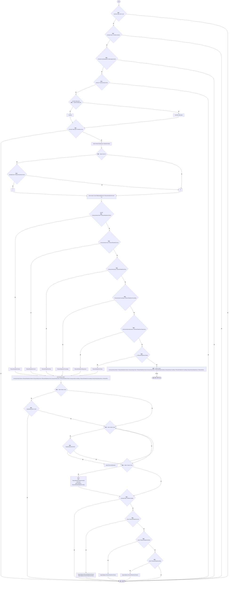
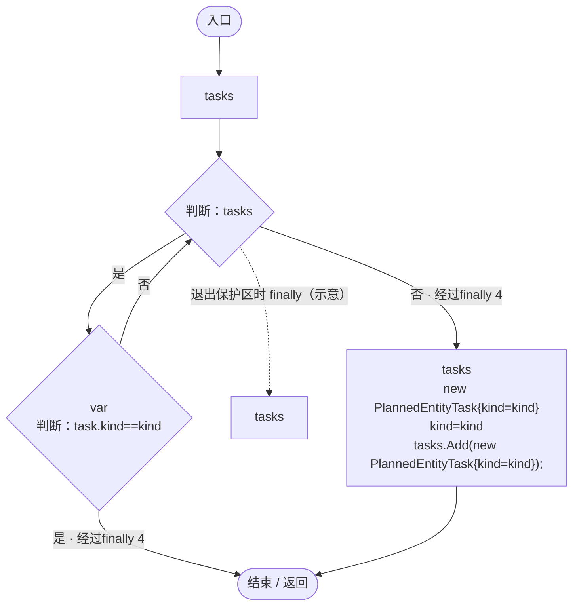

# MemberTaskSequence.cs

[返回总索引](../README.md) · `Runtime` · `Assets/DarwinPark/Entities/Ecology/MemberTaskSequence.cs`

[源文件](../../../Assets/DarwinPark/Entities/Ecology/MemberTaskSequence.cs) · 源码校验：`28dcd0ece4ad1c39fc71e3bac697d0bb735fb0d10dfb88ca5182914fe7e11302`

方法按源文件位置排列。事件/回调引用不表示立即执行；分支与异常说明见总索引。完整源码与可点击关系图请打开离线手册。

## Record · L7

`public static void Record(AntColonyMember member,ColonyActivity activity)`

### Editor / Player · Roslyn编译器控制流

项目内调用/回调引用：

- [AntColonyMember.State.get · L33](baebd85c05598377.md#ma804eb9f68138343)（访问器）
- [AntColonyMember.Role.get · L39](baebd85c05598377.md#mbe541ad55a93b0dd)（访问器）
- [ColonyFoundingSupport.Collecting · L13](404bb05c7f82518a.md#m9dbfa09daab029b1)（方法）
- [WorkerTaskQueue.Tasks · L16](dc0692495776be10.md#m39e1f5f7df33e56c)（方法）
- [MemberTaskSequence.Append · L21](e0c3a41d605c176a.md#m1ee49f1dc3678923)（方法）

## Append · L21

`private static void Append(List<PlannedEntityTask> tasks,PlannedTaskKind kind)`

### Editor / Player · Roslyn编译器控制流

