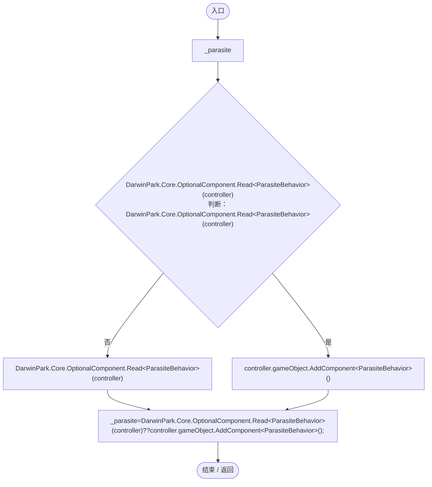
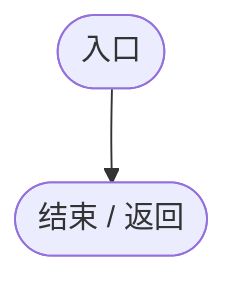
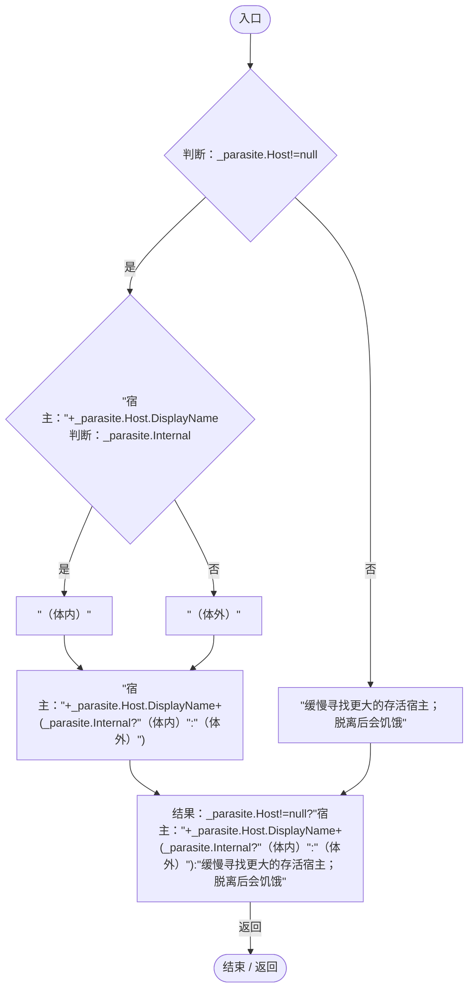

# ParasiticGeneLogic.cs

[返回总索引](../README.md) · `Runtime` · `Assets/DarwinPark/Entities/Logic/ParasiticGeneLogic.cs`

[源文件](../../../Assets/DarwinPark/Entities/Logic/ParasiticGeneLogic.cs) · 源码校验：`8987de178e7696998777133874b2e9c41923a456f1cd485d96c2ed03135f3e72`

方法按源文件位置排列。事件/回调引用不表示立即执行；分支与异常说明见总索引。完整源码与可点击关系图请打开离线手册。

## Initialize · L10

`public void Initialize(EntityGeneController controller,GeneInstance gene)`

### Editor / Player · Roslyn编译器控制流

项目内调用/回调引用：

- [OptionalComponent.Read · L7](806c46b42ced4d36.md#m69622a4dee165c5a)（方法）

## OnUpdate · L11

`public void OnUpdate(float dt)`

### Editor / Player · Roslyn编译器控制流

## GetTooltipInfo · L12

`public string GetTooltipInfo()`

### Editor / Player · Roslyn编译器控制流

项目内调用/回调引用：

- [ParasiteBehavior.Host.get · L18](ec21ecbd299caaed.md#m26d7e4af4cdffdbb)（访问器）
