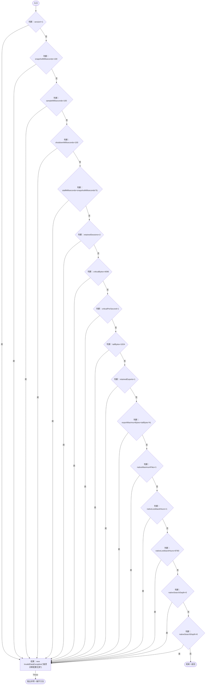
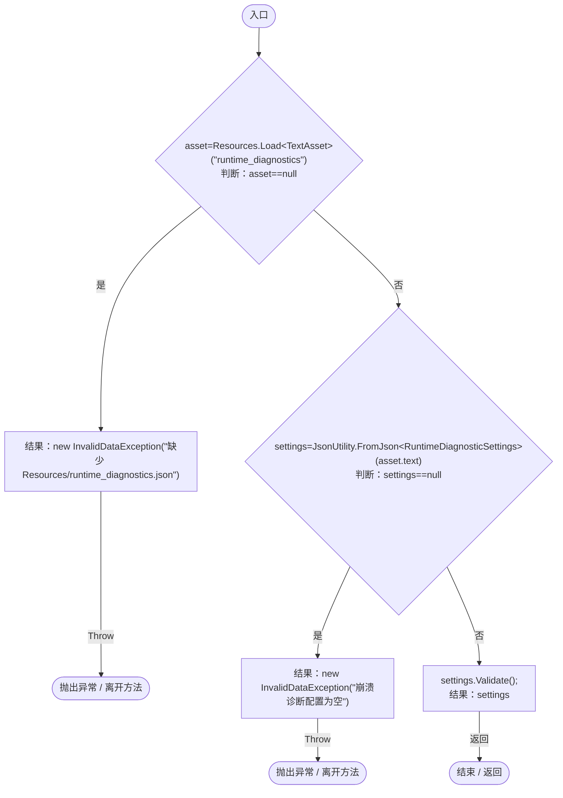

# RuntimeDiagnosticSettings.cs

[返回总索引](../README.md) · `Runtime` · `Assets/DarwinPark/Core/Logging/RuntimeDiagnosticSettings.cs`

[源文件](../../../Assets/DarwinPark/Core/Logging/RuntimeDiagnosticSettings.cs) · 源码校验：`3b2f102d9a6b3aef8fd7f4d88b65834b0b1690e210cb9220c691d081913fcb42`

方法按源文件位置排列。事件/回调引用不表示立即执行；分支与异常说明见总索引。完整源码与可点击关系图请打开离线手册。

## Validate · L17

`public void Validate()`

### Editor / Player · Roslyn编译器控制流

## Load · L23

`public static RuntimeDiagnosticSettings Load()`

### Editor / Player · Roslyn编译器控制流

项目内调用/回调引用：

- [RuntimeDiagnosticSettings.Validate · L17](e1f8672949291bee.md#mc96db0457c0367e1)（方法）
