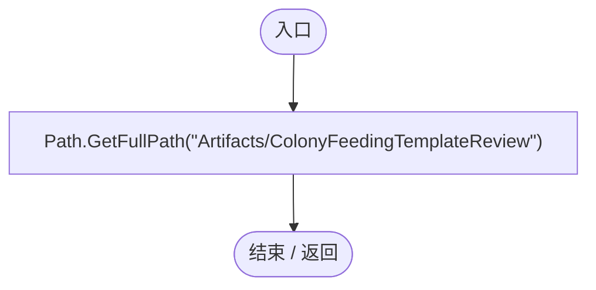
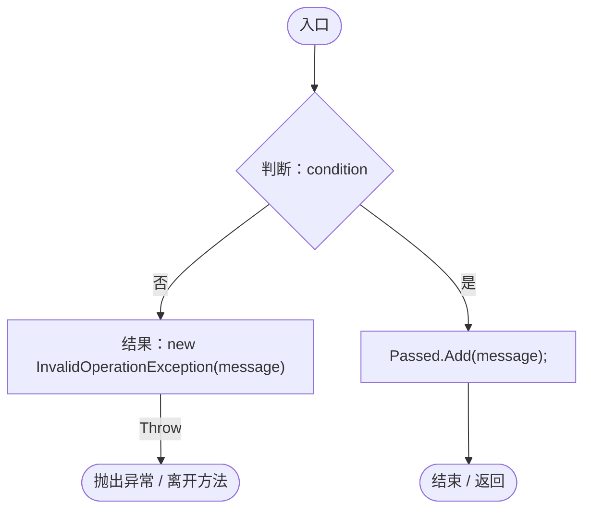
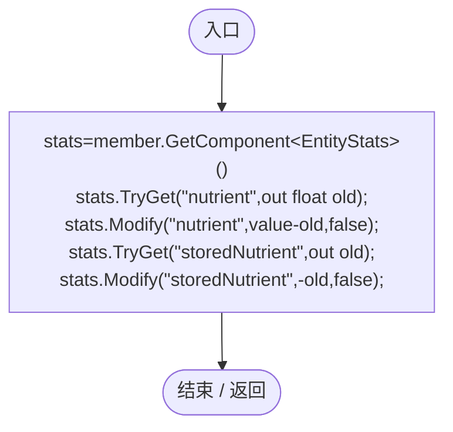
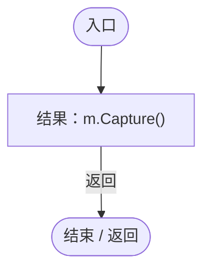
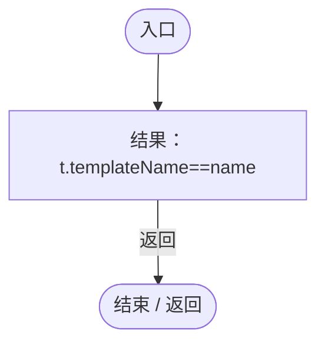
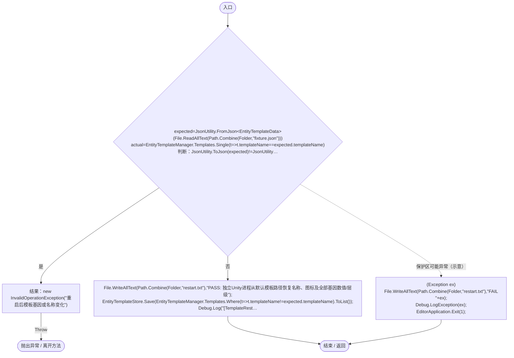

```mermaid
flowchart TD
  b0(["入口"])
  b1["Directory.CreateDirectory(Folder);<br/>Passed.Clear();<br/>members=new[]{queen,worker,soldier,young}<br/>positions=members.Select(m=&gt;m.transform.position).ToArray()<br/>stats=members.Select(m=&gt;m.GetComponent&lt;EntityStats&gt;().CaptureValues()).ToArray()<br/>sta…"]
  b2["new[]{queen,young}"]
  b3{"判断：new[]{queen,young}"}
  b4["var"]
  b5["Fill(member,0);<br/>member.transform.position=supply.transform.position;<br/>member.Destination(out var point,out var target,out _);"]
  b6{"判断：target==null"}
  b7["EcologyQueries.Distance(point,nursery.transform.position)&lt;=AntColonySettings.Current.feedRadius"]
  b8["target==null"]
  b9["Check(target==null&amp;&amp;EcologyQueries.Distance(point,nursery.transform.position)&lt;=AntColonySettings.Current.feedRadius,&quot;饥饿&quot;+member.Role+&quot;主动走向育幼能量块&quot;);"]
  b10["member.transform.position=nursery.transform.position;<br/>energy=nursery.State.energy<br/>member.Advance(.1f);"]
  b11{"判断：Food(member)&gt;0"}
  b12["Mathf.Abs(energy-nursery.State.energy-Food(member))&lt;.001f"]
  b13["Food(member)&gt;0"]
  b14["Check(Food(member)&gt;0&amp;&amp;Mathf.Abs(energy-nursery.State.energy-Food(member))&lt;.001f,&quot;育幼能量经实际分工更新进入&quot;+member.Role+&quot;且守恒&quot;);"]
  b15{"new[]{queen,young}<br/>判断：new[]{queen,young}"}
  b16["new[]{queen,young}"]
  b17["连接 / 离开区域"]
  b18["Fill(queen,0);<br/>Fill(young,0);<br/>young.transform.position=nursery.transform.position;<br/>nursery.State.energy=AntColonySettings.Current.queenFeedThreshold+AntColonySettings.Current.memberFeedThreshold;<br/>ColonyResource.Feed(young,1);"]
  b19{"判断：Food(young)&gt;0"}
  b20["nursery.State.energy&gt;=AntColonySettings.Current.queenFeedThreshold"]
  b21["Food(young)&gt;0"]
  b22["Check(Food(young)&gt;0&amp;&amp;nursery.State.energy&gt;=AntColonySettings.Current.queenFeedThreshold,&quot;幼体先抵达时保留饥饿王后的最低口粮&quot;);"]
  b23["queen.transform.position=nursery.transform.position;<br/>ColonyResource.Feed(queen,.1f);<br/>Check(Food(queen)&gt;0,&quot;王后抵达后可领取预留口粮&quot;);<br/>nursery.State.energy=1000;<br/>Fill(soldier,0);<br/>typeof(AntColonyMember).GetField(&quot;HuntTarget&quot;,BindingFlags.NonPublic&#124;Bi…"]
  b24{"判断：feedingTarget==null"}
  b25["EcologyQueries.Distance(feedingPoint,supply.transform.position)&lt;=AntColonySettings.Current.feedRadius"]
  b26["feedingTarget==null"]
  b27["Check(feedingTarget==null&amp;&amp;EcologyQueries.Distance(feedingPoint,supply.transform.position)&lt;=AntColonySettings.Current.feedRadius,&quot;已有追猎目标时士兵先前往补给&quot;);"]
  b28["typeof(AntColonyMember).GetField(&quot;HuntTarget&quot;,BindingFlags.NonPublic&#124;BindingFlags.Instance).SetValue(soldier,null);"]
  b29["new ColonyResourceSave{id=Guid.NewGuid().ToString(&quot;N&quot;),group=worker.GroupId,kind=ColonyResourceKind.Corpse,energy=12,local=EcologyQueries.ToLocal(worker.transform.position),scale=Vector3.one}<br/>id=Guid.NewGuid().ToString(&quot;N&quot;)<br/>group=worker.…"]
  b30["Fill(worker,10);<br/>worker.State.resourceTarget=corpse.State.id;<br/>worker.State.scan=10;<br/>worker.Advance(.1f);<br/>Check(worker.State.carriedResource==corpse.State.id,&quot;补给测试建立真实尸体运输&quot;);<br/>worker.State.deliveryPoint=EcologyQueries.ToLocal(nursery.trans…"]
  b31{"判断：worker.Activity==ColonyActivity.Feed"}
  b32{"判断：EcologyQueries.Distance(feedingPoint,supply.transform.position)&lt;=AntColonySettings.Current.feedRadius"}
  b33{"判断：worker.State.carriedResource==corpse.State.id"}
  b34["corpse.State.claim==worker.Id"]
  b35["worker.Activity==ColonyActivity.Feed&amp;&amp;EcologyQueries.Distance(feedingPoint,supply.transform.position)&lt;=AntColonySettings.Current.feedRadius&amp;&amp;worker.State.carriedResource==corpse.State.id&amp;&amp;corpse.State.claim==worker.Id"]
  b36["Check(worker.Activity==ColonyActivity.Feed&amp;&amp;EcologyQueries.Distance(feedingPoint,supply.transform.position)&lt;=AntColonySettings.Current.feedRadius&amp;&amp;worker.State.carriedResource==corpse.State.id&amp;&amp;corpse.State.claim==worker.Id,&quot;饥饿工匠暂停运输去补给并…"]
  b37["worker.transform.position=supply.transform.position;"]
  b38["i=0"]
  b39{"判断：i&lt;100"}
  b40{"判断：ColonyFeeding.WantsFood(worker)"}
  b41["worker.Advance(.1f);<br/>i++"]
  b42["Check(Food(worker)&gt;AntColonySettings.Current.memberFeedThreshold,&quot;繁忙工匠通过实际分工更新吃饱&quot;);<br/>worker.Destination(out var delivery,out _,out _);<br/>Check(delivery==EcologyQueries.ToWorld(worker.State.deliveryPoint),&quot;工匠吃饱后自动恢复原运输目的地&quot;);<br/>worker.transform…"]
  b43{"判断：ColonyResource.Find(corpse.State.id)==null"}
  b44["string.IsNullOrEmpty(worker.State.carriedResource)"]
  b45["ColonyResource.Find(corpse.State.id)==null"]
  b46["Check(ColonyResource.Find(corpse.State.id)==null&amp;&amp;string.IsNullOrEmpty(worker.State.carriedResource),&quot;补给后运输完成且尸体仅转换一次&quot;);"]
  b47["Fill(soldier,0);<br/>soldier.transform.position=supply.transform.position;<br/>vitals=soldier.GetComponent&lt;DarwinPark.Entities.Vitals.EntityVitals&gt;()<br/>advance=typeof(DarwinPark.Entities.Vitals.EntityVitals).GetMethod(&quot;AdvanceVitals&quot;,BindingFlags.…"]
  b48["i=0"]
  b49{"判断：i&lt;1200"}
  b50["soldier.Advance(.1f);<br/>advance.Invoke(vitals,new object[]{.1f});<br/>i++"]
  b51["soldier.GetComponent&lt;EntityStats&gt;().TryGet(&quot;health&quot;,out float afterHealth);"]
  b52{"判断：Food(soldier)&gt;0"}
  b53["afterHealth&gt;=health"]
  b54["Food(soldier)&gt;0"]
  b55["Check(Food(soldier)&gt;0&amp;&amp;afterHealth&gt;=health,&quot;士兵营养基因受抑仍连续120秒吸收补给且不因饥饿掉血&quot;);"]
  b56["Fill(soldier,0);<br/>queenGroup=queen.GroupId<br/>foreignGroup=Guid.NewGuid().ToString(&quot;N&quot;)<br/>queen.Population.JoinColony(foreignGroup,true);<br/>supply.State.group=foreignGroup;<br/>ColonyResource.Feed(soldier,1);<br/>Check(Food(soldier)==0,&quot;不能吸收存活外群的能量块&quot;);<br/>…"]
  b57{"判断：File.Exists(EntityTemplateStore.FilePath)"}
  b58["EntityTemplateManager.Templates.Count(t=&gt;t.templateName==name)==1"]
  b59["File.Exists(EntityTemplateStore.FilePath)"]
  b60["Check(File.Exists(EntityTemplateStore.FilePath)&amp;&amp;EntityTemplateManager.Templates.Count(t=&gt;t.templateName==name)==1,&quot;模板实际落盘且同名保存不重复&quot;);"]
  b61["File.WriteAllText(Path.Combine(Folder,&quot;fixture.json&quot;),JsonUtility.ToJson(EntityTemplateManager.Templates.Single(t=&gt;t.templateName==name)));<br/>VerifyStoreRecovery();<br/>File.WriteAllText(Path.Combine(Folder,&quot;result.txt&quot;),&quot;PASS\n&quot;+string.Join(&quot;…"]
  b62["i=0"]
  b63{"判断：i&lt;members.Length"}
  b64["members[i].transform.position=positions[i];<br/>members[i].GetComponent&lt;EntityStats&gt;().RestoreValues(stats[i]);<br/>members[i].Restore(states[i]);<br/>i++"]
  b65["nursery.State.energy=nurseryEnergy;<br/>supply.State.energy=supplyEnergy;"]
  b66(["结束 / 返回"])
  b0 --> b1
  b1 --> b2
  b2 --> b3
  b3 -->|"是"| b4
  b3 -->|"否 · 经过finally 15"| b18
  b4 --> b5
  b5 --> b6
  b6 -->|"是"| b7
  b6 -->|"否"| b8
  b7 --> b9
  b8 --> b9
  b9 --> b10
  b10 --> b11
  b11 -->|"是"| b12
  b11 -->|"否"| b13
  b12 --> b14
  b13 --> b14
  b14 --> b3
  b15 -->|"否"| b16
  b15 -->|"是"| b17
  b16 --> b17
  b18 --> b19
  b19 -->|"是"| b20
  b19 -->|"否"| b21
  b20 --> b22
  b21 --> b22
  b22 --> b23
  b23 --> b24
  b24 -->|"是"| b25
  b24 -->|"否"| b26
  b25 --> b27
  b26 --> b27
  b27 --> b28
  b28 --> b29
  b29 --> b30
  b30 --> b31
  b31 -->|"是"| b32
  b31 -->|"否"| b35
  b32 -->|"是"| b33
  b32 -->|"否"| b35
  b33 -->|"是"| b34
  b33 -->|"否"| b35
  b34 --> b36
  b35 --> b36
  b36 --> b37
  b37 --> b38
  b38 --> b39
  b39 -->|"是"| b40
  b39 -->|"否"| b42
  b40 -->|"是"| b41
  b40 -->|"否"| b42
  b41 --> b39
  b42 --> b43
  b43 -->|"是"| b44
  b43 -->|"否"| b45
  b44 --> b46
  b45 --> b46
  b46 --> b47
  b47 --> b48
  b48 --> b49
  b49 -->|"是"| b50
  b49 -->|"否"| b51
  b50 --> b49
  b51 --> b52
  b52 -->|"是"| b53
  b52 -->|"否"| b54
  b53 --> b55
  b54 --> b55
  b55 --> b56
  b56 --> b57
  b57 -->|"是"| b58
  b57 -->|"否"| b59
  b58 --> b60
  b59 --> b60
  b60 --> b61
  b61 -->|"经过finally 62"| b66
  b62 --> b63
  b63 -->|"是"| b64
  b63 -->|"否"| b65
  b64 --> b63
  b3 -. "退出保护区时 finally（示意）" .-> b15
  b2 -. "退出保护区时 finally（示意）" .-> b62

```

# ColonyFeedingTemplateRegression.cs

[返回总索引](../README.md) · `Editor` · `Assets/DarwinPark/Editor/ColonyFeedingTemplateRegression.cs`

[源文件](../../../Assets/DarwinPark/Editor/ColonyFeedingTemplateRegression.cs) · 源码校验：`2c8c4f31d4321427731adc64b381b68b17007aeed90c5b60960f127c74c43e16`

方法按源文件位置排列。事件/回调引用不表示立即执行；分支与异常说明见总索引。完整源码与可点击关系图请打开离线手册。

## Folder.get · L20

`private static string Folder`

### Editor · 语法控制结构 / 声明（非CFG）

## Check · L22

`private static void Check(bool condition,string message)`

### Editor · Roslyn编译器控制流

## Food · L23

`private static float Food(AntColonyMember member)`

### Editor · Roslyn编译器控制流

项目内调用/回调引用：

- [EntityStats.TryGet · L90](75aa86a368efdf24.md#m24ee1433e4a70d94)（方法）

## Fill · L25

`private static void Fill(AntColonyMember member,float value)`

### Editor · Roslyn编译器控制流

项目内调用/回调引用：

- [EntityStats.TryGet · L90](75aa86a368efdf24.md#m24ee1433e4a70d94)（方法）
- [EntityStats.Modify · L111](75aa86a368efdf24.md#m9c837be197158240)（方法）

## Verify · L27

`public static void Verify(AntColonyMember queen,AntColonyMember worker,AntColonyMember soldier,AntColonyMember young,ColonyResource nursery,ColonyResource supply)`

### Editor · Roslyn编译器控制流

项目内调用/回调引用：

- [ColonyResource.State.get · L24](293dbaecfff4b585.md#m41824f1a0e160aa5)（访问器）
- [ColonyFeedingTemplateRegression.Fill · L25](e3a5269cbeb35cff.md#m671c46cff06fdbf7)（方法）
- [AntColonyMember.Destination · L148](baebd85c05598377.md#m2229452cec30050d)（方法）
- [ColonyFeedingTemplateRegression.Check · L22](e3a5269cbeb35cff.md#m34b9c42c0fe6e75b)（方法）
- [EcologyQueries.Distance · L42](bdf7ccc2c9c0452f.md#mba9c3e3c95d0f2dd)（方法）
- [AntColonySettings.Current.get · L31](cb0a937e97c8fbb3.md#mcd121159f407ccdf)（访问器）
- [AntColonyMember.Role.get · L38](baebd85c05598377.md#mab30d459d599e4df)（访问器）
- [AntColonyMember.Advance · L89](baebd85c05598377.md#m9debe7e325e53fdb)（方法）
- [ColonyFeedingTemplateRegression.Food · L23](e3a5269cbeb35cff.md#m74b4dc2173d9759d)（方法）
- [ColonyResource.Feed · L90](293dbaecfff4b585.md#m766d56c99e2c849e)（方法）
- [AntColonyMember.Entity.get · L34](baebd85c05598377.md#m490b8793043471d0)（访问器）
- [ColonyResource.Create · L44](293dbaecfff4b585.md#m33778cc050209631)（方法）
- [EcologyQueries.ToLocal · L39](bdf7ccc2c9c0452f.md#m1a07639eacf3aa47)（方法）
- [AntColonyMember.State.get · L32](baebd85c05598377.md#m426db6a7c12dd7aa)（访问器）
- [AntColonyMember.Activity.get · L50](baebd85c05598377.md#m50ece4c10946f98c)（访问器）
- [ColonyFeeding.WantsFood · L10](2cb56c08d08ff8ec.md#m56d2edeb3860f143)（方法）
- [EcologyQueries.ToWorld · L40](bdf7ccc2c9c0452f.md#m320932c05ccecbf7)（方法）
- [ColonyResource.Find · L28](293dbaecfff4b585.md#m1324285ab40ac6f4)（方法）
- [EntityStats.TryGet · L90](75aa86a368efdf24.md#m24ee1433e4a70d94)（方法）
- [PopulationBehavior.JoinColony · L123](21e4f62f75a9a80f.md#m570adce7c88ec55a)（方法）
- [AntColonyMember.Population.get · L35](baebd85c05598377.md#mbb8ec90c4baa2d1c)（访问器）
- [EntityTemplateManager.SaveTemplate · L30](ab5e6457e8a7aba0.md#me559754bdf2cc955)（方法）
- [EntityTemplateManager.Templates.get · L23](ab5e6457e8a7aba0.md#m45cc5b075f7bf4ec)（访问器）
- [ColonyFeedingTemplateRegression.VerifyStoreRecovery · L94](e3a5269cbeb35cff.md#ma3af956f578f4615)（方法）
- [EntityStats.RestoreValues · L88](75aa86a368efdf24.md#m774f994eaa3183ca)（方法）
- [AntColonyMember.Restore · L207](baebd85c05598377.md#m18602525f00165f5)（方法）
- [ColonyFeedingTemplateRegression.回调@30 · L30](e3a5269cbeb35cff.md#med102d65212e2c31)（回调/委托）
- [ColonyFeedingTemplateRegression.回调@31 · L31](e3a5269cbeb35cff.md#maf89cf4f4b0885cf)（回调/委托）
- [ColonyFeedingTemplateRegression.回调@32 · L32](e3a5269cbeb35cff.md#mc4b8445a52b3cc47)（回调/委托）
- [ColonyFeedingTemplateRegression.回调@82 · L82](e3a5269cbeb35cff.md#m53151f69d88255ee)（回调/委托）
- [ColonyFeedingTemplateRegression.回调@83 · L83](e3a5269cbeb35cff.md#me94438a90ef18594)（回调/委托）

## 回调@30 · L30

`m … => 回调`

### Editor · Roslyn编译器控制流

## 回调@31 · L31

`m … => 回调`

### Editor · Roslyn编译器控制流

项目内调用/回调引用：

- [EntityStats.CaptureValues · L86](75aa86a368efdf24.md#mbf54fc67f0d07a99)（方法）

## 回调@32 · L32

`m … => 回调`

### Editor · Roslyn编译器控制流

项目内调用/回调引用：

- [AntColonyMember.Capture · L205](baebd85c05598377.md#m0340dada4907c03f)（方法）

## 回调@82 · L82

`t … => 回调`

### Editor · Roslyn编译器控制流

## 回调@83 · L83

`t … => 回调`

### Editor · Roslyn编译器控制流

## VerifyStoreRecovery · L94

`private static void VerifyStoreRecovery()`

### Editor · Roslyn编译器控制流

项目内调用/回调引用：

- [EntityTemplateStore.Save · L51](2a560a9e3c003e7b.md#m853c3cfd96f490b9)（方法）
- [ColonyFeedingTemplateRegression.Check · L22](e3a5269cbeb35cff.md#m34b9c42c0fe6e75b)（方法）
- [EntityTemplateStore.Load · L34](2a560a9e3c003e7b.md#m8c4dc64a4aa5668b)（方法）

## VerifyAfterRestart · L102

`public static void VerifyAfterRestart()`

### Editor · Roslyn编译器控制流

项目内调用/回调引用：

- [EntityTemplateManager.Templates.get · L23](ab5e6457e8a7aba0.md#m45cc5b075f7bf4ec)（访问器）
- [EntityTemplateStore.Save · L51](2a560a9e3c003e7b.md#m853c3cfd96f490b9)（方法）
- [ColonyFeedingTemplateRegression.回调@107 · L107](e3a5269cbeb35cff.md#mda47d590aa140074)（回调/委托）
- [ColonyFeedingTemplateRegression.回调@111 · L111](e3a5269cbeb35cff.md#m39732eb6356ea2b1)（回调/委托）

## 回调@107 · L107

`t … => 回调`

### Editor · Roslyn编译器控制流

## 回调@111 · L111

`t … => 回调`

### Editor · Roslyn编译器控制流

