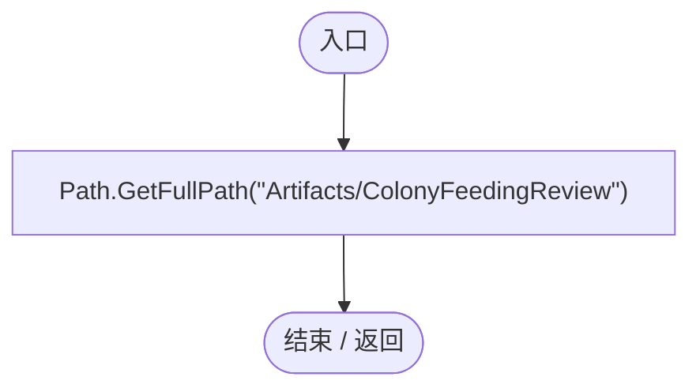
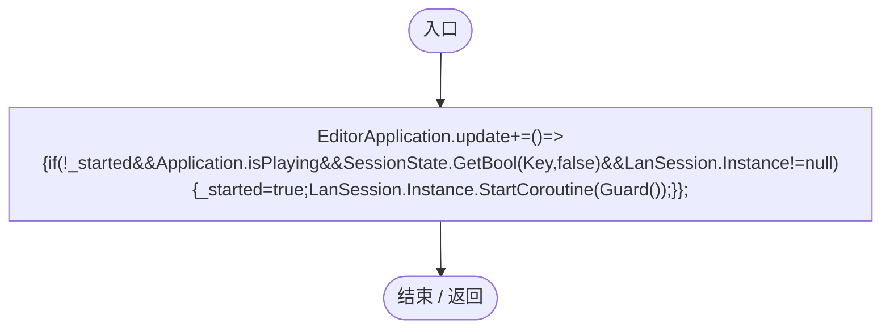
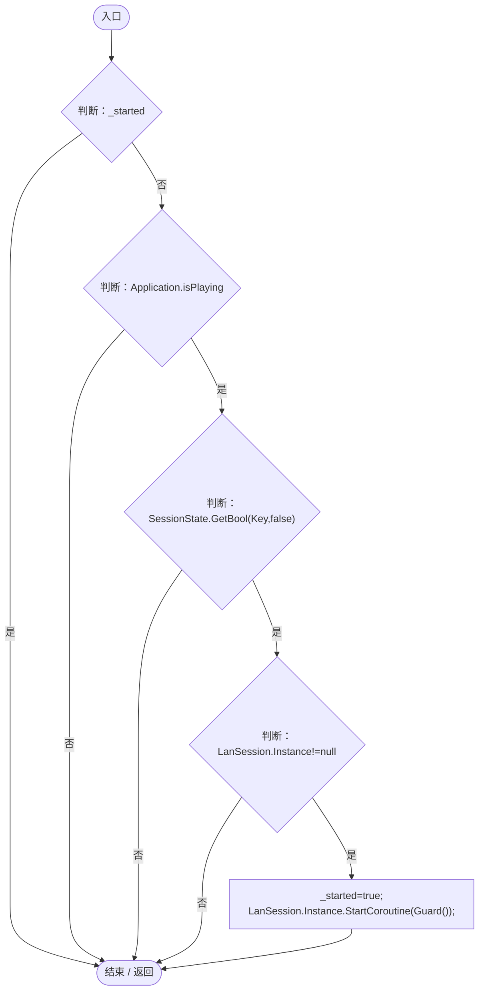
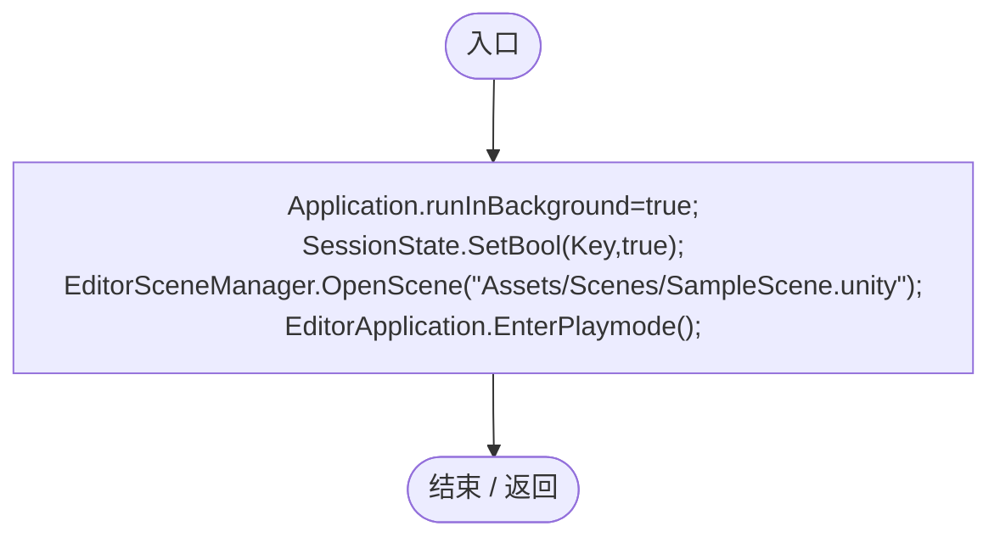
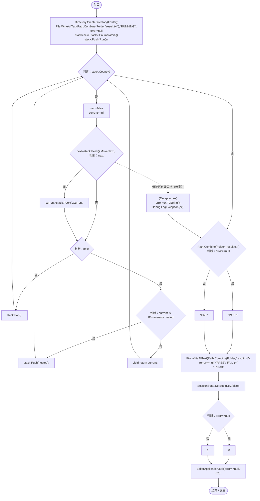
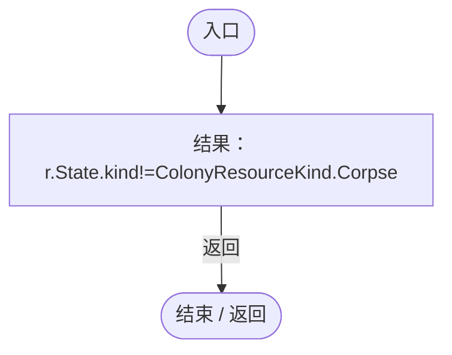
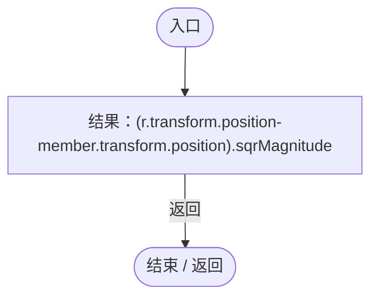
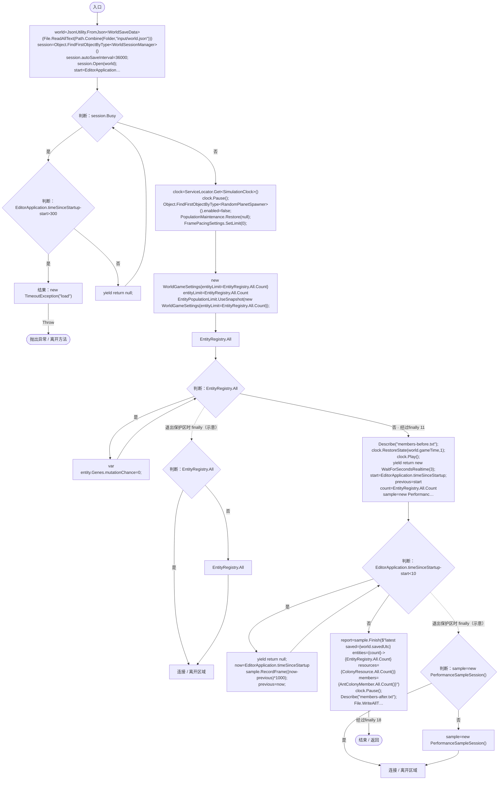

```mermaid
flowchart TD
  b0(["入口"])
  b1["lines=new List&lt;string&gt;()"]
  b2["AntColonyMember.All"]
  b3{"判断：AntColonyMember.All"}
  b4["var"]
  b5["stats=member.GetComponent&lt;EntityStats&gt;()<br/>stats.TryGet(&quot;nutrient&quot;,out float food);<br/>stats.TryGet(&quot;storedNutrient&quot;,out float reserve);<br/>stats.TryGet(&quot;health&quot;,out float hp);<br/>target=ColonyFeeding.Find(member,false)<br/>nearby=ColonyFeeding.Find(me…"]
  b6["lines<br/>member.Id<br/>member.Role<br/>member.Genes.CurrentAge<br/>member.Active<br/>hp<br/>food<br/>reserve<br/>member.Genes.GetAttribute(&quot;moveSpeed&quot;)<br/>member.transform.position<br/>body.linearVelocity<br/>body.isKinematic<br/>hazard.IsSubmerged<br/>hazard.StressLevel<br/>ColonyFeeding.W…"]
  b7{"target<br/>判断：target"}
  b8[".State.id"]
  b9["target"]
  b10{"target<br/>判断：target"}
  b11[".State.kind"]
  b12["target"]
  b13{"target<br/>判断：target"}
  b14[".State.energy"]
  b15["target"]
  b16{"判断：target!=null"}
  b17["EcologyQueries.Distance(member.transform.position,target.transform.position)"]
  b18["-1"]
  b19{"nearby<br/>判断：nearby"}
  b20[".State.id"]
  b21["nearby"]
  b22["lines.Add($&quot;id={member.Id} role={member.Role} age={member.Genes.CurrentAge} active={member.Active} hp={hp} food={food} reserve={reserve} move={member.Genes.GetAttribute(&quot;moveSpeed&quot;)} position={member.transform.position} velocity={body.li…"]
  b23["ColonyResource.All.Where(r=&gt;r.State.kind!=ColonyResourceKind.Corpse).OrderBy(r=&gt;(r.transform.position-member.transform.position).sqrMagnitude).Take(5)"]
  b24{"判断：ColonyResource.All.Where(r=&gt;r.State.kind!=ColonyResourceKind.Corpse).OrderBy(r=&gt;(r.transform.position-member.transform.position).sqrMagnitude).Take(5)"}
  b25["var<br/>lines.Add($&quot; resource={resource.State.id} kind={resource.State.kind} energy={resource.State.energy} sameGroup={resource.State.group==member.GroupId} available={ColonyResourceOwnership.Available(resource,member)} distance={EcologyQuer…"]
  b26{"判断：ColonyResource.All.Where(r=&gt;r.State.kind!=ColonyResourceKind.Corpse).OrderBy(r=&gt;(r.transform.position-member.transform.position).sqrMagnitude).Take(5)"}
  b27["ColonyResource.All.Where(r=&gt;r.State.kind!=ColonyResourceKind.Corpse).OrderBy(r=&gt;(r.transform.position-member.transform.position).sqrMagnitude).Take(5)"]
  b28["连接 / 离开区域"]
  b29["member.Genes.Evaluation.Genes"]
  b30{"判断：member.Genes.Evaluation.Genes"}
  b31["var"]
  b32["lines<br/>evaluation.Definition.Id<br/>evaluation.EffectiveStrength"]
  b33{"evaluation.State<br/>判断：evaluation.State"}
  b34[".StateId"]
  b35["evaluation.State"]
  b36["lines.Add($&quot; gene={evaluation.Definition.Id} strength={evaluation.EffectiveStrength} state={evaluation.State?.StateId}&quot;);"]
  b37["member.Genes.Evaluation.Genes"]
  b38{"判断：AntColonyMember.All"}
  b39["AntColonyMember.All"]
  b40["连接 / 离开区域"]
  b41["File.WriteAllLines(Path.Combine(Folder,file),lines);"]
  b42(["结束 / 返回"])
  b0 --> b1
  b1 --> b2
  b2 --> b3
  b3 -->|"是"| b4
  b3 -->|"否 · 经过finally 38"| b41
  b4 --> b5
  b5 --> b6
  b6 --> b7
  b7 -->|"否"| b8
  b7 -->|"是"| b9
  b8 --> b10
  b9 --> b10
  b10 -->|"否"| b11
  b10 -->|"是"| b12
  b11 --> b13
  b12 --> b13
  b13 -->|"否"| b14
  b13 -->|"是"| b15
  b14 --> b16
  b15 --> b16
  b16 -->|"是"| b17
  b16 -->|"否"| b18
  b17 --> b19
  b18 --> b19
  b19 -->|"否"| b20
  b19 -->|"是"| b21
  b20 --> b22
  b21 --> b22
  b22 --> b23
  b23 --> b24
  b24 -->|"是"| b25
  b24 -->|"否 · 经过finally 26"| b29
  b25 --> b24
  b26 -->|"否"| b27
  b26 -->|"是"| b28
  b27 --> b28
  b29 --> b30
  b30 -->|"是"| b31
  b30 -->|"否 · 经过finally 37"| b3
  b31 --> b32
  b32 --> b33
  b33 -->|"否"| b34
  b33 -->|"是"| b35
  b34 --> b36
  b35 --> b36
  b36 --> b30
  b38 -->|"否"| b39
  b38 -->|"是"| b40
  b39 --> b40
  b41 --> b42
  b24 -. "退出保护区时 finally（示意）" .-> b26
  b30 -. "退出保护区时 finally（示意）" .-> b37
  b3 -. "退出保护区时 finally（示意）" .-> b38

```

# ColonyFeedingAuditRegression.cs

[返回总索引](../README.md) · `Editor` · `Assets/DarwinPark/Editor/ColonyFeedingAuditRegression.cs`

[源文件](../../../Assets/DarwinPark/Editor/ColonyFeedingAuditRegression.cs) · 源码校验：`618b1074f45df98d042795069e9b47c4db4fb30e8d041a1a8fa9aa3b5dee7f6e`

方法按源文件位置排列。事件/回调引用不表示立即执行；分支与异常说明见总索引。完整源码与可点击关系图请打开离线手册。

## Folder.get · L23

`private static string Folder`

### Editor · 语法控制结构 / 声明（非CFG）

## ColonyFeedingAuditRegression.ctor · L24

`static ColonyFeedingAuditRegression()`

### Editor · Roslyn编译器控制流

项目内调用/回调引用：

- [ColonyFeedingAuditRegression.回调@24 · L24](e4d7714ee72a340e.md#m91a19807906c7b96)（回调/委托）

## 回调@24 · L24

`( … => 回调`

### Editor · Roslyn编译器控制流

项目内调用/回调引用：

- [LanSession.Instance.get · L23](9fb633eebffe669c.md#mbf83306994878383)（访问器）
- [ColonyFeedingAuditRegression.Guard · L26](e4d7714ee72a340e.md#m3da62349cbfe2027)（方法）

## RunBatch · L25

`public static void RunBatch()`

### Editor · Roslyn编译器控制流

## Guard · L26

`private static IEnumerator Guard()`

### Editor · Roslyn编译器控制流

项目内调用/回调引用：

- [ColonyFeedingAuditRegression.Run · L46](e4d7714ee72a340e.md#m9e380e418333f0a3)（方法）

## Describe · L32

`private static void Describe(string file)`

### Editor · Roslyn编译器控制流

项目内调用/回调引用：

- [EntityStats.TryGet · L90](75aa86a368efdf24.md#m24ee1433e4a70d94)（方法）
- [ColonyFeeding.Find · L11](2cb56c08d08ff8ec.md#mfea041f7d0713775)（方法）
- [AntColonyMember.Role.get · L38](baebd85c05598377.md#mab30d459d599e4df)（访问器）
- [EntityGeneController.CurrentAge.get · L37](7494d53178552f0e.md#md08823d8f9a2fa16)（访问器）
- [AntColonyMember.Genes.get · L33](baebd85c05598377.md#m7331eee1fdd98961)（访问器）
- [EntityGeneController.GetAttribute · L286](7494d53178552f0e.md#m18bff2b38f95b556)（方法）
- [EntityEnvironmentHazard.IsSubmerged.get · L31](5c434d0ba85333b1.md#mab7b6057b8137739)（访问器）
- [EntityEnvironmentHazard.StressLevel.get · L34](5c434d0ba85333b1.md#m5b49c0526a2393cc)（访问器）
- [ColonyFeeding.WantsFood · L10](2cb56c08d08ff8ec.md#m56d2edeb3860f143)（方法）
- [AntColonyMember.State.get · L32](baebd85c05598377.md#m426db6a7c12dd7aa)（访问器）
- [ColonyResource.State.get · L24](293dbaecfff4b585.md#m41824f1a0e160aa5)（访问器）
- [EcologyQueries.Distance · L42](bdf7ccc2c9c0452f.md#mba9c3e3c95d0f2dd)（方法）
- [ColonyResourceOwnership.Available · L23](2988679fde59fc87.md#ma3b7caf13a1f8423)（方法）
- [EntityGeneController.Evaluation.get · L18](7494d53178552f0e.md#mc0039c100a31b455)（访问器）
- [ColonyFeedingAuditRegression.回调@40 · L40](e4d7714ee72a340e.md#m5cea5f506f4478f0)（回调/委托）
- [ColonyFeedingAuditRegression.回调@40 · L40](e4d7714ee72a340e.md#m7f040d30022a027c)（回调/委托）

## 回调@40 · L40

`r … => 回调`

### Editor · Roslyn编译器控制流

项目内调用/回调引用：

- [ColonyResource.State.get · L24](293dbaecfff4b585.md#m41824f1a0e160aa5)（访问器）

## 回调@40 · L40

`r … => 回调`

### Editor · Roslyn编译器控制流

## Run · L46

`private static IEnumerator Run()`

### Editor · Roslyn编译器控制流

项目内调用/回调引用：

- [WorldSessionManager.Open · L60](08741c7b7b9d9344.md#m7bd56ef45131b4e5)（方法）
- [WorldSessionManager.Busy.get · L24](08741c7b7b9d9344.md#m4483e2e4f28f7c85)（访问器）
- [ServiceLocator.Get · L33](f2fdbe9f9ccd93cb.md#m2ae625299520c56d)（方法）
- [SimulationClock.Pause · L79](a8f444aec9614b0a.md#m30929d45a885d0f1)（方法）
- [PopulationMaintenance.Restore · L157](923ccc4e86c4786c.md#m6eadf366fa1602cc)（方法）
- [FramePacingSettings.SetLimit · L19](8a946f816b77d4b6.md#mff17d0cc654b6a7f)（方法）
- [EntityPopulationLimit.UseSnapshot · L30](44f717c5df79d270.md#m735185cedc969868)（方法）
- [DarwinEntity.Genes.get · L14](70798dde169f2e8b.md#m622eb1adf401d431)（访问器）
- [ColonyFeedingAuditRegression.Describe · L32](e4d7714ee72a340e.md#mf4fb4b14cbacc537)（方法）
- [SimulationClock.RestoreState · L74](a8f444aec9614b0a.md#m8f617e95e1282846)（方法）
- [SimulationClock.Play · L78](a8f444aec9614b0a.md#m7aa9e64b7de60ed0)（方法）
- [PerformanceSampleSession.PerformanceSampleSession.ctor · L42](a8403a4c7503726d.md#m7edb727de35dd4e0)（构造函数）
- [PerformanceSampleSession.RecordFrame · L50](a8403a4c7503726d.md#md8103bcb92ec1d0b)（方法）
- [PerformanceSampleSession.Finish · L54](a8403a4c7503726d.md#mbe1d31dc542eeb76)（方法）
