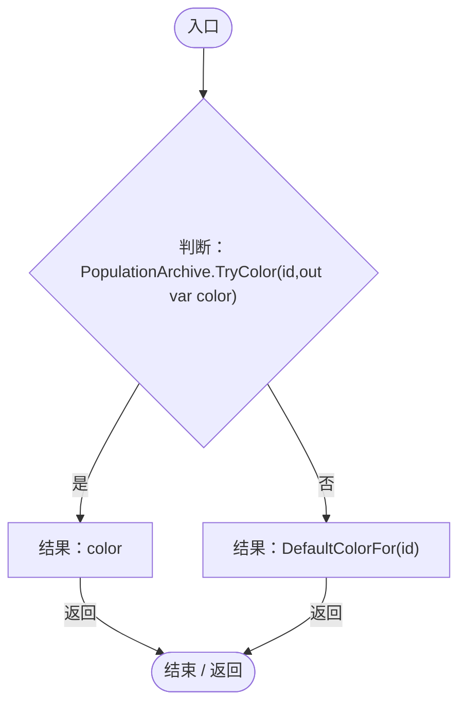
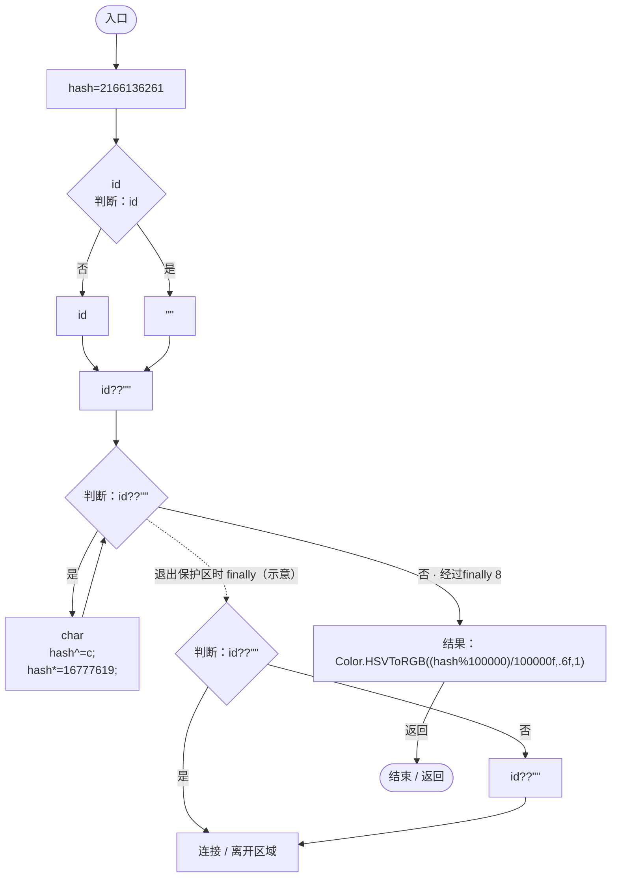
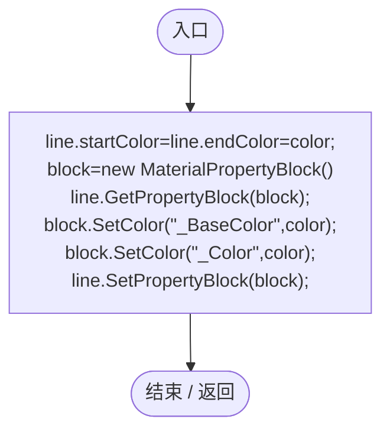
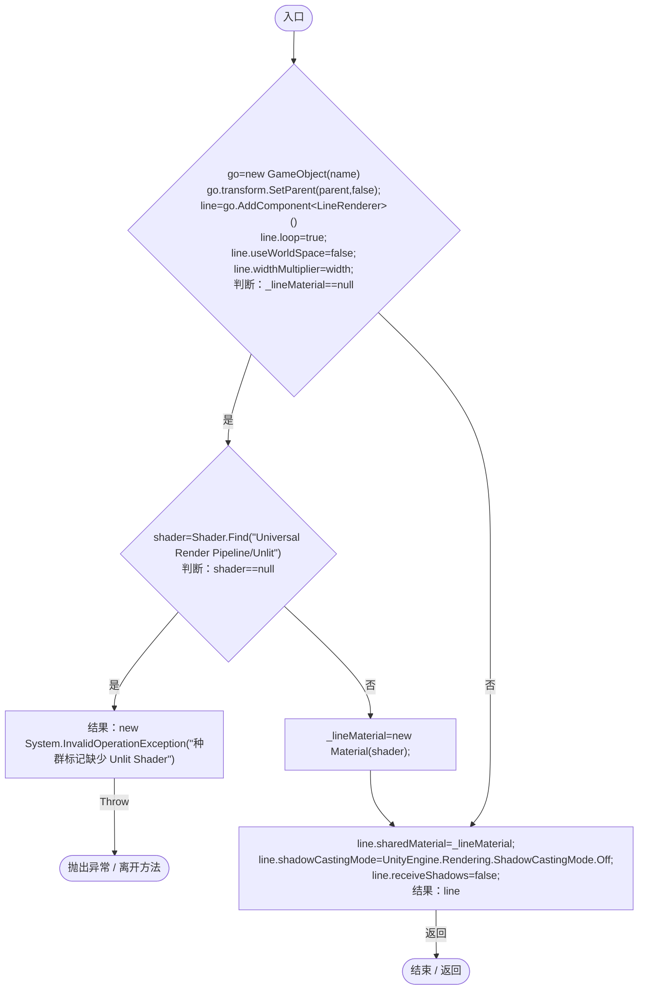

# ColonyAppearance.cs

[返回总索引](../README.md) · `Runtime` · `Assets/DarwinPark/Entities/Ecology/ColonyAppearance.cs`

[源文件](../../../Assets/DarwinPark/Entities/Ecology/ColonyAppearance.cs) · 源码校验：`3c9ddc9bdccb98efbe56f78fc679e535ca0458a25fb1b4f363db0e013b3bf429`

方法按源文件位置排列。事件/回调引用不表示立即执行；分支与异常说明见总索引。完整源码与可点击关系图请打开离线手册。

## ColorFor · L9

`public static Color ColorFor(string id)`

### Editor / Player · Roslyn编译器控制流

项目内调用/回调引用：

- [PopulationArchive.TryColor · L108](084e119b69cdd751.md#m8c20cb43a453efa6)（方法）
- [ColonyAppearance.DefaultColorFor · L11](e51c7c842d87a26d.md#mcedf0484b3bf132c)（方法）

## DefaultColorFor · L11

`public static Color DefaultColorFor(string id)`

### Editor / Player · Roslyn编译器控制流

## Tint · L14

`public static void Tint(LineRenderer line,Color color)`

★ 修复（防Bug回归）：URP Unlit 不读取线条顶点色，必须使用独立属性块，否则所有种群标记和范围均显示成白色。

### Editor / Player · Roslyn编译器控制流

## Circle · L19

`public static LineRenderer Circle(Transform parent,string name,float width)`

### Editor / Player · Roslyn编译器控制流

