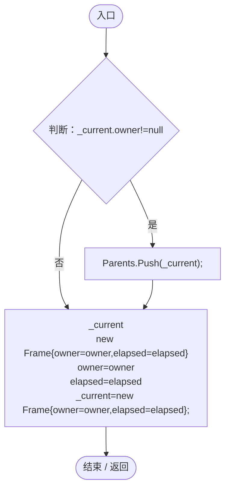
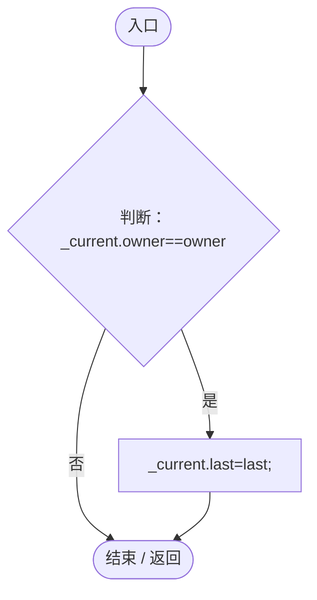
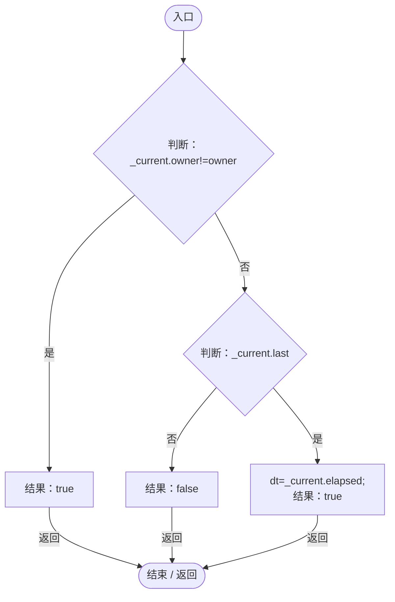
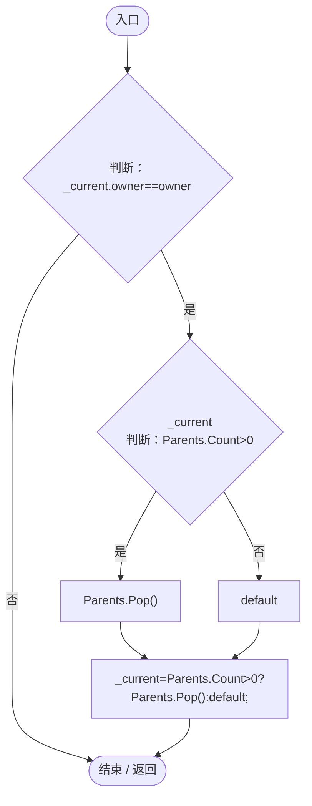
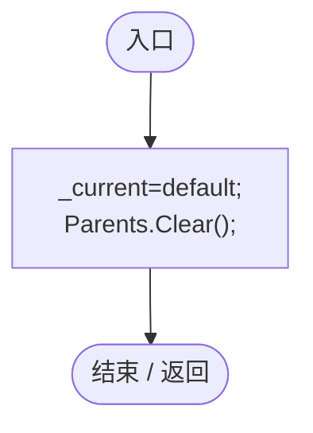

# ActionMotionBatch.cs

[返回总索引](../README.md) · `Runtime` · `Assets/DarwinPark/Entities/Simulation/ActionMotionBatch.cs`

[源文件](../../../Assets/DarwinPark/Entities/Simulation/ActionMotionBatch.cs) · 源码校验：`df42b9eb669dafa3a168f44382812a8ae875654793b3398b5a3cc70285e539c7`

方法按源文件位置排列。事件/回调引用不表示立即执行；分支与异常说明见总索引。完整源码与可点击关系图请打开离线手册。

## Begin · L9

`public static void Begin(EntityGeneController owner,float elapsed)`

### Editor / Player · Roslyn编译器控制流

## Step · L10

`public static void Step(EntityGeneController owner,bool last)`

### Editor / Player · Roslyn编译器控制流

## Consume · L11

`public static bool Consume(EntityGeneController owner,ref float dt)`

### Editor / Player · Roslyn编译器控制流

## End · L12

`public static void End(EntityGeneController owner)`

### Editor / Player · Roslyn编译器控制流

## Reset · L13

`[RuntimeInitializeOnLoadMethod(RuntimeInitializeLoadType.SubsystemRegistration)]private static void Reset()`

### Editor / Player · Roslyn编译器控制流

