# EntityNeighborhood.cs

[返回总索引](../README.md) · `Runtime` · `Assets/DarwinPark/Entities/Ecology/EntityNeighborhood.cs`

[源文件](../../../Assets/DarwinPark/Entities/Ecology/EntityNeighborhood.cs) · 源码校验：`36905e15aaf00f2c43f9a690aa960b9ccd6ae3ec79b41d4a51daf8b1b146f954`

方法按源文件位置排列。事件/回调引用不表示立即执行；分支与异常说明见总索引。完整源码与可点击关系图请打开离线手册。

## BuildCount.get · L22

`get`

### Editor / Player · 语法控制结构 / 声明（非CFG）

## BuildCount.set · L22

`private set`

### Editor / Player · 语法控制结构 / 声明（非CFG）

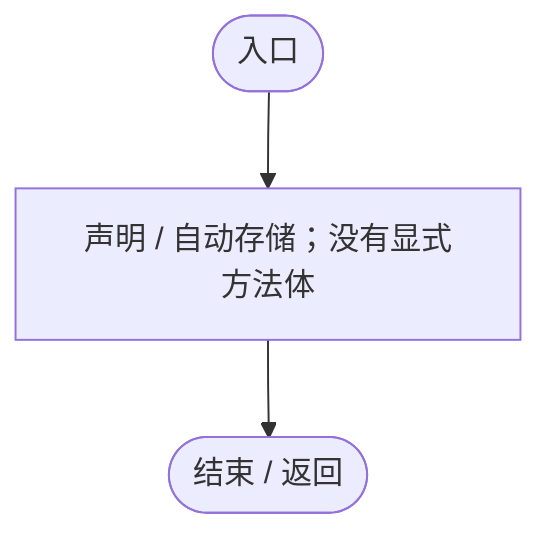

## PositionVersion.get · L23

`get`

### Editor / Player · Roslyn编译器控制流

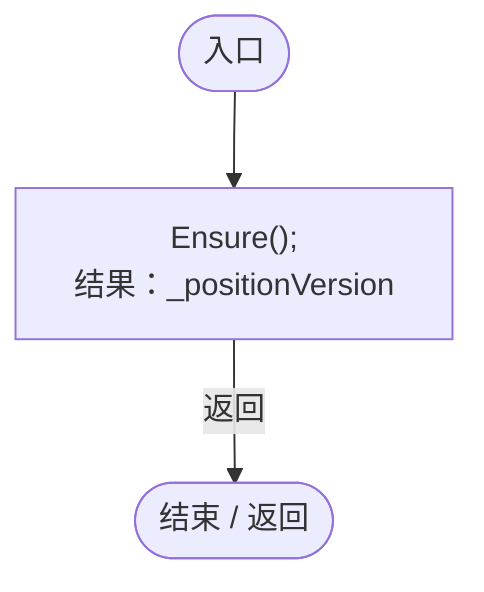

项目内调用/回调引用：

- [EntityNeighborhood.Ensure · L46](e5e24c4aff0395b1.md#m5b89953e9e4e9bbf)（方法）

## Cell · L24

`private static Vector3Int Cell(Vector3 position)`

### Editor / Player · Roslyn编译器控制流

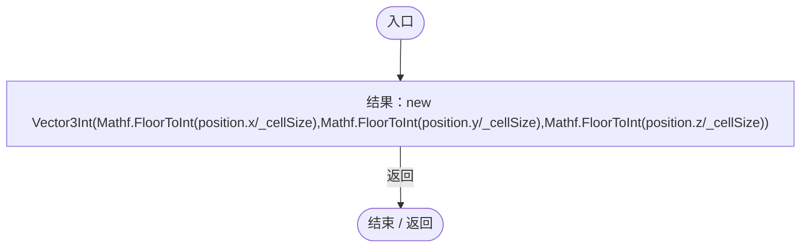

## AddCell · L25

`private static void AddCell(Entry entry)`

### Editor / Player · Roslyn编译器控制流

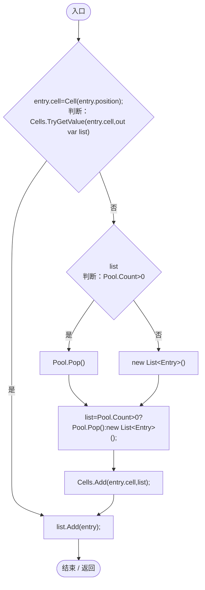

项目内调用/回调引用：

- [EntityNeighborhood.Cell · L24](e5e24c4aff0395b1.md#m3e08959497cddc34)（方法）

## Dirty · L30

`private static void Dirty(Vector3Int cell)`

### Editor / Player · Roslyn编译器控制流

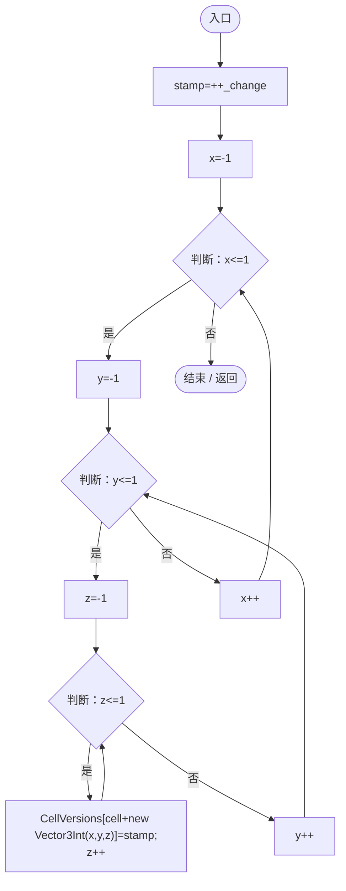

## RemoveCell · L34

`private static void RemoveCell(Entry entry)`

### Editor / Player · Roslyn编译器控制流

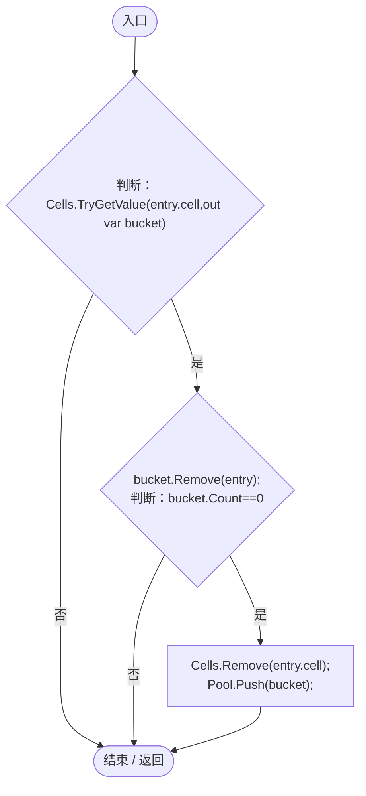

## Refresh · L36

`private static void Refresh(Entry entry)`

### Editor / Player · Roslyn编译器控制流

```mermaid
flowchart TD
  b0(["入口"])
  b1{"previous=entry.position<br/>alive=entry.alive<br/>producer=entry.producer<br/>oldCell=entry.cell<br/>entry.position=entry.entity.transform.position;<br/>判断：entry.stats==null"}
  b2["entry.stats=entry.entity.GetComponent&lt;EntityStats&gt;();"]
  b3{"entry.alive<br/>判断：entry.entity.isActiveAndEnabled"}
  b4{"判断：entry.stats!=null"}
  b5{"判断：entry.stats.TryGet(&quot;health&quot;,out var hp)"}
  b6["hp&gt;0"]
  b7["entry.entity.isActiveAndEnabled&amp;&amp;entry.stats!=null&amp;&amp;entry.stats.TryGet(&quot;health&quot;,out var hp)&amp;&amp;hp&gt;0"]
  b8["entry.alive=entry.entity.isActiveAndEnabled&amp;&amp;entry.stats!=null&amp;&amp;entry.stats.TryGet(&quot;health&quot;,out var hp)&amp;&amp;hp&gt;0;"]
  b9{"entry.producer<br/>判断：entry.alive"}
  b10["ProducerClassification.IsProducer(entry.genes)"]
  b11["entry.alive"]
  b12["entry.producer=entry.alive&amp;&amp;ProducerClassification.IsProducer(entry.genes);"]
  b13{"判断：previous!=entry.position"}
  b14{"判断：alive!=entry.alive"}
  b15["_positionVersion++;"]
  b16{"判断：previous!=entry.position"}
  b17{"判断：producer!=entry.producer"}
  b18{"判断：alive!=entry.alive"}
  b19{"entry.competitionVersion=-1;<br/>_version++;<br/>判断：producer"}
  b20{"判断：entry.producer"}
  b21["Dirty(oldCell);<br/>Dirty(Cell(entry.position));"]
  b22{"判断：oldCell!=Cell(entry.position)"}
  b23["RemoveCell(entry);<br/>AddCell(entry);"]
  b24(["结束 / 返回"])
  b0 --> b1
  b1 -->|"是"| b2
  b1 -->|"否"| b3
  b2 --> b3
  b3 -->|"是"| b4
  b3 -->|"否"| b7
  b4 -->|"是"| b5
  b4 -->|"否"| b7
  b5 -->|"是"| b6
  b5 -->|"否"| b7
  b6 --> b8
  b7 --> b8
  b8 --> b9
  b9 -->|"是"| b10
  b9 -->|"否"| b11
  b10 --> b12
  b11 --> b12
  b12 --> b13
  b13 -->|"否"| b14
  b13 -->|"是"| b15
  b14 -->|"是"| b15
  b14 -->|"否"| b16
  b15 --> b16
  b16 -->|"否"| b17
  b16 -->|"是"| b19
  b17 -->|"否"| b18
  b17 -->|"是"| b19
  b18 -->|"是"| b19
  b18 -->|"否"| b22
  b19 -->|"否"| b20
  b19 -->|"是"| b21
  b20 -->|"是"| b21
  b20 -->|"否"| b22
  b21 --> b22
  b22 -->|"是"| b23
  b22 -->|"否"| b24
  b23 --> b24

```

项目内调用/回调引用：

- [EntityStats.TryGet · L90](75aa86a368efdf24.md#m24ee1433e4a70d94)（方法）
- [ProducerClassification.IsProducer · L10](ad32a2250ced390a.md#m3befbc4c5815283b)（方法）
- [EntityNeighborhood.Dirty · L30](e5e24c4aff0395b1.md#m516cfa9f4a19851b)（方法）
- [EntityNeighborhood.Cell · L24](e5e24c4aff0395b1.md#m3e08959497cddc34)（方法）
- [EntityNeighborhood.RemoveCell · L34](e5e24c4aff0395b1.md#m64c02849b044057b)（方法）
- [EntityNeighborhood.AddCell · L25](e5e24c4aff0395b1.md#mad3c29a1b2682548)（方法）

## Ensure · L46

`private static void Ensure()`

### Editor / Player · Roslyn编译器控制流

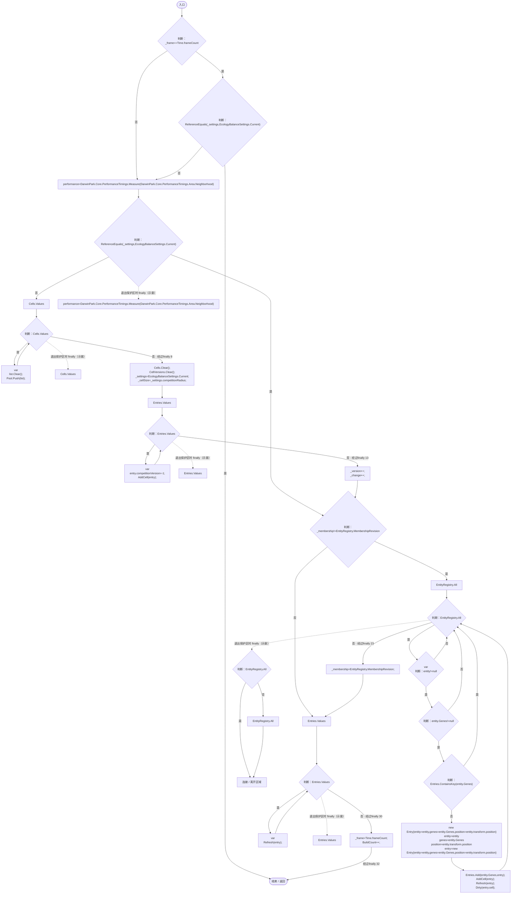

项目内调用/回调引用：

- [EcologyBalanceSettings.Current.get · L29](5a37bc79f15f6238.md#md33d4c4b8f82540b)（访问器）
- [PerformanceTimings.Measure · L24](a8403a4c7503726d.md#m10eb19b6d45944c4)（方法）
- [EntityNeighborhood.AddCell · L25](e5e24c4aff0395b1.md#mad3c29a1b2682548)（方法）
- [EntityRegistry.MembershipRevision.get · L15](2093aaf08559c9f2.md#m6afb6f184d119e11)（访问器）
- [DarwinEntity.Genes.get · L14](70798dde169f2e8b.md#m622eb1adf401d431)（访问器）
- [EntityNeighborhood.Refresh · L36](e5e24c4aff0395b1.md#ma620dcdd35e13a3e)（方法）
- [EntityNeighborhood.Dirty · L30](e5e24c4aff0395b1.md#m516cfa9f4a19851b)（方法）
- [EntityNeighborhood.BuildCount.set · L22](e5e24c4aff0395b1.md#m154b79d360bd2e6c)（访问器）
- [EntityNeighborhood.BuildCount.get · L22](e5e24c4aff0395b1.md#md488c7583c67ba7d)（访问器）

## MembershipChanged · L66

`public static void MembershipChanged(DarwinEntity entity,bool removed)`

★ 适配：出生/停用改变注册表后，下次查询重建；初始化未结束时不提前锁定生产者分类。

### Editor / Player · Roslyn编译器控制流

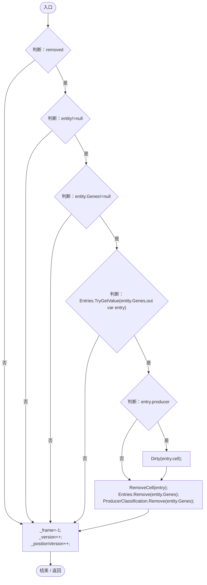

项目内调用/回调引用：

- [DarwinEntity.Genes.get · L14](70798dde169f2e8b.md#m622eb1adf401d431)（访问器）
- [EntityNeighborhood.Dirty · L30](e5e24c4aff0395b1.md#m516cfa9f4a19851b)（方法）
- [EntityNeighborhood.RemoveCell · L34](e5e24c4aff0395b1.md#m64c02849b044057b)（方法）
- [ProducerClassification.Remove · L24](ad32a2250ced390a.md#me846cdc55437ba89)（方法）

## Changed · L74

`public static void Changed(EntityGeneController genes)`

★ 适配：在重算完成、生命归零/恢复以及模拟前同步，帧内表达变化和移动不等待下一次全表重建。

### Editor / Player · Roslyn编译器控制流

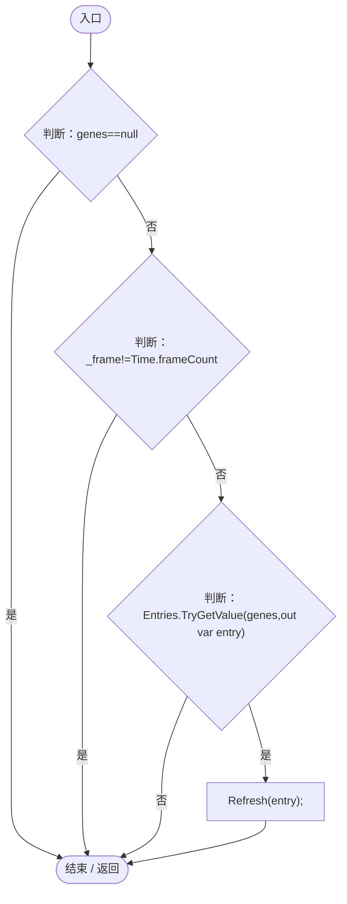

项目内调用/回调引用：

- [EntityNeighborhood.Refresh · L36](e5e24c4aff0395b1.md#ma620dcdd35e13a3e)（方法）

## ObservePosition · L79

`public static void ObservePosition(EntityGeneController genes)`

### Editor / Player · Roslyn编译器控制流

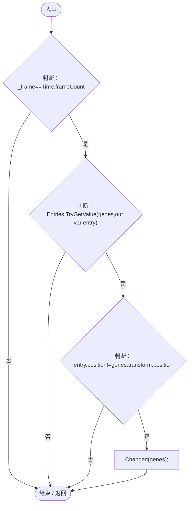

项目内调用/回调引用：

- [EntityNeighborhood.Changed · L74](e5e24c4aff0395b1.md#mf0b3d17fc4cd9f8b)（方法）

## Competition · L81

`public static float Competition(EntityGeneController genes)`

### Editor / Player · Roslyn编译器控制流

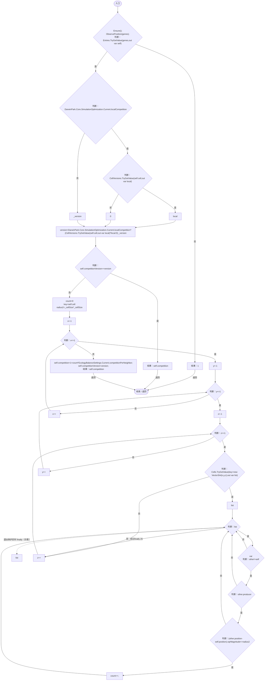

项目内调用/回调引用：

- [EntityNeighborhood.Ensure · L46](e5e24c4aff0395b1.md#m5b89953e9e4e9bbf)（方法）
- [EntityNeighborhood.ObservePosition · L79](e5e24c4aff0395b1.md#mb9ec623f7390bded)（方法）
- [SimulationOptimization.Current.get · L20](11c9091e70893352.md#ma9e5050539f360e7)（访问器）
- [EcologyBalanceSettings.Current.get · L29](5a37bc79f15f6238.md#md33d4c4b8f82540b)（访问器）

## ProductionCompetition · L93

`public static float ProductionCompetition(EntityGeneController genes)`

### Editor / Player · Roslyn编译器控制流

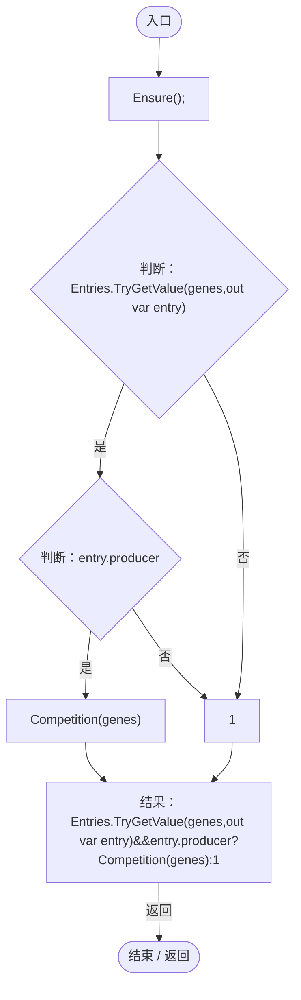

项目内调用/回调引用：

- [EntityNeighborhood.Ensure · L46](e5e24c4aff0395b1.md#m5b89953e9e4e9bbf)（方法）
- [EntityNeighborhood.Competition · L81](e5e24c4aff0395b1.md#me8c81d89a68e9742)（方法）

## TryPosition · L96

`public static bool TryPosition(DarwinEntity entity,out Vector3 point)`

★ 适配：感知复用唯一坐标表，不为每个观察者重新扫描所有Transform。

### Editor / Player · Roslyn编译器控制流

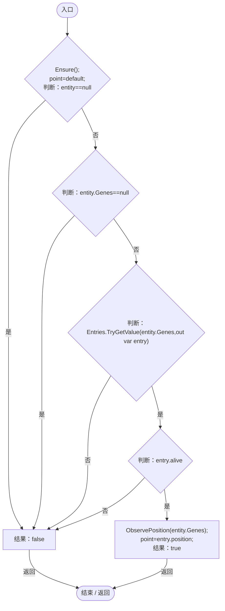

项目内调用/回调引用：

- [EntityNeighborhood.Ensure · L46](e5e24c4aff0395b1.md#m5b89953e9e4e9bbf)（方法）
- [DarwinEntity.Genes.get · L14](70798dde169f2e8b.md#m622eb1adf401d431)（访问器）
- [EntityNeighborhood.ObservePosition · L79](e5e24c4aff0395b1.md#mb9ec623f7390bded)（方法）

## CopyPositions · L98

`public static void CopyPositions(List<EntityCoordinate> result)`

### Editor / Player · Roslyn编译器控制流

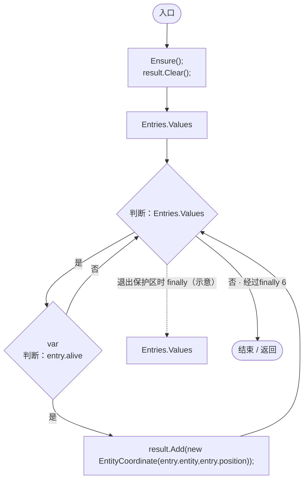

项目内调用/回调引用：

- [EntityNeighborhood.Ensure · L46](e5e24c4aff0395b1.md#m5b89953e9e4e9bbf)（方法）
- [EntityCoordinate.EntityCoordinate.ctor · L9](f6d0404a662a5d5c.md#m5e783a3323544f9a)（构造函数）

## Query · L101

`public static void Query(Vector3 position,float radius,List<DarwinEntity> result)`

★ 新增：感知/食物压力复用同一索引；大半径改扫紧凑记录，避免遍历几万个空格子。

### Editor / Player · Roslyn编译器控制流

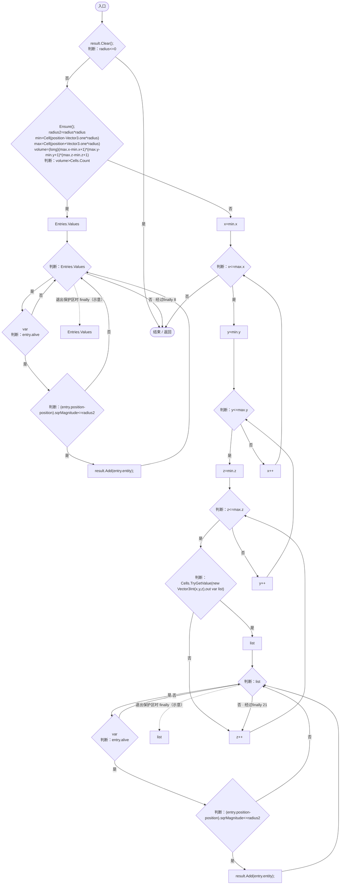

项目内调用/回调引用：

- [EntityNeighborhood.Ensure · L46](e5e24c4aff0395b1.md#m5b89953e9e4e9bbf)（方法）
- [EntityNeighborhood.Cell · L24](e5e24c4aff0395b1.md#m3e08959497cddc34)（方法）

## Clear · L112

`[RuntimeInitializeOnLoadMethod(RuntimeInitializeLoadType.SubsystemRegistration)] public static void Clear()`

### Editor / Player · Roslyn编译器控制流

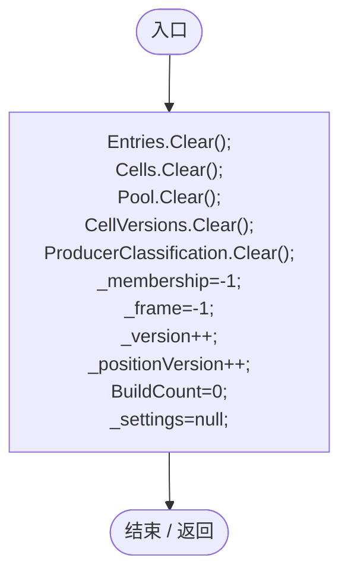

项目内调用/回调引用：

- [ProducerClassification.Clear · L25](ad32a2250ced390a.md#m6e5747a7a733b6f6)（方法）
- [EntityNeighborhood.BuildCount.set · L22](e5e24c4aff0395b1.md#m154b79d360bd2e6c)（访问器）
