# EntityNeighborhood.cs

[返回总索引](../README.md) · `Runtime` · `Assets/DarwinPark/Entities/Ecology/EntityNeighborhood.cs`

[源文件](../../../Assets/DarwinPark/Entities/Ecology/EntityNeighborhood.cs) · 源码校验：`e606ab5374837395237d5a93088de288b901908f68aa677a166e742fb0a43cdf`

方法按源文件位置排列。事件/回调引用不表示立即执行；分支与异常说明见总索引。完整源码与可点击关系图请打开离线手册。

## BuildCount.get · L20

`get`

### Editor / Player · 语法控制结构 / 声明（非CFG）

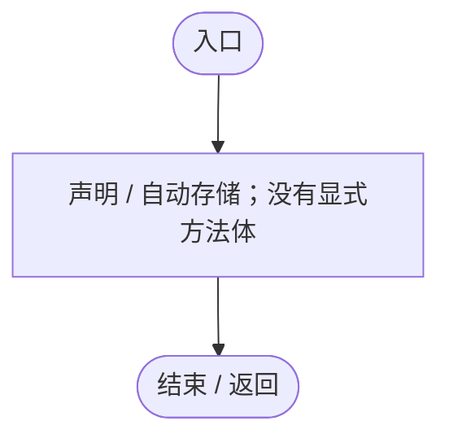

## BuildCount.set · L20

`private set`

### Editor / Player · 语法控制结构 / 声明（非CFG）

## Cell · L21

`private static Vector3Int Cell(Vector3 position)`

### Editor / Player · Roslyn编译器控制流

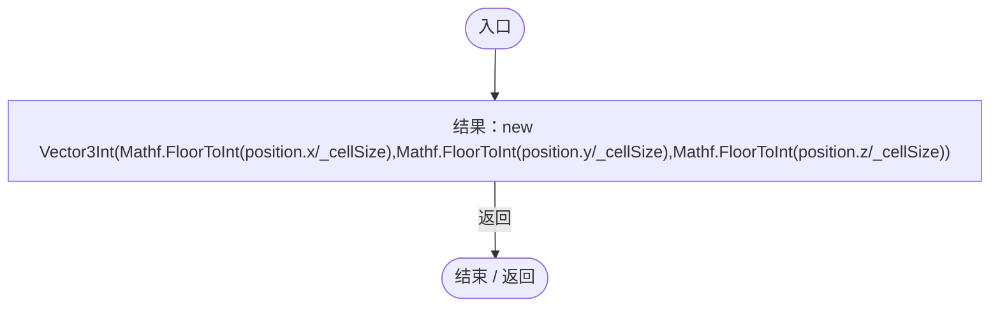

## AddCell · L22

`private static void AddCell(Entry entry)`

### Editor / Player · Roslyn编译器控制流

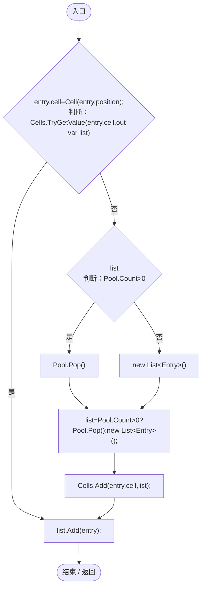

项目内调用/回调引用：

- [EntityNeighborhood.Cell · L21](e5e24c4aff0395b1.md#md0deab43d7d690df)（方法）

## Refresh · L27

`private static void Refresh(Entry entry)`

### Editor / Player · Roslyn编译器控制流

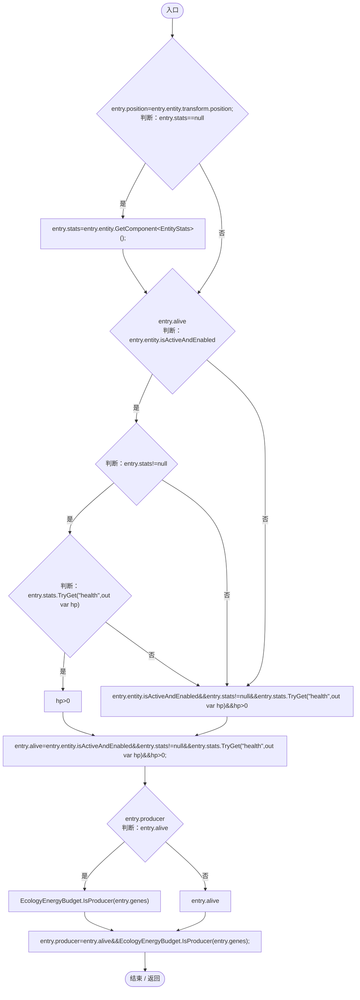

项目内调用/回调引用：

- [EntityStats.TryGet · L90](75aa86a368efdf24.md#m24ee1433e4a70d94)（方法）
- [EcologyEnergyBudget.IsProducer · L24](06a91c8201f26593.md#mcb3499a2649d9648)（方法）

## Ensure · L34

`private static void Ensure()`

### Editor / Player · Roslyn编译器控制流

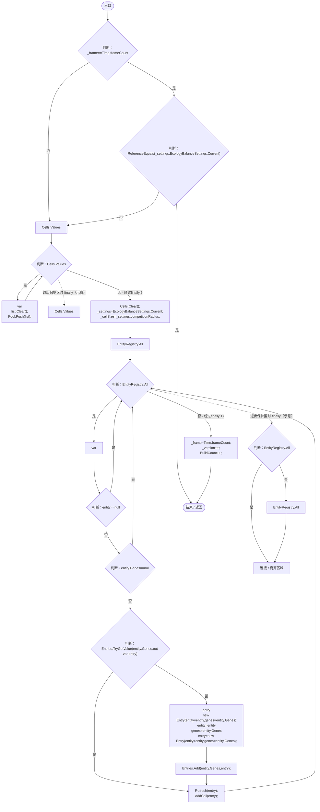

项目内调用/回调引用：

- [EcologyBalanceSettings.Current.get · L29](5a37bc79f15f6238.md#md33d4c4b8f82540b)（访问器）
- [DarwinEntity.Genes.get · L14](70798dde169f2e8b.md#m622eb1adf401d431)（访问器）
- [EntityNeighborhood.Refresh · L27](e5e24c4aff0395b1.md#m5816d884e953184c)（方法）
- [EntityNeighborhood.AddCell · L22](e5e24c4aff0395b1.md#m9a43040922667712)（方法）
- [EntityNeighborhood.BuildCount.set · L20](e5e24c4aff0395b1.md#ma393131149cb2989)（访问器）
- [EntityNeighborhood.BuildCount.get · L20](e5e24c4aff0395b1.md#m08a89e8246fbbdac)（访问器）

## MembershipChanged · L49

`public static void MembershipChanged(DarwinEntity entity,bool removed)`

★ 适配：出生/停用改变注册表后，下次查询重建；初始化未结束时不提前锁定生产者分类。

### Editor / Player · Roslyn编译器控制流

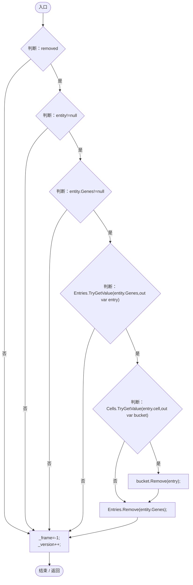

项目内调用/回调引用：

- [DarwinEntity.Genes.get · L14](70798dde169f2e8b.md#m622eb1adf401d431)（访问器）

## Changed · L57

`public static void Changed(EntityGeneController genes)`

★ 适配：在重算完成、生命归零/恢复以及模拟前同步，帧内表达变化和移动不等待下一次全表重建。

### Editor / Player · Roslyn编译器控制流

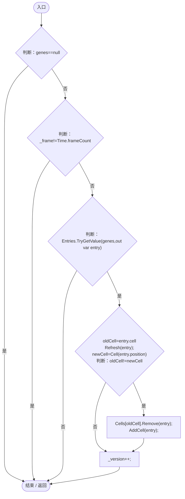

项目内调用/回调引用：

- [EntityNeighborhood.Refresh · L27](e5e24c4aff0395b1.md#m5816d884e953184c)（方法）
- [EntityNeighborhood.Cell · L21](e5e24c4aff0395b1.md#md0deab43d7d690df)（方法）
- [EntityNeighborhood.AddCell · L22](e5e24c4aff0395b1.md#m9a43040922667712)（方法）

## ObservePosition · L63

`public static void ObservePosition(EntityGeneController genes)`

### Editor / Player · Roslyn编译器控制流

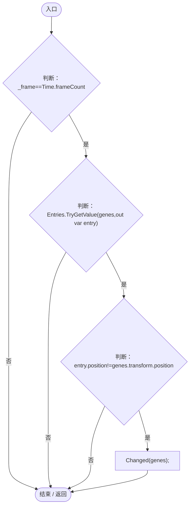

项目内调用/回调引用：

- [EntityNeighborhood.Changed · L57](e5e24c4aff0395b1.md#mc8e20797b798aa16)（方法）

## Competition · L65

`public static float Competition(EntityGeneController genes)`

### Editor / Player · Roslyn编译器控制流

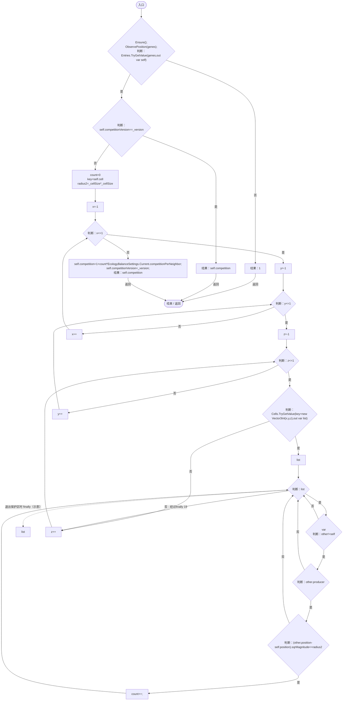

项目内调用/回调引用：

- [EntityNeighborhood.Ensure · L34](e5e24c4aff0395b1.md#mb853b18442aa456c)（方法）
- [EntityNeighborhood.ObservePosition · L63](e5e24c4aff0395b1.md#m994f4a7ab30bcd1d)（方法）
- [EcologyBalanceSettings.Current.get · L29](5a37bc79f15f6238.md#md33d4c4b8f82540b)（访问器）

## ProductionCompetition · L76

`public static float ProductionCompetition(EntityGeneController genes)`

### Editor / Player · Roslyn编译器控制流

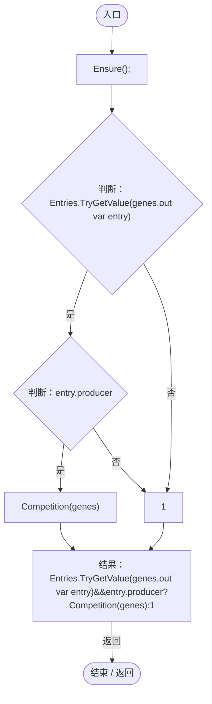

项目内调用/回调引用：

- [EntityNeighborhood.Ensure · L34](e5e24c4aff0395b1.md#mb853b18442aa456c)（方法）
- [EntityNeighborhood.Competition · L65](e5e24c4aff0395b1.md#m7ed9231d003fddb0)（方法）

## Query · L79

`public static void Query(Vector3 position,float radius,List<DarwinEntity> result)`

★ 新增：感知/食物压力复用同一索引；大半径改扫紧凑记录，避免遍历几万个空格子。

### Editor / Player · Roslyn编译器控制流

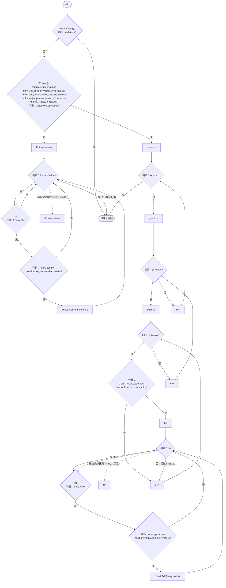

项目内调用/回调引用：

- [EntityNeighborhood.Ensure · L34](e5e24c4aff0395b1.md#mb853b18442aa456c)（方法）
- [EntityNeighborhood.Cell · L21](e5e24c4aff0395b1.md#md0deab43d7d690df)（方法）

## Clear · L90

`[RuntimeInitializeOnLoadMethod(RuntimeInitializeLoadType.SubsystemRegistration)] public static void Clear()`

### Editor / Player · Roslyn编译器控制流

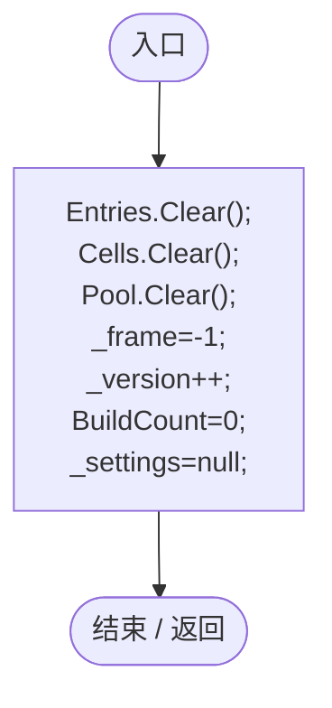

项目内调用/回调引用：

- [EntityNeighborhood.BuildCount.set · L20](e5e24c4aff0395b1.md#ma393131149cb2989)（访问器）
